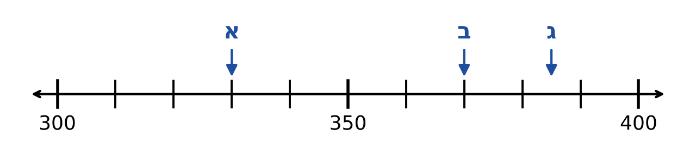
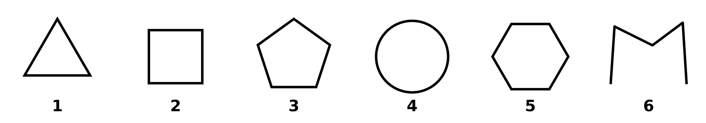
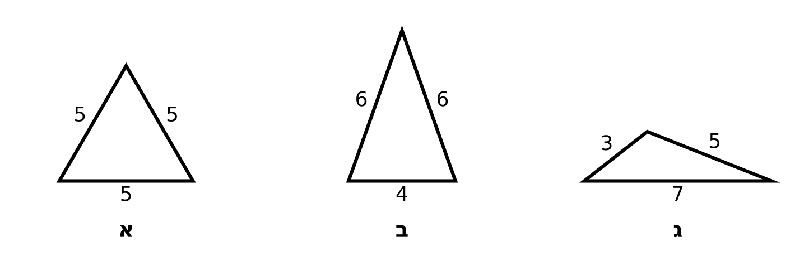

# דף החזרה

12 שאלות, כ-30 דקות. ★ קל · ★★ בינוני · ★★★ מאתגר. רוצים להדפיס? [קובץ Word](_files/grade-3-math-review.docx).

## חלק א – מספרים עד 1,000

### תרגיל 3.1 – קריאה וכתיבה של מספרים

- ★ א. כתבו בספרות: שלוש מאות ארבעים ושבע.
- ★ ב. כתבו בספרות: שש מאות ותשע.
- ★★ ג. כתבו במילים: 520.

[פתרון](solutions.md#3-1)

### תרגיל 3.2 – יחידות, עשרות, מאות ואלפים

- ★ א. במספר 638: מהי ספרת המאות? ספרת העשרות? ספרת היחידות?
- ★★ ב. איזה מספר יש בו 4 מאות, 0 עשרות ו-9 יחידות?
- ★★ ג. במספר 1,000: מהי ספרת האלפים, וכמה ספרות יש בו?

[פתרון](solutions.md#3-2)

### תרגיל 3.3 – זוגי ואי-זוגי, מספר קודם ומספר עוקב

★ א. אילו מהמספרים זוגיים?

‏$14 \qquad 27 \qquad 30 \qquad 45 \qquad 92 \qquad 103$

★★ ב. השלימו את הטבלה (השורה האחרונה ★★★):

| מספר קודם | המספר | מספר עוקב |
|:---:|:---:|:---:|
| | 400 | |
| | 659 | |
| | | 500 |

[פתרון](solutions.md#3-3)

### תרגיל 3.4 – מספר חד-ספרתי, דו-ספרתי ותלת-ספרתי

★★ כתבו כל מספר בעמודה המתאימה: 7, 85, 312, 40, 999, 3.

| חד-ספרתי | דו-ספרתי | תלת-ספרתי |
|:---:|:---:|:---:|
| | | |

[פתרון](solutions.md#3-4)

### תרגיל 3.5 – סדרות

השלימו את שני המספרים הבאים בכל סדרה:

- ★ ‏$5,\ 10,\ 15,\ \underline{\qquad},\ \underline{\qquad}$
- ★★ ‏$120,\ 110,\ 100,\ \underline{\qquad},\ \underline{\qquad}$
- ★★★ ‏$301,\ 305,\ 309,\ \underline{\qquad},\ \underline{\qquad}$ – ומה הכלל של הסדרה?

[פתרון](solutions.md#3-5)

### תרגיל 3.6 – השוואת מספרים

כתבו בעיגול את הסימן המתאים: $>$, $<$ או $=$.

- ★ ‏$458 \bigcirc 485$
- ★ ‏$702 \bigcirc 699$
- ★★ ‏$300 + 40 \bigcirc 340$
- ★★★ ‏$5 \times 4 \bigcirc 3 \times 10$

[פתרון](solutions.md#3-6)

### תרגיל 3.7 – ישר המספרים

- ★★ א. איזה מספר מסמנת האות א? ואיזה מספר מסמנת האות ב?
- ★★★ ב. איזה מספר מסמנת האות ג?

[פתרון](solutions.md#3-7)

## חלק ב – חיבור, חיסור וכפל

### תרגיל 3.8 – חיבור וחיסור במאונך

פתרו במאונך (כותבים את המספרים זה מתחת לזה, יחידות מתחת ליחידות ועשרות מתחת לעשרות):

| ★ | ★★ | ★★ | ★★★ |
|:---:|:---:|:---:|:---:|
| $\begin{array}{r} 34 \\ +\ 25 \\ \hline \end{array}$ | $\begin{array}{r} 47 \\ +\ 36 \\ \hline \end{array}$ | $\begin{array}{r} 72 \\ -\ 38 \\ \hline \end{array}$ | $\begin{array}{r} 90 \\ -\ 47 \\ \hline \end{array}$ |

[פתרון](solutions.md#3-8)

### תרגיל 3.9 – לוח הכפל, גורמים ומכפלה

- ★ ‏$3 \times 4 = \underline{\qquad} \qquad 5 \times 6 = \underline{\qquad} \qquad 10 \times 7 = \underline{\qquad} \qquad 2 \times 9 = \underline{\qquad}$
- ★★ ‏$4 \times \underline{\qquad} = 32 \qquad \underline{\qquad} \times 5 = 45$
- ★★★ ‏$5 \times 8 = 4 \times \underline{\qquad}$
- ★★ מהי מכפלת המספרים 4 ו-5?
- ★★★ כתבו את המספר 12 כמכפלה של שני גורמים, בשתי דרכים שונות.

[פתרון](solutions.md#3-9)

### תרגיל 3.10 – בעיות מילוליות

כתבו תרגיל ותשובה לכל בעיה.

- ★ א. בכיתה ג' יש 18 בנים ו-15 בנות. כמה ילדים יש בכיתה?
- ★★ ב. לנועה היו 64 מדבקות. היא נתנה לחברה 27 מדבקות. כמה מדבקות נשארו לנועה?
- ★★ ג. בכל קופסה יש 5 עפרונות. כמה עפרונות יש ב-4 קופסאות?
- ★★★ ד. לעומר היו 50 שקלים. הוא קנה 3 מחברות, וכל מחברת עולה 5 שקלים. כמה כסף נשאר לעומר?

[פתרון](solutions.md#3-10)

## חלק ג – גאומטריה

### תרגיל 3.11 – מצולעים

- ★ א. מה השם של צורות 1, 2, 3 ו-5?
- ★★ ב. אילו צורות אינן מצולעים? למה?
- ★ ג. כמה צלעות וכמה קודקודים יש למחומש? כמה צלעות יש למשושה?

[פתרון](solutions.md#3-11)

### תרגיל 3.12 – משולשים

אורכי הצלעות כתובים בסנטימטרים.

- ★★ א. מה הסוג של כל משולש: שווה צלעות, שווה שוקיים או שונה צלעות?
- ★★★ ב. לכל הצלעות של משולש שווה צלעות יש אורך 5 ס"מ. מה סכום אורכי כל הצלעות?

[פתרון](solutions.md#3-12)
