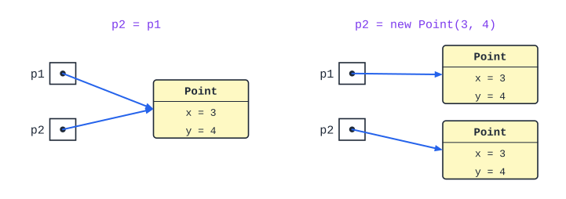

# מחלקות, הפניות, רקורסיה ויעילות

איך בונים מחלקות משלנו, מה זה הפניה, ואיך כותבים אלגוריתמים רקורסיביים ויעילים.

## מחלקות ועצמים

### מחלקה ועצם

- **מחלקה** - **תבנית** ("שרטוט") שמגדירה אילו **תכונות** ואילו **פעולות** יהיו לעצמים מסוג מסוים.
- **עצם** (אובייקט, מופע) - **מימוש** של המחלקה בזיכרון, עם **ערכים** משלו.

מחלקה `Student` אחת - והרבה עצמים: דנה, יוסי, נועה, כל אחד עם שם וציון משלו.

### מבנה מחלקה

```csharp
public class Student
{
    // fields (attributes) - usually private
    private string name;
    private int grade;

    // constructor - builds a new object
    public Student(string name, int grade)
    {
        this.name = name;
        this.grade = grade;
    }

    // getters
    public string GetName() { return this.name; }
    public int GetGrade() { return this.grade; }

    // setter - can protect the object from invalid values
    public void SetGrade(int grade)
    {
        if (grade >= 0 && grade <= 100)
            this.grade = grade;
    }

    // a "real" method
    public bool Passed() { return this.grade >= 55; }

    public override string ToString()
    {
        return this.name + ": " + this.grade;
    }
}
```

| חלק | תפקיד |
|---|---|
| **כותרת** | שם המחלקה |
| **תכונות** | הנתונים של כל עצם - בדרך כלל **`private`** |
| **פעולה בונה** (constructor) | **יוצרת** עצם ומאתחלת את התכונות. שמה **כשם המחלקה**, **בלי** טיפוס מוחזר. אפשר כמה בונות עם **פרמטרים שונים** |
| **פעולות מאחזרות** (`Get`) | **מחזירות** ערך של תכונה |
| **פעולות קובעות** (`Set`) | **משנות** תכונה - ויכולות **לבדוק** שהערך תקין |
| ‏`ToString()` | מחזירה **תיאור כמחרוזת** של העצם (למשל להדפסה) |

### יצירת עצם ושימוש

```csharp
Student s = new Student("Dana", 92);
Console.WriteLine(s.GetName());     // Dana
s.SetGrade(97);
Console.WriteLine(s);               // calls ToString(): "Dana: 97"
```

### ‏this

‏`this` - **העצם הנוכחי**: זה שהפעולה נקראה עליו. משתמשים בו בעיקר כשיש **דו-משמעות** - פרמטר באותו שם כמו תכונה: `this.name = name;`.

### ‏static

| | **רגיל** (של עצם) | ‏**`static`** (של מחלקה) |
|---|---|---|
| **שייך ל-** | **כל עצם** - לכל אחד עותק משלו | **המחלקה** - עותק **אחד** משותף |
| **קריאה** | דרך עצם: `s.GetName()` | דרך המחלקה: `Math.Sqrt(2)`, `int.Parse("5")` |
| **דוגמאות** | שם, ציון | **מונה** כמה עצמים נוצרו; קבוע כמו `PI`; פעולות כלליות |

פעולה `static` **לא יכולה** לגשת לתכונות רגילות - אין לה `this`.

### תיעוד מחלקה

- **בכותרת** - מה המחלקה מייצגת.
- **לכל תכונה** - מה היא מייצגת.
- **לכל פעולה** - מה היא מקבלת ומחזירה.

### שאלות לחזרה

- מה ההבדל בין מחלקה לעצם?
- למה התכונות בדרך כלל `private`? מה היתרון של פעולה קובעת?
- מה ההבדל בין תכונה רגילה לתכונה `static`? תן דוגמה לשימוש בכל אחת.
- כתוב מחלקה `Rectangle` עם אורך, רוחב, פעולה בונה ופעולה שמחזירה את השטח.


## הפניות ועצמים מורכבים

### טיפוס ערך מול טיפוס הפניה

| | **טיפוס ערך** | **טיפוס הפניה** |
|---|---|---|
| **מה** | ‏`int`, `double`, `char`, `bool` | **מערכים**, **עצמים** של מחלקות (וגם `string`) |
| **מה המשתנה מכיל** | **את הערך עצמו** | **הפניה** ("כתובת") **לעצם** שנמצא במקום אחר בזיכרון |
| ‏**`b = a`** | **מעתיק את הערך** - שני משתנים נפרדים | **מעתיק את ההפניה** - שניהם מפנים **לאותו עצם** |



### למה זה חשוב?

```csharp
Point p1 = new Point(3, 4);
Point p2 = p1;          // NOT a copy - p2 refers to the same object
p2.SetX(10);
Console.WriteLine(p1.GetX());   // 10 - p1 changed too!
```

- **שינוי דרך הפניה אחת** - **נראה גם דרך השנייה**: יש רק **עצם אחד**.
- **רוצים עותק עצמאי?** יוצרים **עצם חדש** עם אותם ערכים: `Point p2 = new Point(p1.GetX(), p1.GetY());`.

#### השוואה

- ‏`p1 == p2` בין עצמים **משווה הפניות**: `true` רק אם זה **אותו עצם** - לא אם הערכים זהים.
- כדי להשוות **תוכן** - משווים את התכונות (או כותבים פעולה כמו `Equals`).
- (ב-`string` דווקא `==` משווה **תוכן**.)

#### העברה לפעולה

כשמעבירים עצם לפעולה, או מחזירים עצם ממנה, מועתקת **ההפניה** - לא העצם. לכן פעולה **יכולה לשנות** את העצם של הקורא.

### ‏null

‏`null` - הפניה **שלא מפנה לשום עצם**. קריאה לפעולה על `null` - **חריגה בזמן ריצה** (`NullReferenceException`). לכן לפני שימוש בודקים: `if (p != null) ...`.

### עצם מורכב

**עצם מורכב** - עצם שאחת התכונות שלו היא **עצם של מחלקה אחרת** (שכתבנו).

```csharp
public class Circle
{
    private Point center;    // a reference to a Point object
    private double radius;

    public Circle(Point center, double radius)
    {
        this.center = new Point(center.GetX(), center.GetY());  // own copy
        this.radius = radius;
    }
}
```

**לבחור במודע**: אם הבונה שומר את **ההפניה שקיבל** (`this.center = center;`) - שינוי של הנקודה מבחוץ **ישנה גם את המעגל**. אם הוא **יוצר עותק** - המעגל **מוגן**.

### הזיכרון - בקצרה

- **משתנים** (גם הפניות) - ב**מחסנית** (stack).
- **עצמים** (`new`) - ב**ערימה** (heap).
- **אוסף הזבל** (Garbage Collector) - משחרר אוטומטית עצמים **שאין אליהם אף הפניה**.

### שאלות לחזרה

- מה ההבדל בין `int b = a;` לבין `Point q = p;`?
- מה מחזיר `p1 == p2` כשיש להם אותם ערכים אבל הם נוצרו בנפרד?
- למה פעולה יכולה לשנות מערך שהועבר אליה, אבל לא `int`?
- מה ההבדל בין בונה שמעתיק עצם לבונה ששומר את ההפניה?


## רקורסיה

**רקורסיה** - פעולה ש**קוראת לעצמה** על **גרסה פשוטה יותר** של אותה בעיה, עד שהבעיה פשוטה מספיק לפתרון **ישיר**.

### שני חלקים - תמיד

| חלק | מה | דוגמה (עצרת) |
|---|---|---|
| **מקרה בסיס** (תנאי עצירה) | הבעיה הכי פשוטה - **פותרים ישירות**, בלי קריאה | `0! = 1` |
| **צעד רקורסיבי** | פותרים **בעזרת** פתרון של בעיה **קטנה יותר** | ‏`n! = n · (n-1)!` |

```csharp
public static int Factorial(int n)
{
    if (n == 0)                      // base case
        return 1;
    return n * Factorial(n - 1);     // recursive step: a smaller problem
}
```

**בלי מקרה בסיס** (או אם הבעיה **לא קטנה** בכל קריאה) - הרקורסיה **לא נעצרת**, עד שהזיכרון נגמר (`StackOverflowException`).

### לחשוב על המשמעות

**הסוד**: לכל פעולה רקורסיבית יש **משמעות** - מה היא **מחזירה** (סכום איברי המערך, האם המספר ראשוני, האם המחרוזת פלינדרום). **מאמינים** שהקריאה הרקורסיבית מחזירה את **המשמעות הזו** לבעיה הקטנה - ושואלים: **איך משתמשים בזה** כדי לפתור את הבעיה הגדולה?

**דוגמה - סכום ספרות**: "`SumDigits(n)` מחזירה את סכום הספרות של `n`". אז סכום הספרות של `472` הוא **הספרה האחרונה** (`2`) ועוד **סכום הספרות של `47`**:

```csharp
public static int SumDigits(int n)
{
    if (n < 10)
        return n;
    return n % 10 + SumDigits(n / 10);
}
```

### עץ מעקב

עוקבים אחרי רקורסיה ב**עץ**: כל **קריאה** היא צומת, ו**הערך שהיא מחזירה** כתוב לידה.

```csharp
public static int Fib(int n)
{
    if (n < 2)
        return n;
    return Fib(n - 1) + Fib(n - 2);
}
```


- **יורדים** - כל קריאה פותחת קריאות חדשות.
- **עולים** - הערכים **חוזרים** מהעלים (מקרי הבסיס) למעלה.
- שימו לב: `Fib(2)` מחושבת **פעמיים** - הרקורסיה הזו **לא יעילה** (מספר הקריאות גדל בערך פי 2 בכל פעם).

### רקורסיה על מחרוזות ומערכים

- **מחרוזת** - **מקצרים** אותה בכל קריאה, בעזרת `Substring`:

```csharp
public static bool IsPalindrome(string s)
{
    if (s.Length <= 1)                                // base: empty or one char
        return true;
    return s[0] == s[s.Length - 1]
        && IsPalindrome(s.Substring(1, s.Length - 2)); // drop first and last
}
```

- **מערך** - **לא** מקצרים את המערך. מעבירים **אינדקס** (או שניים) שמסמנים את **הטווח** שנשאר:

```csharp
// Returns the sum of arr[i..end].
public static int Sum(int[] arr, int i)
{
    if (i == arr.Length)
        return 0;
    return arr[i] + Sum(arr, i + 1);
}
// call: Sum(arr, 0)
```

### שאלות לחזרה

- מהם שני החלקים של כל פעולה רקורסיבית? מה קורה בלי מקרה בסיס?
- כתוב פעולה רקורסיבית שמחזירה את מספר הספרות של מספר.
- למה ברקורסיה על מערך מעבירים אינדקס במקום לקצר את המערך?
- צייר את עץ המעקב של `Factorial(3)`.

### הנפשה: מחסנית הקריאות ברקורסיה

כל קריאה רקורסיבית נדחפת למחסנית, וחוזרת כשהיא מסתיימת.

<bl-call-stack></bl-call-stack>

## יעילות, חיפוש ומיון

### מה מודדים?

- **יעילות זמן** - **כמה פעולות** האלגוריתם מבצע.
- **יעילות מקום** - **כמה זיכרון** נוסף הוא צריך.

**לא סופרים שניות** - כי זה תלוי במחשב. סופרים **פעולות** כפונקציה של **גודל הקלט** $n$ (אורך המערך, מספר הספרות...).

- **צעד בסיסי** - קבוצת פעולות שמספרן **לא תלוי** ב-$n$. נוח לספור צעדים במקום כל פעולה.
- **המקרה הגרוע** - בדרך כלל מנתחים אותו (למשל, בחיפוש - כשהערך **לא נמצא**).

### סדר גודל

**סדר גודל** ($O$) - **קצב הגדילה** של מספר הפעולות כש-$n$ גדל. **מתעלמים מקבועים** ומאיברים **זניחים**:

‏$3n^2 + 5n + 7 \;\Rightarrow\; O(n^2)$


| סדר גודל | שם | דוגמה |
|---|---|---|
| ‏$O(1)$ | **קבוע** | גישה לאיבר במערך; פעולה חשבונית |
| ‏$O(\log n)$ | **לוגריתמי** | **חיפוש בינארי**; מספר הספרות של $n$ |
| ‏$O(n)$ | **לינארי** | **לולאה אחת** על המערך: סכום, מקסימום, חיפוש רגיל |
| ‏$O(n\log n)$ | | **מיון מיזוג** |
| ‏$O(n^2)$ | **ריבועי** | **לולאה מקוננת**; מיון בועות, בחירה, הכנסה |

**שיפור בקבוע** (למשל לעבור על חצי מערך במקום על כולו) - **לא משנה** את סדר הגודל. מה שחשוב - **מעבר לסדר גודל נמוך יותר**.

**כמה קלטים**: אם יש שני גדלים, $n$ ו-$m$, כותבים את שניהם: $O(n \cdot m)$. אבל אם $m = n + k$ ו-$k$ קבוע - זה $O(n^2)$.

#### מה כותבים בניתוח יעילות?

1. **סדר הגודל**.
2. **מה $n$ מייצג** ("$n$ - אורך המערך").
3. **נימוק**: כמה פעמים עוברים על הקלט ("לולאה מקוננת - לכל אחד מ-$n$ האיברים עוברים על כל $n$ האיברים").

**ואל תכתבו "תבניתית"** - לחשוב על הפתרון היעיל: לפעמים מעבר **אחד** מספיק במקום לולאה מקוננת.

### חיפוש

| | **חיפוש סדרתי** | **חיפוש בינארי** |
|---|---|---|
| **דרישה** | אין | המערך **ממוין** |
| **רעיון** | עוברים על האיברים אחד-אחד | בודקים את **האמצע**; לפי התוצאה ממשיכים **רק בחצי אחד** |
| **יעילות** | ‏$O(n)$ | ‏$O(\log n)$ |

```csharp
// Returns the index of x in the sorted array arr, or -1.
public static int BinarySearch(int[] arr, int x)
{
    int low = 0, high = arr.Length - 1;
    while (low <= high)
    {
        int mid = (low + high) / 2;
        if (arr[mid] == x) return mid;
        if (arr[mid] < x) low = mid + 1;    // continue in the right half
        else high = mid - 1;                // continue in the left half
    }
    return -1;
}
```

**למה $\log n$?** כל צעד **מחלק את הטווח בחצי**. במערך של מיליון איברים - **כ-20** צעדים בלבד.

### מיונים

| מיון | הרעיון | זמן |
|---|---|---|
| **בועות** | משווים **זוגות שכנים** ומחליפים אם צריך. אחרי כל מעבר, הגדול ביותר "מבעבע" לסוף | ‏$O(n^2)$ |
| **בחירה** | בכל שלב **בוחרים את הקטן ביותר** מבין הנותרים ומעבירים אותו למקומו | ‏$O(n^2)$ |
| **הכנסה** | כל איבר **מוכנס** למקומו בין האיברים שכבר ממוינים. **מהיר** על מערך **כמעט ממוין** | ‏$O(n^2)$ |
| **מיזוג** | **רקורסיבי**: ממיינים כל **חצי**, ואז **ממזגים** שני מערכים ממוינים. צריך זיכרון נוסף $O(n)$ | ‏$O(n\log n)$ |
| **מהיר** (quicksort) | בוחרים **ציר**, מחלקים לקטנים וגדולים ממנו, ממיינים כל צד רקורסיבית | ממוצע $O(n\log n)$; גרוע $O(n^2)$ |
| **ערימה** | בונים **ערימה** ושולפים כל פעם את הגדול. **בלי** זיכרון נוסף | ‏$O(n\log n)$ |

**מיון בועות:**

```csharp
for (int i = 0; i < n - 1; i++)
    for (int j = 0; j < n - 1 - i; j++)       // the last i cells are already sorted
        if (arr[j] > arr[j + 1])
        {
            int t = arr[j]; arr[j] = arr[j + 1]; arr[j + 1] = t;
        }
```

### שאלות לחזרה

- מה סדר הגודל של $5n + 3n\log n + 100$?
- למה חיפוש בינארי דורש מערך ממוין? מה היעילות שלו, ולמה?
- מה סדר הגודל של שתי לולאות **זו אחר זו** (לא מקוננות) על מערך באורך $n$?
- השווה בין מיון בועות למיון מיזוג.

### הנפשה: אלגוריתמי מיון

בחרו אלגוריתם וצפו איך הוא מסדר את המערך, צעד אחר צעד.

<bl-sorting algorithm="bubble"></bl-sorting>
