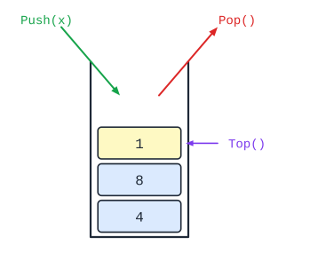
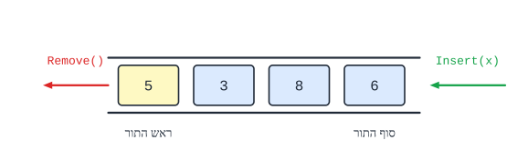
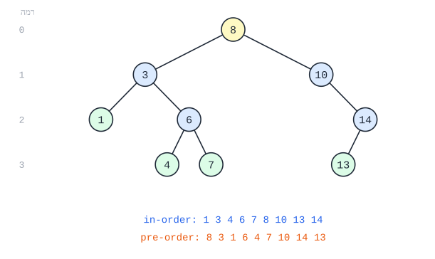
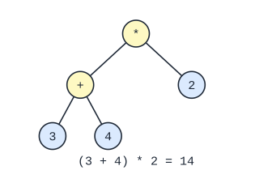

# מבני נתונים: שרשרת חוליות, מחסנית, תור ועצים

דרכים לארגן אוספים של נתונים - כל אחת עם יתרונות משלה.

## שרשרת חוליות

### למה לא מספיק מערך?

| חיסרון של מערך | הסבר |
|---|---|
| **גודל קבוע** | אחרי שנוצר - אי אפשר להגדיל או להקטין אותו |
| **הכנסה והוצאה יקרות** | כדי להכניס איבר באמצע, צריך **להזיז** את כל מה שאחריו - $O(n)$ |
| **מבנה סדרתי בלבד** | קשה לייצג בו מבנים מורכבים (כמו עצים) |

### חוליה

**חוליה** (`Node<T>`) - עצם עם שתי תכונות:

1. **ערך** (`value`) - הנתון.
2. **הפניה לחוליה הבאה** (`next`) - או `null` אם זו האחרונה.

**שרשרת חוליות** - חוליות שכל אחת **מפנה לבאה**. השרשרת **אינה עצם** בפני עצמה - היא **מבנה**. מחזיקים **הפניה לחוליה הראשונה**, ודרכה מגיעים לכל השאר.


**מבנה רקורסיבי**: הפניה לחוליה היא גם הפניה **לשרשרת** שמתחילה בה. לכן הרבה פעולות על שרשרת נכתבות **ברקורסיה** ("טפל בחוליה הראשונה, והמשך עם `GetNext()`").

### הממשק

| פעולה | מה עושה |
|---|---|
| ‏`new Node<T>(x)` | חוליה עם ערך `x`, בלי המשך |
| ‏`new Node<T>(x, next)` | חוליה עם ערך `x` שמפנה ל-`next` |
| ‏`GetValue()` / `SetValue(x)` | מחזירה / משנה את הערך |
| ‏`GetNext()` / `SetNext(n)` | מחזירה / משנה את ההפניה לבאה |
| ‏`HasNext()` | ‏`true` אם יש חוליה אחריה |

### פעולות בסיסיות

**סריקה** (מעבר על כל החוליות):

```csharp
Node<int> pos = first;
while (pos != null)
{
    Console.WriteLine(pos.GetValue());
    pos = pos.GetNext();
}
```

**הכנסה אחרי חוליה `pos`** - $O(1)$, בלי הזזות:

```csharp
Node<int> n = new Node<int>(x, pos.GetNext());   // the new node points to pos's next
pos.SetNext(n);                                   // pos points to the new node
```

**הכנסה בהתחלה**: `first = new Node<int>(x, first);`

**מחיקת החוליה שאחרי `pos`**: `pos.SetNext(pos.GetNext().GetNext());` - "מדלגים" עליה.

**מחיקת הראשונה**: `first = first.GetNext();`

**חיפוש**:

```csharp
public static bool Contains(Node<int> first, int x)
{
    Node<int> pos = first;
    while (pos != null && pos.GetValue() != x)
        pos = pos.GetNext();
    return pos != null;
}
```

### דגשים

- **סדר הפעולות בהכנסה חשוב**: קודם מחברים את **החדשה** להמשך, ורק אחר כך את `pos` אליה. אחרת - **ההמשך אובד**.
- **לא מאבדים את ההתחלה**: סורקים עם משתנה עזר (`pos`), לא עם `first`.
- **בודקים `null`** לפני `GetNext().GetValue()`.
- **שרשרת ריקה** - `first == null`. לטפל בה!

### מחלקות גנריות

‏`Node<T>` היא מחלקה **גנרית**: `T` הוא **טיפוס** שבוחרים ביצירה - `Node<int>`, `Node<string>`, `Node<Student>`. כך כותבים את המחלקה **פעם אחת** לכל טיפוס. (כך בנויות גם [מחסנית](#מחסנית) ו[תור](#תור).)

### שאלות לחזרה

- מה היתרונות של שרשרת חוליות על מערך? ומה החסרונות (רמז: גישה לאיבר ה-$k$)?
- כתוב פעולה שמחזירה את אורך השרשרת - בלולאה וברקורסיה.
- למה חשוב סדר הפעולות בהכנסת חוליה?
- איך מוחקים את החוליה הראשונה? את האחרונה?


## מחסנית

**מחסנית** (`Stack<T>`) - אוסף שבו **מכניסים ומוציאים רק מלמעלה**: הערך שיוצא הוא תמיד **זה שנכנס אחרון**. (LIFO - Last In, First Out.) כמו **ערימת צלחות**.



### הממשק

| פעולה | מה עושה |
|---|---|
| ‏`new Stack<T>()` | מחסנית ריקה |
| ‏`Push(x)` | **מכניסה** את `x` למעלה |
| ‏`Pop()` | **מוציאה ומחזירה** את העליון |
| ‏`Top()` | **מחזירה** את העליון **בלי להוציא** |
| ‏`IsEmpty()` | ‏`true` אם המחסנית ריקה |

- ‏**`Pop` ו-`Top` - רק כשהמחסנית לא ריקה!** תמיד בודקים `IsEmpty()` קודם.
- **אין גישה לאיברים באמצע** - רק לעליון. כדי לעבור על המחסנית צריך **לרוקן** אותה (ואם צריך - לשמור במחסנית עזר ולהחזיר).

### הפרדה בין ממשק למימוש

המשתמש מכיר **רק את הפעולות**. הוא **לא יודע** איך המחסנית בנויה בפנים (מערך? שרשרת חוליות?), ו**לא יכול לקלקל** את המבנה. זו דוגמה ל**כימוס** (ראו [עקרונות התכנות מונחה העצמים](05-oop.md#עקרונות-התכנות-מונחה-העצמים)).

### תבנית: מעבר על מחסנית בלי להרוס אותה

```csharp
public static int Count(Stack<int> s)
{
    Stack<int> temp = new Stack<int>();
    int count = 0;
    while (!s.IsEmpty())
    {
        temp.Push(s.Pop());
        count++;
    }
    while (!temp.IsEmpty())        // restore the original stack
        s.Push(temp.Pop());
    return count;
}
```

**שימו לב**: מחסנית העזר **הופכת את הסדר** - וההחזרה הופכת אותו **שוב**, לסדר המקורי.

### שימושים

- **היפוך סדר** - כל מה שצריך לשלוף **בסדר הפוך** לקליטה.
- ‏**Undo** (ביטול פעולה) - הפעולה האחרונה מתבטלת ראשונה.
- **מחסנית הקריאות** - כשפעולה קוראת לפעולה (גם ברקורסיה), המחשב שומר במחסנית לאן לחזור.
- **בדיקת סוגריים** - כל סוגר פותח נדחף; כל סוגר סוגר צריך להתאים לעליון.

### שאלות לחזרה

- מה ההבדל בין `Pop` ל-`Top`?
- למה צריך מחסנית עזר כדי לספור איברים?
- כתוב פעולה שבודקת אם מחרוזת של סוגריים `()` מאוזנת.
- כתוב פעולה שהופכת את סדר האיברים במחסנית.


## תור

**תור** (`Queue<T>`) - אוסף שבו **מכניסים בסוף** ו**מוציאים מההתחלה**: הערך שיוצא הוא **זה שנכנס ראשון**. (FIFO - First In, First Out.) בדיוק **כמו תור בקופה**.



### הממשק

| פעולה | מה עושה |
|---|---|
| ‏`new Queue<T>()` | תור ריק |
| ‏`Insert(x)` | **מכניסה** את `x` **לסוף** התור |
| ‏`Remove()` | **מוציאה ומחזירה** את **ראש** התור |
| ‏`Head()` | **מחזירה** את הראש **בלי להוציא** |
| ‏`IsEmpty()` | ‏`true` אם התור ריק |

- ‏**`Remove` ו-`Head` - רק כשהתור לא ריק!**
- כמו במחסנית: **הממשק מופרד מהמימוש** (מערך או שרשרת חוליות), והמשתמש **לא יכול לקלקל** את המבנה.

### תבנית: מעבר על תור בלי להרוס אותו

שתי אפשרויות:

**א. תור עזר:**

```csharp
Queue<int> temp = new Queue<int>();
while (!q.IsEmpty())
{
    int x = q.Remove();
    // ... use x ...
    temp.Insert(x);
}
while (!temp.IsEmpty())
    q.Insert(temp.Remove());
```

**ב. סיבוב** - מוציאים ומכניסים חזרה **לסוף** - צריך לדעת **כמה** איברים יש (או להכניס **סימן** בסוף):

```csharp
q.Insert(-1);                       // sentinel (a value that cannot appear)
int x = q.Remove();
while (x != -1)
{
    // ... use x ...
    q.Insert(x);
    x = q.Remove();
}
```

**הבדל ממחסנית**: תור עזר **שומר על הסדר** (לא הופך אותו).

### מחסנית מול תור

| | **מחסנית** | **תור** |
|---|---|---|
| **יוצא קודם** | **האחרון** שנכנס | **הראשון** שנכנס |
| **הכנסה / הוצאה** | ‏`Push` / `Pop` | ‏`Insert` / `Remove` |
| **הצצה** | ‏`Top` | ‏`Head` |
| **שימושים** | היפוך, Undo, רקורסיה | המתנה בתור, הדפסות, **סריקה לפי רמות** בעץ |

### שאלות לחזרה

- מה ההבדל בין תור למחסנית?
- למה מעבר עם תור עזר שומר על הסדר, ומעבר עם מחסנית עזר הופך אותו?
- כתוב פעולה שמחזירה את סכום האיברים בתור, בלי לשנות אותו.


## עצים בינאריים

### מושגים



| מושג | הגדרה |
|---|---|
| **צומת** | איבר בעץ |
| **שורש** | הצומת **היחיד בלי הורה** (למעלה). כל הצמתים הם צאצאים שלו |
| **הורה, ילד, אח** | לכל צומת (חוץ מהשורש) **הורה אחד בדיוק**. **אחים** - ילדים של אותו הורה |
| **צאצא, הורה קדמון** | כל מי שמתחת / מעל, בכמה דורות |
| **עלה** | צומת **בלי ילדים** |
| **תת-עץ** | צומת עם כל הצאצאים שלו - עץ בפני עצמו |
| **רמה** | המרחק מהשורש. **השורש ברמה 0** |
| **גובה** | מספר **הרמה האחרונה** |
| **עץ בינארי** | לכל צומת **לכל היותר שני ילדים** - **שמאלי** ו**ימני** |

**מבנה רקורסיבי**: כל צומת הוא **שורש של תת-עץ**. לכן כמעט כל פעולה על עץ נכתבת **ברקורסיה**: "טפל בשורש, ואז בתת-העץ השמאלי ובתת-העץ הימני".

**הממשק** (`BinNode<T>`): `GetValue()`, `GetLeft()`, `GetRight()`, `HasLeft()`, `HasRight()`, `SetLeft(...)`, `SetRight(...)`.

```csharp
// Returns the number of nodes in the tree.
public static int Count(BinNode<int> t)
{
    if (t == null)
        return 0;
    return 1 + Count(t.GetLeft()) + Count(t.GetRight());
}
```

### סריקות

שלושה דברים עושים בכל צומת: **(א)** סורקים את **השמאלי**, **(ב)** **מבקרים** בצומת, **(ג)** סורקים את **הימני**. הסדר קובע את סוג הסריקה:

| סריקה | סדר | בעץ שבאיור |
|---|---|---|
| **תחילית** (pre-order) | **צומת**, שמאל, ימין | 8 3 1 6 4 7 10 14 13 |
| **תוכית** (in-order) | שמאל, **צומת**, ימין | 1 3 4 6 7 8 10 13 14 |
| **סופית** (post-order) | שמאל, ימין, **צומת** | 1 4 7 6 3 13 14 10 8 |

```csharp
public static void InOrder(BinNode<int> t)
{
    if (t != null)
    {
        InOrder(t.GetLeft());
        Console.Write(t.GetValue() + " ");
        InOrder(t.GetRight());
    }
}
```

**סריקה לפי רמות** - בעזרת **[תור](#תור)**: מכניסים את השורש; כל עוד התור לא ריק - מוציאים צומת, מבקרים בו, ומכניסים את **ילדיו**.

### עץ חיפוש בינארי

**עץ חיפוש בינארי** - בכל צומת: **כל** הערכים **בתת-העץ השמאלי קטנים** ממנו, ו**כל** הערכים **בימני גדולים או שווים** לו.

- **חיפוש** - משווים לשורש ויורדים **רק לצד אחד**. בעץ **מאוזן** - צומת אחד בכל רמה: $O(\log n)$.
- **מינימום** - הכי **שמאלי**; **מקסימום** - הכי **ימני**.
- **הכנסה** - יורדים כמו בחיפוש, ומכניסים כ**עלה** במקום הריק.
- **סריקה תוכית מחזירה את הערכים ממוינים!** לכן אפשר **למיין**: מכניסים הכול לעץ, וסורקים בסדר תוכי.

```csharp
public static bool Exists(BinNode<int> t, int x)
{
    if (t == null) return false;
    if (t.GetValue() == x) return true;
    if (x < t.GetValue()) return Exists(t.GetLeft(), x);
    return Exists(t.GetRight(), x);
}
```

### עץ ביטוי חשבוני



- **העלים** - **מספרים**; **הצמתים הפנימיים** - **פעולות** (`+`, `-`, `*`, `/`).
- **חישוב** (רקורסיבי): אם הצומת **מספר** - מחזירים אותו. אם **פעולה** - מחשבים את **שני הילדים** ומפעילים עליהם את הפעולה.
- אין צורך **בסוגריים** - המבנה של העץ קובע את הסדר.

### סוגי עצים

- **עץ מלא** - **כל הרמות מלאות**. ברמה $k$ יש $2^k$ צמתים.
- עץ שבו לכל צומת יש **0 או 2** ילדים (אף צומת לא עם ילד אחד).

### שאלות לחזרה

- הגדר: שורש, עלה, רמה, גובה.
- כתוב את שלוש הסריקות של העץ שבאיור. איזו מחזירה ערכים ממוינים?
- כתוב פעולה רקורסיבית שמחזירה את מספר העלים בעץ.
- למה חיפוש בעץ חיפוש בינארי מאוזן הוא $O(\log n)$?
- חשב את עץ הביטוי שבאיור, צעד אחרי צעד.
