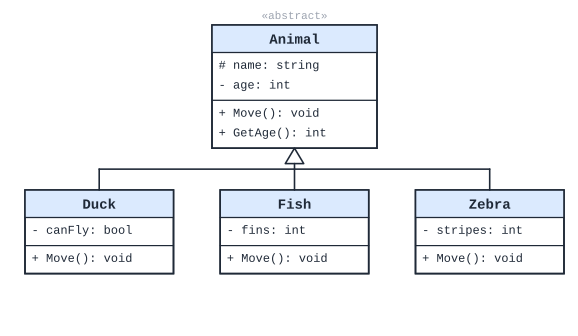
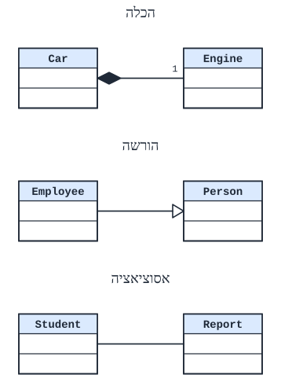

# תכנות מונחה עצמים: עקרונות, הורשה ו-UML

כימוס, הורשה ופולימורפיזם - והדרך לתכנן מערכת בתרשים UML.

## עקרונות התכנות מונחה העצמים

**תכנות מונחה עצמים** - דרך לבנות תכנית מ**עצמים** שכל אחד מהם **מחזיק נתונים** ו**מספק שירותים** לאחרים (**מודל שרת-לקוח**: עצם אחד מספק שירות, ואחר משתמש בו).

### מחלקה ועצם - הרחבה

| | **מחלקה** | **עצם** |
|---|---|---|
| **מה** | ישות **לוגית**, **מופשטת** - הגדרה | ישות **בזיכרון** - **מופע** של המחלקה |
| **תפקיד** | **תבנית** ("בית יוצר") לעצמים | מחזיק **ערכים** ממשיים |

**לכל עצם שלושה מאפיינים:**

1. **מצב** (state) - **ערכי התכונות** שלו ברגע נתון. **משתנה** לאורך חייו.
2. **התנהגות** (behavior) - **מה אפשר לעשות** איתו: **השירותים** שהוא נותן.
3. **זהות** (identity) - מה שמבדיל אותו **מכל עצם אחר**, גם אם המצב זהה. (מכונית היא אותה מכונית - בין אם היא נוסעת ב-10 קמ"ש ובין אם ב-50.)

### מרכיבי מחלקה ב-C#

#### תכונות

- ‏**`readonly`** - אפשר לקבוע **רק בבונה**.
- ‏**`const`** - **קבוע** שנקבע בהגדרה, **זהה לכל העצמים** (ולכן גם `static` באופן מובלע).

#### פעולות בונות

- **מקצות זיכרון** לעצם ו**מאתחלות** את התכונות.
- **בונה ברירת מחדל** - בלי פרמטרים. נוצר **אוטומטית** רק אם **לא כתבנו אף בונה**.
- **בונה מעתיק** - מקבל עצם מאותה מחלקה ויוצר **עותק**: `public Point(Point other) { ... }`.
- **בונה סטטי** - מאתחל תכונות `static`. רץ **פעם אחת**.
- **בירושה** - הבונים רצים **מהמחלקה הכללית אל המתמחה** (קודם הבסיס, אחר כך הנגזרת).

#### העמסה (overloading)

כמה פעולות **באותו שם** עם **פרמטרים שונים** (במספר או בטיפוס). הקומפיילר בוחר לפי הקריאה. **דוגמה**: כמה בונים.

#### מאפיינים (properties)

תחביר של C# ש**נראה כמו תכונה** - אבל הוא בעצם **פעולה**:

```csharp
private int age;
public int Age
{
    get { return age; }
    set { if (value >= 0) age = value; }   // filter invalid values
}
// usage: p.Age = 17;  Console.WriteLine(p.Age);
```

**יתרונות**: נוח כמו תכונה; **מסנן** ערכים (גיל לא שלילי); אפשר **שדה מחושב** (שמחזיר ערך שלא שמור).

### הרשאות גישה

| הרשאה | מי ניגש | סימון UML |
|---|---|---|
| ‏`public` | **כולם** | `+` |
| ‏`private` | **רק המחלקה עצמה** | `-` |
| ‏`protected` | המחלקה **והמחלקות היורשות** ממנה | `#` |

‏**`protected` - יתרונות וחסרונות**: גישה **ישירה** מהירה וקריאה; אבל מעודדת **שכפול קוד**, מגדילה סיכון **לשגיאות** ומקשה על **תחזוקה**.

**כלל**: תכונות - **`private`**, וגישה דרך פעולות.

### כימוס (Encapsulation)

**כימוס** - **איגוד** הנתונים והפעולות יחד, ו**הסתרת** המימוש מאחורי **ממשק** ציבורי. העצם הוא **"קופסה שחורה"**: יודעים **מה** הוא עושה, לא **איך**.

**הפשטה** - מתייחסים **רק לפרטים שצריך**, כשצריך: חושבים על **מה** רוצים, ופחות על **איך**.

**יתרונות:**

- אפשר **לשנות את המימוש** בלי לפגוע במי שמשתמש בו.
- שינוי נעשה **במקום אחד**.
- **גורמים חיצוניים לא יכולים לקלקל** את העצם (ולגרום לבאגים).
- המשתמש **יודע מעט** ומקבל שירות **מורכב**.

**דוגמה**: [מחסנית](04-data-structures.md#מחסנית) - רק `Push`, `Pop`, `Top`, `IsEmpty`. אף אחד לא יודע אם בפנים יש מערך או שרשרת.

### חיי העצם ב-C#

- ‏`new` יוצר את העצם **בערימה** (heap); המשתנה שמחזיק את **ההפניה** - **במחסנית** (stack).
- **טווח הכרה** (scope) - איפה בקוד המשתנה **מוכר**.
- **אוסף הזבל** (GC) - משחרר עצם כשאין אליו **אף הפניה**. אפשר להציב `null` כדי לשחרר הפניה.

### שאלות לחזרה

- מהם שלושת המאפיינים של עצם? הסבר "זהות" בדוגמה.
- מתי נוצר בונה ברירת מחדל?
- מה ההבדל בין `private`, `protected` ו-`public`?
- מהו כימוס? תן שלושה יתרונות.
- מה היתרון של מאפיין (property) על תכונה ציבורית?


## הורשה ופולימורפיזם

### הורשה

**הורשה** - מחלקה חדשה (**נגזרת**, "בת") **מרחיבה** מחלקה קיימת (**בסיס**, "אם") - ומקבלת את כל התכונות והפעולות שלה. יחס **"סוג של"**: עובד **הוא סוג של** אדם.

```csharp
public class Person
{
    protected string name;
    public Person(string name) { this.name = name; }
    public virtual string Describe() { return "Person " + name; }
}

public class Employee : Person          // ':' means "inherits from"
{
    private double salary;
    public Employee(string name, double salary) : base(name)   // calls Person's constructor first
    {
        this.salary = salary;
    }
    public override string Describe() { return "Employee " + name + ", " + salary; }
}
```

- **הכללה והתמחות**: הבסיס **כללי**, הנגזרת **מתמחה** ומוסיפה.
- ‏**`base`** - גישה למרכיבי מחלקת הבסיס: `base(...)` בבונה, `base.Describe()` בפעולה.
- **הבונים רצים מהבסיס לנגזרת.**
- **יתרונות**: **שימוש חוזר** בקוד; עבודה עם **ממשקים**; משתמשים במחלקה **בלי להתעמק** במה הגדירה בעצמה ומה ירשה.
- ‏C# **לא מאפשרת** לרשת **משתי מחלקות** (אבל אפשר לממש כמה **ממשקים**).
- **כל המחלקות** יורשות בסוף מ-**`Object`** (ומשם `ToString()`, `Equals()`).

### פולימורפיזם

**פולימורפיזם** ("רב-צורתיות") - **הפניה מטיפוס הבסיס** יכולה להפנות **לעצם נגזר**, וקריאה לפעולה **וירטואלית** מגיעה **לגרסה של העצם בפועל**.

```csharp
Person p = new Employee("Dana", 12000);   // a base reference to a derived object
Console.WriteLine(p.Describe());          // "Employee Dana, 12000" - the derived version runs
```

**התנאים**: **הורשה**; פעולות **וירטואליות**; **הפניה מטיפוס הבסיס** לעצם נגזר.

**השימוש העיקרי** - **אוסף מעורב**:

```csharp
Person[] people = { new Person("Yossi"), new Employee("Dana", 12000) };
foreach (Person x in people)
    Console.WriteLine(x.Describe());      // each object runs its own version
```

#### ‏virtual ו-override

- בבסיס: **`virtual`**; בנגזרת: **`override`** - עם **אותה חתימה** בדיוק.
- **לא** `static` ו**לא** `private`.
- אפשר לדרוס שוב ושוב בדורות הבאים.
- **מתי?** רק כשבאמת יש **התנהגות שונה** לכל נגזרת. קוד **משותף** לכולם - בפעולה **רגילה** בבסיס.

#### הסתרה (new) מול דריסה (override)

| | ‏**`override`** (דריסה) | ‏**`new`** (הסתרה) |
|---|---|---|
| **קריאה דרך הפניה לבסיס** | מגיעה ל**נגזרת** (לפי **העצם**) | מגיעה ל**בסיס** (לפי **ההפניה**) |

### מחלקה מופשטת ופעולה מופשטת

**מחלקה מופשטת** (`abstract class`) - **אי אפשר ליצור ממנה עצמים**; היא משמשת **רק כבסיס**. מתאימה לישות **שלא קיימת לבדה** במציאות: "בעל חיים", "רהיט", "צורה".

**פעולה מופשטת** (`abstract`) - פעולה וירטואלית **בלי מימוש** בבסיס. מתאימה כש**אין משמעות** למימוש כללי: מה יצייר `Shape.Draw()`? מלבן? עיגול?

```csharp
public abstract class Shape
{
    public abstract double Area();          // no body - every shape computes it differently
}

public class Circle : Shape
{
    private double r;
    public Circle(double r) { this.r = r; }
    public override double Area() { return Math.PI * r * r; }
}
```

**כל נגזרת שאינה מופשטת חייבת לממש** את הפעולות המופשטות - אחרת **שגיאת קומפילציה**. זה **יתרון**: את הבאג מגלים **מיד**, ולא בזמן ריצה.

### ממשק

**ממשק** (`interface`) - **"חוזה"**: רשימת **חתימות** בלי מימוש, שכל מחלקה שמממשת אותו **חייבת** לממש. יחס **"מתפקד כ-"**.

```csharp
public interface IMovable
{
    void Move(int dx, int dy);              // all members are public, no body
}

public class Car : Vehicle, IMovable { ... }
public class Dog : Animal, IMovable { ... }
```

**מתי ממשק ולא מחלקה?**

- כשמגדירים **התנהגות** יותר מאשר **ישות**.
- כשעצם צריך **כמה התנהגויות** (אין ירושה מרובה).
- כשאותה התנהגות משותפת ל**עצי ירושה שונים**: גם **רכב** וגם **חיה** יכולים **לזוז**.

אי אפשר ליצור עצם מממשק.

### המרות והאופרטור is

```csharp
class A { public void FuncA() { } }
class B : A { public void FuncB() { } }
```

| קוד | תוצאה | למה |
|---|---|---|
| ‏`A ab = new B();` | **תקין** | הפניה לבסיס יכולה להפנות לנגזרת - **הבסיס לפולימורפיזם** |
| ‏`B b = new B(); A a = (A)b; B b2 = (B)a;` | **תקין** | העצם באמת מטיפוס `B` - מותר להמיר הלוך וחזור |
| ‏`B ba = new A();` | **שגיאת קומפילציה** | ‏`A` **אינו** `B` - הפניה לנגזרת לא יכולה להפנות לבסיס |
| ‏`A a = new A(); B b = (B)a;` | **שגיאת זמן ריצה** | הקומפיילר מאשר המרה, אבל **העצם בפועל** אינו `B` |
| ‏`A ab = new B(); ab.FuncB();` | **שגיאת קומפילציה** | הקומפיילר מסתכל על **טיפוס ההפניה** (`A`) - ול-`A` אין `FuncB` |
| ‏`A ab = new B(); ((B)ab).FuncB();` | **תקין** | המרה מפורשת ל-`B` |

**הכלל**: **הקומפיילר** בודק לפי **טיפוס ההפניה**; **בזמן ריצה** - לפי **טיפוס העצם בפועל**.

‏**`is`** - בודק אם העצם **הוא** מהטיפוס (או יורש ממנו): `if (p is Employee) ...` - שימושי **לפני המרה**.

### סוגי שאלות בבחינה

- **תכנון**: חלוקה למחלקות וממשקים (ותרשים [UML](#תרשים-uml-וקשרים-בין-מחלקות)).
- **השלמת טיפוסים** לפי קוד.
- **מעקב** אחר סדר הפעלת **בונים**.
- **מעקב** אחר **פולימורפיזם**: מה יודפס?
- **קטע קוד**: לא מתקמפל / נכשל בריצה / תקין - ולמה.

### שאלות לחזרה

- מה ההבדל בין `override` ל-`new`?
- מתי משתמשים במחלקה מופשטת? בפעולה מופשטת? בממשק?
- למה `ab.FuncB()` לא מתקמפל אף שהעצם הוא `B`?
- מה ההבדל בין שגיאת קומפילציה לשגיאת ריצה בהמרות?


## תרשים UML וקשרים בין מחלקות

‏**UML** - שפה **גרפית** לתכנון מערכות. בתרשים מחלקות רואים את **המחלקות** ואת **הקשרים** ביניהן - **לפני** שכותבים קוד.

### מחלקה בתרשים

**מלבן** עם שלושה חלקים: **שם**; **תכונות**; **פעולות**.

- **הרשאות**: `+` ציבורי, `-` פרטי, `#` מוגן.
- **תכונה**: `- age: int`. **פעולה**: `+ GetAge(): int`.



### הקשרים בין מחלקות



| קשר | יחס | סימון | דוגמה |
|---|---|---|---|
| **הורשה** | **"סוג של"** | **חץ עם משולש חלול** - **אל מחלקת הבסיס** | ‏`Employee` הוא סוג של `Person` |
| **הכלה** (composition) | **"מורכב מ-"**; המוכל **לא קיים בלי** המכיל - **אותו אורך חיים** | **קו עם יהלום מלא** - היהלום **בצד המכיל** | ‏`Car` מכילה `Engine`; רכבת מכילה קרונות |
| **צבירה** (aggregation) | **"שייך ל-"** - אבל **אורכי החיים עצמאיים** | **קו עם יהלום חלול** | ‏`Student` ו-`Car` שלו |
| **אסוציאציה** | קשר **ארעי**: מחלקה אחת **משתמשת** באחרת (לא תכונה, לא ירושה) | **קו** פשוט | ‏`Program` משתמשת בעצמים; `Student` ו-`Report` |

**בקוד:**

- **הורשה** - `class Employee : Person`.
- **הכלה / צבירה** - **תכונה** מטיפוס המחלקה האחרת: `private Engine engine;`.
- **אסוציאציה** - שימוש **מקומי**: פרמטר, משתנה בתוך פעולה.

**תקשורת בין מחלקות** - דרך **החברים הציבוריים** (פעולות `public`).

### שאלות לחזרה

- איך מסמנים הורשה? לאיזה כיוון החץ?
- מה ההבדל בין הכלה לצבירה? תן דוגמה לכל אחת.
- מה הסימון של תכונה פרטית ושל פעולה ציבורית?
- תכנן תרשים UML לבית ספר: `Person`, `Student`, `Teacher`, `Class`.
