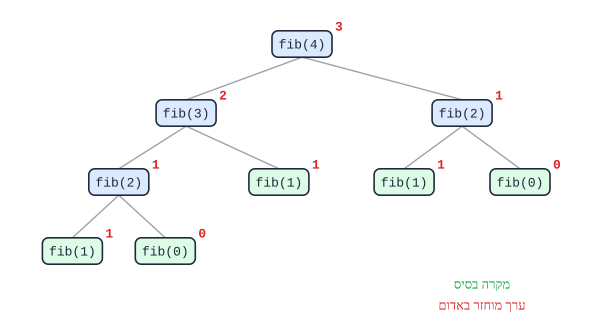

# רקורסיה

**רקורסיה** - פעולה ש**קוראת לעצמה** על **גרסה פשוטה יותר** של אותה בעיה, עד שהבעיה פשוטה מספיק לפתרון **ישיר**.

## שני חלקים - תמיד

| חלק | מה | דוגמה (עצרת) |
|---|---|---|
| **מקרה בסיס** (תנאי עצירה) | הבעיה הכי פשוטה - **פותרים ישירות**, בלי קריאה | `0! = 1` |
| **צעד רקורסיבי** | פותרים **בעזרת** פתרון של בעיה **קטנה יותר** | ‏`n! = n · (n-1)!` |

```csharp
public static int Factorial(int n)
{
    if (n == 0)                      // base case
        return 1;
    return n * Factorial(n - 1);     // recursive step: a smaller problem
}
```

**בלי מקרה בסיס** (או אם הבעיה **לא קטנה** בכל קריאה) - הרקורסיה **לא נעצרת**, עד שהזיכרון נגמר (`StackOverflowException`).

## לחשוב על המשמעות

**הסוד**: לכל פעולה רקורסיבית יש **משמעות** - מה היא **מחזירה** (סכום איברי המערך, האם המספר ראשוני, האם המחרוזת פלינדרום). **מאמינים** שהקריאה הרקורסיבית מחזירה את **המשמעות הזו** לבעיה הקטנה - ושואלים: **איך משתמשים בזה** כדי לפתור את הבעיה הגדולה?

**דוגמה - סכום ספרות**: "`SumDigits(n)` מחזירה את סכום הספרות של `n`". אז סכום הספרות של `472` הוא **הספרה האחרונה** (`2`) ועוד **סכום הספרות של `47`**:

```csharp
public static int SumDigits(int n)
{
    if (n < 10)
        return n;
    return n % 10 + SumDigits(n / 10);
}
```

## עץ מעקב

עוקבים אחרי רקורסיה ב**עץ**: כל **קריאה** היא צומת, ו**הערך שהיא מחזירה** כתוב לידה.

```csharp
public static int Fib(int n)
{
    if (n < 2)
        return n;
    return Fib(n - 1) + Fib(n - 2);
}
```



- **יורדים** - כל קריאה פותחת קריאות חדשות.
- **עולים** - הערכים **חוזרים** מהעלים (מקרי הבסיס) למעלה.
- שימו לב: `Fib(2)` מחושבת **פעמיים** - הרקורסיה הזו **לא יעילה** (מספר הקריאות גדל בערך פי 2 בכל פעם).

## רקורסיה על מחרוזות ומערכים

- **מחרוזת** - **מקצרים** אותה בכל קריאה, בעזרת `Substring`:

```csharp
public static bool IsPalindrome(string s)
{
    if (s.Length <= 1)                                // base: empty or one char
        return true;
    return s[0] == s[s.Length - 1]
        && IsPalindrome(s.Substring(1, s.Length - 2)); // drop first and last
}
```

- **מערך** - **לא** מקצרים את המערך. מעבירים **אינדקס** (או שניים) שמסמנים את **הטווח** שנשאר:

```csharp
// Returns the sum of arr[i..end].
public static int Sum(int[] arr, int i)
{
    if (i == arr.Length)
        return 0;
    return arr[i] + Sum(arr, i + 1);
}
// call: Sum(arr, 0)
```

## שאלות לחזרה

- מהם שני החלקים של כל פעולה רקורסיבית? מה קורה בלי מקרה בסיס?
- כתוב פעולה רקורסיבית שמחזירה את מספר הספרות של מספר.
- למה ברקורסיה על מערך מעבירים אינדקס במקום לקצר את המערך?
- צייר את עץ המעקב של `Factorial(3)`.
