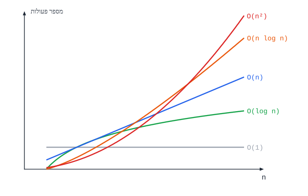

# יעילות, חיפוש ומיון

## מה מודדים?

- **יעילות זמן** - **כמה פעולות** האלגוריתם מבצע.
- **יעילות מקום** - **כמה זיכרון** נוסף הוא צריך.

**לא סופרים שניות** - כי זה תלוי במחשב. סופרים **פעולות** כפונקציה של **גודל הקלט** $n$ (אורך המערך, מספר הספרות...).

- **צעד בסיסי** - קבוצת פעולות שמספרן **לא תלוי** ב-$n$. נוח לספור צעדים במקום כל פעולה.
- **המקרה הגרוע** - בדרך כלל מנתחים אותו (למשל, בחיפוש - כשהערך **לא נמצא**).

## סדר גודל

**סדר גודל** ($O$) - **קצב הגדילה** של מספר הפעולות כש-$n$ גדל. **מתעלמים מקבועים** ומאיברים **זניחים**:

‏$3n^2 + 5n + 7 \;\Rightarrow\; O(n^2)$



| סדר גודל | שם | דוגמה |
|---|---|---|
| ‏$O(1)$ | **קבוע** | גישה לאיבר במערך; פעולה חשבונית |
| ‏$O(\log n)$ | **לוגריתמי** | **חיפוש בינארי**; מספר הספרות של $n$ |
| ‏$O(n)$ | **לינארי** | **לולאה אחת** על המערך: סכום, מקסימום, חיפוש רגיל |
| ‏$O(n\log n)$ | | **מיון מיזוג** |
| ‏$O(n^2)$ | **ריבועי** | **לולאה מקוננת**; מיון בועות, בחירה, הכנסה |

**שיפור בקבוע** (למשל לעבור על חצי מערך במקום על כולו) - **לא משנה** את סדר הגודל. מה שחשוב - **מעבר לסדר גודל נמוך יותר**.

**כמה קלטים**: אם יש שני גדלים, $n$ ו-$m$, כותבים את שניהם: $O(n \cdot m)$. אבל אם $m = n + k$ ו-$k$ קבוע - זה $O(n^2)$.

### מה כותבים בניתוח יעילות?

1. **סדר הגודל**.
2. **מה $n$ מייצג** ("$n$ - אורך המערך").
3. **נימוק**: כמה פעמים עוברים על הקלט ("לולאה מקוננת - לכל אחד מ-$n$ האיברים עוברים על כל $n$ האיברים").

**ואל תכתבו "תבניתית"** - לחשוב על הפתרון היעיל: לפעמים מעבר **אחד** מספיק במקום לולאה מקוננת.

## חיפוש

| | **חיפוש סדרתי** | **חיפוש בינארי** |
|---|---|---|
| **דרישה** | אין | המערך **ממוין** |
| **רעיון** | עוברים על האיברים אחד-אחד | בודקים את **האמצע**; לפי התוצאה ממשיכים **רק בחצי אחד** |
| **יעילות** | ‏$O(n)$ | ‏$O(\log n)$ |

```csharp
// Returns the index of x in the sorted array arr, or -1.
public static int BinarySearch(int[] arr, int x)
{
    int low = 0, high = arr.Length - 1;
    while (low <= high)
    {
        int mid = (low + high) / 2;
        if (arr[mid] == x) return mid;
        if (arr[mid] < x) low = mid + 1;    // continue in the right half
        else high = mid - 1;                // continue in the left half
    }
    return -1;
}
```

**למה $\log n$?** כל צעד **מחלק את הטווח בחצי**. במערך של מיליון איברים - **כ-20** צעדים בלבד.

## מיונים

| מיון | הרעיון | זמן |
|---|---|---|
| **בועות** | משווים **זוגות שכנים** ומחליפים אם צריך. אחרי כל מעבר, הגדול ביותר "מבעבע" לסוף | ‏$O(n^2)$ |
| **בחירה** | בכל שלב **בוחרים את הקטן ביותר** מבין הנותרים ומעבירים אותו למקומו | ‏$O(n^2)$ |
| **הכנסה** | כל איבר **מוכנס** למקומו בין האיברים שכבר ממוינים. **מהיר** על מערך **כמעט ממוין** | ‏$O(n^2)$ |
| **מיזוג** | **רקורסיבי**: ממיינים כל **חצי**, ואז **ממזגים** שני מערכים ממוינים. צריך זיכרון נוסף $O(n)$ | ‏$O(n\log n)$ |
| **מהיר** (quicksort) | בוחרים **ציר**, מחלקים לקטנים וגדולים ממנו, ממיינים כל צד רקורסיבית | ממוצע $O(n\log n)$; גרוע $O(n^2)$ |
| **ערימה** | בונים **ערימה** ושולפים כל פעם את הגדול. **בלי** זיכרון נוסף | ‏$O(n\log n)$ |

**מיון בועות:**

```csharp
for (int i = 0; i < n - 1; i++)
    for (int j = 0; j < n - 1 - i; j++)       // the last i cells are already sorted
        if (arr[j] > arr[j + 1])
        {
            int t = arr[j]; arr[j] = arr[j + 1]; arr[j + 1] = t;
        }
```

## שאלות לחזרה

- מה סדר הגודל של $5n + 3n\log n + 100$?
- למה חיפוש בינארי דורש מערך ממוין? מה היעילות שלו, ולמה?
- מה סדר הגודל של שתי לולאות **זו אחר זו** (לא מקוננות) על מערך באורך $n$?
- השווה בין מיון בועות למיון מיזוג.
