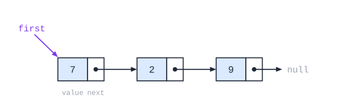

# שרשרת חוליות

## למה לא מספיק מערך?

| חיסרון של מערך | הסבר |
|---|---|
| **גודל קבוע** | אחרי שנוצר - אי אפשר להגדיל או להקטין אותו |
| **הכנסה והוצאה יקרות** | כדי להכניס איבר באמצע, צריך **להזיז** את כל מה שאחריו - $O(n)$ |
| **מבנה סדרתי בלבד** | קשה לייצג בו מבנים מורכבים (כמו עצים) |

## חוליה

**חוליה** (`Node<T>`) - עצם עם שתי תכונות:

1. **ערך** (`value`) - הנתון.
2. **הפניה לחוליה הבאה** (`next`) - או `null` אם זו האחרונה.

**שרשרת חוליות** - חוליות שכל אחת **מפנה לבאה**. השרשרת **אינה עצם** בפני עצמה - היא **מבנה**. מחזיקים **הפניה לחוליה הראשונה**, ודרכה מגיעים לכל השאר.



**מבנה רקורסיבי**: הפניה לחוליה היא גם הפניה **לשרשרת** שמתחילה בה. לכן הרבה פעולות על שרשרת נכתבות **ברקורסיה** ("טפל בחוליה הראשונה, והמשך עם `GetNext()`").

## הממשק

| פעולה | מה עושה |
|---|---|
| ‏`new Node<T>(x)` | חוליה עם ערך `x`, בלי המשך |
| ‏`new Node<T>(x, next)` | חוליה עם ערך `x` שמפנה ל-`next` |
| ‏`GetValue()` / `SetValue(x)` | מחזירה / משנה את הערך |
| ‏`GetNext()` / `SetNext(n)` | מחזירה / משנה את ההפניה לבאה |
| ‏`HasNext()` | ‏`true` אם יש חוליה אחריה |

## פעולות בסיסיות

**סריקה** (מעבר על כל החוליות):

```csharp
Node<int> pos = first;
while (pos != null)
{
    Console.WriteLine(pos.GetValue());
    pos = pos.GetNext();
}
```

**הכנסה אחרי חוליה `pos`** - $O(1)$, בלי הזזות:

```csharp
Node<int> n = new Node<int>(x, pos.GetNext());   // the new node points to pos's next
pos.SetNext(n);                                   // pos points to the new node
```

**הכנסה בהתחלה**: `first = new Node<int>(x, first);`

**מחיקת החוליה שאחרי `pos`**: `pos.SetNext(pos.GetNext().GetNext());` - "מדלגים" עליה.

**מחיקת הראשונה**: `first = first.GetNext();`

**חיפוש**:

```csharp
public static bool Contains(Node<int> first, int x)
{
    Node<int> pos = first;
    while (pos != null && pos.GetValue() != x)
        pos = pos.GetNext();
    return pos != null;
}
```

## דגשים

- **סדר הפעולות בהכנסה חשוב**: קודם מחברים את **החדשה** להמשך, ורק אחר כך את `pos` אליה. אחרת - **ההמשך אובד**.
- **לא מאבדים את ההתחלה**: סורקים עם משתנה עזר (`pos`), לא עם `first`.
- **בודקים `null`** לפני `GetNext().GetValue()`.
- **שרשרת ריקה** - `first == null`. לטפל בה!

## מחלקות גנריות

‏`Node<T>` היא מחלקה **גנרית**: `T` הוא **טיפוס** שבוחרים ביצירה - `Node<int>`, `Node<string>`, `Node<Student>`. כך כותבים את המחלקה **פעם אחת** לכל טיפוס. (כך בנויות גם [מחסנית](../02-stack/_index.md) ו[תור](../03-queue/_index.md).)

## שאלות לחזרה

- מה היתרונות של שרשרת חוליות על מערך? ומה החסרונות (רמז: גישה לאיבר ה-$k$)?
- כתוב פעולה שמחזירה את אורך השרשרת - בלולאה וברקורסיה.
- למה חשוב סדר הפעולות בהכנסת חוליה?
- איך מוחקים את החוליה הראשונה? את האחרונה?
