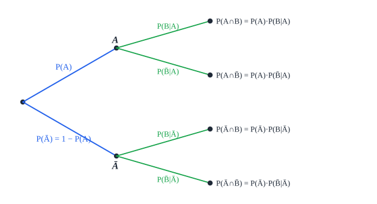

# הסתברות

שאלות הסתברות **לא דורשות הרבה חישוב** - אבל נחשבות קשות: **כל מילה** בשאלה קובעת, ואין "טעות נגררת". **קראו את השאלה כמה פעמים.**

## הגדרות בסיסיות

| מושג | הגדרה | דוגמה (הטלת קובייה) |
|---|---|---|
| **ניסוי מקרי** | פעולה שאי אפשר לדעת מראש את תוצאתה, ואפשר לחזור עליה באותם תנאים | הטלת קובייה |
| **ניסיון / שלב** | פעולה **בודדת** בתוך הניסוי (ניסוי יכול להכיל כמה) | הטלה אחת מתוך שלוש |
| **מרחב המדגם** $\Omega$ | **כל** התוצאות האפשריות | ‏$\{1, 2, 3, 4, 5, 6\}$ |
| **מאורע** | תוצאה אחת או **אוסף** של תוצאות | "יצא זוגי" = $\{2, 4, 6\}$ |
| **מאורע ריק** $\Phi$ | מאורע **שלא יכול** לקרות | "יצא 7" |

**הסתברות** - מספר בין 0 ל-1: $0 \le P(A) \le 1$. **מאורע ודאי**: $P(\Omega) = 1$. **מאורע בלתי אפשרי**: $P(\Phi) = 0$.

**כשכל התוצאות שוות הסתברות**:

$$P(A) = \frac{\text{מספר התוצאות ב-}A}{\text{מספר התוצאות ב-}\Omega}$$

"יצא זוגי": $\frac{3}{6} = \frac{1}{2}$.

- מספיק לדעת **כמה** תוצאות יש, לא **מהן**.
- ‏$n$ שלבים עם $m$ אפשרויות בכל אחד - $m^n$ תוצאות.
- **לא מעגלים** הסתברויות לשבר עשרוני - משאירים **שבר פשוט**.
- **"לכל הפחות"** = מהערך ומעלה; **"לכל היותר"** = מהערך ומטה.
- **הרבה חישובים?** בדקו את **המאורע המשלים** - אולי הוא קל יותר.

### הנפשה: חוק המספרים הגדולים

ככל שמטילים יותר פעמים, השכיחות היחסית מתקרבת להסתברות.

<bl-coin-flips></bl-coin-flips>

## פעולות בין מאורעות

| פעולה | סימון | במילים | חוק |
|---|---|---|---|
| **חיתוך** | ‏$A \cap B$ | "**וגם**" - שניהם קרו | |
| **איחוד** | ‏$A \cup B$ | "**או**" - לפחות אחד קרה | ‏$P(A \cup B) = P(A) + P(B) - P(A \cap B)$ |
| **משלים** | ‏$\overline{A}$ | ‏$A$ **לא** קרה | ‏$P(A) + P(\overline{A}) = 1$ |

ועוד: $P(A \cup B) + P(\overline{A} \cap \overline{B}) = 1$ - "**לפחות אחד**" הוא המשלים של "**אף אחד**".

## סוגי מאורעות

- **זרים** - **לא יכולים לקרות יחד**: $A \cap B = \Phi$. לכן $P(A \cup B) = P(A) + P(B)$.
- **חלקי** ($A \subseteq B$) - כל תוצאה של $A$ היא גם של $B$.
- **בלתי תלויים** - הידיעה ש-$B$ קרה **לא משנה** את ההסתברות של $A$. **התנאי** (וגם **ההוכחה**):
$$P(A \cap B) = P(A) \cdot P(B)$$
- **תלויים** - הידיעה ש-$B$ קרה **משנה** את ההסתברות של $A$.

**שימו לב**: **זרים** ו**בלתי תלויים** - שני דברים שונים! מאורעות זרים (עם הסתברות חיובית) הם דווקא **תלויים**: אם $B$ קרה, $A$ **בטוח לא** קרה.

## הסתברות מותנית

**ההסתברות של $A$, בתנאי ש-$B$ קרה:**

$$P(A/B) = \frac{P(A \cap B)}{P(B)}$$

- **מילות מפתח**: "**אם ידוע ש...**", "**בתנאי ש...**", "**מבין...**", "**איזה חלק מ...**". מה שבא אחריהן הוא $B$ - **המצב הידוע**.
- ‏$P(A/B) + P(\overline{A}/B) = 1$.
- **נוסחת בייס**: $P(A/B) \cdot P(B) = P(B/A) \cdot P(A)$.

## דיאגרמת עץ

- כל **פיצול** - שלב בניסוי. **סכום ההסתברויות** בכל פיצול = 1.
- **לאורך ענף** (וגם) - **כופלים**.
- **בין ענפים** (או) - **מחברים**.
- **יתרון**: רואים את **כל** המקרים. **מתאים** כשמספר השלבים **קטן**.
- **שלב שני תלוי בראשון** (למשל הוצאה **בלי החזרה**) - ההסתברויות בענפים **משתנות** בהתאם.

## טבלה דו-ממדית

**מתאימה** כשהמאורעות **תלויים** או **לא זרים**, ונותנים הסתברויות של חיתוכים.

| | ‏$A$ | ‏$\overline{A}$ | |
|---|---|---|---|
| ‏$B$ | ‏$P(A \cap B)$ | ‏$P(\overline{A} \cap B)$ | ‏$P(B)$ |
| ‏$\overline{B}$ | ‏$P(A \cap \overline{B})$ | ‏$P(\overline{A} \cap \overline{B})$ | ‏$P(\overline{B})$ |
| | ‏$P(A)$ | ‏$P(\overline{A})$ | **1** |

- **לפני** הטבלה - **מגדירים** במילים מה הם $A$ ו-$B$.
- כל **שורה** ו**עמודה** מסתכמות **לשוליים**; הכול מסתכם ל-**1**.
- כותבים את **הנתונים** ואת **שלבי המילוי** (כמו טענה-נימוק). נעלם? מסמנים אותו ופותרים.
- **טבלת שכיחויות** - אותו דבר, עם **מספרים** במקום הסתברויות.
- **הסתברות מותנית מהטבלה**: $P(A/B)$ = התא $A \cap B$ חלקי סכום **השורה** של $B$.

## נוסחת ברנולי

**ניסוי שחוזר $n$ פעמים**, בכל פעם **הצלחה** בהסתברות $p$, **באופן בלתי תלוי**. ההסתברות ל**בדיוק $k$ הצלחות**:

$$P_n(k) = \binom{n}{k}p^k(1 - p)^{n-k} \qquad \binom{n}{k} = \frac{n!}{k!\,(n - k)!}$$

- ‏$\binom{n}{k}$ - **כמה דרכים** לבחור **איפה** יהיו ההצלחות. במחשבון: **nCr**.
- כדאי לזכור: $\binom{n}{0} = \binom{n}{n} = 1$, $\binom{n}{1} = \binom{n}{n-1} = n$.
- **התנאים**: הניסיונות **בלתי תלויים**, ו-$p$ **זהה** בכל אחד. בהוצאה - רק **עם החזרה** (באוכלוסייה גדולה - מתייחסים כאילו יש החזרה).
- **"לפחות 3 מתוך 5"** = 3 **או** 4 **או** 5 - מחשבים כל אחד ומחברים. (או: 1 פחות "לכל היותר 2".)
- ‏$k$ הצלחות = $n - k$ כישלונות - אותו ביטוי.

**דוגמה**: מטילים מטבע 5 פעמים. מה ההסתברות ל-3 "עץ" בדיוק? $\binom{5}{3}\left(\frac{1}{2}\right)^3\left(\frac{1}{2}\right)^2 = \frac{10}{32} = \frac{5}{16}$.

### הנפשה: לוח גלטון

כל כדור "מטיל מטבע" בכל שורה. מספר הפניות ימינה מתפלג בינומית, כמו בנוסחת ברנולי.

<bl-coin-flips mode="galton"></bl-coin-flips>

## שאלות לחזרה

- מה ההבדל בין מאורעות זרים למאורעות בלתי תלויים?
- איך מוכיחים ששני מאורעות בלתי תלויים?
- מאילו מילים בשאלה מזהים הסתברות מותנית?
- בשקית 3 כדורים אדומים ו-2 כחולים. מוציאים שניים **בלי החזרה**. מה ההסתברות ששניהם אדומים?
- מתי משתמשים בנוסחת ברנולי? מה התנאים?
