# גיאומטריה וטריגונומטריה

## זוויות ומשולשים

**איך עובדת גיאומטריה?** מתחילים מ**הגדרות** ומ**אקסיומות** (הנחות יסוד), ומהן מוכיחים **משפטים**. בבגרות מותר **לצטט** רק משפטים מהרשימה הרשמית (ראו [משפטים שמותר לצטט](_index.md#משפטים-שמותר-לצטט)) - כל טענה אחרת צריך **להוכיח**. לא צריך לזכור את הניסוח מילה במילה - העיקר שהמשמעות נכונה.

**משפט הפוך** - מחליף בין ה"אם" ל"אז". **לא תמיד** משפט הפוך נכון, ולכן כל אחד מהם הוא משפט נפרד.

### מושגי יסוד

- **נקודה**, **ישר** ו**מישור** - המושגים הבסיסיים (לא מגדירים אותם).
- **אקסיומת המקבילים** (האקסיומה החמישית של אוקלידס): דרך נקודה מחוץ לישר עובר **ישר מקביל אחד בלבד**.
- **סוגי זוויות**: **חדה** (פחות מ-$90°$), **ישרה** ($90°$), **קהה** (בין $90°$ ל-$180°$), **שטוחה** ($180°$), **סיבוב שלם** ($360°$).

### זוויות

**שני ישרים נחתכים:**

- **זוויות צמודות** משלימות ל-$180°$.
- **זוויות קודקודיות** שוות.

**שני ישרים מקבילים נחתכים בישר שלישי:**

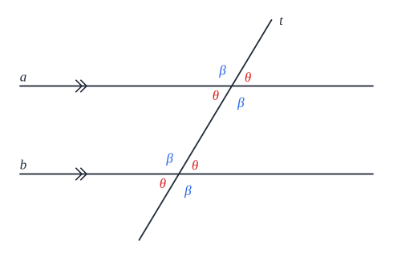

| זוג זוויות | הקשר (כשהישרים מקבילים) |
|---|---|
| **מתאימות** (באותו מקום בכל צומת) | **שוות** |
| **מתחלפות** (בצדדים שונים של החותך, בין המקבילים) | **שוות** |
| **חד-צדדיות** (באותו צד של החותך, בין המקבילים) | **משלימות ל-$180°$** |

**וההפך**: אם יש זוג מתאימות שוות, **או** מתחלפות שוות, **או** חד-צדדיות שסכומן $180°$ - **הישרים מקבילים**.

### משולש - כללי

- **סכום הזוויות** במשולש - $180°$. (במצולע קמור עם $n$ צלעות - $180°(n - 2)$.)
- **זווית חיצונית** שווה **לסכום שתי הפנימיות שאינן צמודות לה**.
- **אי-שוויון המשולש**: סכום כל שתי צלעות **גדול** מהשלישית.
- **מול זוויות שוות - צלעות שוות**; מול צלע **גדולה** יותר - זווית **גדולה** יותר (ולהפך).
- **שטח**: $S = \frac{a \cdot h_a}{2}$ - חצי צלע כפול הגובה אליה.

#### חפיפת משולשים

**חופפים** = כל הצלעות וכל הזוויות **שוות בהתאמה**. ארבעה משפטי חפיפה:

| משפט | מה צריך |
|---|---|
| **צ.ז.צ** | שתי צלעות **והזווית שביניהן** |
| **ז.צ.ז** | שתי זוויות **והצלע שביניהן** |
| **צ.צ.צ** | שלוש צלעות |
| **צ.צ.ז** | שתי צלעות **והזווית שמול הגדולה** מביניהן |

#### משולש שווה שוקיים

- שתי צלעות שוות (**שוקיים**). **זוויות הבסיס שוות** (ולהפך).
- **חוצה זווית הראש**, **התיכון לבסיס** ו**הגובה לבסיס** - **אותו קטע**.
- **הפוך**: אם במשולש **שניים** מהשלושה (חוצה זווית, תיכון, גובה) מתלכדים - הוא **שווה שוקיים**.
- **בניית עזר**: מורידים את **הגובה לבסיס** (שהוא גם תיכון וחוצה זווית).

#### משולש ישר זווית

- הצלע מול הזווית הישרה - **יתר**; האחרות - **ניצבים**.
- **פיתגורס**: $a^2 + b^2 = c^2$ (וההפך: אם מתקיים - הזווית ישרה). **שלשות פיתגוריות**: $(3, 4, 5)$, $(5, 12, 13)$, $(8, 15, 17)$ וכפולותיהן.
- **התיכון ליתר** שווה ל**חצי היתר** (וההפך: אם התיכון שווה לחצי הצלע - הזווית מולה ישרה).
- **זווית של $30°$**: הניצב **מולה** שווה ל**חצי היתר** (וההפך).

**הגובה ליתר** יוצר **שני משולשים דומים** למשולש הגדול, ומכאן:

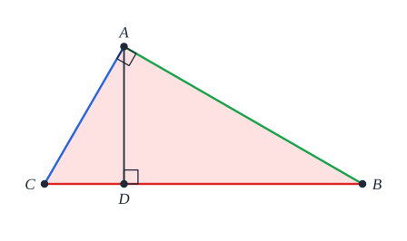

- **ניצב** = ממוצע הנדסי של **היתר** ו**היטלו** עליו: $AC^2 = BC \cdot CD$.
- **הגובה** = ממוצע הנדסי של **שני ההיטלים**: $AD^2 = BD \cdot CD$.

### קטע אמצעים במשולש

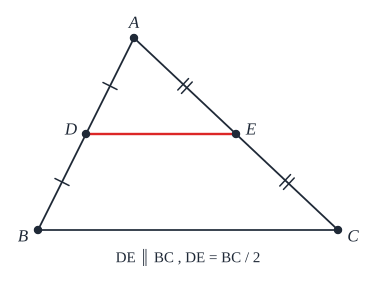

- **קטע אמצעים** - מחבר **אמצעי שתי צלעות**. הוא **מקביל** לצלע השלישית ו**שווה למחציתה**.
- **הפוך 1**: ישר שיוצא **מאמצע צלע** ו**מקביל** לצלע שנייה - **חוצה** את השלישית.
- **הפוך 2**: קטע בין שתי צלעות ש**מקביל** לשלישית **ושווה למחציתה** - הוא קטע אמצעים.
- בכל משולש **3** קטעי אמצעים. הם מחלקים אותו ל-**4 משולשים חופפים**.

### הנקודות המיוחדות במשולש

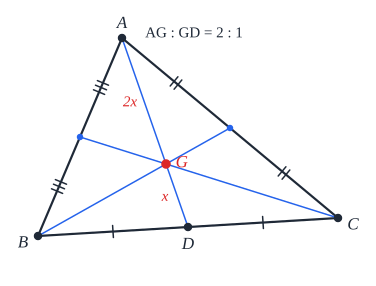

| נקודה | נפגשים בה | תכונה | מיקום |
|---|---|---|---|
| **מפגש התיכונים** | 3 **תיכונים** | מחלקת כל תיכון ביחס **2:1** (החלק הארוך ליד הקודקוד) | **תמיד בפנים** |
| **מרכז המעגל החסום** | 3 **חוצי זוויות** | **שווה מרחק מהצלעות** | **תמיד בפנים** |
| **מרכז המעגל החוסם** | 3 **אנכים אמצעיים** | **שווה מרחק מהקודקודים** | חד-זווית - **בפנים**; ישר-זווית - **אמצע היתר**; קהה-זווית - **בחוץ** |
| **מפגש הגבהים** | 3 **גבהים** | | חד-זווית - **בפנים**; ישר-זווית - **בקודקוד הישר**; קהה-זווית - **בחוץ** |

### מקומות גיאומטריים

**מקום גיאומטרי** - **כל** הנקודות שמקיימות תכונה מסוימת.

- **חוצה זווית** - כל הנקודות **שוות המרחק משוקי הזווית** (וההפך).
- **אנך אמצעי** לקטע (מאונך לו ועובר באמצעו) - כל הנקודות **שוות המרחק מקצות הקטע** (וההפך).
- **מעגל** - כל הנקודות **במרחק קבוע** מנקודה.

### פרופורציות במשולש

#### משפט תאלס

**ישרים מקבילים** חותכים על שני ישרים **קטעים פרופורציוניים**. ובמשולש - אם $DE \parallel BC$:

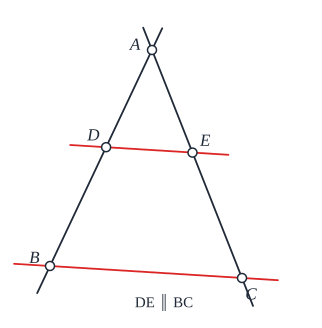

$$\frac{AD}{DB} = \frac{AE}{EC} \qquad \text{ובמורחב:}\quad \frac{AD}{AB} = \frac{AE}{AC} = \frac{DE}{BC}$$

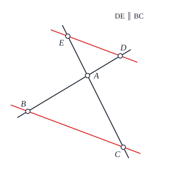

(בבגרות מספיק לכתוב "**משפט תאלס המורחב**".) **הפוך**: אם הקטעים פרופורציוניים - הישרים **מקבילים**.

#### משפט חוצה הזווית

**חוצה זווית** במשולש מחלק את **הצלע שמולה** באותו יחס כמו **שתי הצלעות שכולאות** את הזווית:

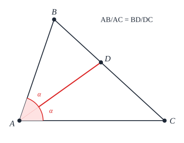

$$\frac{AB}{AC} = \frac{BD}{DC}$$

### דמיון משולשים

**דומים** - כל הזוויות **שוות**, והצלעות המתאימות **פרופורציוניות** (באותו **יחס דמיון** $k$). חופפים הם דומים עם $k = 1$.

**משפטי דמיון**: **ז.ז** (שתי זוויות שוות - הכי שימושי!); **צ.ז.צ** (שתי צלעות פרופורציוניות **והזווית שביניהן** שווה); **צ.צ.צ** (שלוש צלעות פרופורציוניות).

**במשולשים דומים** - היחס בין **כל** אורך מתאים שווה ל-$k$: גבהים, תיכונים, חוצי זוויות, **היקפים**, רדיוסים של המעגלים החוסמים והחסומים. **אבל**:

$$\frac{S_1}{S_2} = k^2$$

**יחס השטחים = ריבוע יחס הדמיון.**

### שאלות לחזרה

- מה ההבדל בין זוויות מתאימות למתחלפות?
- מנה את ארבעת משפטי החפיפה ואת שלושת משפטי הדמיון.
- איפה נמצא מרכז המעגל החוסם משולש ישר זווית? למה?
- במשולש ישר זווית ההיטלים על היתר הם 4 ו-9. מה אורך הגובה ליתר?
- יחס הדמיון בין שני משולשים הוא 3. מה יחס השטחים?

## מרובעים

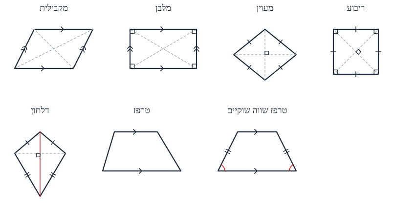

**הרעיון**: כל מרובע "מיוחד" יורש את התכונות של המרובעים שמעליו. **ריבוע** הוא גם מלבן, גם מעוין וגם מקבילית - ולכן יש לו **את כל** התכונות שלהם.

### מקבילית

**הגדרה**: מרובע ש**כל שתי צלעות נגדיות מקבילות**.

**תכונות** (ולכל אחת יש משפט **הפוך** - מרובע שמקיים אותה **הוא** מקבילית):

1. **צלעות נגדיות שוות**.
2. **זוויות נגדיות שוות**.
3. **האלכסונים חוצים זה את זה**.

**ועוד דרך להוכיח מקבילית**: מרובע עם **זוג צלעות נגדיות מקבילות וגם שוות**.

**שטח**: $S = a \cdot h_a$ (צלע כפול הגובה אליה).

### מלבן

**הגדרה**: מקבילית עם **זווית ישרה** (או מרובע עם **שלוש** זוויות ישרות).

- כל תכונות המקבילית, **ועוד**: **האלכסונים שווים**.
- **הפוך**: מקבילית שאלכסוניה שווים - **מלבן**.
- **שטח**: $S = ab$.

### מעוין

**הגדרה**: מרובע ש**כל צלעותיו שוות** (או מקבילית עם **שתי צלעות סמוכות שוות**).

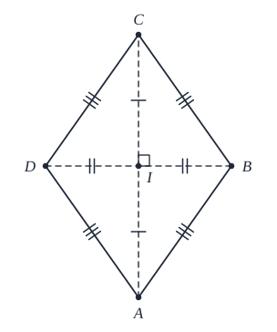

- כל תכונות המקבילית, **ועוד**:
  - **האלכסונים מאונכים** זה לזה.
  - **האלכסונים חוצים את הזוויות**.
- **הפוך**: מקבילית שבה אלכסון **חוצה זווית**, או שאלכסוניה **מאונכים** - **מעוין**.
- **שטח**: $S = \frac{d_1 d_2}{2}$ (חצי מכפלת האלכסונים), או כמו מקבילית.

### ריבוע

**הגדרה**: מלבן **ומעוין** גם יחד. כלומר, אחת מאלה:

- מלבן עם **צלעות סמוכות שוות**, או שאלכסוניו **מאונכים**, או שאלכסון שלו **חוצה זווית**.
- מעוין עם **זווית ישרה**, או שאלכסוניו **שווים**.

**שטח**: $S = a^2$.

### דלתון

**הגדרה**: שני **משולשים שווי שוקיים** עם **בסיס משותף** (צורת עפיפון).

- **האלכסון הראשי** (בין שני קודקודי הראש) **חוצה את זוויות הראש**, **חוצה את האלכסון השני** ו**מאונך** לו.
- **שטח**: $S = \frac{d_1 d_2}{2}$ - כמו בכל מרובע **שאלכסוניו מאונכים**.

### טרפז

**הגדרה**: מרובע עם **זוג אחד בלבד** של צלעות מקבילות - **הבסיסים** (גדול וקטן). הצלעות האחרות - **שוקיים**.

- **להוכיח שזה טרפז ולא מקבילית?** מראים שהבסיסים **לא שווים**, או שהאלכסונים **לא חוצים** זה את זה.
- **טרפז ישר זווית** - עם זווית ישרה. **השוק הקצרה** (הצמודה לזווית הישרה) **שווה לגובה**.
- **שטח**: $S = \frac{(a + b)h}{2}$.
- **בניות עזר**: **הורדת גבהים** מקצות הבסיס הקטן; **העברת מקביל לשוק**.

#### טרפז שווה שוקיים

- **השוקיים שוות** (וזה ההגדרה).
- **הזוויות ליד כל בסיס שוות**, ו**האלכסונים שווים** - ולכל אחת משפט **הפוך**.
- סכום כל **שתי זוויות נגדיות** - $180°$ (ולכן הוא **ניתן לחסימה במעגל**).

#### קטע אמצעים בטרפז

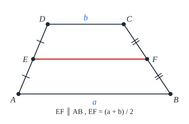

- מחבר את **אמצעי השוקיים**.
- **מקביל** לבסיסים, ו**שווה למחצית סכומם**: $\frac{a + b}{2}$.
- **הפוך**: ישר שיוצא מאמצע שוק **ומקביל** לבסיסים - **חוצה** את השוק השנייה.

### שאלות לחזרה

- מנה שלוש דרכים להוכיח שמרובע הוא מקבילית.
- מה מוסיף מלבן על מקבילית? ומעוין?
- מקבילית שאלכסוניה שווים ומאונכים - מה היא?
- בסיסי טרפז 6 ו-10, וגובהו 4. מה שטחו? מה אורך קטע האמצעים?

## מעגל

### הגדרות

- **מעגל** - כל הנקודות במישור **במרחק קבוע** (**רדיוס** $r$) מנקודה קבועה (**המרכז**). ("מעגל" = הקו; "עיגול" = השטח.)
- **מיתר** - קטע בין שתי נקודות על המעגל. **קוטר** - מיתר **דרך המרכז** ($2r$): **המיתר הארוך ביותר**.
- **קשת** - חלק מהמעגל. גודלה נמדד לפי **הזווית המרכזית** שלה.
- **זווית מרכזית** - קודקודה **במרכז**. **זווית היקפית** - קודקודה **על המעגל**.
- **היקף**: $P = 2\pi r$. **שטח עיגול**: $S = \pi r^2$.
- **גזרה** (בין שני רדיוסים): $\frac{S_{\text{גזרה}}}{\pi r^2} = \frac{\alpha}{360°}$. ובאורך קשת: $\frac{L}{2\pi r} = \frac{\alpha}{360°}$.
- **דרך כל שלוש נקודות** שאינן על ישר אחד עובר **מעגל אחד בלבד**.
- **ישר ומעגל**: **זרים** (אין נקודה משותפת), **משיק** (אחת), **חותך** (שתיים).

**בניות עזר נפוצות**: להעביר **רדיוס** או **קוטר**; לחבר את **נקודת ההשקה** למרכז; בשני מעגלים משיקים - **משיק משותף**; בשני מעגלים נחתכים - **מיתר משותף**.

### זוויות מרכזיות, קשתות ומיתרים

באותו מעגל: **זוויות מרכזיות שוות** ⟺ **קשתות שוות** ⟺ **מיתרים שווים**.

**האנך מהמרכז למיתר** - **חוצה** את המיתר, את **הזווית המרכזית** ואת **הקשת**. (וגם: קטע מהמרכז ש**חוצה** מיתר - **מאונך** לו.)

**מרחק מהמרכז**: מיתרים **שווים** - **באותו מרחק** מהמרכז (וההפך). מיתר **קרוב** יותר למרכז - **ארוך** יותר.

### זוויות היקפיות

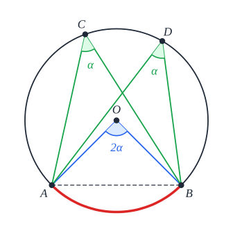

- **זווית היקפית = חצי הזווית המרכזית** שנשענת על **אותה קשת**.
- **זוויות היקפיות** שנשענות על **אותה קשת** (מאותו צד של המיתר) - **שוות**. (מ**צדדים שונים** - **משלימות** ל-$180°$.)
- **זווית היקפית שנשענת על קוטר - ישרה** (וההפך: זווית היקפית ישרה נשענת על קוטר).
- זוויות היקפיות **שוות** ⟺ **קשתות שוות** ⟺ **מיתרים שווים**.

### זווית פנימית וחיצונית

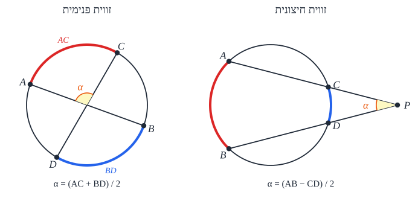

- **זווית פנימית** (קודקודה **בתוך** המעגל, בין שני מיתרים) = **חצי סכום** הקשתות שהיא ו**הזווית הקודקודית** לה כולאות.
- **זווית חיצונית** (קודקודה **מחוץ** למעגל) = **חצי הפרש** הקשתות שהיא כולאת.

### משיקים

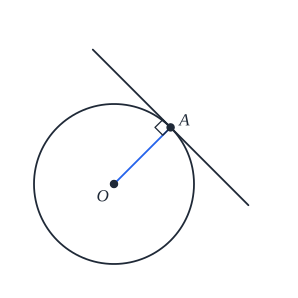 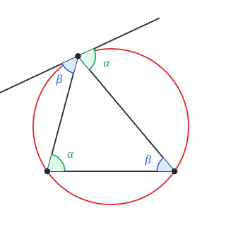 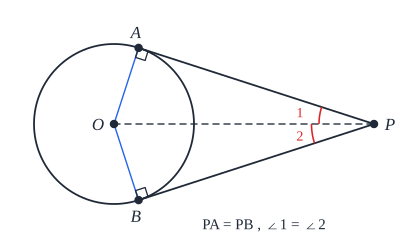

- **המשיק מאונך לרדיוס** בנקודת ההשקה (וההפך: ישר מאונך לרדיוס בקצהו - **משיק**).
- **זווית בין משיק ומיתר** = **הזווית ההיקפית** שנשענת על המיתר **מהצד השני**.
- **שני משיקים** מאותה נקודה - **שווים**.
- הקטע מ**המרכז** לנקודה שממנה יוצאים שני המשיקים **חוצה את הזווית** שביניהם.

### שני מעגלים

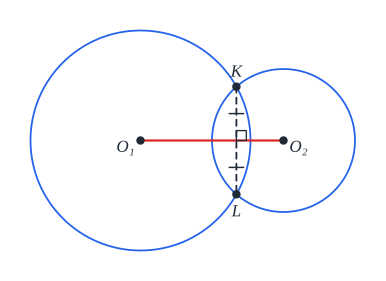

- **מצבים**: **זרים** (אחד בתוך השני או זה ליד זה), **משיקים** (מבפנים או מבחוץ), **חותכים**, **מתלכדים**.
- **קטע המרכזים** של מעגלים **נחתכים** - **חוצה** את המיתר המשותף ו**מאונך** לו.
- **נקודת ההשקה** של מעגלים משיקים - **על קטע המרכזים** (או על המשכו).

### פרופורציות במעגל

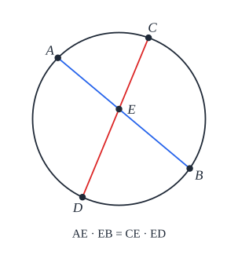 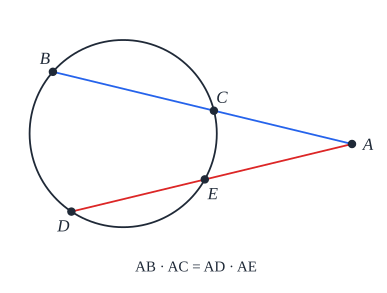 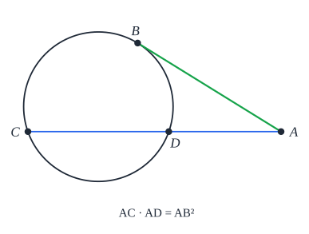

| מצב | הקשר |
|---|---|
| **שני מיתרים נחתכים** | מכפלת קטעי מיתר אחד = מכפלת קטעי השני |
| **שני חותכים** מנקודה בחוץ | חותך **כולו** × **חלקו החיצוני** - שווה בשניהם |
| **חותך ומשיק** מנקודה בחוץ | חותך × חלקו החיצוני = **ריבוע המשיק** |

**הוכחה** (שאלה נפוצה!): בכל המקרים - **דמיון משולשים** (ז.ז, בעזרת זוויות היקפיות).

### מעגל ומשולש

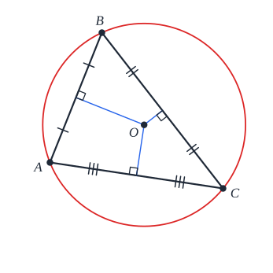 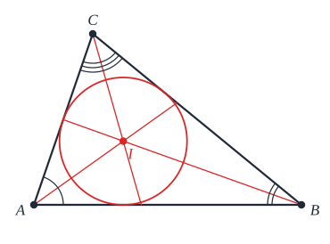

| | **מעגל חוסם** | **מעגל חסום** |
|---|---|---|
| **מה** | עובר דרך **שלושת הקודקודים** | **משיק לשלוש הצלעות** |
| **המרכז** | מפגש **האנכים האמצעיים** | מפגש **חוצי הזוויות** |
| **קיים?** | **לכל** משולש | **לכל** משולש |

### מעגל ומרובע

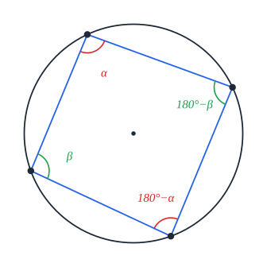 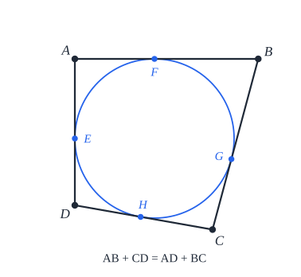

- **מרובע חסום במעגל** (המעגל עובר בכל הקודקודים) ⟺ **סכום כל זוג זוויות נגדיות $180°$**.
  - **תמיד אפשר**: מלבן, ריבוע, טרפז שווה שוקיים.
  - **לא תמיד**: מקבילית (רק מלבן), מעוין (רק ריבוע), טרפז (רק שווה שוקיים), דלתון (רק עם זוויות ישרות בצדדים).
- **מעגל חסום במרובע** (משיק לכל הצלעות) ⟺ **סכומי הצלעות הנגדיות שווים**: $a + c = b + d$.

### מצולע משוכלל

**כל הצלעות וכל הזוויות שוות**. הזווית: $\alpha = \frac{180°(n - 2)}{n}$. **אפשר תמיד לחסום אותו במעגל**, ו**לחסום בו מעגל** - ושני המעגלים **באותו מרכז**.

### הנפשה: זווית היקפית וזווית מרכזית

גררו את הנקודות על המעגל: כל הזוויות ההיקפיות שנשענות על אותה קשת שוות, וכל אחת מהן חצי מהזווית המרכזית.

<bl-inscribed-angle></bl-inscribed-angle>

### שאלות לחזרה

- זווית מרכזית $100°$. מה הזווית ההיקפית על אותה קשת?
- למה זווית היקפית על קוטר ישרה?
- מנקודה מחוץ למעגל יוצאים משיק באורך 6 וחותך שחלקו החיצוני 4. מה אורך החותך?
- הוכח: מרובע חסום במעגל - סכום הזוויות הנגדיות $180°$.
- אילו מרובעים תמיד אפשר לחסום במעגל?

## הוכחות נפוצות וטענות עזר

### הוכחות שחוזרות בבחינות

| מה מוכיחים | איך |
|---|---|
| **מכפלת קטעי מיתרים נחתכים** | **דמיון** משולשים (זוויות היקפיות על אותה קשת) |
| **מכפלת שני חותכים** מאותה נקודה | **דמיון** משולשים |
| **הגובה ליתר** הוא ממוצע הנדסי | **דמיון** - הגובה יוצר שני משולשים דומים |
| **סכום צלעות נגדיות** במרובע **החוסם** מעגל | מכל קודקוד יוצאים **שני משיקים שווים** - מחברים |
| **סכום זוויות נגדיות** במרובע **החסום** במעגל | מחברים את **המרכז** לקודקודים: כל זווית היא **חצי** מזווית מרכזית, ושתי המרכזיות ביחד $360°$ |
| **יחס שטחי משולשים דומים** = $k^2$ | מבטאים **גם את הצלע וגם את הגובה** בעזרת $k$ |

**עצה**: שאלות **הוכחה** עדיפות על שאלות **חישוב** - התשובה כבר **ידועה**, ואפשר לבדוק את עצמך.

### טענות עזר

**טענות עזר** הן טענות **נכונות ושימושיות**, אבל **אסור לצטט אותן** בבגרות בלי הוכחה. הן עוזרות **לראות** את הפתרון - ואז מוכיחים את מה שצריך. (המודגשות - הכי שימושיות.)

#### שטחים

1. **קטע מקודקוד שמחלק את הצלע שמולו ביחס $a:b$, מחלק גם את השטח ביחס $a:b$.** (לשני המשולשים **אותו גובה**.) מכאן:
   - **תיכון** מחלק משולש לשני משולשים **שווי שטח**.
   - **האלכסונים במקבילית** מחלקים אותה ל-**4** משולשים שווי שטח.
   - **שלושת התיכונים** מחלקים משולש ל-**6** משולשים שווי שטח.
2. **רדיוס המעגל החסום**: $r = \frac{2S}{P}$ ($P$ - ההיקף). **הוכחה**: מחברים את מרכז המעגל לקודקודים, ומקבלים 3 משולשים שגובהם $r$: $S = \frac{ar}{2} + \frac{br}{2} + \frac{cr}{2} = \frac{Pr}{2}$.

   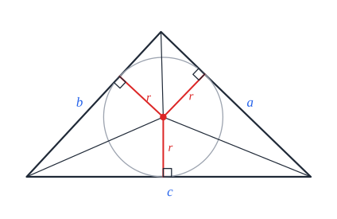

3. **שטח מרובע שאלכסוניו מאונכים**: $S = \frac{d_1 d_2}{2}$. (מחברים את 4 המשולשים ישרי הזווית.)
4. **שטח משולש ורדיוס המעגל החוסם**: $S = \frac{abc}{4R}$. (משפט הסינוסים + $S = \frac{1}{2}ab\sin\gamma$.)
5. **במעוין הגבהים שווים** (השטח בשתי דרכים).
6. **משפט ויויאני**: במשולש **שווה צלעות**, **סכום המרחקים** של כל נקודה פנימית מהצלעות **שווה לגובה**. (מחלקים ל-3 משולשים ומשווים שטחים.)

#### מרובעים במעגל

7. **כל טרפז החסום במעגל - שווה שוקיים.** (זוויות חד-צדדיות $180°$, וזוויות נגדיות במרובע חסום $180°$.)
8. **כל מקבילית החסומה במעגל - מלבן.** (זוויות נגדיות שוות **וגם** סכומן $180°$.)

#### טרפזים

9. **בטרפז: בסיס שווה לשוק ⟺ האלכסון חוצה את הזווית** שבין השוק לבסיס השני. (משולש שווה שוקיים + זוויות מתחלפות.)
10. **בטרפז שווה שוקיים** - האלכסונים נחתכים כך ש**הקטעים ליד אותו בסיס שווים**.
11. **קטע בין השוקיים שמקביל לבסיסים** - מחלק את **שתי השוקיים באותו יחס** (וההפך). (ממשיכים את השוקיים למשולש, ותאלס.)
12. **בטרפז שווה שוקיים** - **האנך האמצעי** לבסיס אחד הוא אנך אמצעי **גם לשני**; והקטע בין **אמצעי הבסיסים** מאונך להם.

#### קטעים וחוצים

13. **תיכון חוצה את קטע האמצעים** (המקביל לצלע שאליה הוא יורד) ונחצה על ידו. (מתקבלת מקבילית.)
14. **תיכון לקטע חוצה כל קטע מקביל** לו (תאלס).
15. **קטע דרך מפגש האלכסונים במקבילית** (בין שתי צלעות נגדיות) - **נחצה** בנקודה הזו.
16. **ארבעת חוצי הזוויות במקבילית** יוצרים **מלבן** ($\alpha + \beta = 90°$). **במלבן** - יוצרים **ריבוע**.
17. **חיבור אמצעי הצלעות של מרובע** נותן:
    - בכל מרובע - **מקבילית**;
    - אם האלכסונים **מאונכים** - **מלבן**;
    - אם האלכסונים **שווים** - **מעוין**;
    - אם **שווים ומאונכים** - **ריבוע**.

    (קטעי אמצעים במשולשים שהאלכסונים יוצרים.)

#### נקודות מיוחדות

18. **ישר אוילר**: **מפגש הגבהים**, **מפגש התיכונים** ו**מרכז המעגל החוסם** - **על ישר אחד**.
19. משולש עם **שני תיכונים שווים**, או **שני גבהים שווים**, או **שני חוצי זוויות שווים** - **שווה שוקיים**.

## טריגונומטריה

### במשולש ישר זווית

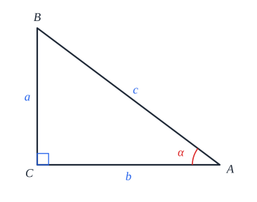

| פונקציה | הגדרה | |
|---|---|---|
| **סינוס** | **ניצב מול** חלקי **יתר** | ‏$\sin A = \frac{a}{c}$ |
| **קוסינוס** | **ניצב ליד** חלקי **יתר** | ‏$\cos A = \frac{b}{c}$ |
| **טנגנס** | **ניצב מול** חלקי **ניצב ליד** | ‏$\tan A = \frac{a}{b}$ |

### מעגל היחידה

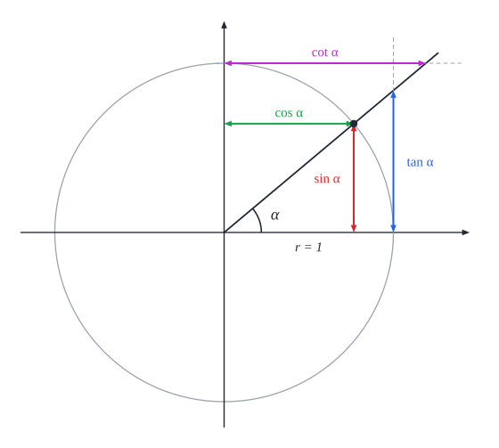

כדי להגדיר סינוס וקוסינוס **לכל זווית** (לא רק חדה) - משתמשים ב**מעגל היחידה** (רדיוס 1, מרכז בראשית):

- **הזווית** נמדדת מהכיוון החיובי של ציר $x$: **נגד כיוון השעון - חיובית**; עם כיוון השעון - שלילית.
- ‏**$\cos\alpha$** - שיעור **ה-$x$** של הנקודה על המעגל; **$\sin\alpha$** - שיעור **ה-$y$**.
- ‏**$\tan\alpha$** - שיעור ה-$y$ של נקודת המפגש של הקרן עם **המשיק** למעגל בנקודה $(1, 0)$. ובנוסף $\tan\alpha = \frac{\sin\alpha}{\cos\alpha}$.

### זוויות מיוחדות

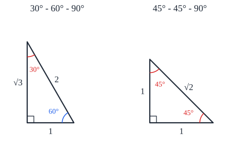

| ‏$\alpha$ | ‏$0°$ | ‏$30° = \frac{\pi}{6}$ | ‏$45° = \frac{\pi}{4}$ | ‏$60° = \frac{\pi}{3}$ | ‏$90° = \frac{\pi}{2}$ |
|---|---|---|---|---|---|
| ‏$\sin\alpha$ | ‏$0$ | ‏$\frac{1}{2}$ | ‏$\frac{\sqrt{2}}{2}$ | ‏$\frac{\sqrt{3}}{2}$ | ‏$1$ |
| ‏$\cos\alpha$ | ‏$1$ | ‏$\frac{\sqrt{3}}{2}$ | ‏$\frac{\sqrt{2}}{2}$ | ‏$\frac{1}{2}$ | ‏$0$ |
| ‏$\tan\alpha$ | ‏$0$ | ‏$\frac{\sqrt{3}}{3}$ | ‏$1$ | ‏$\sqrt{3}$ | לא מוגדר |

**טריק לזכירה**: הסינוסים הם $\frac{\sqrt{0}}{2}, \frac{\sqrt{1}}{2}, \frac{\sqrt{2}}{2}, \frac{\sqrt{3}}{2}, \frac{\sqrt{4}}{2}$, והקוסינוסים - **באותו סדר הפוך**.

### תכונות

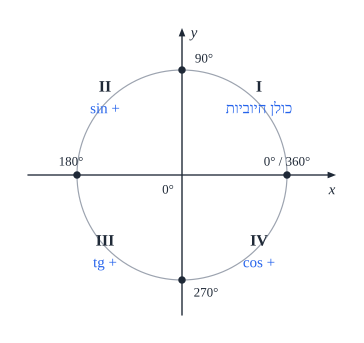

| | ‏$\sin$ | ‏$\cos$ | ‏$\tan$ |
|---|---|---|---|
| **מחזור** | ‏$360°$ ($2\pi$) | ‏$360°$ ($2\pi$) | ‏$180°$ ($\pi$) |
| **טווח** | ‏$[-1, 1]$ | ‏$[-1, 1]$ | כל המספרים |
| **זוגיות** | **אי-זוגית** | **זוגית** | **אי-זוגית** |
| **חיובית ברביעים** | ‏I, II | ‏I, IV | ‏I, III |

### זהויות

**הזהות היסודית**: $\sin^2\alpha + \cos^2\alpha = 1$ (פיתגורס במעגל היחידה).

| | |
|---|---|
| ‏$\sin(90° - \alpha) = \cos\alpha$ | ‏$\cos(90° - \alpha) = \sin\alpha$ |
| ‏$\sin(180° - \alpha) = \sin\alpha$ | ‏$\cos(180° - \alpha) = -\cos\alpha$ |
| ‏$\sin(-\alpha) = -\sin\alpha$ | ‏$\cos(-\alpha) = \cos\alpha$ |
| ‏$\tan(180° - \alpha) = -\tan\alpha$ | ‏$\tan(-\alpha) = -\tan\alpha$ |
| ‏$1 + \tan^2\alpha = \frac{1}{\cos^2\alpha}$ | ‏$1 + \cot^2\alpha = \frac{1}{\sin^2\alpha}$ |

**סכום והפרש זוויות:**

$$\sin(\alpha \pm \beta) = \sin\alpha\cos\beta \pm \cos\alpha\sin\beta \qquad \cos(\alpha \pm \beta) = \cos\alpha\cos\beta \mp \sin\alpha\sin\beta$$

**זווית כפולה:**

$$\sin 2\alpha = 2\sin\alpha\cos\alpha \qquad \cos 2\alpha = \cos^2\alpha - \sin^2\alpha = 2\cos^2\alpha - 1 = 1 - 2\sin^2\alpha$$

**סכום למכפלה:**

- ‏$\sin\alpha + \sin\beta = 2\sin\frac{\alpha + \beta}{2}\cos\frac{\alpha - \beta}{2}$
- ‏$\sin\alpha - \sin\beta = 2\sin\frac{\alpha - \beta}{2}\cos\frac{\alpha + \beta}{2}$
- ‏$\cos\alpha + \cos\beta = 2\cos\frac{\alpha + \beta}{2}\cos\frac{\alpha - \beta}{2}$
- ‏$\cos\alpha - \cos\beta = -2\sin\frac{\alpha + \beta}{2}\sin\frac{\alpha - \beta}{2}$

**שימושיות - אבל צריך להוכיח** אם משתמשים בהן:

- ‏$\sin(90° + \alpha) = \cos\alpha$, $\cos(90° + \alpha) = -\sin\alpha$.
- ‏$\cos^4\alpha - \sin^4\alpha = (\cos^2\alpha + \sin^2\alpha)(\cos^2\alpha - \sin^2\alpha) = \cos 2\alpha$.

**איך מוכיחים זהות?** פועלים על **אגף אחד** (רצוי **המסובך**) עד שמגיעים לשני; או על **שני האגפים** עד לפסוק אמת.

### בכל משולש

**משפט הסינוסים** ($R$ - רדיוס המעגל החוסם):

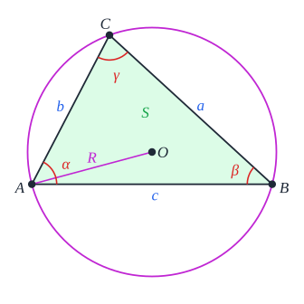

$$\frac{a}{\sin\alpha} = \frac{b}{\sin\beta} = \frac{c}{\sin\gamma} = 2R$$

**משפט הקוסינוסים** (פיתגורס מוכלל):

$$c^2 = a^2 + b^2 - 2ab\cos\gamma$$

**מתי מה?**

| נתון | משתמשים ב- |
|---|---|
| **צלע והזווית שמולה** (+ עוד צלע או זווית) | **סינוסים** |
| **שלוש צלעות**, או **שתי צלעות והזווית שביניהן** | **קוסינוסים** |
| **משולש ישר זווית** | עדיף **הגדרות** ו**פיתגורס** |

**זהירות במשפט הסינוסים**: $\sin\alpha = \sin(180° - \alpha)$ - כשמחפשים **זווית**, ייתכנו **שני פתרונות** (חדה וקהה). בודקים אם שניהם אפשריים.

### שטחים

| צורה | נוסחה |
|---|---|
| **משולש** - שתי צלעות והזווית ביניהן | ‏$S = \frac{1}{2}ab\sin\gamma$ |
| **משולש** - לפי $R$ | ‏$S = 2R^2\sin\alpha\sin\beta\sin\gamma$ |
| **משולש** - צלע והזוויות | ‏$S = \frac{a^2\sin\beta\sin\gamma}{2\sin\alpha}$ |
| **מרובע** - האלכסונים והזווית ביניהם | ‏$S = \frac{1}{2}d_1d_2\sin\alpha$ |
| **מקבילית** (**צריך להוכיח** - שני משולשים חופפים) | ‏$S = ab\sin\alpha$ |

### רדיאנים

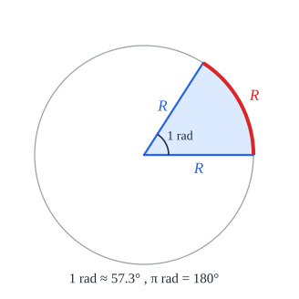

**רדיאן** - הזווית המרכזית שנשענת על **קשת באורך הרדיוס**. בכל המעגל יש $\frac{2\pi r}{r} = 2\pi$ רדיאנים:

$$180° = \pi \qquad x_{\text{rad}} = \frac{\pi}{180°}\alpha$$

### משוואות טריגונומטריות

**הפתרון הכללי** ($k$ - שלם כלשהו):

| משוואה | פתרון |
|---|---|
| ‏$\sin x = \sin\alpha$ | ‏$x = \alpha + 2\pi k$ **או** $x = \pi - \alpha + 2\pi k$ |
| ‏$\cos x = \cos\alpha$ | ‏$x = \pm\alpha + 2\pi k$ |
| ‏$\tan x = \tan\alpha$ | ‏$x = \alpha + \pi k$ |

**מקרים מיוחדים** (פתרון אחד במקום שניים):

| | פתרון | | פתרון |
|---|---|---|---|
| ‏$\sin x = 0$ | ‏$x = \pi k$ | ‏$\cos x = 0$ | ‏$x = \frac{\pi}{2} + \pi k$ |
| ‏$\sin x = 1$ | ‏$x = \frac{\pi}{2} + 2\pi k$ | ‏$\cos x = 1$ | ‏$x = 2\pi k$ |
| ‏$\sin x = -1$ | ‏$x = -\frac{\pi}{2} + 2\pi k$ | ‏$\cos x = -1$ | ‏$x = \pi + 2\pi k$ |
| ‏$\tan x = 0$ | ‏$x = \pi k$ | | |

**טיפים:**

- **מוציאים גורם משותף** - **לא מחלקים** (מאבדים פתרונות): $\sin x\cos x = \sin x \Rightarrow \sin x(\cos x - 1) = 0$.
- ‏**$\sin x = \pm\cos x$** - **מותר** לחלק ב-$\cos x$ (אם $\cos x = 0$ גם $\sin x = 0$ - בלתי אפשרי). מקבלים $\tan x = \pm 1$.
- ‏**$\sin x \pm \cos x = a$** - אפשר להעלות בריבוע, אבל אז **חובה לבדוק** את הפתרונות במשוואה המקורית.
- **זוויות שונות** ($2x$ ו-$x$) - בדרך כלל **יורדים לזווית הקטנה** בעזרת זהויות של זווית כפולה.
- **בחדו"א** - התשובה **ברדיאנים**, ו**בתחום** הנתון (הפונקציות מחזוריות). כשיש $x$ גם מחוץ לטריגו (כמו $x^2$) - **חייבים** רדיאנים. **להחזיר את המחשבון למעלות** אחר כך!

### הנפשה: מעגל היחידה

הזווית קובעת נקודה על מעגל היחידה: הקואורדינטה האופקית היא הקוסינוס והאנכית היא הסינוס.

<bl-unit-circle></bl-unit-circle>

### הנפשה: משפט הסינוסים ושטח משולש

גררו את קודקודי המשולש: היחס בין צלע לסינוס הזווית שמולה תמיד שווה לקוטר המעגל החוסם (2R).

<bl-triangle></bl-triangle>

### שאלות לחזרה

- מה $\sin 150°$? $\cos 120°$? $\tan 225°$?
- במשולש $a = 7$, $b = 5$, $\gamma = 60°$. מצא את $c$ ואת השטח.
- למה משפט הסינוסים עלול לתת שתי זוויות?
- פתור $2\sin^2 x = \sin x$ בתחום $[0, 2\pi]$.
- המר $135°$ לרדיאנים, ו-$\frac{5\pi}{6}$ למעלות.
