# חשבון דיפרנציאלי ואינטגרלי

## פונקציות, ישרים ופרבולות

### מהי פונקציה?

**פונקציה** - כלל שמתאים **לכל** $x$ (מתחום ההגדרה) **ערך אחד ויחיד** $y$. (לשני $x$-ים שונים **מותר** אותו $y$; ל-$x$ אחד **אסור** שני $y$-ים.)

**דרכים להציג**: נוסחה, טבלה, דיאגרמת חצים, **גרף** - אוסף כל הנקודות $(x, f(x))$.

**קריאת גרף:**

- **חיובית / שלילית** - הגרף **מעל / מתחת** לציר $x$.
- **עולה / יורדת** - קוראים **משמאל לימין**: האם ה-$y$ גדל או קטן.
- **המרחק של נקודה מציר** - הערך של **השיעור השני**: מרחק $(3, -5)$ מציר $x$ הוא 5.
- **מרחק בין נקודות**: $d = \sqrt{(x_2 - x_1)^2 + (y_2 - y_1)^2}$.

**טבלת סימנים** ("**שיטת הנחש**"): פותרים $f(x) = 0$; בודקים את **הסימן** בין כל שני פתרונות (מציבים נקודה); משרטטים.

### הישר

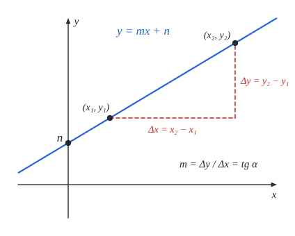

**המשוואה המפורשת**: $y = mx + n$. **$m$** - **השיפוע**; **$n$** - נקודת החיתוך עם **ציר $y$**.

- ‏$m > 0$ - **עולה**; $m < 0$ - **יורד**; $m = 0$ - **מקביל לציר $x$**; ישר **אנכי** ($x = k$) - שיפוע **לא מוגדר**.
- **שיפוע משתי נקודות**: $m = \frac{y_2 - y_1}{x_2 - x_1}$.
- **ישר דרך נקודה ושיפוע**: $y - y_1 = m(x - x_1)$.
- **זווית עם הכיוון החיובי של ציר $x$**: $m = \tan\alpha$.

**שני ישרים:**

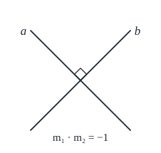

- **מקבילים** - **שיפועים שווים**.
- **מאונכים** - $m_1 \cdot m_2 = -1$.
- **מצב הדדי**: **נחתכים** (פתרון אחד), **מקבילים** (אין פתרון), **מתלכדים** (אינסוף).
- **שטח משולש במערכת צירים** - בוחרים צלע **מקבילה לציר** (או על הציר), כך שקל לחשב את הגובה אליה.

### הפרבולה

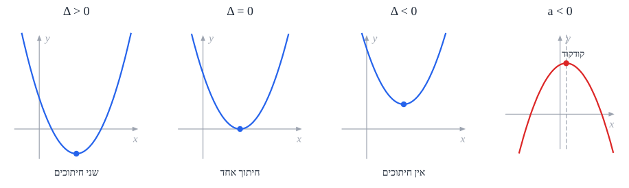

**צורות:** $y = ax^2 + bx + c$ ($a \neq 0$), או **צורת קודקוד** $y = a(x - p)^2 + k$.

- ‏**$a > 0$** - "**מחייכת**" (∪), יש **מינימום**. **$a < 0$** - "**עצובה**" (∩), יש **מקסימום**. $|a|$ גדול - פרבולה **צרה**.
- **הקודקוד**: $x = -\frac{b}{2a}$ (ואת ה-$y$ מקבלים בהצבה). בצורת קודקוד - $(p, k)$.
- **ציר הסימטריה** - הישר $x = -\frac{b}{2a}$.
- ‏**$c$** - נקודת החיתוך עם **ציר $y$**.
- **חיתוך עם ציר $x$** - לפי $\Delta = b^2 - 4ac$: **חותכת** ($\Delta > 0$, שתי נקודות), **משיקה** ($\Delta = 0$, אחת), "**מרחפת**" ($\Delta < 0$, אין).
- **הזזות**: $p$ מזיז **אופקית**, $k$ **אנכית**.

**ישר ופרבולה** - משווים ופותרים משוואה ריבועית: **נחתכים** (2 נקודות), **משיק** (1), **זרים** (0).

### פונקציות בסיסיות

כדאי להכיר את **הצורה** של כל אחת - בלי לחשב:

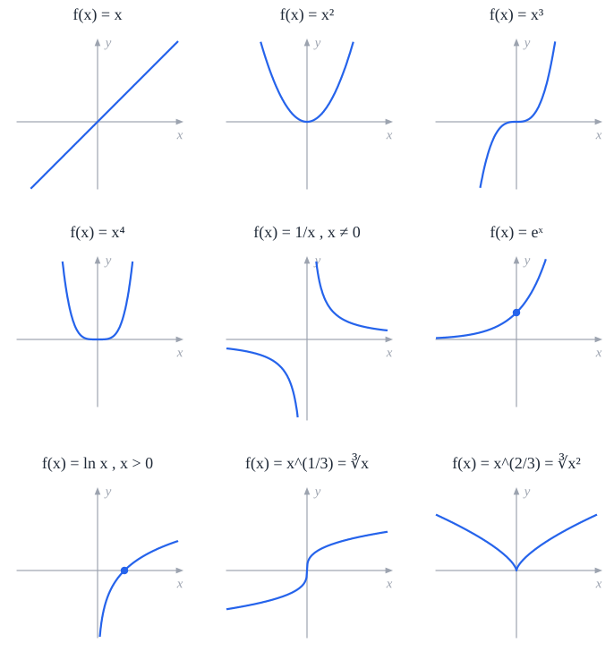

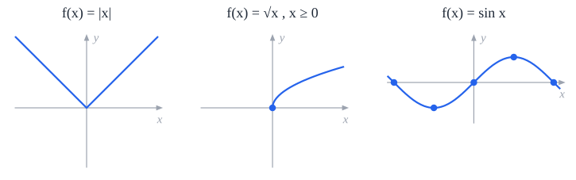 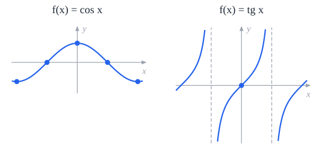

### הזזות ושינויים בגרף

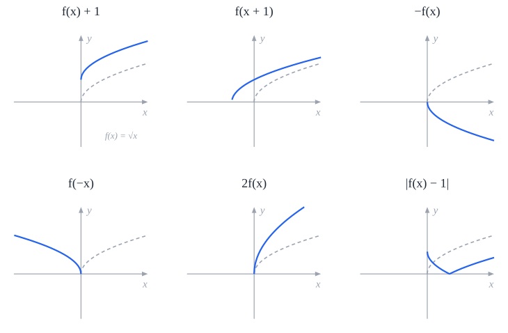

| פונקציה חדשה | מה קורה לגרף של $f$ |
|---|---|
| ‏$f(x) + k$ | **הזזה אנכית** ב-$k$ (למעלה אם $k > 0$) |
| ‏$f(x + k)$ | **הזזה אופקית** ב-$k$ - **שמאלה** אם $k > 0$! |
| ‏$k \cdot f(x)$ | **מתיחה** אנכית (ערכי $y$ מוכפלים ב-$k$) |
| ‏$-f(x)$ | **שיקוף** על ציר $x$ |
| ‏$f(-x)$ | **שיקוף** על ציר $y$ |
| ‏$\lvert f(x)\rvert$ | החלקים **השליליים** מתהפכים למעלה |
| ‏$\sqrt{f(x)}$ | מוגדרת רק כש-$f(x) \ge 0$, וכולה **אי-שלילית** |

### הנפשה: פרבולה

שנו את המקדמים a, b, c וראו איך הפרבולה זזה ומשנה צורה.

<bl-function-graph preset="parabola"></bl-function-graph>

### שאלות לחזרה

- מצא את משוואת הישר דרך $(1, 2)$ ו-$(3, 8)$, ואת הישר המאונך לו דרך הראשית.
- מצא את קודקוד הפרבולה $y = 2x^2 - 8x + 3$. האם יש לה מינימום או מקסימום?
- איך נראה הגרף של $(x - 3)^2 + 1$ לעומת $x^2$?
- עבור אילו $c$ הישר $y = 2x + c$ משיק לפרבולה $y = x^2$?

## נגזרות ומשיקים

### מה זו נגזרת?

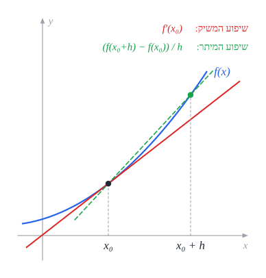

- **שיפוע של ישר** - קבוע. **שיפוע של עקומה** - **משתנה** מנקודה לנקודה.
- **המשיק** בנקודה - הישר ש"נוגע" בעקומה ו**הולך בכיוון שלה** באותה נקודה.
- **הנגזרת** $f'(x_0)$ - **שיפוע המשיק** בנקודה $x_0$. כלומר: **קצב השינוי** של הפונקציה ברגע מסוים.

**איך מוצאים את שיפוע המשיק?** לוקחים **מיתר** (ישר דרך שתי נקודות על הגרף) ומקרבים את הנקודה השנייה לראשונה. השיפוע של המיתר **שואף** לשיפוע המשיק - זה **הגבול**:

$$f'(x) = \lim_{h \to 0}\frac{f(x + h) - f(x)}{h}$$

**גבול** - הערך שהביטוי **מתקרב** אליו ככל ש-$h$ קטן, גם אם ב-$h = 0$ עצמו אי אפשר להציב.

**דוגמה**: $f(x) = x^2$: $\frac{(x + h)^2 - x^2}{h} = \frac{2xh + h^2}{h} = 2x + h \to 2x$. כלומר $f'(x) = 2x$.

### נגזרות בסיסיות

| פונקציה | נגזרת |
|---|---|
| ‏$c$ (קבוע) | ‏$0$ |
| ‏$x^n$ | ‏$nx^{n-1}$ |
| ‏$\sqrt{x}$ | ‏$\frac{1}{2\sqrt{x}}$ |
| ‏$\frac{1}{x}$ | ‏$-\frac{1}{x^2}$ |
| ‏$\sin x$ | ‏$\cos x$ |
| ‏$\cos x$ | ‏$-\sin x$ |
| ‏$\tan x$ | ‏$\frac{1}{\cos^2 x}$ |

(ובשאלון 582: [מעריכיות ולוגריתמים](../582/06-calculus.md).)

### חוקי גזירה

| חוק | נוסחה |
|---|---|
| **כפל בקבוע** | ‏$(kf)' = kf'$ |
| **סכום** | ‏$(f + g)' = f' + g'$ |
| **מכפלה** | ‏$(fg)' = f'g + fg'$ |
| **מנה** | ‏$\left(\frac{f}{g}\right)' = \frac{f'g - fg'}{g^2}$ |
| **פונקציה מורכבת** ("שרשרת") | ‏$[f(u(x))]' = f'(u) \cdot u'(x)$ |

**פונקציה מורכבת** - גוזרים את **החיצונית** (משאירים את הפנימית כמו שהיא) ו**כופלים בנגזרת הפנימית**:

- ‏$\left[(3x + 1)^5\right]' = 5(3x + 1)^4 \cdot 3$.
- ‏$\left[\sin(x^2)\right]' = \cos(x^2) \cdot 2x$.
- ‏$\left[\sqrt{1 - x^2}\right]' = \frac{1}{2\sqrt{1 - x^2}} \cdot (-2x)$.

**טיפ**: לפני שגוזרים **מנה פעמיים** - כדאי **לצמצם**. (אבל זהירות עם שורשים - הצמצום עלול לשנות את **תחום ההגדרה**.)

**עבדו לאט!** טעות בגזירה **גוררת** את כל המשך החקירה.

### משוואת משיק

**משיק בנקודה $(x_0, f(x_0))$:**

1. **השיפוע**: $m = f'(x_0)$.
2. **הישר**: $y - f(x_0) = m(x - x_0)$.

**תנאי השקה** - ישר $y = mx + n$ **משיק** לגרף ב-$x_0$ אם **שני** התנאים מתקיימים:

- **עובר בנקודה**: $f(x_0) = mx_0 + n$.
- **אותו שיפוע**: $f'(x_0) = m$.

(שתי משוואות - שימושי כשיש **פרמטרים** למצוא.)

**נורמל** - הישר **המאונך** למשיק באותה נקודה: שיפועו $-\frac{1}{f'(x_0)}$.

#### משיק מנקודה שאינה על הגרף

1. מסמנים את **נקודת ההשקה** (הלא ידועה) $(t, f(t))$.
2. **השיפוע לפי הנגזרת**: $f'(t)$.
3. **השיפוע לפי שתי נקודות** - נקודת ההשקה והנקודה הנתונה.
4. **משווים** ופותרים את $t$ (בדרך כלל **שני** פתרונות - שני משיקים).
5. משוואת הישר לכל $t$.

**המרחק הקצר ביותר בין גרף לישר** - בנקודה שבה **המשיק מקביל לישר** ($f'(x) = m$).

### הנפשה: משיק ושיפוע

הזיזו את נקודת ההשקה: שיפוע המשיק בנקודה הוא ערך הנגזרת בה.

<bl-function-graph preset="tangent"></bl-function-graph>

### שאלות לחזרה

- גזור: $\frac{x^2 + 1}{x - 1}$, $x\sin x$, $\sqrt{x^2 + 3}$, $\cos^2(2x)$.
- מצא את משוואת המשיק ל-$y = x^3$ בנקודה $x = 1$.
- מהם שני תנאי ההשקה?
- מצא את המשיקים ל-$y = x^2$ שעוברים בנקודה $(0, -1)$.

## חקירת פונקציה

**חקירה** - מגלים את כל התכונות של פונקציה, ובסוף משרטטים אותה. **הסדר**:

1. **תחום הגדרה** - **תמיד מתחילים כאן**.
2. **נקודות אי-הגדרה** ו**אסימפטוטות**.
3. **חיתוך עם הצירים**.
4. **נקודות קיצון** ו**תחומי עלייה וירידה**.
5. **נקודות פיתול** ו**תחומי קעירות** (כשמבקשים).
6. **שרטוט**.

**עבדו לאט** בתחום ההגדרה ובגזירה - טעות כאן **גוררת** את כל השאר.

### תחום הגדרה

- בדרך כלל - **כל $x$**.
- **שבר**: $\frac{f(x)}{g(x)}$ - **המכנה** $g(x) \neq 0$.
- **שורש** (זוגי): $\sqrt{f(x)}$ - **מה שבתוכו** $f(x) \ge 0$.
- **סימון קטעים**: סוגר **מרובע** - **כולל**; **עגול** - **לא כולל**. $[a, b) \iff a \le x < b$.

### נקודת אי-הגדרה ("חור")

כשאותו גורם **מצטמצם** מהמונה ומהמכנה - הפונקציה מתנהגת **בדיוק כמו אחרי הצמצום**, **חוץ מנקודה אחת** שבה היא **לא מוגדרת** (חילוק ב-0). בגרף - **עיגול ריק**.

**דוגמה**: $f(x) = \frac{x^2 - 1}{x - 1} = x + 1$, אבל **ללא** $x = 1$ - חור בנקודה $(1, 2)$.

### אסימפטוטות

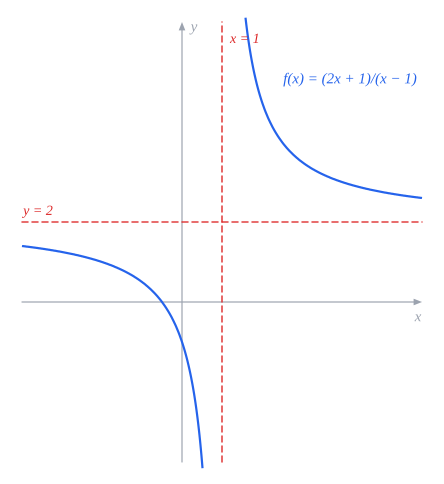

**אסימפטוטה אנכית** $x = k$ - כש-$x$ מתקרב ל-$k$, הפונקציה **שואפת ל-$\pm\infty$**.

- **איך מוצאים**: ערך ש**מאפס את המכנה** ו**לא מאפס את המונה**. (אם מאפס גם את המונה - זה **חור**, לא אסימפטוטה.)
- הגרף **לעולם לא חוצה** אסימפטוטה אנכית.
- כדאי לבדוק **משני הצדדים** (מציבים ערכים קרובים) - לאן הפונקציה הולכת: $+\infty$ או $-\infty$.

**אסימפטוטה אופקית** $y = k$ - כש-$x \to \pm\infty$, הפונקציה **מתקרבת** ל-$k$.

- **בפונקציה רציונלית** - משווים את **החזקות הגבוהות**:
  - **המכנה חזק יותר** - $y = 0$.
  - **שוות** - $y$ שווה ל**יחס המקדמים** של החזקות הגבוהות: $\frac{2x^2 + 1}{x^2 - 3} \to y = 2$.
  - **המונה חזק יותר** - **אין** אסימפטוטה אופקית.
- **עם שורשים** - בודקים **בנפרד** את $+\infty$ ואת $-\infty$ (התוצאות עלולות להיות שונות). מחלקים מונה ומכנה בחזקה הגבוהה.
- הגרף **יכול** לחצות אסימפטוטה אופקית (רק לא "בקצוות").

### חיתוך עם הצירים

- **ציר $y$**: מציבים $x = 0$ (אם $0$ בתחום).
- **ציר $x$**: פותרים $f(x) = 0$ (בשבר - **המונה** מתאפס, והמכנה לא).

### נקודות קיצון

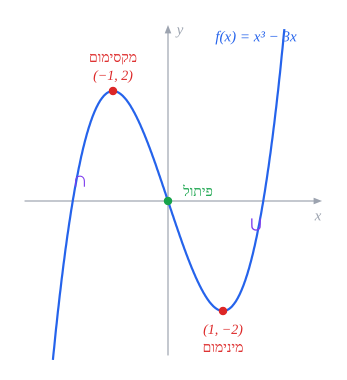

- **קיצון פנימי** - נקודה שבה **הנגזרת מתאפסת ומחליפה סימן**. (אם הנגזרת מתאפסת **בלי** להחליף סימן - **אין** קיצון, כמו $x^3$ ב-0.)
- **קיצון קצה** - בקצה של **תחום סגור** (בתחום חקירה, בפונקציית שורש).
- **קיצון מוחלט** - הנקודה **הכי גבוהה / נמוכה** בכל התחום.

**הוכחת סוג הקיצון** - אחת מהדרכים:

1. **טבלת ערכים** - מציבים בנגזרת ערכים **משני הצדדים**: מ-$+$ ל-$-$ - **מקסימום**; מ-$-$ ל-$+$ - **מינימום**.
2. **נגזרת שנייה** בנקודה: $f'' > 0$ - **מינימום** (∪); $f'' < 0$ - **מקסימום** (∩); $f'' = 0$ - **לא ידוע**, צריך טבלה.

**תחומי עלייה וירידה** - בין נקודות הקיצון (ונקודות אי-ההגדרה): $f' > 0$ - **עולה**; $f' < 0$ - **יורדת**.

### נקודות פיתול וקעירות

- **קעורה כלפי מעלה** (∪) - שיפועי המשיקים **עולים** - $f'' > 0$.
- **קעורה כלפי מטה** (∩) - שיפועי המשיקים **יורדים** - $f'' < 0$.
- **נקודת פיתול** - הקעירות **מתחלפת**: $f''$ **מתאפסת ומחליפה סימן**.
- **בין שתי נקודות קיצון רצופות** (בפונקציה רציפה וגזירה) - יש **נקודת פיתול**.
- **מציאת פרמטרים** מנקודה נתונה - **שתי משוואות**: הצבה **בפונקציה** והצבה **בנגזרת** (המתאימה).

### שרטוט

- מסמנים את **כל** הנקודות והאסימפטוטות.
- מחברים לפי **העלייה והירידה** (והקעירות).
- כותבים ליד כל נקודה **מה היא** (מקסימום, מינימום, פיתול) ואת **שיעוריה**.
- משרטטים **רק בתחום ההגדרה**.

### פונקציה זוגית ואי-זוגית

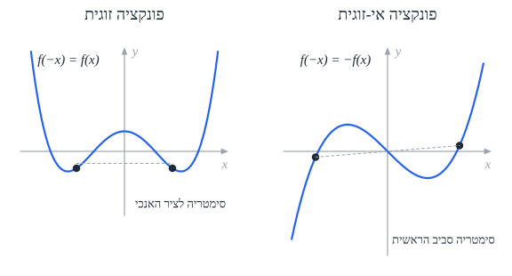

| | **זוגית** | **אי-זוגית** |
|---|---|---|
| **התנאי** | ‏$f(-x) = f(x)$ | ‏$f(-x) = -f(x)$ |
| **סימטריה** | ביחס ל**ציר $y$** | ביחס ל**ראשית** |
| **ב-$x = 0$** (אם גזירה) | **נקודת קיצון** | **עוברת בראשית** (ולרוב נקודת פיתול) |
| **דוגמאות** | ‏$x^2$, $\cos x$, $\lvert x\rvert$ | ‏$x^3$, $\sin x$, $\frac{1}{x}$ |

**שימושי**: מספיק לחקור את **צד אחד**, ולהשלים בסימטריה.

### הקשר בין גרף הפונקציה לגרף הנגזרת

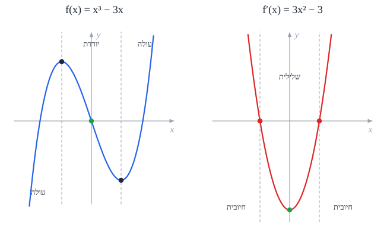

| ‏$f(x)$ | ‏$f'(x)$ | ‏$f''(x)$ |
|---|---|---|
| **עולה** | **חיובית** (מעל ציר $x$) | |
| **יורדת** | **שלילית** | |
| **קיצון** | **חותכת** את ציר $x$ (ומחליפה סימן) | |
| **קעורה ∪** | **עולה** | **חיובית** |
| **קעורה ∩** | **יורדת** | **שלילית** |
| **פיתול** | **קיצון** | **חותכת** את ציר $x$ |

**השאלה הנפוצה**: נותנים את **גרף הנגזרת** ושואלים על **הפונקציה**. **לא להתבלבל**: קיצון של $f$ - איפה ש**$f'$ חותכת** את הציר; **לא** איפה שיש לה קיצון.

### שאלות לחזרה

- מצא תחום הגדרה ואסימפטוטות של $f(x) = \frac{x^2}{x^2 - 4}$.
- מה ההבדל בין חור לאסימפטוטה אנכית?
- מצא את נקודות הקיצון של $f(x) = x^3 - 3x$ והוכח את סוגן.
- נתון גרף $f'$ שחותך את ציר $x$ ב-$x = 2$ מלמטה למעלה. מה יש ל-$f$ ב-$x = 2$?

## בעיות קיצון

**בעיית קיצון** - מוצאים את **הגדול ביותר** או **הקטן ביותר** (שטח, נפח, מרחק, רווח) בעזרת נגזרת.

1. **בונים פונקציה** - **השלב העיקרי**: מבטאים את מה שרוצים למקסם/למזער **בעזרת משתנה אחד**. (אם יש שני משתנים - מבטאים אחד בעזרת השני מהנתונים.)
2. קובעים **תחום** למשתנה (אורך חיובי וכו').
3. **גוזרים**, משווים ל-0.
4. **מוכיחים את סוג הקיצון** - **חובה!**
5. בודקים גם את **קצוות התחום** - הקיצון יכול להיות שם.
6. **עונים על מה ששאלו** (לפעמים שואלים על האורך, ולפעמים על השטח המקסימלי עצמו).

**דוגמה**: מכל המלבנים שהיקפם 20, לאיזה השטח הגדול ביותר? צלע $x$, השנייה $10 - x$. $S(x) = x(10 - x) = 10x - x^2$, $0 < x < 10$. $S' = 10 - 2x = 0 \Rightarrow x = 5$. $S'' = -2 < 0$ - **מקסימום**. **ריבוע** בצלע 5, ושטחו 25.

**סוגים**: מספרים, נקודות על גרפים (מרחק), כלכלה, **שטחים** ו**נפחים** (ראו [אינטגרלים](#אינטגרלים)), וגופים במרחב.

### גופים במרחב

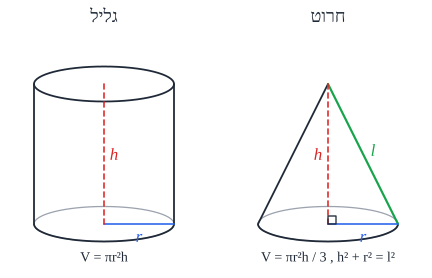

| גוף | נפח | הערות |
|---|---|---|
| **תיבה** | ‏$V = abc$ | **קובייה**: $a^3$ |
| **מנסרה** (ישרה) | ‏$V = S_{\text{base}} \cdot h$ | בסיס מצולע, מעטפת מלבנים |
| **פירמידה** (ישרה) | ‏$V = \frac{1}{3}S_{\text{base}} \cdot h$ | הגובה יורד ל**מרכז המעגל החוסם** את הבסיס; כל המקצועות הצדדיים **שווים** |
| **גליל** | ‏$V = \pi r^2 h$ | **חתך צירי** - מלבן $2r \times h$ |
| **חרוט** | ‏$V = \frac{1}{3}\pi r^2 h$ | **מעטפת**: $\pi r l$; ו-$h^2 + r^2 = l^2$ ($l$ - **קו יוצר**) |

### הנפשה: קופסה מגיליון

חותכים ריבוע בצלע x מכל פינה של גיליון ומקפלים לקופסה. איזה x נותן נפח מרבי? הנקודה שבה V'(x) = 0.

<bl-box-optimization></bl-box-optimization>

## אינטגרלים

### האינטגרל הלא מסוים

**אינטגרציה** - **הפעולה ההפוכה לגזירה**. **פונקציה קדומה** $F$ של $f$ - פונקציה שנגזרתה $f$: $F' = f$.

$$\int f(x)\,dx = F(x) + C$$

- ‏**$C$ - קבוע האינטגרציה**: בגזירה קבועים **נעלמים**, ולכן יש **משפחה** של פונקציות קדומות.
- **תמיד אפשר לבדוק** אינטגרל - **גוזרים** את התשובה.
- **אינטגרל "מיידי"** - מנחשים לפי היכרות עם נגזרות, ו**מוכיחים בגזירה**.

**אינטגרלים בסיסיים:**

| פונקציה | אינטגרל |
|---|---|
| ‏$x^n$ ($n \neq -1$) | ‏$\frac{x^{n+1}}{n + 1} + C$ |
| ‏$\frac{1}{x^n} = x^{-n}$ ($n \neq 1$) | ‏$\frac{x^{1-n}}{1 - n} + C$ |
| ‏$\frac{1}{2\sqrt{x}}$ | ‏$\sqrt{x} + C$ |
| ‏$\sin x$ | ‏$-\cos x + C$ |
| ‏$\cos x$ | ‏$\sin x + C$ |
| ‏$\frac{1}{\cos^2 x}$ | ‏$\tan x + C$ |

**חוקים:**

- ‏$\int kf\,dx = k\int f\,dx$; $\int(f + g)\,dx = \int f\,dx + \int g\,dx$.
- **פונקציה פנימית לינארית**: $\int f(mx + b)\,dx = \frac{1}{m}F(mx + b) + C$. למשל $\int\cos 3x\,dx = \frac{1}{3}\sin 3x + C$.
- ‏$\int f(u(x))\,u'(x)\,dx = F(u(x)) + C$ - **נגזרת הפנימית כבר "מוכנה"** בפנים.
- ‏**$\sin^2 x$ ו-$\cos^2 x$** - מורידים חזקה בעזרת הזווית הכפולה: $\sin^2 x = \frac{1 - \cos 2x}{2}$, $\cos^2 x = \frac{1 + \cos 2x}{2}$.
- **שבר של פולינומים** (מונה ממעלה גבוהה או שווה) - **חילוק ארוך** של פולינומים, ואת השארית מחלקים במכנה.

### שיטת ההצבה

1. מסמנים ב-$u$ את **הביטוי המסובך** (בלי החזקה שלו).
2. גוזרים: $du = u'\,dx$, ומבודדים את $dx$.
3. מציבים - הכול צריך להיות **רק ב-$u$**.
4. מחשבים את האינטגרל.
5. מחזירים את $u$ לביטוי ב-$x$.

**דוגמה**: $\int x(x^2 + 1)^5\,dx$. $u = x^2 + 1$, $du = 2x\,dx$: $\int u^5\frac{du}{2} = \frac{u^6}{12} = \frac{(x^2 + 1)^6}{12} + C$.

(**חובה להראות** את החישוב.)

### האינטגרל המסוים ושטחים

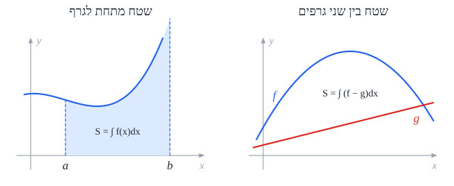

$$\int_a^b f(x)\,dx = F(b) - F(a)$$

- ‏**$C$ מצטמצם** - לא כותבים אותו.
- **שטח מתחת לגרף** (בין הגרף לציר $x$), כשהגרף **מעל** הציר: $\int_a^b f\,dx$.
- **שטח בין שני גרפים**: $S = \int_a^b (f(x) - g(x))\,dx$ - **העליון פחות התחתון**.
- **השטח תמיד חיובי**. אם יצא שלילי - הפכתם עליון ותחתון.
- **הגרפים מתחלפים** (נחתכים באמצע)? מפצלים ל**כמה אינטגרלים**, ובכל אחד - העליון פחות התחתון.
- **שטח מסובך** - משרטטים, מסמנים את **כל** הגבולות ונקודות החיתוך, ומפרקים לחלקים.

### נפח גוף סיבוב

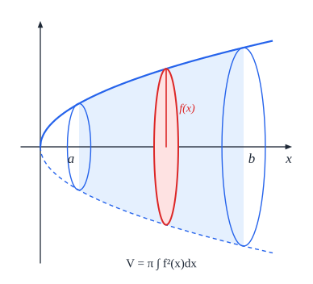

כשמסובבים שטח **סביב ציר $x$**:

$$V = \pi\int_a^b \left(f^2(x) - g^2(x)\right)dx$$

- ‏$f$ - הפונקציה **החיצונית** (הרחוקה מהציר), $g$ - **הפנימית**. **מעלים כל אחת בריבוע, ורק אז מחסרים** - **לא** $(f - g)^2$!
- שטח בין גרף לציר: $V = \pi\int_a^b f^2\,dx$.
- גם כאן הפונקציות צריכות להישאר **באותו תפקיד** בכל התחום.
- כותבים את **הנוסחה המלאה** בתשובה.

### הנפשה: סכומי רימן

ככל שיש יותר מלבנים, הסכום מתקרב לשטח שמתחת לגרף.

<bl-riemann></bl-riemann>

### שאלות לחזרה

- חשב: $\int(3x^2 - \frac{1}{x^2})\,dx$, $\int\sin 2x\,dx$, $\int\cos^2 x\,dx$.
- מצא את השטח בין $y = x^2$ ל-$y = x$.
- מה הנפח הנוצר מסיבוב השטח שמתחת ל-$y = \sqrt{x}$ בין 0 ל-4 סביב ציר $x$?
- למה בנפח מעלים בריבוע כל פונקציה בנפרד?
