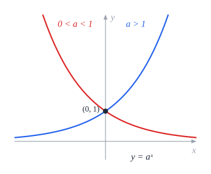
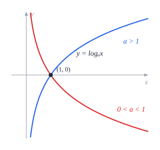
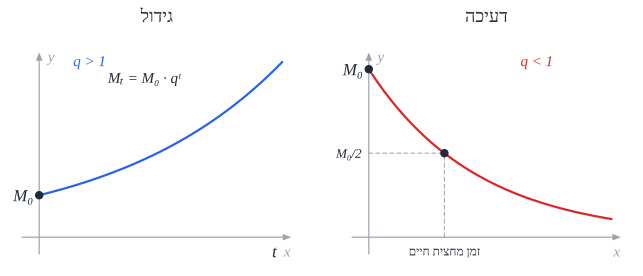

# חזקות, מעריכיות ולוגריתמים

## חזקה עם מעריך רציונלי

שורש הוא חזקה **שברית**: **מעריך החזקה במונה**, **סדר השורש במכנה**.

$$\sqrt[n]{a^m} = a^{\frac{m}{n}} \qquad \text{למשל}\quad \sqrt{x} = x^{\frac{1}{2}},\quad \frac{1}{\sqrt[3]{x^2}} = x^{-\frac{2}{3}}$$

כך כל [חוקי החזקות](../581/01-algebra.md) עובדים גם על שורשים - ונוח לגזור ולבצע אינטגרציה.

## הפונקציה המעריכית

‏$y = a^x$, עם **בסיס חיובי** $a > 0$ ($a \neq 1$).

- **תמיד חיובית**, ועוברת ב-$(0, 1)$.
- ‏$a > 1$ - **עולה**; $0 < a < 1$ - **יורדת**.
- **אסימפטוטה אופקית** $y = 0$ (בצד אחד).
- ‏**$e \approx 2.718$** - בסיס "טבעי", שימושי מאוד בחדו"א.

**משוואות**: $a^x = a^y \iff x = y$ - מביאים את שני האגפים **לאותו בסיס**. למשל $4^x = 8 \Rightarrow 2^{2x} = 2^3 \Rightarrow x = \frac{3}{2}$.

**אי-שוויונים**: $a^x < a^y$ -

- אם $a > 1$: $x < y$ (הכיוון **נשמר**).
- אם $0 < a < 1$: $x > y$ (הכיוון **מתהפך**).

**טריק ה-$t$**: $4^x - 3 \cdot 2^x - 4 = 0$ - מסמנים $t = 2^x$ (ואז $4^x = t^2$), פותרים, ו**זוכרים ש-$t > 0$**.

## לוגריתמים

**לוגריתם** - **החזקה** שצריך להעלות בה את הבסיס כדי לקבל את המספר:

$$\log_a x = b \iff a^b = x \qquad (a > 0,\ a \neq 1,\ x > 0)$$

למשל $\log_2 8 = 3$ כי $2^3 = 8$.

- **בלי בסיס** - בסיס **10**: $\log 100 = 2$.
- ‏**$\ln x = \log_e x$** - הלוגריתם **הטבעי**.
- **תחום הגדרה**: מה שבתוך הלוג **חיובי**.

‏$y = \log_a x$ היא **הפונקציה ההפוכה** ל-$a^x$ (שיקוף לפי $y = x$): מוגדרת רק ל-$x > 0$, עוברת ב-$(1, 0)$, ויש לה **אסימפטוטה אנכית** $x = 0$.

### חוקי לוגריתמים

| חוק | |
|---|---|
| **מכפלה** | ‏$\log_a(xy) = \log_a x + \log_a y$ |
| **מנה** | ‏$\log_a\frac{x}{y} = \log_a x - \log_a y$ |
| **חזקה** | ‏$\log_a x^n = n\log_a x$ |
| **החלפת בסיס** | ‏$\log_a b = \frac{\log_c b}{\log_c a}$; ולכן $\log_a b \cdot \log_b a = 1$ |
| **ביטול** | ‏$\log_a a^x = x$; $a^{\log_a x} = x$ |
| **ערכים** | ‏$\log_a a = 1$; $\log_a 1 = 0$ |
| **בסיס בחזקה** (צריך להוכיח) | ‏$\log_{a^n} x = \frac{1}{n}\log_a x$ |

**זהירות:**

- **חזקה זוגית** - צריך **ערך מוחלט**: $\log x^2 = 2\log\lvert x\rvert$ (כי $x$ יכול להיות שלילי).
- החזקה צריכה להיות על **כל** הביטוי: $\log 2x^3 \neq 3\log 2x$.
- **אין** חוק ל-$\log(x + y)$.

**במחשבון** (לוג בבסיס 10 או $\ln$): $a^x = b \Rightarrow x = \frac{\log b}{\log a}$.

**משוואות**: $\log_a x = \log_a y \iff x = y$ - ו**בודקים תחום הגדרה**! **אי-שוויונים** - כמו במעריכית: $a > 1$ הכיוון נשמר, $0 < a < 1$ מתהפך.

## גידול ודעיכה

כמות שמשתנה **באותו אחוז** בכל יחידת זמן:

$$M_t = M_0 \cdot q^t \qquad q = 1 \pm \frac{p}{100}$$

| סימן | משמעות |
|---|---|
| ‏$M_0$ | הכמות **ההתחלתית** |
| ‏$M_t$ | הכמות **אחרי** $t$ יחידות זמן |
| ‏$p$ | **אחוז השינוי** ביחידת זמן |
| ‏$q$ | **קצב**: $q > 1$ - **גידול** (פלוס); $q < 1$ - **דעיכה** (מינוס) |

- **יחידות הזמן** - חייבות להתאים ל-$p$ (אחוז לשנה? $t$ בשנים).
- **מה היה לפני?** מציבים $t$ **שלילי**, או מסמנים את הכמות הנוכחית כ-$M_t$.
- **מציאת הזמן** - בעזרת **לוגריתמים**: $q^t = \frac{M_t}{M_0} \Rightarrow t = \frac{\log(M_t / M_0)}{\log q}$.
- **זמן מחצית חיים** - הזמן שבו הכמות **יורדת לחצי**: $q^t = \frac{1}{2}$.
- **עיגול** - לפעמים אין משמעות לתוצאה לא שלמה (אנשים, ימים שלמים) - לשים לב.

**דוגמה**: חומר דועך ב-10% בשנה. מתי יישאר חצי? $0.9^t = 0.5 \Rightarrow t = \frac{\log 0.5}{\log 0.9} \approx 6.58$ שנים.

## שאלות לחזרה

- פתור: $9^x = 27$, $\log_2(x + 1) + \log_2(x - 1) = 3$.
- למה $\log x^2 = 2\log\lvert x\rvert$ ולא $2\log x$?
- חשב $\log_4 32$ בעזרת החלפת בסיס.
- אוכלוסייה גדלה ב-3% בשנה. אחרי כמה שנים תוכפל?
