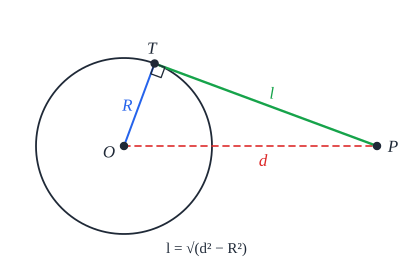
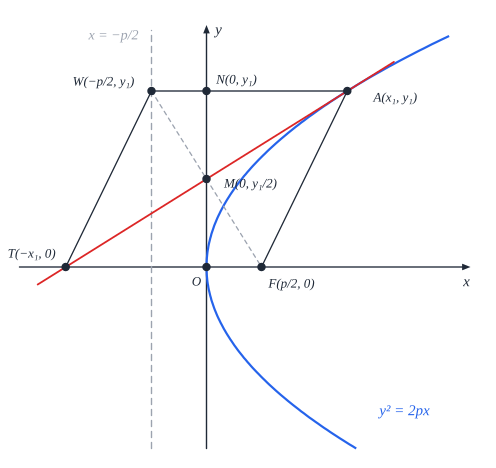
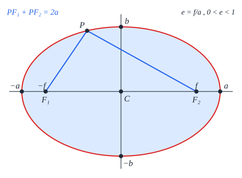

# גיאומטריה אנליטית

**הרעיון**: מתארים צורות גיאומטריות (ישרים, מעגלים, פרבולות) **במשוואות** - ופותרים בעיות גיאומטריות **באלגברה**.

## ישרים ונקודות

(ישר, שיפוע, ישרים מקבילים ומאונכים - ראו [שאלון 581](../581/04-calculus.md).)

- **המשוואה הכללית**: $ax + by + c = 0$ - מתארת **כל** ישר, גם **אנכי** (שאין לו $y = mx + n$).
- **מרחק בין נקודות**: $d = \sqrt{(x_2 - x_1)^2 + (y_2 - y_1)^2}$.
- **אמצע קטע**: $M\left(\frac{x_1 + x_2}{2}, \frac{y_1 + y_2}{2}\right)$.
- **חלוקת קטע ביחס נתון** - נקודה $C$ על $AB$ כך ש-$AC : CB = m : l$:
$$C\left(\frac{lx_A + mx_B}{l + m},\ \frac{ly_A + my_B}{l + m}\right)$$
- **מפגש התיכונים** (צריך להוכיח - אמצע צלע + חלוקה ביחס 2:1): $\left(\frac{x_1 + x_2 + x_3}{3}, \frac{y_1 + y_2 + y_3}{3}\right)$.
- **מפגש האלכסונים במקבילית** - **האמצע** של כל אלכסון.

**מרחקים:**

| | נוסחה |
|---|---|
| **נקודה מישר** | ‏$d = \frac{\lvert ax_0 + by_0 + c\rvert}{\sqrt{a^2 + b^2}}$ |
| **בין ישרים מקבילים** $ax + by + c_1 = 0$, $ax + by + c_2 = 0$ | ‏$d = \frac{\lvert c_1 - c_2\rvert}{\sqrt{a^2 + b^2}}$ (אותם $a, b$!) |

**הישר האמצעי** בין שני מקבילים (צריך להוכיח): $ax + by + \frac{c_1 + c_2}{2} = 0$.

## מעגל

$$(x - a)^2 + (y - b)^2 = R^2$$

- **מרכז** $(a, b)$, **רדיוס** $R$. (מעגל **קנוני** - מרכזו בראשית.)
- **הגדרה**: כל הנקודות **במרחק $R$** מהמרכז.
- אם המשוואה פתוחה ($x^2 + y^2 + Dx + Ey + F = 0$) - **משלימים לריבוע**. קיים רק אם $R^2 > 0$.
- **מעגל דרך 3 נקודות** - מציבים את שלושתן ופותרים.
- **נקודה ומעגל** - משווים את המרחק מהמרכז ל-$R$: בפנים, על, בחוץ.
- **מעגל משיק לציר** - המרחק מהמרכז לציר = $R$: משיק לציר $x$ ⟹ $R = \lvert b\rvert$.

**ישר ומעגל** - לפי $d$ = המרחק **מהמרכז לישר**: $d < R$ **חותך**; $d = R$ **משיק**; $d > R$ **זר**.

**משיק למעגל בנקודה $(x_1, y_1)$ שעליו**:

$$(x_1 - a)(x - a) + (y_1 - b)(y - b) = R^2$$

(או: **הרדיוס מאונך למשיק** - שיפוע המשיק הוא **ההופכי והנגדי** לשיפוע הרדיוס.)

**אורך משיק** מנקודה חיצונית ($d$ - מרחקה מהמרכז):

$$l = \sqrt{d^2 - R^2}$$

**מעגל ומשולש**: מרכז **החוסם** - חיתוך שני **אנכים אמצעיים** (או מעגל דרך 3 הקודקודים); מרכז **החסום** - נקודה **שווה מרחק** מכל הצלעות.

## פרבולה

$$y^2 = 2px$$

- **הגדרה**: כל הנקודות ש**מרחקן מהמוקד שווה למרחקן מהמדריך**.
- **מוקד** $F\left(\frac{p}{2}, 0\right)$; **מדריך** $x = -\frac{p}{2}$; **קודקוד** בראשית.
- ‏$p$ גדול - הזרועות **רחבות** יותר.
- **נקודה ופרבולה** - מציבים: $y_0^2 < 2px_0$ - **בפנים** (בצד המוקד); $=$ - **על**; $>$ - **בחוץ**.

**משיק בנקודה $(x_1, y_1)$**:

$$yy_1 = p(x + x_1)$$

**תכונות** (צריך להוכיח):

- המשיק חותך את הצירים ב-$(-x_1, 0)$ וב-$\left(0, \frac{y_1}{2}\right)$.
- **נורמל**: $py = y_1(x_1 + p - x)$.
- **שיפוע מיתר** = $\frac{p}{y_M}$ ($y_M$ - ה-$y$ של אמצע המיתר). **הוכחה**: $m = \frac{y_1 - y_2}{x_1 - x_2} = \frac{y_1 - y_2}{\frac{y_1^2 - y_2^2}{2p}} = \frac{2p}{y_1 + y_2}$.
- **מיתר דרך המוקד**: $y_Ay_B = -p^2$ ו-$x_Ax_B = \frac{p^2}{4}$.
- פרבולה ומעגל (שמרכזו על ציר $x$) - נקודות החיתוך **סימטריות**: אותו $x$.

## אליפסה

$$\frac{x^2}{a^2} + \frac{y^2}{b^2} = 1 \qquad b^2 = a^2 - c^2$$

- **הגדרה**: כל הנקודות ש**סכום מרחקיהן משני המוקדים** קבוע ($= 2a$).
- **מוקדים** $(\pm c, 0)$; **ציר גדול** $2a$ (על ציר $x$), **ציר קטן** $2b$ ($b < a$).
- **רדיוסי וקטור** - הקטעים מנקודה לשני המוקדים. **קוטר** - מיתר דרך המרכז.
- **נקודה ואליפסה** - מציבים: $\frac{x_0^2}{a^2} + \frac{y_0^2}{b^2}$ **קטן מ-1 - בפנים**; $= 1$ - על; גדול - בחוץ.
- **כיווץ ומתיחה** - מעגל ברדיוס $R$ שמכווצים אנכית פי $k$ הופך לאליפסה עם $a = R$, $b = kR$.

**תכונות** (צריך להוכיח):

- **ריבוע חסום** (צלעותיו מקבילות לצירים) - קודקודו $(x_1, x_1)$ (סימטריה), ושטחו $\frac{4a^2b^2}{a^2 + b^2}$.
- **מיתר והקוטר לאמצעו** - מכפלת השיפועים $-\frac{b^2}{a^2}$.

## מקומות גיאומטריים

**השיטה**: מסמנים נקודה כללית $(x, y)$, מתרגמים את התנאי **למשוואה**, ומפשטים. בסוף בודקים אם יש נקודות **שאסור** לכלול.

- **אנך אמצעי** - מרחק שווה משתי נקודות.
- **חוצה זווית** (בין שני ישרים) - מרחק שווה משני הישרים (מתקבלים **שני** ישרים).
- **מעגל אפולוניוס** - מרחקים מ**שתי נקודות ביחס קבוע** ($\neq 1$) - **מעגל**.
- **מיתר באליפסה עם אמצע נתון** - מערכת: שתי הנקודות על האליפסה + נוסחת האמצע.

**תקועים?** **חשבו על שיפוע.**

## שאלות לחזרה

- מצא את המרחק בין הנקודה $(1, 2)$ לישר $3x + 4y - 1 = 0$.
- מצא מרכז ורדיוס של $x^2 + y^2 - 6x + 4y = 3$.
- מה משוואת המשיק לפרבולה $y^2 = 8x$ בנקודה $(2, 4)$? איפה המוקד?
- באליפסה $\frac{x^2}{25} + \frac{y^2}{9} = 1$ - מצא את המוקדים.
- מצא את המקום הגיאומטרי של הנקודות שמרחקן מ-$(0, 0)$ כפול ממרחקן מ-$(3, 0)$.
