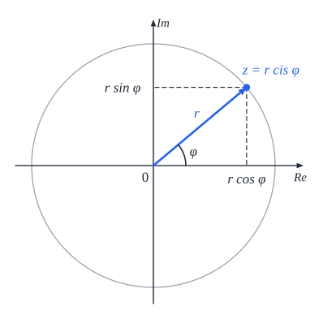
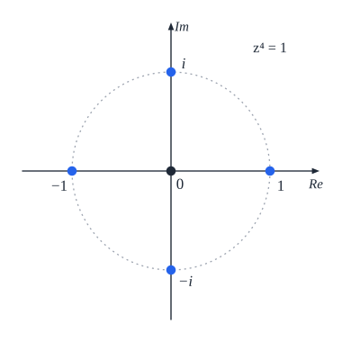

# מספרים מרוכבים

## היחידה המדומה

במספרים הממשיים **אין** שורש למספר שלילי. מגדירים מספר חדש:

$$i = \sqrt{-1} \qquad i^2 = -1$$

**חזקות של $i$** חוזרות כל 4: $i^1 = i$, $i^2 = -1$, $i^3 = -i$, $i^4 = 1$, $i^5 = i$... (מחלקים את המעריך ב-4 ומסתכלים על השארית.) ועוד שימושי: $(1 + i)^2 = 2i$.

## הצגה אלגברית

**מספר מרוכב**: $z = a + bi$ - **$a$ החלק הממשי**, **$b$ החלק המדומה** (שניהם ממשיים). כדאי לכתוב תשובות **בצורה הזו**.

| פעולה | איך |
|---|---|
| **שוויון** | ‏$z_1 = z_2 \iff$ החלקים הממשיים שווים **וגם** המדומים שווים |
| **חיבור / חיסור** | חלק ממשי עם ממשי, מדומה עם מדומה |
| **כפל** | פתיחת סוגריים, ו-$i^2 = -1$ |
| **צמוד** | ‏$\overline{z} = a - bi$. ומתקיים $z\overline{z} = a^2 + b^2$ - **ממשי!** |
| **חילוק** | כופלים מונה ומכנה **בצמוד של המכנה** |

$$\frac{a + bi}{c + di} = \frac{(a + bi)(c - di)}{(c + di)(c - di)} = \frac{(a + bi)(c - di)}{c^2 + d^2}$$

**שוויון** הוא הכלי המרכזי: משוואה אחת במרוכבים = **שתי** משוואות בממשיים.

**שורש של מרוכב** - מסמנים $\sqrt{a + bi} = x + yi$, מעלים בריבוע ומשווים:

$$a = x^2 - y^2 \qquad b = 2xy$$

**משוואה ריבועית** עם $\Delta < 0$ - יש עכשיו **שני פתרונות מרוכבים צמודים**: $\frac{-b \pm i\sqrt{-\Delta}}{2a}$.

## מישור גאוס

כל מרוכב $z = x + yi$ הוא **נקודה** $(x, y)$ במישור: ציר $x$ **ממשי**, ציר $y$ **מדומה**.

**הצגה קוטבית** - לפי **המרחק** מהראשית (**ערך מוחלט**) ו**הזווית** עם הכיוון החיובי של ציר $x$ (**ארגומנט**):

$$z = r(\cos\theta + i\sin\theta) = r\,\text{cis}\,\theta$$

| מאלגברית לקוטבית | מקוטבית לאלגברית |
|---|---|
| ‏$r = \lvert z\rvert = \sqrt{x^2 + y^2}$ | ‏$x = r\cos\theta$ |
| ‏$\tan\theta = \frac{y}{x}$ - **ולבדוק את הרביע!** | ‏$y = r\sin\theta$ |

**הצמוד** - **שיקוף** על ציר $x$: $\overline{z} = r\,\text{cis}(-\theta)$.

### כפל, חילוק וחזקה - בקוטבית קל!

$$z_1z_2 = r_1r_2\,\text{cis}(\theta_1 + \theta_2) \qquad \frac{z_1}{z_2} = \frac{r_1}{r_2}\,\text{cis}(\theta_1 - \theta_2)$$

**כופלים** את הגדלים ו**מחברים** את הזוויות. **במישור**: כפל ב-$\text{cis}\,\alpha$ = **סיבוב** בזווית $\alpha$.

**משפט דה-מואבר**:

$$z^n = r^n\,\text{cis}(n\theta)$$

**מכאן**: $\lvert z_1z_2\rvert = \lvert z_1\rvert\lvert z_2\rvert$.

### שורשים

**הפתרונות של $z^n = w$** (כש-$w = R\,\text{cis}\,\alpha$): יש **בדיוק $n$** פתרונות, כולם על **מעגל** ברדיוס $\sqrt[n]{R}$, **במרווחים שווים**:

$$z_k = \sqrt[n]{R}\,\text{cis}\frac{\alpha + 360°k}{n} \qquad k = 0, 1, \ldots, n - 1$$

**שורשי היחידה** ($z^n = 1$): $z_k = \text{cis}\frac{360°k}{n}$ - **קודקודי מצולע משוכלל** על מעגל היחידה.

- הם **סדרה הנדסית**: איבר ראשון 1, מנה $\text{cis}\frac{360°}{n}$.
- **סכומם 0** (נוסחת הסכום ההנדסי, כי $q^n = 1$).
- **מכפלתם** $\text{cis}(180°(n - 1)) = (-1)^{n-1}$.

## מקומות גיאומטריים

מסמנים $z = x + yi$, מציבים בתנאי, ומקבלים **משוואה ב-$x, y$**.

- ‏$\lvert z - z_0\rvert = r$ - **מעגל** סביב $z_0$ ברדיוס $r$. ($\lvert z_1 - z_2\rvert$ הוא **המרחק** בין הנקודות.)
- ‏$\lvert z - z_1\rvert = \lvert z - z_2\rvert$ - **האנך האמצעי** בין שתי הנקודות.
- ‏$\arg z = \alpha$ - **קרן** מהראשית.

## שאלות לחזרה

- חשב: $i^{27}$, $\frac{3 + i}{1 - 2i}$.
- הצג $z = -1 + i\sqrt{3}$ בצורה קוטבית, וחשב את $z^6$.
- מצא את כל הפתרונות של $z^3 = 8i$.
- למה סכום שורשי היחידה הוא 0?
- איזה מקום גיאומטרי מתאר $\lvert z - 2\rvert = \lvert z + 2i\rvert$?
