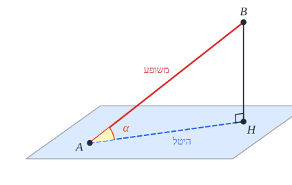
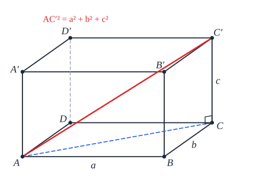
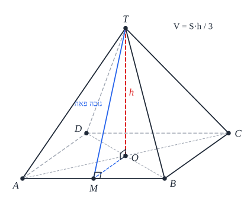

# הנדסת המרחב

## ישרים ומישורים

**מישור** נקבע על ידי **3 נקודות שלא על ישר אחד** (או ישר ונקודה מחוצה לו, או שני ישרים נחתכים/מקבילים).

### שני ישרים

| | **באותו כיוון** | **לא באותו כיוון** |
|---|---|---|
| **יש נקודה משותפת** | **מתלכדים** | **נחתכים** |
| **אין נקודה משותפת** | **מקבילים** | **מצטלבים** - לא באותו מישור |

**מצטלבים** קיימים רק במרחב: למשל, מקצוע עליון של קובייה ומקצוע תחתון שאינו מקביל לו.

### ישר ומישור

- **מוכל** - כל הנקודות שלו במישור (מספיק שתיים).
- **חותך** - נקודה משותפת אחת (**העקב**).
- **מקביל** - אין נקודה משותפת. (ישר **מקביל לישר שבמישור** - מקביל למישור או מוכל בו.)

**ישר מאונך למישור** - מאונך **לכל** ישר במישור. **מספיק** שיהיה מאונך ל**שני ישרים לא מקבילים** במישור.

**משופע** - ישר שחותך את המישור ואינו מאונך לו. **היטל** המשופע - הקטע מהעקב לרגל האנך.

- **הזווית בין משופע למישור** - הזווית **בין המשופע להיטלו** על המישור. היא **הקטנה ביותר** מכל הזוויות בין המשופע לישרים במישור.
- **משפט שלושת האנכים**: ישר **במישור** מאונך **למשופע** ⟺ הוא מאונך **להיטל**.

### שני מישורים

- **מתלכדים** (3 נקודות משותפות שלא על ישר), **מקבילים** (אין משותפות), **נחתכים** - **בישר** (ישר החיתוך).
- **הזווית בין מישורים**: על ישר החיתוך בוחרים נקודה, ומעבירים ממנה **בכל מישור אנך** לישר החיתוך. הזווית **בין שני האנכים** היא הזווית בין המישורים.

**דרך עבודה**: מסמנים קודם **באותיות** ורק אחר כך מציבים; **משרטטים בנפרד** את המשולשים שבהם מחשבים (במישור - בלי פרספקטיבה).

## גופים

| גוף | נפח | שטח פנים |
|---|---|---|
| **תיבה** | ‏$V = abc$ | ‏$2(ab + bc + ac)$ |
| **מנסרה** | ‏$V = S_{\text{base}} \cdot h$ | מעטפת (מלבנים) + 2 בסיסים |
| **פירמידה** | ‏$V = \frac{1}{3}S_{\text{base}} \cdot h$ | מעטפת (משולשים) + בסיס |

### תיבה

- **המקצועות הצדדיים מאונכים לבסיסים** (מאונכים לשני ישרים בבסיס).
- **אלכסון התיבה**: $d = \sqrt{a^2 + b^2 + c^2}$ (פיתגורס **פעמיים**). **ארבעת האלכסונים שווים**.
- **שימושי**: גובה ליתר במשולש ישר זווית: $h = \frac{ab}{c}$ (שטח בשתי דרכים).

### מנסרה

**שני בסיסים חופפים ומקבילים** (מצולע כלשהו), ופאות צדדיות **מלבנים** (במנסרה ישרה).

### פירמידה

- **פירמידה ישרה**: הגובה יורד ל**מרכז המעגל החוסם** את הבסיס ⟺ **כל המקצועות הצדדיים שווים**.
- **משוכללת** - ישרה עם **בסיס משוכלל**.
- **בסיס משולש ישר זווית** - הגובה יורד ל**אמצע היתר** (מרכז המעגל החוסם).
- **זווית בין פאה לבסיס** - בין **גובה הפאה** (אל צלע הבסיס) לבין הקטע **ממרכז הבסיס** אל אותה נקודה (משלושת האנכים).
- **זווית בין פאות סמוכות** - מורידים **גבהים** משני קודקודי בסיס אל המקצוע המשותף; מוכיחים (בחפיפה) שהם **נפגשים באותה נקודה** ו**שווים**; הזווית - במשולש **שווה שוקיים**.

## שאלות לחזרה

- מה ההבדל בין ישרים מקבילים לישרים מצטלבים?
- מתי ישר מאונך למישור? מה אומר משפט שלושת האנכים?
- איך מוצאים את הזווית בין שני מישורים?
- בתיבה שמקצועותיה 3, 4, 12 - מה אורך האלכסון?
- בפירמידה ישרה שבסיסה ריבוע בצלע 6 וגובהה 4 - מה הזווית בין פאה צדדית לבסיס?
