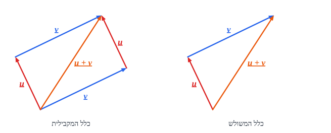
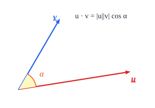
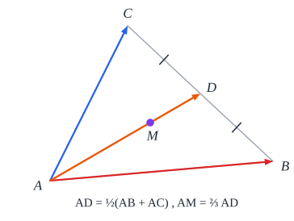

# וקטורים

## הגדרות ופעולות

- **וקטור** - גודל **עם כיוון**. סימון: $\vec{AB}$ או $\underline{u}$.
- **סקלר** - גודל **בלי כיוון** (מספר).
- **שוויון** - אותו **גודל** ואותו **כיוון** (לא משנה מאיפה מתחיל).

| פעולה | איך |
|---|---|
| **חיבור** | **ראש לזנב**: $\vec{AB} + \vec{BC} = \vec{AC}$ |
| **וקטור נגדי** | ‏$-\underline{u}$ - אותו גודל, כיוון הפוך |
| **חיסור** | חיבור הנגדי: $\vec{AC} - \vec{AB} = \vec{BC}$ |
| **כפל בסקלר** | ‏$t\underline{u}$ - **מקביל** ל-$\underline{u}$, אורכו פי $\lvert t\rvert$ (ואם $t < 0$ - כיוון הפוך) |

- **וקטורים מקבילים** ⟺ אחד הוא כפולה של השני: $\vec{AB} = t\vec{CD}$.
- **שלוש נקודות על ישר** ⟺ $\vec{AB} = t\vec{AC}$.
- **מישור** מתואר על ידי **שני** וקטורים לא מקבילים; **המרחב** - על ידי **שלושה** שלא באותו מישור. כל וקטור אחר הוא **צירוף** שלהם ($a\underline{u} + b\underline{v} + c\underline{w}$), **באופן יחיד** - ולכן אפשר **להשוות מקדמים**.

## מכפלה סקלרית

$$\underline{u} \cdot \underline{v} = \lvert\underline{u}\rvert\lvert\underline{v}\rvert\cos\alpha$$

- התוצאה - **מספר** (סקלר).
- **מאונכים** ⟺ $\underline{u} \cdot \underline{v} = 0$.
- ‏$\underline{u}^2 = \lvert\underline{u}\rvert^2$ - **הדרך למצוא אורך** של וקטור שמבוטא בעזרת אחרים. (אבל $\underline{u} \neq \lvert\underline{u}\rvert$ - וקטור לא שווה למספר!)
- **אין חילוק** בווקטורים ו**אין צמצום**.
- **זווית בין וקטורים**: $\cos\alpha = \frac{\underline{u} \cdot \underline{v}}{\lvert\underline{u}\rvert\lvert\underline{v}\rvert}$.

## וקטורים גיאומטריים

**וקטור התיכון** (כולם יוצאים מ-$A$): $\vec{AD} = \frac{1}{2}(\vec{AB} + \vec{AC})$.

**נקודה $P$ ביחס למשולש** - אם $\vec{AP} = a\vec{AB} + b\vec{AC}$ (צריך להוכיח):

| ‏$a + b$ | ‏$P$ נמצאת |
|---|---|
| ‏$= 1$ | **על הצלע** $BC$ (או המשכה) |
| ‏$< 1$ (ו-$a, b > 0$) | **בתוך** המשולש |
| ‏$> 1$ | **מחוץ** למשולש (מעבר ל-$BC$) |

**הוכחה למקרה $a + b = 1$**: $\vec{AP} = \vec{AB} + t\vec{BC} = \vec{AB} + t(\vec{AC} - \vec{AB}) = (1 - t)\vec{AB} + t\vec{AC}$.

**וקטורים מיוחדים** (צריך להוכיח):

- קודקוד אל **מפגש התיכונים**: $\vec{AM} = \frac{2}{3}\vec{AD} = \frac{1}{3}\vec{AB} + \frac{1}{3}\vec{AC}$.
- בטטרהדר $ABCD$ - קודקוד אל מפגש התיכונים של הפאה ממול: $\frac{1}{3}(\vec{AB} + \vec{AC} + \vec{AD})$.
- קודקוד אל **מרכז הכובד** של הטטרהדר: $\frac{1}{4}(\vec{AB} + \vec{AC} + \vec{AD})$.

**טיפים**: כותבים תשובה בצורה $a\underline{u} + b\underline{v} + c\underline{w}$; לפעמים צריך **לסמן יחס לא ידוע** בעצמנו ($\vec{AE} = t\vec{AC}$) ולמצוא אותו בהשוואת מקדמים.

## וקטורים אלגבריים

**מערכת צירים במרחב** - $x, y, z$. נקודה $(x, y, z)$; וקטור - **הרכיבים** שלו.

| | חישוב |
|---|---|
| **וקטור בין נקודות** | ‏$\vec{AB} = B - A$ (רכיב-רכיב) |
| **חיבור, כפל בסקלר** | רכיב-רכיב |
| **אורך** | ‏$\lvert\underline{u}\rvert = \sqrt{u_1^2 + u_2^2 + u_3^2}$ |
| **מכפלה סקלרית** | ‏$\underline{u} \cdot \underline{v} = u_1v_1 + u_2v_2 + u_3v_3$ |
| **אמצע, חלוקה ביחס, מפגש תיכונים** | כמו במישור, עם רכיב שלישי |

**מישורי הצירים**: $[xy]$ הוא $z = 0$, $[xz]$ - $y = 0$, $[yz]$ - $x = 0$. **המרחק** של נקודה ממישור צירים - הרכיב השלישי שלה (בערך מוחלט).

### ישר

**הצגה פרמטרית**: $\underline{x} = A + t\underline{u}$ - **נקודה** על הישר ועוד **וקטור כיוון**.

- **נקודה כללית** על הישר: $(a_1 + tu_1,\ a_2 + tu_2,\ a_3 + tu_3)$.
- **שני ישרים** - **פרמטרים בשמות שונים** ($t$ ו-$s$)!
- **חיתוך** - משווים נקודות כלליות (3 משוואות, 2 נעלמים: אם אין פתרון - **מצטלבים** או מקבילים).
- **זווית בין ישרים** - בין **וקטורי הכיוון**, עם **ערך מוחלט** כדי לקבל את החדה.
- **מרחק נקודה מישר** - הווקטור מהנקודה **לנקודה כללית** על הישר **מאונך** לכיוון הישר: מכפלה סקלרית 0 ⟹ $t$ ⟹ הנקודה הקרובה ⟹ אורך.
- **חוצה זווית** - משפט חוצה הזווית + חלוקת קטע ביחס.

### מישור

**משוואת מישור**: $ax + by + cz + d = 0$, כש-$\underline{N} = (a, b, c)$ - **הנורמל** (מאונך למישור).

- **מישור דרך 3 נקודות**: שני וקטורים במישור ← נורמל שמכפלתו הסקלרית **עם שניהם 0** ← מציבים נקודה למציאת $d$.
- **נקודה על המישור** ⟺ מקיימת את המשוואה.
- **חיתוך ישר ומישור** - מציבים **נקודה כללית** של הישר במשוואה.
- **מרחק נקודה ממישור**: $\frac{\lvert ax_0 + by_0 + cz_0 + d\rvert}{\sqrt{a^2 + b^2 + c^2}}$.
- **מרחק בין מישורים מקבילים** (אותם $a, b, c$!): $\frac{\lvert d_1 - d_2\rvert}{\sqrt{a^2 + b^2 + c^2}}$.
- **זווית בין ישר למישור** - הזווית בין הישר **לנורמל** משלימה אותה ל-$90°$. לכן $\sin\alpha = \frac{\lvert\underline{u} \cdot \underline{N}\rvert}{\lvert\underline{u}\rvert\lvert\underline{N}\rvert}$.
- **זווית בין מישורים** - הזווית **החדה** בין **הנורמלים**.
- **ישר החיתוך** של מישורים - שתי נקודות משותפות, או נקודה אחת + כיוון שמאונך **לשני הנורמלים**.
- **מרחק בין ישרים מצטלבים** - המרחק מישר אחד אל **המישור** שמכיל את השני ומקביל לראשון.
- (**הצגה פרמטרית של מישור** $A + t\underline{u} + s\underline{v}$ - אפשרית, אבל מסורבלת. עדיף משוואה.)

**מצבים הדדיים:**

| ישר ומישור | ‏**$\underline{u} \perp \underline{N}$** | **לא מאונך** |
|---|---|---|
| **יש נקודה משותפת** | הישר **מוכל** במישור | הישר **חותך** |
| **אין** | הישר **מקביל** | - |

| שני מישורים | **נורמלים מקבילים** | **לא מקבילים** |
|---|---|---|
| **המשוואות פרופורציוניות** (כולל $d$) | **מתלכדים** | - |
| **לא** | **מקבילים** | **נחתכים** |

## שאלות לחזרה

- איך מוצאים אורך של וקטור שמבוטא בעזרת וקטורים אחרים?
- במשולש $ABC$, $\vec{AP} = 0.3\vec{AB} + 0.5\vec{AC}$. איפה $P$?
- מצא את משוואת המישור דרך $(1, 0, 0)$, $(0, 2, 0)$, $(0, 0, 3)$.
- מצא את הזווית בין הישר $(1, 1, 0) + t(1, 0, 1)$ למישור $z = 0$.
- איך בודקים אם שני ישרים מצטלבים?
