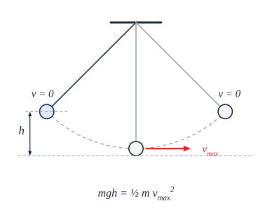
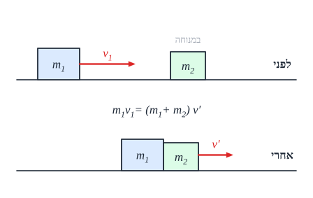
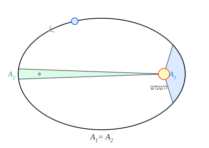

# אנרגיה, תנע, כבידה ותנועה הרמונית

## עבודה ואנרגיה

אנרגיה היא דרך **אחרת** לפתור בעיות תנועה - בלי לעקוב אחרי הכוחות בכל רגע. היא נוחה במיוחד כשהכוח **משתנה** (קפיץ, מסלול מעוקל), ו**כשלא שואלים על זמן**.

### עבודה

**עבודה** של כוח קבוע לאורך העתק $d$:

$$W = Fd\cos\alpha$$

- ‏$\alpha$ - הזווית **בין הכוח להעתק**.
- **יחידה**: ג'אול, $\text{J} = \text{N}\cdot\text{m}$. עבודה היא **סקלר**.
- כוח **בכיוון התנועה** - עבודה **חיובית** (מוסיף אנרגיה). **נגד התנועה** - **שלילית** (כמו חיכוך). **מאונך** לתנועה - **אפס** (כמו הנורמל על משטח אופקי, או הכוח במעגל).
- **כוח משתנה** - העבודה היא **השטח מתחת לגרף כוח-מקום**.

### אנרגיה קינטית ומשפט עבודה-אנרגיה

**אנרגיה קינטית** - אנרגיית התנועה:

$$E_k = \frac{1}{2}mv^2$$

**משפט עבודה-אנרגיה**: **העבודה של הכוח השקול** שווה **לשינוי באנרגיה הקינטית**:

$$W_{total} = \Delta E_k$$

### כוחות משמרים ואנרגיה פוטנציאלית

**כוח משמר** - כוח ש**עבודתו תלויה רק בנקודת ההתחלה ובנקודת הסיום**, לא בדרך. (ולכן במסלול סגור - עבודתו **אפס**.) דוגמאות: **כובד**, **קפיץ**, **חשמלי**. **לא משמר**: **חיכוך** - כמה שהדרך ארוכה יותר, הוא "גוזל" יותר.

לכוח משמר אפשר להגדיר **אנרגיה פוטנציאלית** - אנרגיה "אגורה" לפי **המקום**:

| אנרגיה | נוסחה | הערות |
|---|---|---|
| **כובדית** (ליד הקרקע) | ‏$E_p = mgh$ | ‏$h$ - גובה מעל **רמת אפס שבוחרים** |
| **כובדית** (כללית) | ‏$E_p = -\frac{GMm}{r}$ | אפס **באינסוף** (פרק הכבידה) |
| **אלסטית** (קפיץ) | ‏$E_p = \frac{1}{2}kx^2$ | ‏$x$ - ההתארכות או ההתכווצות **מהמצב הרפוי** |
| **חשמלית** | ‏$E_p = \frac{kq_1q_2}{r}$ | פרק הפוטנציאל |
| **בקבל** | ‏$E = \frac{1}{2}CV^2$ | פרק הקבלים |

### שימור אנרגיה

**אנרגיה מכנית** = קינטית + פוטנציאלית: $E = E_k + E_p$.

- **כשפועלים רק כוחות משמרים** (או שהאחרים לא עושים עבודה) - **האנרגיה המכנית נשמרת**:
$$E_{k1} + E_{p1} = E_{k2} + E_{p2}$$
- **כשיש כוחות לא משמרים** (חיכוך, דחיפה של אדם, מנוע):
$$W_{non\text{-}cons} = \Delta E = E_2 - E_1$$
  חיכוך עושה עבודה **שלילית** ← האנרגיה המכנית **קטנה** (הופכת לחום).

**דוגמה - מטוטלת**: בקצוות המהירות **אפס** - כל האנרגיה **פוטנציאלית**. בתחתית - הגובה **מינימלי** והמהירות **מקסימלית**. משימור אנרגיה: $mgh = \frac{1}{2}mv_{max}^2$, ולכן $v_{max} = \sqrt{2gh}$ - **לא תלוי במסה**. (המתיחות **לא עושה עבודה** - היא תמיד מאונכת לתנועה.)

**בתנועה הרמונית** (מסה על קפיץ) האנרגיה הכוללת: $E = \frac{1}{2}kA^2$ ($A$ - המשרעת).

### הספק

**הספק** - **קצב** ביצוע העבודה:

$$P = \frac{W}{t} = Fv$$

**יחידה**: וואט, $\text{W} = \frac{\text{J}}{\text{s}}$.

### דוגמה

גוף במסה $2\ \text{kg}$ מחליק ממנוחה מגובה $5\ \text{m}$ במסלול מעוקל **חלק**, ואז נכנס למשטח אופקי **עם חיכוך** ($\mu_k = 0.5$). ($g = 10$)

- **המהירות בתחתית** (שימור אנרגיה): $mgh = \frac{1}{2}mv^2 \Rightarrow v = \sqrt{2\cdot10\cdot5} = 10\ \text{m/s}$. **צורת המסלול לא משנה!**
- **כמה הוא יחליק עד שייעצר?** החיכוך $f = \mu_k mg = 10\ \text{N}$, ועבודתו מורידה את כל האנרגיה הקינטית: $-fd = 0 - \frac{1}{2}mv^2 \Rightarrow d = \frac{100}{10} = 10\ \text{m}$.

### שאלות לחזרה

- מתי העבודה של כוח חיובית, שלילית או אפס? תן דוגמה לכל מקרה.
- מהו כוח משמר? תן שתי דוגמאות ודוגמה לכוח לא משמר.
- מתי האנרגיה המכנית נשמרת? מה קורה לה כשיש חיכוך?
- הוכח שמהירות המטוטלת בתחתית היא $\sqrt{2gh}$.
- מהו הספק? מה היחידה שלו?

## תנע ומתקף

### תנע

**תנע** - "כמות התנועה" של גוף:

$$\vec{p} = m\vec{v}$$

- **וקטור**, בכיוון המהירות.
- **יחידות**: $\text{kg}\cdot\text{m/s}$.
- משאית איטית ואופנוע מהיר יכולים להיות **באותו תנע**.

### מתקף

**מתקף** - השפעה של כוח **לאורך זמן**:

$$\vec{J} = \vec{F}\Delta t$$

- **כוח משתנה** - המתקף הוא **השטח מתחת לגרף כוח-זמן**.
- **יחידות**: $\text{N}\cdot\text{s}$ (שקולות ל-$\text{kg}\cdot\text{m/s}$).

**חוק המתקף**: **המתקף של הכוח השקול** שווה **לשינוי בתנע**:

$$\Sigma\vec{F}\,\Delta t = \Delta\vec{p}$$

(זה בעצם החוק השני של ניוטון, בניסוח אחר.)

**שימוש בחיים**: **כרית אוויר** ו**קסדה** **מאריכות את זמן העצירה** $\Delta t$. שינוי התנע זהה - ולכן **הכוח** על הגוף **קטן**.

**טיפ**: לפעמים נוח להסתכל על וקטורי התנע והמתקף **בצורה גיאומטרית** - $\vec{p}_2 = \vec{p}_1 + \vec{J}$ הוא חיבור וקטורים ("ראש לזנב").

### שימור תנע

**אם השקול של הכוחות החיצוניים על מערכת הוא אפס - התנע הכולל של המערכת נשמר:**

$$\Sigma\vec{p}_{before} = \Sigma\vec{p}_{after}$$

- **כוחות פנימיים** (בין גופי המערכת) **לא משנים** את התנע הכולל - הם באים בזוגות (חוק 3) ומתבטלים.
- זה חוק **וקטורי**: אפשר שהתנע יישמר **בציר אחד** (שבו אין כוחות חיצוניים) ולא בציר האחר.
- **בהתנגשות** הכוחות הפנימיים **גדולים מאוד וקצרים** - ולכן בדרך כלל מזניחים את הכוחות החיצוניים **בזמן ההתנגשות** ומניחים שימור תנע.

### סוגי התנגשויות

| סוג | תנע | אנרגיה קינטית | מאפיין |
|---|---|---|---|
| **אלסטית** | **נשמר** | **נשמרת** | הגופים "קופצים" זה מזה בלי איבוד אנרגיה |
| **פלסטית** | **נשמר** | **לא נשמרת** (חלקה הופך לחום ולעיוות) | שני הגופים **נדבקים** ונעים **באותה מהירות** |
| **לא אלסטית** (כללית) | **נשמר** | **לא נשמרת** | בין שני הקצוות |

- **אסור להניח** שהתנגשות **אלסטית** - רק אם כתוב בשאלה.
- **התנגשות מצח** - **חד-ממדית**: כל המהירויות על ישר אחד.

### רתע

**רתע** - התנע ההתחלתי **אפס** (הכול במנוחה), ואחרי "פיצוץ" הגופים נעים **בכיוונים מנוגדים**: $0 = m_1v_1 + m_2v_2$. **דוגמאות**: רובה שיורה ונהדף אחורה; טיל שפולט גזים.

### דוגמה

עגלה במסה $2\ \text{kg}$ נעה ב-$6\ \text{m/s}$ ומתנגשת בעגלה במסה $1\ \text{kg}$ שעומדת. הן נדבקות.

- **שימור תנע**: $2\cdot6 + 1\cdot0 = (2+1)v' \Rightarrow v' = 4\ \text{m/s}$.
- **אנרגיה קינטית**: לפני - $\frac{1}{2}\cdot2\cdot36 = 36\ \text{J}$; אחרי - $\frac{1}{2}\cdot3\cdot16 = 24\ \text{J}$. **אבדו $12\ \text{J}$** - כצפוי בהתנגשות פלסטית.

### שאלות לחזרה

- מה הקשר בין מתקף לשינוי בתנע? למה כרית אוויר מגינה?
- מתי התנע של מערכת נשמר?
- מה ההבדל בין התנגשות אלסטית לפלסטית?
- רובה במסה $4\ \text{kg}$ יורה כדור של $10\ \text{g}$ במהירות $400\ \text{m/s}$. מה מהירות הרתע?

## כבידה ותנועת לוויינים

### היסטוריה בקצרה

| מי | מה |
|---|---|
| **העת העתיקה** (אריסטו, תלמי) | מודל **גיאוצנטרי** - כדור הארץ במרכז, הכול סובב סביבו |
| **קופרניקוס** | מודל **הליוצנטרי** - **השמש** במרכז |
| **טיכו ברהה** | אסף **תצפיות ומדידות** מדויקות מאוד של כוכבי הלכת |
| **גלילאו** | צפה בשמיים ב**טלסקופ** ותמך במודל ההליוצנטרי (למשל, ירחי צדק) |
| **קפלר** | עוזרו של ברהה - מצא **קשרים מתמטיים** בנתונים: **חוקי קפלר** |
| **ניוטון** | **חוק הכבידה האוניברסלי** - הסביר את חוקי קפלר |

### חוקי קפלר

1. **חוק המסלולים**: כל כוכב לכת נע ב**אליפסה**, ו**השמש באחד המוקדים**.
2. **חוק השטחים**: הקו מהשמש לכוכב הלכת **מכסה שטחים שווים בזמנים שווים**. **משמעות**: כוכב הלכת נע **מהר** כשהוא **קרוב** לשמש, ו**לאט** כשהוא **רחוק**.
3. **חוק זמני המחזור**: $\frac{T^2}{r^3}$ **קבוע** לכל כוכבי הלכת סביב אותה שמש ($r$ - חצי הציר הארוך).

### חוק הכבידה האוניברסלי

כל שתי מסות **מושכות** זו את זו:

$$F = \frac{GMm}{r^2}$$

- ‏$G = 6.67\cdot10^{-11}\ \frac{\text{N}\cdot\text{m}^2}{\text{kg}^2}$ - קבוע הכבידה.
- ‏$r$ - המרחק **בין המרכזים**.
- **"אוניברסלי"** - אותו חוק לתפוח שנופל ולירח שסובב.

**תאוצת הכובד בגובה כלשהו**: $g(r) = \frac{GM}{r^2}$. ליד פני כדור הארץ ($r = R_E$) מקבלים את $g \approx 10$; **רחוק יותר - $g$ קטן**. לכן בשאלות כבידה **לא מציבים $g = 10$** אוטומטית!

### תנועת לוויינים

לוויין במסלול **מעגלי** ברדיוס $r$: **הכבידה** היא הכוח אל המרכז.

$$\frac{GMm}{r^2} = m\frac{v^2}{r} \quad\Rightarrow\quad v = \sqrt{\frac{GM}{r}}$$

- **מסת הלוויין מצטמצמת** - המהירות לא תלויה בה.
- **לוויין רחוק יותר - איטי יותר**.
- **זמן מחזור**: מציבים $v = \frac{2\pi r}{T}$ ומקבלים $T^2 = \frac{4\pi^2}{GM}r^3$ - **החוק השלישי של קפלר**!
- **לוויין גיאוסטציונרי** - זמן המחזור שלו **יממה**, ולכן הוא "עומד" מעל אותה נקודה.

### אנרגיה בשדה כבידה

**אנרגיה פוטנציאלית כובדית** (כללית):

$$E_p = -\frac{GMm}{r}$$

- **אפס באינסוף**, ו**שלילית** בכל מקום אחר: צריך **להשקיע** אנרגיה כדי להתרחק.
- ליד הקרקע, ההפרש בין שני גבהים קרובים נותן בחזרה את $mg\Delta h$.

**האנרגיה הכוללת של לוויין** במסלול מעגלי ($E_k = \frac{GMm}{2r}$):

$$E = E_k + E_p = -\frac{GMm}{2r}$$

**שלילית** - הלוויין **"קשור"** לכדור הארץ.

### מהירות מילוט

**מהירות מילוט** - המהירות המינימלית שבה צריך לשגר גוף כדי ש**יתרחק לאינסוף** ולא יחזור. התנאי: **האנרגיה הכוללת אפס**.

$$\frac{1}{2}mv_{esc}^2 - \frac{GMm}{R} = 0 \quad\Rightarrow\quad v_{esc} = \sqrt{\frac{2GM}{R}}$$

מכדור הארץ: בערך $11.2\ \text{km/s}$.

### שאלות לחזרה

- נסח את שלושת חוקי קפלר. מה המשמעות של חוק השטחים?
- למה המהירות של לוויין לא תלויה במסתו?
- גזור את החוק השלישי של קפלר מחוק הכבידה.
- למה האנרגיה הפוטנציאלית הכובדית שלילית?
- מהי מהירות מילוט? גזור את הנוסחה.

## תנועה הרמונית פשוטה

### מה זו תנועה הרמונית?

**תנועה הרמונית פשוטה** - תנועה **הלוך ושוב** סביב **נקודת שיווי משקל**, כשהכוח השקול:

1. **פרופורציוני** למרחק מנקודת שיווי המשקל, ו-
2. **מכוון תמיד אליה** (כוח **מחזיר**).

$$F = -kx$$

הדוגמה הקלאסית: **מסה על קפיץ** (בלי חיכוך).

### המשוואות

| גודל | נוסחה | מקסימום |
|---|---|---|
| **מקום** | ‏$x(t) = A\cos(\omega t + \varphi)$ | ‏$A$ - **משרעת** (אמפליטודה) |
| **מהירות** | ‏$v(t) = -A\omega\sin(\omega t + \varphi)$ | ‏$v_{max} = A\omega$ - **בנקודת שיווי המשקל** |
| **תאוצה** | ‏$a(t) = -A\omega^2\cos(\omega t + \varphi) = -\omega^2 x$ | ‏$a_{max} = A\omega^2$ - **בקצוות** |

- ‏$\omega$ - התדירות **הזוויתית**, $\varphi$ - **מופע** התחלתי (תלוי מאיפה מתחילים).
- **הקשר החשוב**: $a = -\omega^2 x$ - התאוצה **פרופורציונית** למקום ו**הפוכה** לו.

**איפה מה?**

| | **בקצוות** ($x = \pm A$) | **בשיווי משקל** ($x = 0$) |
|---|---|---|
| **מהירות** | **אפס** | **מקסימלית** |
| **תאוצה וכוח** | **מקסימליים**, אל המרכז | **אפס** |
| **אנרגיה** | כולה **פוטנציאלית** | כולה **קינטית** |

### זמן המחזור

**מסה על קפיץ** (מהשוואת $ma = -kx$ ל-$a = -\omega^2 x$):

$$\omega = \sqrt{\frac{k}{m}} \qquad T = 2\pi\sqrt{\frac{m}{k}}$$

**מטוטלת פשוטה** (זוויות קטנות):

$$T = 2\pi\sqrt{\frac{L}{g}}$$

**שימו לב**: זמן המחזור **לא תלוי במשרעת**! קפיץ שנמתח יותר נע מהר יותר - ומסיים מחזור **באותו זמן**. ובמטוטלת - גם **לא במסה**.

### אנרגיה

האנרגיה המכנית **נשמרת** ועוברת כל הזמן בין קינטית לפוטנציאלית:

$$E = \frac{1}{2}mv^2 + \frac{1}{2}kx^2 = \frac{1}{2}kA^2 = \frac{1}{2}mv_{max}^2$$

**שימוש**: המהירות בכל מקום - $v = \omega\sqrt{A^2 - x^2}$.

### דוגמה

מסה של $0.5\ \text{kg}$ על קפיץ עם $k = 50\ \text{N/m}$, נמתחת $10\ \text{cm}$ ומשוחררת.

- ‏$\omega = \sqrt{\frac{50}{0.5}} = 10\ \text{rad/s}$; $T = \frac{2\pi}{10} \approx 0.63\ \text{s}$.
- ‏$v_{max} = A\omega = 0.1\cdot10 = 1\ \text{m/s}$; $a_{max} = A\omega^2 = 10\ \text{m/s}^2$.
- ‏$E = \frac{1}{2}\cdot50\cdot0.1^2 = 0.25\ \text{J}$.

### שאלות לחזרה

- מהם שני התנאים לתנועה הרמונית פשוטה?
- איפה המהירות מקסימלית? איפה התאוצה מקסימלית?
- גזור את $\omega = \sqrt{k/m}$ מהחוק השני של ניוטון.
- מה קורה לזמן המחזור אם מכפילים את המשרעת? את המסה?

### הנפשה: תנועה הרמונית

מסה על קפיץ: המיקום משתנה כמו סינוס בזמן.

<bl-spring></bl-spring>
