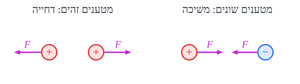
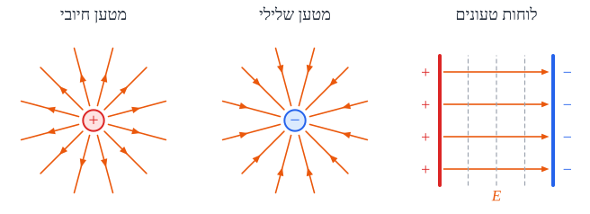

# שדה חשמלי, פוטנציאל וקבלים

ממטענים ושדות חשמליים, דרך מעגלים וקבלים, ועד שדות מגנטיים והשראה.

## מטען, חוק קולון ושדה חשמלי

### מטען חשמלי

**מטען** - תכונה של חומר שגורמת לתופעות חשמליות. יש **שני סוגים**: **חיובי** ו**שלילי**. יחידה: **קולון** ($\text{C}$).

**מבנה האטום**: בגרעין - **פרוטונים** (חיוביים) ו**ניוטרונים** (נייטרליים); סביבו - **אלקטרונים** (שליליים). אטום **נייטרלי** - מספר אלקטרונים ופרוטונים **שווה**. גוף **טעון** - יש לו **עודף** או **חוסר** של אלקטרונים.

**המטען "מקוונטט"** - הוא תמיד כפולה שלמה של **המטען היסודי**:

$$Q = n\,e \qquad e = 1.6\cdot10^{-19}\ \text{C}$$

**שימור מטען** - מטען לא נוצר ולא נעלם, רק **עובר** מגוף לגוף.

#### מוליכים ומבודדים

- **מוליך** (מתכות) - יש בו **אלקטרונים חופשיים** שיכולים לנוע. מטען עודף מתפזר **על פני השטח החיצוני**.
- **מבודד** (פלסטיק, זכוכית, עץ יבש) - האלקטרונים **קשורים**; המטען **נשאר במקום** שבו הונח.

#### טעינה בהשראה

אפשר לטעון גופים **בלי לגעת** בהם:

1. שני כדורים מוליכים **נייטרליים** נוגעים זה בזה.
2. מקרבים **מטען** (למשל חיובי) לאחד מהם - האלקטרונים **נמשכים** לצד הקרוב.
3. **מפרידים** את הכדורים כשהמטען עדיין קרוב.
4. מרחיקים את המטען - הקרוב נשאר **שלילי**, והרחוק **חיובי**.

#### הארקה

**הארקה** - חיבור גוף **לכדור הארץ** (פוטנציאל אפס). כדור הארץ ענק, ולכן הוא **מנטרל** את המטען של הגוף. **דוגמאות**: **כליא ברק** על בניינים; **שרשרת** שגוררות **מכליות דלק** - כדי שניצוץ לא יגרום לפיצוץ.

### חוק קולון

הכוח בין שני מטענים נקודתיים:

$$F = \frac{k\,\lvert q_1 q_2\rvert}{r^2} \qquad k = 9\cdot10^{9}\ \frac{\text{N}\cdot\text{m}^2}{\text{C}^2}$$

- **כיוון**: על הקו שמחבר ביניהם. מטענים **זהים - דחייה**; **שונים - משיכה**.
- **פעולה ותגובה**: כל מטען מרגיש **אותו גודל** של כוח (גם אם המטענים שונים בגודלם).
- **דומה לכבידה** ($\frac{1}{r^2}$) - אבל הכבידה **רק מושכת**, והחשמלי **הרבה יותר חזק**.
- **כמה מטענים** - הכוח השקול הוא **חיבור וקטורי** של הכוחות מכל מטען.

### השדה החשמלי

**השדה החשמלי** בנקודה - **הכוח שיפעל על מטען של קולון אחד** (חיובי) שיוצב שם:

$$\vec{E} = \frac{\vec{F}}{q} \qquad\Leftrightarrow\qquad \vec{F} = q\vec{E}$$

- **יחידות**: $\frac{\text{N}}{\text{C}}$ (או $\frac{\text{V}}{\text{m}}$).
- **מטען חיובי** - הכוח **בכיוון** השדה; **שלילי** - **נגד** השדה.
- השדה **קיים** גם אם אין שם מטען - הוא תכונה של **המרחב** סביב המטען היוצר.

**שדה של מטען נקודתי**: $E = \frac{kQ}{r^2}$ - **לא אחיד**, נחלש עם המרחק.

**עיקרון הסופרפוזיציה**: כשיש כמה מטענים, **השדה השקול** הוא **סכום וקטורי** של השדות מכל המטענים.

#### מודל קווי השדה ("החצים")

- **הכיוון** - כיוון הכוח על **מטען חיובי**: קווים **יוצאים** מחיובי ו**נכנסים** לשלילי.
- **העוצמה** - לפי **צפיפות הקווים**: צפוף = שדה חזק.
- קווי שדה **לא נחתכים**.

#### סוגי שדות

| מקור | צורת השדה |
|---|---|
| **מטען נקודתי** | **רדיאלי**, נחלש כ-$\frac{1}{r^2}$; הקווים מתרחקים זה מזה |
| **לוח טעון גדול** / **שני לוחות** (קבל) | **אחיד** - אותו גודל וכיוון בכל נקודה; קווים **ישרים ובמרווחים שווים** |
| **קליפה כדורית טעונה** | **בפנים - אפס**; **בחוץ** - כמו מטען נקודתי במרכז |
| **תיל ארוך טעון** | רדיאלי מהתיל (מחושב בעזרת **חוק גאוס**) |

**חוק גאוס** מאפשר לחשב שדות של גופים טעונים **שאינם נקודתיים** (כדור, תיל, לוח) בעזרת סימטריה.

### דוגמה

שני מטענים, $q_1 = +4\ \mu\text{C}$ ב-$x = 0$ ו-$q_2 = +1\ \mu\text{C}$ ב-$x = 3\ \text{m}$. איפה השדה **אפס**?

- **בין** המטענים - שני השדות **מנוגדים** (שניהם "דוחפים" החוצה מהמטען שלהם). שם יכול להיות אפס.
- **שוויון גדלים**: $\frac{k\cdot4}{x^2} = \frac{k\cdot1}{(3-x)^2} \Rightarrow \frac{2}{x} = \frac{1}{3-x} \Rightarrow x = 2\ \text{m}$.
- **הגיוני**: הנקודה **קרובה יותר למטען הקטן**.

### שאלות לחזרה

- מה ההבדל בין מוליך למבודד?
- תאר טעינה בהשראה בשלבים.
- כמה פעמים יקטן הכוח בין שני מטענים אם המרחק יוכפל?
- מה ההגדרה של שדה חשמלי? מה כיוון הכוח על אלקטרון בשדה?
- מה השדה בתוך קליפה כדורית טעונה?

## אנרגיה פוטנציאלית חשמלית ופוטנציאל

### אנרגיה פוטנציאלית חשמלית

הכוח החשמלי הוא **כוח משמר** (כמו הכובד) - ולכן אפשר להגדיר לו **אנרגיה פוטנציאלית**.

**אנרגיה פוטנציאלית של שני מטענים** במרחק $r$:

$$E_p = \frac{k\,q_1 q_2}{r}$$

- **סקלר** - מציבים את המטענים **עם הסימנים**.
- **אפס באינסוף**.
- **משמעות**: העבודה שצריך **להשקיע** כדי לקרב את המטענים **מהאינסוף** למרחק $r$. או: האנרגיה הקינטית שהם **יקבלו** אם ישחררו אותם ויתרחקו לאינסוף.
- **חיובית** (מטענים זהים) - צריך **לדחוף** כדי לקרב; שחרור ← הם **בורחים**.
- **שלילית** (מטענים שונים) - הם **מושכים**; צריך להשקיע אנרגיה כדי **להפריד** אותם.

### פוטנציאל חשמלי

**פוטנציאל** בנקודה $A$ - **האנרגיה הפוטנציאלית ליחידת מטען**: העבודה שצריך כדי להביא **קולון אחד** מהאינסוף לנקודה $A$.

$$V = \frac{E_p}{q} \qquad\text{מטען נקודתי:}\quad V = \frac{kQ}{r}$$

- **יחידה**: **וולט**, $\text{V} = \frac{\text{J}}{\text{C}}$.
- **סקלר** - הפוטנציאל של כמה מטענים הוא **סכום רגיל** (עם סימנים), בלי וקטורים. הרבה יותר קל מהשדה!

**מתח חשמלי** = **הפרש פוטנציאלים** בין שתי נקודות: $\Delta V = V_B - V_A$.

**העבודה של הכוח החשמלי** כשמטען עובר מ-$A$ ל-$B$:

$$W_{A\to B} = -q\,\Delta V = q(V_A - V_B)$$

### משטחים שווי פוטנציאל

- **משטח שווה פוטנציאל** - כל הנקודות שבהן **הפוטנציאל זהה**. מעבר לאורכו - **בלי עבודה**.
- הם **מאונכים לקווי השדה**.
- **השדה מצביע לכיוון שבו הפוטנציאל יורד**.
- **מטען חיובי** "נופל" **מפוטנציאל גבוה לנמוך** (כמו כדור במורד); **מטען שלילי** - **מנמוך לגבוה**.
- **כל עוד יש הפרש פוטנציאלים - מטענים חופשיים ינועו** (זה הבסיס לזרם החשמלי).

### שדה אחיד: הקשר בין שדה למתח

בשדה **אחיד** (למשל בין לוחות קבל) הפוטנציאל משתנה **בקצב קבוע** עם המרחק:

$$E = -\frac{\Delta V}{\Delta x} \qquad\text{ובגודל, בין לוחות במרחק } d:\quad E = \frac{V}{d}$$

- מכאן יחידה נוספת לשדה: $\frac{\text{V}}{\text{m}}$.
- **נכון רק לשדה אחיד!**

### פוטנציאל של קליפה כדורית טעונה

- **מחוץ** לקליפה - כמו מטען נקודתי: $V = \frac{kQ}{r}$.
- **בתוך** הקליפה - השדה אפס, ולכן הפוטנציאל **קבוע** ושווה לפוטנציאל **על פני הקליפה**: $V = \frac{kQ}{R}$.

### יחידת אנרגיה: אלקטרון-וולט

**אלקטרון-וולט** ($\text{eV}$) - האנרגיה שמקבל **אלקטרון** שעובר מתח של **וולט אחד**:

$$1\ \text{eV} = 1.6\cdot10^{-19}\ \text{J}$$

נוחה לאנרגיות של חלקיקים.

### דוגמה

אלקטרון מואץ ממנוחה במתח של $100\ \text{V}$. מה מהירותו? ($m_e = 9.1\cdot10^{-31}\ \text{kg}$)

- **שימור אנרגיה**: העבודה החשמלית הופכת לאנרגיה קינטית: $eV = \frac{1}{2}mv^2$.
- ‏$v = \sqrt{\frac{2eV}{m}} = \sqrt{\frac{2\cdot1.6\cdot10^{-19}\cdot100}{9.1\cdot10^{-31}}} \approx 5.9\cdot10^{6}\ \text{m/s}$.
- האנרגיה: בדיוק $100\ \text{eV}$.

### שאלות לחזרה

- מה המשמעות של אנרגיה פוטנציאלית חשמלית שלילית?
- מה ההבדל בין פוטנציאל למתח?
- למה קל יותר לחשב פוטנציאל של כמה מטענים מאשר שדה?
- למה משטחים שווי פוטנציאל מאונכים לקווי השדה?
- מה השדה בין לוחות במרחק $2\ \text{cm}$ שביניהם מתח $100\ \text{V}$?

## קבלים

### מהו קבל?

**קבל** - שני מוליכים (בדרך כלל **שני לוחות מקבילים**) עם **בידוד** ביניהם. כשמחברים אותו למתח, לוח אחד נטען $+Q$ והשני $-Q$, ובין הלוחות נוצר **שדה חשמלי אחיד**. הקבל **אוגר מטען ואנרגיה**.

### קיבול

**קיבול** - המטען שהקבל אוגר **לכל וולט**:

$$C = \frac{Q}{V}$$

- **יחידה**: **פאראד**, $\text{F} = \frac{\text{C}}{\text{V}}$. (פאראד הוא ענק - בפועל $\mu\text{F}$, $\text{nF}$, $\text{pF}$.)
- **קבל לוחות**: $C = \frac{\varepsilon_0 A}{d}$ - לוחות **גדולים** וקרובים ← קיבול **גדול**.
- הקיבול הוא תכונה של **הקבל** - לא תלוי במתח או במטען.

### אנרגיה בקבל

$$E = \frac{1}{2}QV = \frac{1}{2}CV^2 = \frac{Q^2}{2C}$$

### קבלים במעגל: קבל שקול

**קבל שקול** - קבל שאם מחליפים בו את הקבלים הנתונים, המקור עושה **אותה עבודה** בטעינה.

| | **בטור** | **במקביל** |
|---|---|---|
| **מטען** | **שווה** בכולם | **מתחלק** |
| **מתח** | **מתחלק** | **שווה** |
| **קיבול שקול** | ‏$\frac{1}{C} = \frac{1}{C_1} + \frac{1}{C_2}$ | ‏$C = C_1 + C_2$ |

**שימו לב**: זה **הפוך** מנגדים!

**דרך עבודה**: קיבול שקול ← מטען כולל ($Q = CV$) - **שווה לכולם בטור** ← המתח על כל קבל ($V_i = \frac{Q}{C_i}$).

### טעינה ופריקה של קבל

כשמחברים **נגד, קבל ומקור** במעגל:

- **ברגע הראשון** - הקבל ריק, **כל המתח על הנגד**, והזרם **מקסימלי**: $I_0 = \frac{\varepsilon}{R}$.
- **עם הזמן** - הקבל נטען: **המתח עליו עולה**, **המתח על הנגד יורד** (סכומם קבוע - מתח המקור), ו**הזרם יורד**.
- **בסוף** - הקבל **מלא**, $V_C = \varepsilon$, **אין זרם**. קבל טעון בזרם ישר = **נתק**.

**הנוסחאות:**

| | **טעינה** | **פריקה** |
|---|---|---|
| **מתח על הקבל** | ‏$V_C = \varepsilon\left(1 - e^{-t/RC}\right)$ | ‏$V_C = V_0\,e^{-t/RC}$ |
| **זרם** | ‏$I = I_0\,e^{-t/RC}$ | ‏$I = I_0\,e^{-t/RC}$ |

#### קבוע הזמן

$$\tau = RC$$

- **הזמן האופייני** לטעינה או לפריקה. ($R$ - ההתנגדות השקולה במעגל.)
- אחרי זמן $\tau$: הזרם יורד ל-**37%** מהתחלתי ($e^{-1} \approx 0.37$):
$$I(\tau) = I_0 e^{-1} \approx 0.37\,I_0$$
- בטעינה - המתח על הקבל מגיע ל-**63%** מהסופי.
- אחרי בערך $5\tau$ - הקבל **כמעט מלא** (או ריק).

### דוגמה

קבל $C = 100\ \mu\text{F}$ נטען דרך נגד $R = 10\ \text{k}\Omega$ ממקור $\varepsilon = 9\ \text{V}$.

- ‏$\tau = RC = 10^4\cdot10^{-4} = 1\ \text{s}$.
- **זרם התחלתי**: $I_0 = \frac{9}{10^4} = 0.9\ \text{mA}$.
- **בסוף**: $Q = CV = 10^{-4}\cdot9 = 0.9\ \text{mC}$; **אנרגיה**: $\frac{1}{2}\cdot10^{-4}\cdot81 \approx 4\ \text{mJ}$.

### שאלות לחזרה

- מהו קיבול? מה קובע את הקיבול של קבל לוחות?
- איך מחשבים קיבול שקול בטור ובמקביל? מה ההבדל מנגדים?
- תאר מה קורה למתח על הקבל ועל הנגד בזמן הטעינה.
- מהו $\tau$? מה הזרם אחרי זמן $\tau$?
