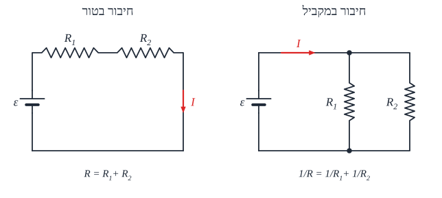
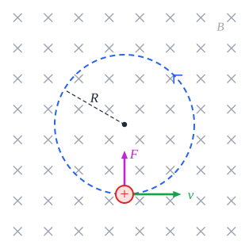
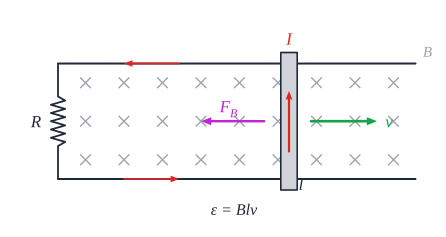

# זרם ישר, מגנטיות והשראה

## מעגלי זרם ישר

### זרם חשמלי

**זרם** - **קצב** מעבר מטען דרך חתך המוליך:

$$I = \frac{\Delta q}{\Delta t}$$

- **יחידה**: **אמפר**, $\text{A} = \frac{\text{C}}{\text{s}}$.
- **הכיוון המוסכם** - כיוון התנועה של **מטען חיובי**: מ**הפוטנציאל הגבוה** (+) **לנמוך** (−) במעגל החיצוני. **בפועל** נעים **אלקטרונים** - בכיוון ההפוך.
- **מהירות** האלקטרונים עצמם **קטנה מאוד**; אבל **האות** החשמלי מתקדם **כמעט במהירות האור** - לכן הנורה נדלקת מיד.

### מקור המתח

**תפקידי** מקור המתח (סוללה):

1. ליצור **הפרש פוטנציאלים קבוע** שמניע את המטענים.
2. **להמיר** אנרגיה (כימית, למשל) **לאנרגיה חשמלית**.
3. **בתוך** הסוללה - להעלות את המטענים החיוביים **מהפוטנציאל הנמוך לגבוה** ("משאבה").

**כא"מ** (כוח אלקטרו-מניע) $\varepsilon$ - **האנרגיה שהמקור נותן לכל קולון** שעובר בו. יחידה: וולט.

### חוק אוהם והתנגדות

$$V = IR$$

**התנגדות** $R$ - כמה הרכיב **"מקשה"** על הזרם. יחידה: **אוהם** ($\Omega$).

**הגורמים להתנגדות תיל**:

$$R = \rho\frac{L}{A}$$

- ‏$L$ - **אורך** (ארוך ← יותר התנגדות).
- ‏$A$ - **שטח החתך** (עבה ← פחות).
- ‏$\rho$ - **התנגדות סגולית**, תכונה של **החומר** (ותלויה בטמפרטורה).

### חיבור נגדים

| | **בטור** | **במקביל** |
|---|---|---|
| **זרם** | **שווה** בכולם | **מתחלק**: $I = I_1 + I_2$ |
| **מתח** | **מתחלק**: $V = V_1 + V_2$ | **שווה** על כולם |
| **התנגדות שקולה** | ‏$R = R_1 + R_2$ - **גדלה** | ‏$\frac{1}{R} = \frac{1}{R_1} + \frac{1}{R_2}$ - **קטנה** (קטנה מהקטן שבהם) |

**שני נגדים במקביל**: $R = \frac{R_1R_2}{R_1 + R_2}$.

#### דרך עבודה במעגל מורכב

**התנגדות שקולה** ← **זרם כולל** (חוק אוהם על כל המעגל) ← **מתח** על כל נגד **בטור** ← **מתח** על החלק **המקבילי** ← **זרם** בכל ענף ← **מתח** על כל נגד בענף.

#### מקרים מיוחדים

- **קצר** - חיבור **בלי התנגדות** (תיל ישר) בין שתי נקודות. **הזרם עובר דרך הקצר**, והרכיבים שבמקביל לו **מושבתים**. קצר על המקור: הזרם **עצום**, התיל **מתחמם ונמס**, והמעגל נפתח.
- **נתק** - המעגל **פתוח** בנקודה כלשהי: **אין זרם** בענף.

### הספק

**הספק חשמלי** - קצב המרת האנרגיה ברכיב:

$$P = IV = I^2R = \frac{V^2}{R}$$

- **הספק המקור** (מה שהוא מייצר): $P = \varepsilon I$.
- **נצילות** - היחס בין ההספק **המועיל** (במעגל החיצוני) להספק **שהמקור מייצר**.

### התנגדות פנימית

לכל מקור יש **התנגדות פנימית** $r$ - ולכן חלק מהמתח "הולך לאיבוד" בתוכו.

**מתח ההדקים** (מה שהמקור מספק בפועל למעגל):

$$V = \varepsilon - Ir \qquad I = \frac{\varepsilon}{R + r}$$

- **כשאין זרם** (מעגל פתוח) - מתח ההדקים **שווה לכא"מ**.
- **בקצר** ($R = 0$) - הזרם המקסימלי $\frac{\varepsilon}{r}$, ומתח ההדקים **אפס**.
- **הגרף** $V(I)$ - **ישר** יורד: **חיתוך** עם ציר $V$ = $\varepsilon$; **שיפוע** = $-r$.
- **הספק מקסימלי במעגל החיצוני** - כש-$R = r$.

### מכשירי מדידה

| מכשיר | מודד | מחובר | התנגדות אידאלית |
|---|---|---|---|
| **אמפרמטר** | זרם | **בטור** | **אפס** - כדי לא לשנות את הזרם |
| **וולטמטר** | מתח | **במקביל** | **אינסופית** - כדי שלא יעבור בו זרם |
| **גלוונומטר** | זרם **קטן** | | הבסיס לשניהם |

### חוקי קירכהוף

1. **חוק הצמתים**: סכום הזרמים **הנכנסים** לצומת = סכום הזרמים **היוצאים** (שימור מטען).
2. **חוק הלולאות**: סכום **שינויי המתח** סביב כל **לולאה סגורה** הוא **אפס** (שימור אנרגיה).

### חיבור מקורות זהים

| | **בטור** | **במקביל** |
|---|---|---|
| **כא"מ שקול** | ‏$n\varepsilon$ | ‏$\varepsilon$ |
| **התנגדות פנימית שקולה** | ‏$nr$ | ‏$\frac{r}{n}$ |

### דוגמה

סוללה עם $\varepsilon = 12\ \text{V}$ ו-$r = 1\ \Omega$ מחוברת ל-$R_1 = 3\ \Omega$ בטור עם שני נגדים של $4\ \Omega$ במקביל.

- **שקולה חיצונית**: $3 + \frac{4\cdot4}{4+4} = 3 + 2 = 5\ \Omega$.
- **זרם**: $I = \frac{12}{5 + 1} = 2\ \text{A}$.
- **מתח ההדקים**: $12 - 2\cdot1 = 10\ \text{V}$.
- **על $R_1$**: $2\cdot3 = 6\ \text{V}$; **על המקבילי**: $2\cdot2 = 4\ \text{V}$, ובכל אחד מהם זרם $1\ \text{A}$.

### הנפשה: חיבור נגדים

השוו בין חיבור טורי למקבילי, והוסיפו התנגדות פנימית למקור.

<bl-resistors></bl-resistors>

### שאלות לחזרה

- מה הכיוון המוסכם של הזרם? באיזה כיוון נעים האלקטרונים?
- איך משתנה ההתנגדות השקולה כשמוסיפים נגד בטור? במקביל?
- מה קורה לרכיב שמקוצר?
- למה מתח ההדקים קטן מהכא"מ? מתי הם שווים?
- איך מחברים אמפרמטר ווולטמטר, ולמה?

## שדה מגנטי וכוח מגנטי

### מקורות השדה המגנטי

שדה מגנטי $\vec{B}$ נוצר בשתי דרכים:

1. **מגנט טבעי** (קבוע).
2. **מטענים חשמליים בתנועה** - כלומר **זרם**.

**יחידה**: **טסלה** ($\text{T}$).

### מגנט טבעי

- לכל מגנט שני קטבים: **צפון** ו**דרום**. **קטבים שונים נמשכים**, **זהים נדחים**. אי אפשר להפריד ביניהם - חותכים מגנט ומקבלים **שני מגנטים**.
- **קווי השדה** - **מחוץ** למגנט **יוצאים מהצפון ונכנסים לדרום**. צפיפותם - **עוצמת** השדה.
- **מצפן** - מגנט קטן, שהקוטב הצפוני שלו **מצביע בכיוון השדה**.
- **השדה המגנטי של כדור הארץ** - כמו מגנט ענק. **הקוטב הצפוני הגיאוגרפי** הוא בעצם **קוטב דרומי מגנטי** (לכן הצפון של המצפן נמשך אליו).

### שדה מגנטי של זרם

**כלל יד ימין**: **אגודל בכיוון הזרם** - **האצבעות המתקפלות** מראות את כיוון השדה.

**סימונים**: $\odot$ - **יוצא** מהדף (רואים את "חוד החץ"); $\otimes$ - **נכנס** לדף ("הזנב").

| מקור | השדה | כיוון |
|---|---|---|
| **תיל ארוך וישר** | ‏$B = \frac{\mu_0 I}{2\pi r}$ | **מעגלים** סביב התיל |
| **במרכז לולאה** (סילונית) עם $N$ כריכות | ‏$B = \frac{\mu_0 N I}{2R}$ | **מאונך** למישור הלולאה |
| **בתוך סליל** ארוך | ‏$B = \mu_0 n I$ ($n$ - כריכות ליחידת אורך) | **לאורך הציר**, **אחיד** בפנים |

‏$\mu_0 = 4\pi\cdot10^{-7}\ \frac{\text{T}\cdot\text{m}}{\text{A}}$.

**דגש**: כל הכריכות צריכות להיות **באותו כיוון** - אחרת השדות **מבטלים** זה את זה.

### כוח מגנטי

#### על מטען נע

$$F = qvB\sin\theta$$

#### על תיל נושא זרם

$$F = ILB\sin\theta$$

- ‏$\theta$ - הזווית בין **המהירות** (או **הזרם**) ל**שדה**. **מקביל** לשדה - **אין כוח**; **מאונך** - כוח **מקסימלי**.
- **הכיוון**: **מאונך גם למהירות וגם לשדה** - לפי **כלל יד ימין** (לכוח, $\vec{v}\times\vec{B}$): אצבעות בכיוון $\vec{v}$, מקפלים לכיוון $\vec{B}$ - האגודל מראה את $\vec{F}$ על **מטען חיובי**. **מטען שלילי** - **הפוך**.
- **הכוח המגנטי לא עושה עבודה** - הוא תמיד **מאונך לתנועה**. הוא משנה **כיוון**, **לא גודל** מהירות.

#### תנועת חלקיק טעון בשדה אחיד

חלקיק שנכנס **מאונך** לשדה נע **במעגל** - הכוח המגנטי הוא הכוח אל המרכז:

$$qvB = m\frac{v^2}{R} \quad\Rightarrow\quad R = \frac{mv}{qB} \qquad T = \frac{2\pi m}{qB}$$

**זמן המחזור לא תלוי במהירות!** חלקיק מהיר עושה מעגל **גדול יותר** - ב**אותו זמן**.

#### כוח בין שני תילים

שני תילים מקבילים: זרמים **באותו כיוון - נמשכים**; **בכיוונים מנוגדים - נדחים**. (כל תיל נמצא בשדה של השני.)

### שימושים טכנולוגיים

#### בורר מהירויות

שדה **חשמלי** ו**מגנטי** **מאונכים**, כך שהכוחות **מנוגדים**. רק חלקיק שבו $qE = qvB$ עובר **ישר**:

$$v = \frac{E}{B}$$

#### שפופרת תומסון

תומסון השתמש בשדות חשמלי ומגנטי כדי למדוד את **היחס בין מטען האלקטרון למסתו**, $\frac{e}{m}$ - וכך **גילה את האלקטרון**.

#### ספקטרוגרף מסות

מפריד חלקיקים **לפי מסה**:

1. **תא יונים** - יוצר יונים חיוביים (קובע את $q$).
2. **מאיץ** - נותן מהירות.
3. **בורר מהירויות** - מעביר רק $v = \frac{E}{B}$.
4. **שדה מגנטי** - כל יון נע בחצי מעגל ברדיוס $R = \frac{mv}{qB}$, ופוגע במרחק $x = 2R$ מהכניסה. **מסה שונה - נקודה שונה**.

#### ציקלוטרון

**מאיץ חלקיקים**: שני חלקים בצורת **D** עם **שדה מגנטי**, וביניהם **מתח חילופין**.

- בתוך כל D החלקיק עושה **חצי מעגל**; בכל מעבר ברווח הוא **מואץ** - והרדיוס **גדל**.
- תדירות החלפת המתח **קבועה** - כי **זמן המחזור לא תלוי במהירות**.
- **מהירות מקסימלית** (ברדיוס החיצוני): $v_{max} = \frac{qBR_{max}}{m}$.

#### גלוונומטר טנגנטי

לולאה עם מצפן **במרכזה**, שמכוונת כך שמישורה **מקביל לשדה כדור הארץ**. כשעובר זרם, המצפן מצביע בכיוון **השקול** של שני שדות **מאונכים**: של הלולאה ושל כדור הארץ.

$$\tan\theta = \frac{B_i}{B_E} = \frac{\mu_0 N I}{2R\,B_E}$$

### הנפשה: מטען בשדה מגנטי

הכוח המגנטי מאונך למהירות, ולכן המטען נע במעגל. שנו את B, v ו-m וראו איך הרדיוס משתנה.

<bl-magnetic></bl-magnetic>

### שאלות לחזרה

- מה הם שני המקורות לשדה מגנטי?
- תאר את השדה סביב תיל ובתוך סליל. איך קובעים את כיוונו?
- למה הכוח המגנטי לא עושה עבודה?
- גזור את רדיוס התנועה של חלקיק בשדה מגנטי. למה זמן המחזור לא תלוי במהירות?
- איך עובד בורר מהירויות? ספקטרוגרף מסות?

## השראה אלקטרומגנטית

**הרעיון**: זרם יוצר שדה מגנטי (הפרק הקודם) - ו**שדה מגנטי משתנה יוצר זרם**. זה העיקרון של **גנרטורים** בתחנות כוח ושל **שנאים**.

### מוט מתכת שנע בשדה מגנטי

1. **היפרדות מטענים**: המוט נע במהירות $v$, ועל האלקטרונים החופשיים בו פועל **כוח מגנטי** $qvB$ לאורך המוט. מטענים מצטברים בקצוות.
2. **כא"מ מושרה** - המוט מתנהג כמו **סוללה**:
$$\varepsilon = Blv$$
3. **זרם מושרה** - אם המוט חלק ממעגל סגור עם התנגדות $R$: $I = \frac{Blv}{R}$.
4. **כוח מתנגד**: עכשיו במוט עובר זרם בשדה מגנטי - ולכן פועל עליו כוח $F = IlB$, **נגד כיוון התנועה**.

**כדי שהמוט ימשיך במהירות קבועה** צריך **כוח חיצוני** שיאזן את הכוח המגנטי:

$$F_{ext} = \frac{B^2l^2v}{R}$$

**העבודה** של הכוח החיצוני הופכת ל**אנרגיה חשמלית** (וחום בנגד) - **שימור אנרגיה**.

**דוגמה**: מוט שנופל אנכית במסגרת מוליכה - הכוח החיצוני הוא **המשקל**. המוט מאיץ עד שהכוח המגנטי משתווה למשקל, ואז נע ב**מהירות קבועה (סופית)**: $mg = \frac{B^2l^2v}{R}$.

### שטף מגנטי

**שטף** - "כמה שדה עובר דרך" משטח:

$$\Phi = BA\cos\theta$$

- ‏$\theta$ - הזווית בין השדה **לאנך** למשטח.
- **יחידה**: **ובר**, $\text{Wb} = \text{T}\cdot\text{m}^2$.

**שלוש דרכים לשנות שטף**: לשנות את **השדה** $B$; לשנות את **השטח** $A$ (כמו המוט על המסילות); לשנות את **הזווית** (לסובב סליל).

### חוק פאראדיי

**הכא"מ המושרה שווה לקצב השינוי בשטף** (כפול מספר הכריכות):

$$\varepsilon = -N\frac{\Delta\Phi}{\Delta t}$$

- **אין שינוי בשטף - אין כא"מ**, גם אם השדה חזק מאוד.
- **שינוי מהיר** ← כא"מ **גדול**.
- **יותר כריכות** ← כא"מ **גדול** יותר.

### חוק לנץ - כיוון הזרם

**המינוס בחוק פאראדיי**: הזרם המושרה **מתנגד לשינוי** שיצר אותו ("**הטבע מנסה לתקן את השינוי**").

- השטף **גדל** ← השדה של הזרם המושרה **נגד** השדה החיצוני.
- השטף **קטן** ← השדה של הזרם המושרה **עם** השדה החיצוני.

**דוגמה**: באיור, המוט נע ימינה - **השטח והשטף גדלים** (לתוך הדף). הזרם המושרה יוצר שדה **החוצה מהדף** בתוך המעגל - כלומר זורם **נגד כיוון השעון**: **למעלה** במוט. והכוח על המוט - **שמאלה**, נגד התנועה. הכול מתיישב.

**חוק לנץ הוא שימור אנרגיה**: אם הזרם היה **מעודד** את השינוי, היינו מקבלים אנרגיה "מכלום".

### זרם חילופין: סליל מסתובב

סליל עם $N$ כריכות ושטח $A$ מסתובב במהירות זוויתית $\omega$ בשדה אחיד. השטף משתנה **בצורת קוסינוס** ($\Phi = BA\cos\omega t$), ולכן:

$$\varepsilon = NBA\omega\sin\omega t$$

הכא"מ **מחליף כיוון** פעמיים בכל סיבוב - **זרם חילופין**. **כא"מ מקסימלי**: $NBA\omega$. כך עובד **גנרטור**.

### דוגמה

מוט באורך $0.5\ \text{m}$ נע ב-$4\ \text{m/s}$ על מסילות בשדה $0.2\ \text{T}$, והמעגל עם התנגדות $2\ \Omega$.

- ‏$\varepsilon = Blv = 0.2\cdot0.5\cdot4 = 0.4\ \text{V}$; $I = \frac{0.4}{2} = 0.2\ \text{A}$.
- **הכוח הדרוש**: $F = IlB = 0.2\cdot0.5\cdot0.2 = 0.02\ \text{N}$.
- **בדיקת אנרגיה**: הספק הכוח $Fv = 0.08\ \text{W}$; הספק בנגד $I^2R = 0.04\cdot2 = 0.08\ \text{W}$ ✓.

### הנפשה: מוט נע בשדה מגנטי

המוט משנה את שטח הלולאה ולכן את השטף, ונוצר כא"מ מושרה ε = BLv.

<bl-induction></bl-induction>

### שאלות לחזרה

- הסבר איך נוצר כא"מ במוט שנע בשדה מגנטי.
- למה צריך כוח חיצוני כדי להזיז את המוט במהירות קבועה?
- מהו שטף? באילו שלוש דרכים אפשר לשנות אותו?
- נסח את חוק פאראדיי ואת חוק לנץ. איך חוק לנץ קשור לשימור אנרגיה?
- מה צורת הכא"מ בסליל מסתובב?
