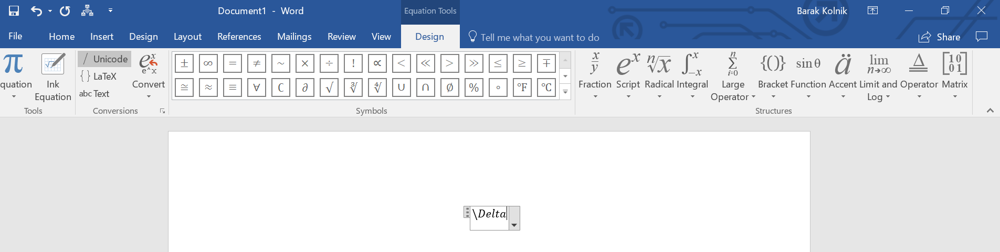
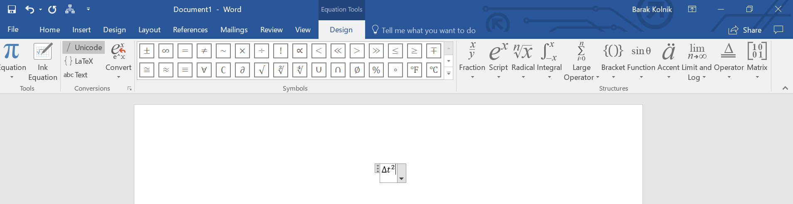
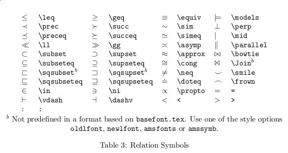

# הקלדת נוסחאות במחשב (LaTeX)

כתיבת נוסחאות ב-Word או ב-Google Docs בעזרת העכבר **איטית ומסורבלת**. אפשר לעשות את זה **מהמקלדת**, בעזרת **פקודות LaTeX**.

## איך זה עובד

‏**LaTeX** מייצג סמלים שאי אפשר להקליד (שבר, אות יוונית, חץ של וקטור, חזקה) בעזרת **תווים רגילים**. Word ו-Google Docs תומכים בהרבה מהפקודות **בתוך עורך המשוואות**.

- **פקודה** מתחילה ב**קו נטוי הפוך** (`\`) ואחריו **שם הסמל**. אחרי הפקודה לוחצים **רווח** - והסמל מופיע. לדוגמה, `\alpha` ורווח נותנים $\alpha$.
- **כתב עילי** (חזקה): `^`. לדוגמה, `r^2` ורווח נותנים $r^2$.
- **כתב תחתי**: `_`. לדוגמה, `x_1` נותן $x_1$.
- בסמלים **שמכילים משהו** (כמו שורש) לפעמים צריך ללחוץ **רווח פעמיים**: `\sqrt`, רווח, רווח.

(בעורכים האלה זה לא **בדיוק** LaTeX: ב-LaTeX אמיתי כותבים `\sqrt{2}` כדי לקבל $\sqrt{2}$.)

## דוגמה: להקליד $\Delta t^2$

**בלי LaTeX**: בוחרים מהתפריט את האות דלתא, בוחרים "כתב עילי", ומקלידים $t$ ו-$2$.

**עם LaTeX**:

1. כותבים `\Delta`

   

2. לוחצים **רווח** - ומופיע $\Delta$:

   

3. כותבים `t^2`

   

4. לוחצים **רווח** - ומופיע $t^2$:

   

## סמלים שימושיים

| סמל | פקודה |
|---|---|
| ‏$\alpha$, $\theta$, $\omega$, $\mu$, $\pi$ | ‏`\alpha`, `\theta`, `\omega`, `\mu`, `\pi` |
| ‏$\Delta$, $\Sigma$ | ‏`\Delta`, `\Sigma` |
| ‏$\frac{1}{2}$ | ‏`\frac` |
| ‏$\vec{a}$ | ‏`\vec`, רווח, `a` |
| ‏$\sqrt{x}$ | ‏`\sqrt` |
| ‏$\lvert x\rvert$ | ‏`\abs` |
| ‏$\int$ | ‏`\int` |
| ‏$\angle$ | ‏`\angle` |
| ‏$x_1$, $x^2$ | ‏`x_1`, `x^2` |
| ‏$\sin$, $\cos$, $\tan$ | ‏`\sin`, `\cos`, `\tan` |
| ‏$\arcsin$, $\arccos$, $\arctan$ | ‏`\arcsin`, `\arccos`, `\arctan` |
| ‏$\rightarrow$ | ‏`\rightarrow` |

