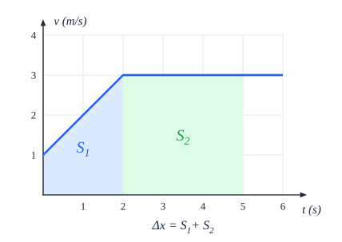

# גדלים, יחידות וגרפים

## גודל פיזיקלי

גודל פיזיקלי מורכב משני חלקים: **מספר** ו**יחידת מידה**. לדוגמה, "$5\ \text{m}$" - המספר 5 והיחידה מטר. מספר בלי יחידה הוא **חסר משמעות** בפיזיקה.

- **מותר לחבר ולחסר** רק גדלים **עם אותן יחידות**: אפשר לחבר מטרים למטרים, אבל לא מטרים לשניות.
- **כפל וחילוק** מותרים בין כל הגדלים - והיחידות **מוכפלות ומחולקות** יחד עם המספרים: $\frac{\text{m}}{\text{s}}$ היא יחידת מהירות.

## יחידות SI

בבחינה **ממירים תמיד ליחידות SI** לפני שמציבים מספרים.

| גודל | סימון | יחידה | סימן היחידה |
|---|---|---|---|
| **אורך** | ‏$x, l, d$ | מטר | ‏$\text{m}$ |
| **זמן** | ‏$t$ | שנייה | ‏$\text{s}$ |
| **מסה** | ‏$m$ | קילוגרם | ‏$\text{kg}$ |
| **כוח** | ‏$F$ | ניוטון | ‏$\text{N} = \text{kg}\cdot\text{m/s}^2$ |
| **אנרגיה ועבודה** | ‏$E, W$ | ג'אול | ‏$\text{J} = \text{N}\cdot\text{m}$ |
| **תדירות** | ‏$f$ | הרץ | ‏$\text{Hz} = \frac{1}{\text{s}}$ |
| **מטען** | ‏$q$ | קולון | ‏$\text{C}$ |
| **מתח** | ‏$V$ | וולט | ‏$\text{V}$ |
| **זרם** | ‏$I$ | אמפר | ‏$\text{A}$ |

**יחידות זמן נוספות**: דקה ($\text{min}$) = 60 שניות; שעה ($\text{h}$) = 3600 שניות; יום ($\text{d}$).

### קידומות

קידומת לפני יחידה היא **כפל בחזקה של 10**.

| שם | אות | ערך |
|---|---|---|
| **מגה** | ‏$\text{M}$ | ‏$10^{6}$ |
| **קילו** | ‏$\text{k}$ | ‏$10^{3}$ |
| **דצי** | ‏$\text{d}$ | ‏$10^{-1}$ |
| **סנטי** | ‏$\text{c}$ | ‏$10^{-2}$ |
| **מילי** | ‏$\text{m}$ | ‏$10^{-3}$ |
| **מיקרו** | ‏$\mu$ | ‏$10^{-6}$ |
| **ננו** | ‏$\text{n}$ | ‏$10^{-9}$ |
| **פיקו** | ‏$\text{p}$ | ‏$10^{-12}$ |

**דוגמאות להמרה:**

- ‏$3\ \text{cm} = 3\cdot10^{-2}\ \text{m} = 0.03\ \text{m}$
- ‏$5\ \mu\text{C} = 5\cdot10^{-6}\ \text{C}$
- **קמ"ש למטר לשנייה** - מחלקים ב-3.6: $72\ \text{km/h} = \frac{72\,000\ \text{m}}{3600\ \text{s}} = 20\ \text{m/s}$

## בדיקת יחידות

כדי לגלות מה היחידות של גודל במשוואה, **מבודדים אותו** ובודקים את יחידות **האגף השני**.

**דוגמה**: מה היחידות של $F$ במשוואה $F = ma$? מכפילים את יחידות $m$ ו-$a$: $\text{kg}\cdot\frac{\text{m}}{\text{s}^2}$ - וזה **ניוטון**.

בדיקת יחידות היא גם **דרך מצוינת לתפוס טעויות**: אם בסוף החישוב של מהירות יצאו $\text{m}^2$ - יש טעות.

## קריאת גרפים: שיפוע ושטח

אם בשאלה יש **גרף**, כמעט תמיד צריך אחד משני דברים:

| מה | המשמעות | דוגמה |
|---|---|---|
| **שיפוע** הגרף | קצב השינוי של הגודל באנך, לפי הגודל באופק: $\frac{\Delta y}{\Delta x}$ | שיפוע גרף **מקום-זמן** = **מהירות** |
| **שטח מתחת** לגרף | מכפלה של שני הגדלים, מצטברת | שטח מתחת לגרף **מהירות-זמן** = **העתק** |

### איך מחשבים שטח מתחת לגרף?

1. **מחלקים** את השטח לצורות פשוטות: **מלבנים, משולשים, טרפזים**.
2. באזור שאי אפשר לחלק - **סופרים משבצות** (כולל חצאי משבצות), ומעריכים כמה שיותר מדויק.
3. מחשבים **כמה "שווה" משבצת אחת**: אם בציר אחד כל משבצת היא $2\ \text{m/s}$ ובציר השני $10\ \text{s}$, משבצת שווה $2\cdot10 = 20\ \text{m}$.
4. **מכפילים** את מספר המשבצות בערך של משבצת.

**דוגמה** (לפי הגרף): בין $t=0$ ל-$t=2$ - **טרפז**: $S_1 = \frac{(1+3)\cdot2}{2} = 4\ \text{m}$. בין $t=2$ ל-$t=5$ - **מלבן**: $S_2 = 3\cdot3 = 9\ \text{m}$. ההעתק הכולל: $\Delta x = 13\ \text{m}$.

### שרטוט גרף מטבלה

1. ממקמים את הנקודות במערכת הצירים. **קנה המידה** - אחיד בכל ציר, ומנצל כמה שיותר מהדף.
2. משרטטים **קו מגמה** (ישר, אם התיאוריה אומרת שהקשר קווי) שעובר **בין** הנקודות - לא בהכרח דרכן.
3. מחשבים את השיפוע לפי **שתי נקודות על הקו** - **רחוקות זו מזו**, ו**לא** מהטבלה.

## שאלות לחזרה

- המר $54\ \text{km/h}$ ל-$\text{m/s}$, ו-$250\ \text{mA}$ ל-$\text{A}$.
- מה היחידות של $k$ בחוק הוק $F = kx$?
- מה המשמעות של השיפוע ושל השטח בגרף מהירות-זמן?
- למה מחשבים שיפוע לפי נקודות על קו המגמה ולא לפי נקודות מהטבלה?
