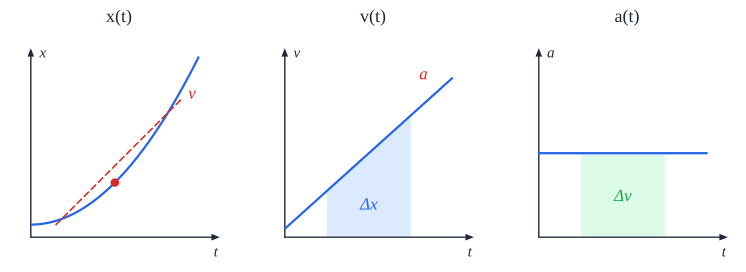

# קינמטיקה - תיאור תנועה

**קינמטיקה** עוסקת ב**תיאור** התנועה: איפה הגוף, כמה מהר ולאן הוא נע. (**למה** הוא נע כך - זו הדינמיקה, בפרק הבא.)

**תנועה** = שינוי המקום של גוף **ביחס לזמן**.

## מושגי יסוד

| מושג | סימון | הגדרה | וקטור? |
|---|---|---|---|
| **ציר** | | קו עם **ראשית**, **יחידות** ו**כיוון חיובי** - לפיו מודדים מקום | |
| **מקום** | ‏$x$ | ערך של נקודה על הציר | כן |
| **העתק** | ‏$\Delta x$ | **הפרש מקומות**: מאוחר פחות מוקדם, $\Delta x = x_2 - x_1$ | כן |
| **מרחק** | ‏$D$ | הערך המוחלט של ההפרש בין שני מקומות | לא |
| **דרך** | ‏$S$ | **סכום הערכים המוחלטים** של כל ההעתקים החלקיים - כמה הגוף "הלך" בפועל | לא |
| **מהירות** | ‏$v$ | קצב שינוי המקום | כן |
| **תאוצה** | ‏$a$ | קצב שינוי המהירות | כן |

**הבדל חשוב - העתק מול דרך**: רץ שמקיף מסלול של 400 מטר וחוזר לנקודת ההתחלה - **הדרך** 400 מטר, **ההעתק** 0.

**כלל**: בכל שינוי מחשבים **מאוחר פחות מוקדם**.

## מהירות ותאוצה

**מהירות ממוצעת** - ההעתק חלקי הזמן:

$$\vec{v} = \frac{\Delta \vec{x}}{\Delta t}$$

**מהירות רגעית** - המהירות ברגע מסוים. היא **הנגזרת** של המקום לפי הזמן, ובגרף מקום-זמן היא **שיפוע המשיק**. יחידות: $\text{m/s}$.

**תאוצה** - שינוי המהירות חלקי הזמן:

$$\vec{a} = \frac{\Delta \vec{v}}{\Delta t}$$

יחידות: $\text{m/s}^2$. התאוצה היא **וקטור**, וכיוונה הוא **כיוון השינוי במהירות** $\Delta\vec{v}$ - לא בהכרח כיוון התנועה.

**אין קשר ישיר** בין גודל המהירות לגודל התאוצה ברגע מסוים: גוף יכול לנוע מהר בלי תאוצה, או לעמוד לרגע עם תאוצה (כמו כדור בשיא הזריקה).

- מהירות ותאוצה **באותו כיוון** ← הגוף **מאיץ**.
- מהירות ותאוצה **בכיוונים מנוגדים** ← הגוף **מאט**.

## הקשר בין הגרפים

| מגרף... | **השיפוע** נותן | **השטח מתחת** נותן |
|---|---|---|
| **מקום-זמן** $x(t)$ | **מהירות** | - |
| **מהירות-זמן** $v(t)$ | **תאוצה** | **העתק** |
| **תאוצה-זמן** $a(t)$ | - | **שינוי מהירות** |

בשפת החשבון הדיפרנציאלי: התאוצה היא נגזרת המהירות, והמהירות היא נגזרת המקום - $a(t) = \dot{v}(t) = \ddot{x}(t)$. בכיוון ההפוך - **אינטגרל**.

## סוגי תנועה בקו ישר

### תנועה שוות מהירות

הגוף עובר **העתקים שווים בפרקי זמן שווים**. התאוצה **אפס**.

$$x(t) = x_0 + v\,(t - t_0)$$

גרף מקום-זמן - **קו ישר**, שיפועו המהירות.

### תנועה שוות תאוצה

המהירות משתנה **בקצב קבוע**. ארבע נוסחאות (בדף הנוסחאות; $t_0 = 0$):

| נוסחה | מתי נוחה |
|---|---|
| ‏$v = v_0 + at$ | אין מקום |
| ‏$x = x_0 + v_0 t + \frac{1}{2}at^2$ | אין מהירות סופית |
| ‏$v^2 = v_0^2 + 2a\,\Delta x$ | **אין זמן** |
| ‏$\Delta x = \frac{v_0 + v}{2}\,t$ | אין תאוצה |

גרף מהירות-זמן - **ישר**; גרף מקום-זמן - **פרבולה**.

### תנועה אחרת

לא שוות מהירות ולא שוות תאוצה - מנתחים בעזרת **גרפים**, **שיפועים** ו**שטחים**.

## ניתוח תנועה ממדידות

כשנותנים טבלת מדידות (למשל מתרשים עקבות - סימנים שהגוף משאיר **בהפרשי זמן קבועים**):

1. **טבלת מקום-זמן**, ואז **גרף מקום-זמן**.
2. **מהירות רגעית** בכל נקודה - לפי השכנות משני הצדדים:
   $$v_n = \frac{x_{n+1} - x_{n-1}}{t_{n+1} - t_{n-1}}$$
3. **טבלת מהירות-זמן**, ואז **גרף מהירות-זמן**.
4. משרטטים **קו מגמה** - מתאר את המגמה הממוצעת. סוג הקו (ישר, פרבולה) לפי **התיאוריה**.
5. **התאוצה** = **שיפוע** קו המגמה, לפי **שתי נקודות על הקו**, רחוקות זו מזו.

בכיוון ההפוך - מגרף מהירות למקום: $x_n = x_{n-1} + v_n\,\Delta t_n$.

**גרף פיזור** (רק נקודות, בלי קו) מתאר מדידות - **אסור לחבר** את הנקודות. **גרף רציף** מתאר פונקציה.

## דוגמה

מכונית נוסעת ב-$20\ \text{m/s}$ ובולמת בתאוצה קבועה של $4\ \text{m/s}^2$. כמה זמן וכמה מטרים עד שתעצור?

- **ציר**: חיובי בכיוון הנסיעה. לכן $v_0 = 20$, $a = -4$ (מאטה), $v = 0$.
- **זמן**: $v = v_0 + at \Rightarrow 0 = 20 - 4t \Rightarrow t = 5\ \text{s}$.
- **דרך** (בלי זמן): $v^2 = v_0^2 + 2a\Delta x \Rightarrow 0 = 400 - 8\Delta x \Rightarrow \Delta x = 50\ \text{m}$.
- **בדיקה**: $\Delta x = \frac{20 + 0}{2}\cdot5 = 50\ \text{m}$. ✓

## שאלות לחזרה

- מה ההבדל בין העתק לדרך? תן דוגמה שבה הם שונים.
- האם גוף יכול להיות במנוחה ובכל זאת בעל תאוצה? הסבר.
- מה מקבלים מהשיפוע ומהשטח של כל אחד משלושת הגרפים?
- כתוב את ארבע נוסחאות התנועה שוות התאוצה. באיזו משתמשים כשאין זמן?
