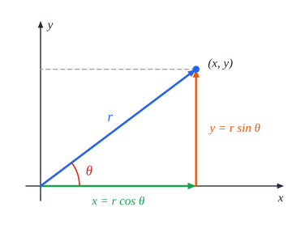
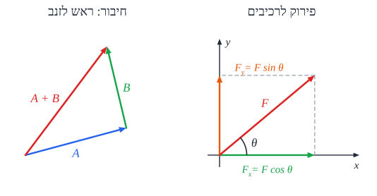

# וקטורים ומערכות צירים

## סקלר ווקטור

| | **סקלר** | **וקטור** |
|---|---|---|
| **מה יש לו** | רק **גודל** | **גודל וכיוון** |
| **דוגמאות** | זמן, מסה, דרך, אנרגיה | העתק, מהירות, תאוצה, כוח |
| **סימון** | ‏$m$ | חץ מעל: $\vec{v}$. הגודל: $v = \lvert\vec{v}\rvert$ |

- **כשלא כתוב "גודל"** - מתכוונים ל**וקטור**: התשובה צריכה לכלול **גם כיוון** (חץ או מילים).
- **שוויון וקטורים**: שני וקטורים שווים אם הם שווים **בגודל וגם בכיוון**.
- **וקטור נגדי**: $-\vec{A}$ - באותו גודל, **בכיוון ההפוך**.
- **כפל בסקלר**: $c\vec{A}$ - וקטור בגודל $\lvert c\rvert A$, **מקביל** ל-$\vec{A}$ (ואם $c<0$ - בכיוון ההפוך).

## מערכות צירים

- **קרטזית** - שני צירים **מאונכים**. כל נקודה מתוארת ב**רכיב** $x$ וב**רכיב** $y$.
- **קוטבית (פולרית)** - כל נקודה מתוארת ב**מרחק** $r$ מהראשית וב**זווית** $\theta$.

**המרה מקוטבית לקרטזית:**

$$x = r\cos\theta \qquad y = r\sin\theta$$

**המרה מקרטזית לקוטבית:**

$$r = \sqrt{x^2 + y^2} \qquad \theta = \arctan\frac{y}{x}$$

**זווית של וקטור** מודדים ביחס **לציר $x$ הקרוב**. תמיד **משרטטים** את הזווית - זה עוזר להבין ומונע טעויות (בעיקר ב-$\arctan$, שלא מבחין בין רביעים).

## חיבור וקטורים

### חיבור גיאומטרי - "ראש לזנב"

מצמידים את **הזנב** של הווקטור השני ל**ראש** של הראשון. **השקול** - מהזנב של הראשון לראש של האחרון.

**חיסור** = חיבור **הנגדי**: $\vec{A} - \vec{B} = \vec{A} + (-\vec{B})$.

### חיבור אלגברי - וקטורים מקבילים

כשהווקטורים על **אותו ישר**, בוחרים **כיוון חיובי** ומחברים מספרים **עם סימנים**:

- **באותו כיוון**: $c = a + b$.
- **בכיוונים מנוגדים**: $c = a - b$.

**כלל ההצבה**: וקטור **נגד** כיוון הציר מציבים **עם מינוס**.

### חיבור ברכיבים - הדרך הכללית

1. מציירים את כל הווקטורים ב**מערכת צירים**.
2. **מפרקים** כל וקטור לרכיבים: $F_x = F\cos\theta$, $F_y = F\sin\theta$ (עם סימנים לפי הכיוון).
3. מחברים **בנפרד**: $\Sigma F_x$ ו-$\Sigma F_y$.
4. מרכיבים את השקול: $F = \sqrt{(\Sigma F_x)^2 + (\Sigma F_y)^2}$, $\tan\theta = \frac{\Sigma F_y}{\Sigma F_x}$.

**עיקרון**: מה שקורה לרכיבים - קורה לשקול, ולהפך. משוואה וקטורית **מתקיימת בכל ציר בנפרד**.

## דוגמה

על גוף פועלים שני כוחות: $F_1 = 10\ \text{N}$ ימינה, ו-$F_2 = 10\ \text{N}$ בזווית $60°$ מעל ציר $x$. מה השקול?

- **רכיבי $x$**: $10 + 10\cos60° = 10 + 5 = 15\ \text{N}$.
- **רכיבי $y$**: $0 + 10\sin60° \approx 8.66\ \text{N}$.
- **גודל**: $\sqrt{15^2 + 8.66^2} \approx 17.3\ \text{N}$.
- **כיוון**: $\theta = \arctan\frac{8.66}{15} = 30°$ מעל ציר $x$ - בדיוק **באמצע** בין שני הכוחות, כצפוי משני כוחות שווים.

## שאלות לחזרה

- מה ההבדל בין סקלר לווקטור? תן שתי דוגמאות לכל אחד.
- פרק וקטור בגודל $20$ בזווית $30°$ לרכיביו.
- איך מחברים שלושה וקטורים שאינם מקבילים?
- למה צריך לשרטט את הזווית כשמשתמשים ב-$\arctan$?
