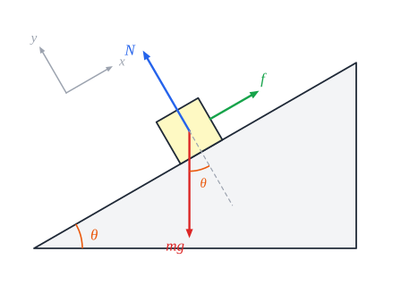

# דינמיקה - חוקי ניוטון וכוחות

**דינמיקה** מסבירה **למה** גוף נע כמו שהוא נע: התשובה היא **הכוחות** שפועלים עליו.

**כוח** - **אינטראקציה** בין **שני גופים בדיוק**. לכל כוח יש **מי שמפעיל** ו**על מי** הוא פועל. כוחות הם **מגע** (נורמל, חיכוך, מתיחות) או **מרחוק** (כבידה, חשמלי, מגנטי). יחידה: **ניוטון** ($\text{N}$).

## שלושת חוקי ניוטון

### החוק הראשון - התמדה

**שקול הכוחות על גוף הוא אפס - אם ורק אם מהירותו לא משתנה.** גוף במנוחה נשאר במנוחה, וגוף בתנועה ממשיך **בקו ישר ובמהירות קבועה**.

### החוק השני

$$\Sigma\vec{F} = m\vec{a}$$

- **שקול הכוחות** שווה למסה כפול התאוצה.
- זה חוק **וקטורי** - ולכן **מתקיים בכל ציר בנפרד**: $\Sigma F_x = ma_x$, $\Sigma F_y = ma_y$.
- **מסקנה**: **שקול הכוחות תמיד בכיוון התאוצה** (לא בהכרח בכיוון התנועה!).
- **מסה** - מידת ה"עקשנות" של הגוף: ככל שהמסה גדולה יותר, **קשה יותר לשנות** את מהירותו.

### החוק השלישי - פעולה ותגובה

אם גוף 1 מפעיל כוח על גוף 2, **גוף 2 מפעיל על גוף 1 כוח שווה בגודלו ומנוגד בכיוונו**.

**שימו לב**: שני הכוחות פועלים על **גופים שונים** - ולכן **לא מבטלים** זה את זה. (הספר על השולחן: כוח הכובד והנורמל **אינם** זוג פעולה-תגובה. בן הזוג של הנורמל הוא הכוח שהספר מפעיל **על השולחן**.)

## סוגי הכוחות

| כוח | סימון | כיוון | גודל ותכונות |
|---|---|---|---|
| **כובד** (משקל) | ‏$W$ | **למטה**, למרכז כדור הארץ | ‏$W = mg$ |
| **נורמל** | ‏$N$ | **מאונך** למשטח, החוצה ממנו | **תוצאתי** - בדיוק כמה שצריך כדי שהגוף לא ייכנס למשטח |
| **מתיחות** | ‏$T$ | **לאורך החבל**, מהגוף אל החבל ("מושך") | בחוט **חסר מסה** - **שווה לכל אורכו**; בחוט עם מסה - שונה בנקודות שונות |
| **קפיץ** | ‏$F_s$ | **מחזיר** - נגד השינוי באורך | **חוק הוק**: $\vec{F}_s = -k\,\Delta\vec{l}$ |
| **חיכוך סטטי** | ‏$f_s$ | **מקביל** למשטח, **נגד** הנטייה לזוז | **תוצאתי**, עד מקסימום: $f_s \le \mu_s N$ |
| **חיכוך קינטי** | ‏$f_k$ | **מקביל** למשטח, **נגד** כיוון ההחלקה | **קבוע**: $f_k = \mu_k N$ |

### חוק הוק

- ‏$k$ - **קבוע הקפיץ**, מודד את **קשיחותו** ($\text{N/m}$).
- ‏$\Delta l$ - השינוי באורך **ביחס לאורך הרפוי**.
- **המינוס** - הכוח **מחזיר**: מותחים את הקפיץ - הוא "רוצה" להתכווץ; מכווצים - הוא "רוצה" להתארך.
- **אלסטי**: כשמרפים - חוזר לצורתו, ו**אותו כוח** תמיד גורם **לאותה התארכות**. אם עוברים את **גבול האלסטיות**, הגוף הופך **פלסטי** - לא חוזר (כמו גומייה שנמתחה יותר מדי).

### חיכוך

- נוצר **מלחיצה** בין משטחים, ולכן תלוי בנורמל.
- **סטטי** - כשאין החלקה. הוא **מתאים את עצמו**: אם דוחפים ארון ב-$20\ \text{N}$ והוא לא זז - החיכוך הוא בדיוק $20\ \text{N}$.
- **קינטי** - כשיש החלקה. **קבוע**, לא תלוי במהירות.
- **מקדמי החיכוך** $\mu$ **חסרי יחידות** ותלויים בסוג החומרים. בדרך כלל $\mu_s \ge \mu_k$. אם השאלה לא מבחינה - הם **שווים**.

## דרך עבודה בשאלת דינמיקה

1. **אילו כוחות פועלים?** קודם **הכובד**; אחר כך **כל מה שנוגע** בגוף (נורמל וחיכוך מכל משטח, מתיחות מכל חבל, קפיץ); בסוף כוחות **חשמליים ומגנטיים**.
2. **תרשים כוחות** - לכל גוף בנפרד.
3. **בחירת צירים** - רצוי שאחד מהם **בכיוון התאוצה**.
4. **סוג התנועה בכל ציר:**
   - שקול **אפס** ← **שוות מהירות** (חוק 1).
   - שקול **קבוע ושונה מאפס** ← **שוות תאוצה** (חוק 2).
   - שקול **משתנה** ← תנועה **אחרת**.
5. **משוואת כוחות לכל ציר**: $\Sigma F_x = ma_x$, $\Sigma F_y = ma_y$.
6. **פתרון** - קודם עם **פרמטרים**, ורק בסוף מציבים מספרים.

**כלל אצבע**: כמעט בכל שאלה צריך **תרשים כוחות** ו**משוואות כוחות**. אם לא צריך - זה חשוד.

## דוגמאות חשובות

### גוף על מישור משופע

- **בוחרים ציר $x$ לאורך המישור** ו-$y$ מאונך לו - כי בציר $y$ אין תנועה ($a_y = 0$).
- **מפרקים את הכובד**: לאורך המישור $mg\sin\theta$ (במורד), מאונך למישור $mg\cos\theta$ (לתוך המישור).
- **ציר $y$**: $N - mg\cos\theta = 0 \Rightarrow N = mg\cos\theta$.
- **ציר $x$** (גוף מחליק במורד עם חיכוך קינטי): $mg\sin\theta - \mu_k mg\cos\theta = ma$, ולכן $a = g(\sin\theta - \mu_k\cos\theta)$.
- שימו לב: **המסה מצטמצמת** - התאוצה לא תלויה במסה.

### מעלית

אדם במעלית שמאיצה בתאוצה $a$ **כלפי מעלה**: $N - mg = ma \Rightarrow N = m(g + a)$. הנורמל (מה שהמשקל במעלית מראה) **גדל**. במעלית שמאיצה **כלפי מטה** - **קטן**. בנפילה חופשית ($a = g$) - **אפס**: "חוסר משקל".

### חוט וגלגלת

- **המתיחות שווה בשני צדי** גלגלת חסרת מסה וחיכוך.
- **אילוץ גיאומטרי**: החוט לא נמתח - אם צד אחד מתארך, השני **מתקצר באותה מידה**. לכן לשני הגופים **אותו גודל תאוצה**.
- **איחוד גופים**: אפשר להתייחס לשני גופים **כגוף אחד** רק אם הם נעים **יחד, באותו ציר**.

### מכונית על כביש

- **הכוח שמניע מכונית** הוא **חיכוך סטטי**: הגלגל **לא מחליק** - כל רגע נקודה אחרת שלו נוגעת בכביש. הגלגל דוחף את הכביש אחורה, והכביש דוחף את המכונית קדימה (חוק 3).
- כשהגלגלים **ננעלים** והמכונית מחליקה - פועל **חיכוך קינטי** (בדרך כלל קטן יותר), ו**לנהג אין שליטה**. לכן מערכת **ABS** מונעת נעילה.

## דגשים

- **כוח שקול** אינו כוח נוסף - **לא מציירים** אותו בתרשים הכוחות.
- **בכבידה** (רחוק מפני כדור הארץ) - **לא** משתמשים ב-$g = 10$, אלא בחוק הכבידה.
- כשיש **חיכוך**, בודקים את **גודלו וכיוונו** - ומהם מסיקים על התנועה (האם הגוף זז בכלל?).
- **רוצים לדעת מה קורה** למקום, למהירות או לתאוצה? **מסתכלים על הכוחות**.

## שאלות לחזרה

- נסח את שלושת חוקי ניוטון. למה כוחות פעולה ותגובה לא מבטלים זה את זה?
- מה ההבדל בין חיכוך סטטי לחיכוך קינטי?
- גוף על מישור משופע בזווית $\theta$ בלי חיכוך: מה תאוצתו? מה הנורמל?
- מה מראה מאזניים במעלית שמאיצה כלפי מעלה? כלפי מטה?
- איזה כוח מניע מכונית? למה?
