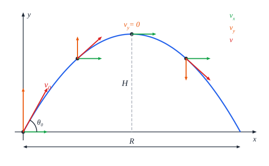

# נפילה חופשית וזריקה משופעת

## נפילה חופשית

**נפילה חופשית** - תנועה של גוף **בהשפעת כוח הכובד בלבד** (בלי התנגדות אוויר). היא יכולה להיות **אנכית** (כדור שנזרק למעלה), **אופקית** (כדור שמתגלגל מקצה שולחן) או **משופעת** (כדור שנבעט באלכסון).

**תאוצת הכובד** $g$ - התאוצה של גוף בנפילה חופשית:

- **כיוון**: **למטה**, לכיוון מרכז כדור הארץ.
- **גודל**: ליד פני כדור הארץ - **קבוע**, $g = 9.8\ \text{m/s}^2$. בחישובים - $g = 10\ \text{m/s}^2$.
- **לא תלויה במסה**: בלי אוויר, נוצה ופטיש נופלים יחד.

## הרעיון המרכזי: שתי תנועות נפרדות

זריקה משופעת היא **שילוב של שתי תנועות בלתי תלויות**:

| ציר | כוח | סוג התנועה |
|---|---|---|
| **אופקי** $x$ | **אין** | **שוות מהירות** - $v_x$ קבוע לאורך כל הדרך |
| **אנכי** $y$ | הכובד, $mg$ | **שוות תאוצה** - $a_y = -g$ (אם ציר $y$ למעלה) |

בכל נקודה - **הרכיב האופקי** (ירוק) **זהה**, **הרכיב האנכי** (כתום) **קטן** בעלייה, **אפס** בשיא, ו**גדל כלפי מטה** בירידה. המהירות (אדומה) תמיד **משיקה למסלול**.

## המשוואות

מפרקים את המהירות ההתחלתית: $v_{0x} = v_0\cos\theta_0$, $v_{0y} = v_0\sin\theta_0$.

| | **ציר $x$** | **ציר $y$** |
|---|---|---|
| **מהירות** | ‏$v_x = v_{0x}$ | ‏$v_y = v_{0y} - gt$ |
| **מקום** | ‏$x = x_0 + v_{0x}t$ | ‏$y = y_0 + v_{0y}t - \frac{1}{2}gt^2$ |

**המהירות בכל רגע**: $v = \sqrt{v_x^2 + v_y^2}$, והזווית מתחת/מעל לאופק: $\tan\theta = \frac{\lvert v_y\rvert}{v_x}$.

**המסלול** - **פרבולה**: מבודדים $t$ ממשוואת $x$ ומציבים במשוואת $y$.

### גדלים שימושיים (זריקה מהקרקע לקרקע)

- **זמן עד השיא** - כש-$v_y = 0$: $t_{top} = \frac{v_{0y}}{g}$.
- **גובה מקסימלי**: $H = \frac{v_{0y}^2}{2g}$.
- **זמן התעופה**: $2t_{top}$.
- **טווח** (המרחק האופקי עד שהגוף חוזר **לאותו גובה**):

$$R = \frac{v_0^2\sin2\theta_0}{g}$$

הטווח **מקסימלי בזווית $45°$**, וזוויות **משלימות** ל-$90°$ (כמו $30°$ ו-$60°$) נותנות **אותו טווח**.

## כללי אצבע

- כמעט תמיד מתחילים ממשוואת **מקום-זמן** - ואם היא לא מספיקה, עוברים לאחרת.
- **"גובה מקסימלי"** פירושו $v_y = 0$. **"פוגע בקרקע"** פירושו $y = 0$.
- **זמן העלייה = זמן הירידה** (לאותו גובה).
- **באותו גובה** - אותו גודל של מהירות אנכית, **בכיוונים הפוכים**.
- מי שמגיע **גבוה יותר** - נמצא **יותר זמן באוויר**, ופוגע בקרקע **מהר יותר**.
- **מתי שני גופים נפגשים?** כשהם באותו מקום **בשני הצירים** באותו רגע - בודקים כל ציר **בנפרד**.
- גוף שנזרק **מגוף נע** (רכבת, מטוס) - המהירות ההתחלתית שלו ביחס לקרקע **כוללת** את מהירות הגוף הנע.

## דוגמאות חשובות

### פצצה ממטוס

מטוס שטס אופקית במהירות קבועה משחרר פצצה. לפצצה **אותה מהירות אופקית** כמו למטוס - ולכן היא **תמיד מתחת למטוס** (בלי אוויר), עד שהיא פוגעת בקרקע.

### חץ ותפוח

חץ מכוון **ישר אל תפוח**, והתפוח **נופל מהעץ** ברגע היריה. החץ **יפגע**:

- **אופקית** - החץ עובר את המרחק עד העץ.
- **אנכית** - **שניהם נופלים** באותה תאוצה $g$. החץ "נופל" מתחת לקו הכיוון בדיוק כמו שהתפוח נופל מהעץ - ולכן הם נפגשים.

### כדור שנבעט

כדור נבעט ב-$v_0 = 20\ \text{m/s}$ בזווית $30°$ מהקרקע. ($g = 10$)

- **פירוק**: $v_{0x} = 20\cos30° \approx 17.3\ \text{m/s}$, $v_{0y} = 20\sin30° = 10\ \text{m/s}$.
- **זמן עד השיא**: $t = \frac{10}{10} = 1\ \text{s}$; **גובה מקסימלי**: $H = \frac{10^2}{2\cdot10} = 5\ \text{m}$.
- **זמן תעופה**: $2\ \text{s}$; **טווח**: $17.3\cdot2 \approx 34.6\ \text{m}$. (בדיקה בנוסחה: $\frac{400\sin60°}{10} \approx 34.6$ ✓)

## שאלות לחזרה

- למה המהירות האופקית בזריקה משופעת קבועה?
- מה מתקיים בשיא המסלול? חשב את הגובה המקסימלי בעזרת $v_{0y}$.
- באיזו זווית הטווח מקסימלי? אילו זוויות נותנות טווח שווה?
- הסבר למה החץ פוגע בתפוח הנופל.
