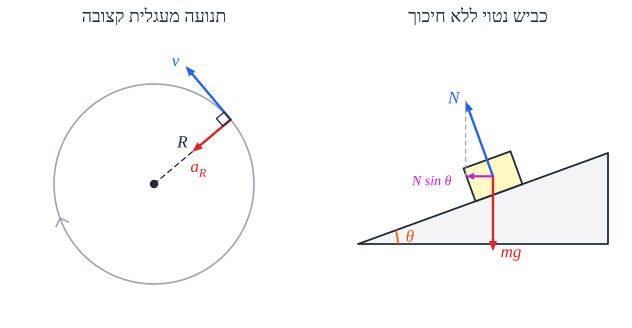

# תנועה מעגלית

## תנועה מחזורית

**תנועה מחזורית** - תנועה ש**חוזרת על עצמה** בזמן.

| גודל | סימון | הגדרה | יחידות |
|---|---|---|---|
| **זמן מחזור** | ‏$T$ | הזמן של **מחזור אחד** (המחזור **הקצר ביותר** שחוזר) | ‏$\text{s}$ |
| **תדירות** | ‏$f$ | **כמה מחזורים בשנייה** | ‏$\text{Hz} = \frac{1}{\text{s}}$ |
| **מהירות זוויתית** | ‏$\omega$ | **קצב הסיבוב**: $\omega = \frac{\Delta\theta}{\Delta t}$ | ‏$\frac{\text{rad}}{\text{s}}$ |

$$f = \frac{1}{T} \qquad \omega = \frac{2\pi}{T} = 2\pi f$$

## תנועה מעגלית קצובה

**קצובה** = **גודל** המהירות קבוע (ולכן גם $\omega$ קבועה). אבל **הכיוון** משתנה כל הזמן - ולכן **יש תאוצה**!

- **המהירות** - **משיקה** למעגל.
- **התאוצה** - **אל המרכז** ("**צנטריפטלית**" או **רדיאלית**), **מאונכת** למהירות:

$$a_R = \frac{v^2}{R} = \omega^2 R \qquad v = \omega R$$

### הדינמיקה

לפי החוק השני, צריך **כוח שקול אל המרכז**:

$$\Sigma F_R = m\frac{v^2}{R}$$

**חשוב**: אין "כוח צנטריפטלי" מיוחד. **אחד הכוחות הרגילים** (או רכיב שלו, או שקול של כמה) הוא שמוביל אל המרכז:

| מצב | מה מספק את הכוח אל המרכז |
|---|---|
| **לוויין** סביב כדור הארץ | **כבידה** |
| **אבן** קשורה לחוט | **מתיחות** |
| **מכונית בפנייה** בכביש ישר | **חיכוך סטטי** |
| **מכונית בכביש נטוי** בלי חיכוך | **רכיב הנורמל** |
| **חלקיק טעון** בשדה מגנטי | **כוח מגנטי** |

### שיטת עבודה

1. **איפה המעגל?** (אופקי? אנכי?) **איפה המרכז?**
2. **צירים**: ציר רדיאלי $R$ **אל המרכז**, וציר **מאונך** לו.
3. **משוואות**: בכיוון המרכז $\Sigma F_R = m\frac{v^2}{R}$; בציר המאונך (במעגל אופקי) $\Sigma F = 0$.

## דוגמאות חשובות

### הטיית כביש

- **כביש אופקי**: רק **החיכוך** מוביל אל המרכז. אם המהירות גדולה מדי - המכונית **מחליקה החוצה**.
- **כביש נטוי בלי חיכוך**: **רכיב הנורמל** מוביל אל המרכז.
  - **אנכית**: $N\cos\theta = mg$.
  - **אל המרכז**: $N\sin\theta = m\frac{v^2}{R}$.
  - **מחלקים**: $\tan\theta = \frac{v^2}{gR}$ - יש **רק מהירות אחת** מתאימה. נוסעים **לאט** יותר - המכונית **מחליקה פנימה** (במורד); **מהר** יותר - **החוצה**.
- **כביש נטוי עם חיכוך**: גם החיכוך תורם.
  - **מהירות מקסימלית** - החיכוך **במורד** (אל המרכז) ומקסימלי.
  - **מהירות מינימלית** - החיכוך **במעלה** (נגד המרכז) ומקסימלי.

### מטוטלת קונית

משקולת על חבל שמסתובבת **במעגל אופקי**. רכיב **המתיחות** האופקי מוביל אל המרכז, והאנכי מאזן את הכובד. **קשר גיאומטרי**: אם $\alpha$ היא הזווית בין החבל לבין רדיוס המעגל, $\cos\alpha = \frac{R}{l}$ ($l$ - אורך החבל).

### מטוס בפנייה

האוויר מפעיל על כנפי המטוס **כוח עילוי** - **מאונך** לכנפיים. כשהמטוס **נוטה**, לעילוי יש רכיב אופקי אל מרכז הפנייה - בדיוק כמו בכביש נטוי.

## תנועה מעגלית לא קצובה

**גודל** המהירות משתנה (למשל **מטוטלת**, או **מכונית בלולאה אנכית**). לתאוצה יש **שני רכיבים**:

$$\vec{a} = \vec{a}_R + \vec{a}_T$$

- **רדיאלית** $a_R = \frac{v^2}{R}$ - משנה את **הכיוון**.
- **משיקית** $a_T$ - משנה את **הגודל**.

**צירים**: ציר **רדיאלי** אל המרכז, וציר **משיקי**.

**דוגמה - הנקודה העליונה בלולאה אנכית**: גם הכובד וגם הנורמל (מהמסילה) פונים **למטה** - אל המרכז: $N + mg = m\frac{v^2}{R}$. **המהירות המינימלית** כדי לא ליפול - כש-$N = 0$: $v_{min} = \sqrt{gR}$.

## שאלות לחזרה

- למה בתנועה מעגלית קצובה יש תאוצה, אף שגודל המהירות קבוע?
- מה הקשרים בין $T$, $f$, $\omega$, $v$ ו-$a_R$?
- איזה כוח מוביל אל המרכז במכונית בפנייה, בלוויין ובאבן על חוט?
- הוכח שבכביש נטוי בלי חיכוך $\tan\theta = \frac{v^2}{gR}$.
- מהי המהירות המינימלית בראש לולאה אנכית? הסבר.
