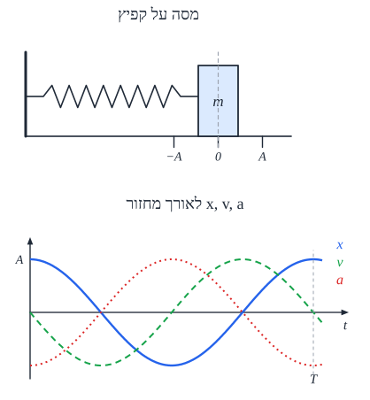

# תנועה הרמונית פשוטה

## מה זו תנועה הרמונית?

**תנועה הרמונית פשוטה** - תנועה **הלוך ושוב** סביב **נקודת שיווי משקל**, כשהכוח השקול:

1. **פרופורציוני** למרחק מנקודת שיווי המשקל, ו-
2. **מכוון תמיד אליה** (כוח **מחזיר**).

$$F = -kx$$

הדוגמה הקלאסית: **מסה על קפיץ** (בלי חיכוך).

## המשוואות

| גודל | נוסחה | מקסימום |
|---|---|---|
| **מקום** | ‏$x(t) = A\cos(\omega t + \varphi)$ | ‏$A$ - **משרעת** (אמפליטודה) |
| **מהירות** | ‏$v(t) = -A\omega\sin(\omega t + \varphi)$ | ‏$v_{max} = A\omega$ - **בנקודת שיווי המשקל** |
| **תאוצה** | ‏$a(t) = -A\omega^2\cos(\omega t + \varphi) = -\omega^2 x$ | ‏$a_{max} = A\omega^2$ - **בקצוות** |

- ‏$\omega$ - התדירות **הזוויתית**, $\varphi$ - **מופע** התחלתי (תלוי מאיפה מתחילים).
- **הקשר החשוב**: $a = -\omega^2 x$ - התאוצה **פרופורציונית** למקום ו**הפוכה** לו.

**איפה מה?**

| | **בקצוות** ($x = \pm A$) | **בשיווי משקל** ($x = 0$) |
|---|---|---|
| **מהירות** | **אפס** | **מקסימלית** |
| **תאוצה וכוח** | **מקסימליים**, אל המרכז | **אפס** |
| **אנרגיה** | כולה **פוטנציאלית** | כולה **קינטית** |

## זמן המחזור

**מסה על קפיץ** (מהשוואת $ma = -kx$ ל-$a = -\omega^2 x$):

$$\omega = \sqrt{\frac{k}{m}} \qquad T = 2\pi\sqrt{\frac{m}{k}}$$

**מטוטלת פשוטה** (זוויות קטנות):

$$T = 2\pi\sqrt{\frac{L}{g}}$$

**שימו לב**: זמן המחזור **לא תלוי במשרעת**! קפיץ שנמתח יותר נע מהר יותר - ומסיים מחזור **באותו זמן**. ובמטוטלת - גם **לא במסה**.

## אנרגיה

האנרגיה המכנית **נשמרת** ועוברת כל הזמן בין קינטית לפוטנציאלית:

$$E = \frac{1}{2}mv^2 + \frac{1}{2}kx^2 = \frac{1}{2}kA^2 = \frac{1}{2}mv_{max}^2$$

**שימוש**: המהירות בכל מקום - $v = \omega\sqrt{A^2 - x^2}$.

## דוגמה

מסה של $0.5\ \text{kg}$ על קפיץ עם $k = 50\ \text{N/m}$, נמתחת $10\ \text{cm}$ ומשוחררת.

- ‏$\omega = \sqrt{\frac{50}{0.5}} = 10\ \text{rad/s}$; $T = \frac{2\pi}{10} \approx 0.63\ \text{s}$.
- ‏$v_{max} = A\omega = 0.1\cdot10 = 1\ \text{m/s}$; $a_{max} = A\omega^2 = 10\ \text{m/s}^2$.
- ‏$E = \frac{1}{2}\cdot50\cdot0.1^2 = 0.25\ \text{J}$.

## שאלות לחזרה

- מהם שני התנאים לתנועה הרמונית פשוטה?
- איפה המהירות מקסימלית? איפה התאוצה מקסימלית?
- גזור את $\omega = \sqrt{k/m}$ מהחוק השני של ניוטון.
- מה קורה לזמן המחזור אם מכפילים את המשרעת? את המסה?
