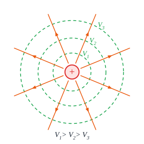

# אנרגיה פוטנציאלית חשמלית ופוטנציאל

## אנרגיה פוטנציאלית חשמלית

הכוח החשמלי הוא **כוח משמר** (כמו הכובד) - ולכן אפשר להגדיר לו **אנרגיה פוטנציאלית**.

**אנרגיה פוטנציאלית של שני מטענים** במרחק $r$:

$$E_p = \frac{k\,q_1 q_2}{r}$$

- **סקלר** - מציבים את המטענים **עם הסימנים**.
- **אפס באינסוף**.
- **משמעות**: העבודה שצריך **להשקיע** כדי לקרב את המטענים **מהאינסוף** למרחק $r$. או: האנרגיה הקינטית שהם **יקבלו** אם ישחררו אותם ויתרחקו לאינסוף.
- **חיובית** (מטענים זהים) - צריך **לדחוף** כדי לקרב; שחרור ← הם **בורחים**.
- **שלילית** (מטענים שונים) - הם **מושכים**; צריך להשקיע אנרגיה כדי **להפריד** אותם.

## פוטנציאל חשמלי

**פוטנציאל** בנקודה $A$ - **האנרגיה הפוטנציאלית ליחידת מטען**: העבודה שצריך כדי להביא **קולון אחד** מהאינסוף לנקודה $A$.

$$V = \frac{E_p}{q} \qquad\text{מטען נקודתי:}\quad V = \frac{kQ}{r}$$

- **יחידה**: **וולט**, $\text{V} = \frac{\text{J}}{\text{C}}$.
- **סקלר** - הפוטנציאל של כמה מטענים הוא **סכום רגיל** (עם סימנים), בלי וקטורים. הרבה יותר קל מהשדה!

**מתח חשמלי** = **הפרש פוטנציאלים** בין שתי נקודות: $\Delta V = V_B - V_A$.

**העבודה של הכוח החשמלי** כשמטען עובר מ-$A$ ל-$B$:

$$W_{A\to B} = -q\,\Delta V = q(V_A - V_B)$$

## משטחים שווי פוטנציאל

- **משטח שווה פוטנציאל** - כל הנקודות שבהן **הפוטנציאל זהה**. מעבר לאורכו - **בלי עבודה**.
- הם **מאונכים לקווי השדה**.
- **השדה מצביע לכיוון שבו הפוטנציאל יורד**.
- **מטען חיובי** "נופל" **מפוטנציאל גבוה לנמוך** (כמו כדור במורד); **מטען שלילי** - **מנמוך לגבוה**.
- **כל עוד יש הפרש פוטנציאלים - מטענים חופשיים ינועו** (זה הבסיס לזרם החשמלי).

## שדה אחיד: הקשר בין שדה למתח

בשדה **אחיד** (למשל בין לוחות קבל) הפוטנציאל משתנה **בקצב קבוע** עם המרחק:

$$E = -\frac{\Delta V}{\Delta x} \qquad\text{ובגודל, בין לוחות במרחק } d:\quad E = \frac{V}{d}$$

- מכאן יחידה נוספת לשדה: $\frac{\text{V}}{\text{m}}$.
- **נכון רק לשדה אחיד!**

## פוטנציאל של קליפה כדורית טעונה

- **מחוץ** לקליפה - כמו מטען נקודתי: $V = \frac{kQ}{r}$.
- **בתוך** הקליפה - השדה אפס, ולכן הפוטנציאל **קבוע** ושווה לפוטנציאל **על פני הקליפה**: $V = \frac{kQ}{R}$.

## יחידת אנרגיה: אלקטרון-וולט

**אלקטרון-וולט** ($\text{eV}$) - האנרגיה שמקבל **אלקטרון** שעובר מתח של **וולט אחד**:

$$1\ \text{eV} = 1.6\cdot10^{-19}\ \text{J}$$

נוחה לאנרגיות של חלקיקים.

## דוגמה

אלקטרון מואץ ממנוחה במתח של $100\ \text{V}$. מה מהירותו? ($m_e = 9.1\cdot10^{-31}\ \text{kg}$)

- **שימור אנרגיה**: העבודה החשמלית הופכת לאנרגיה קינטית: $eV = \frac{1}{2}mv^2$.
- ‏$v = \sqrt{\frac{2eV}{m}} = \sqrt{\frac{2\cdot1.6\cdot10^{-19}\cdot100}{9.1\cdot10^{-31}}} \approx 5.9\cdot10^{6}\ \text{m/s}$.
- האנרגיה: בדיוק $100\ \text{eV}$.

## שאלות לחזרה

- מה המשמעות של אנרגיה פוטנציאלית חשמלית שלילית?
- מה ההבדל בין פוטנציאל למתח?
- למה קל יותר לחשב פוטנציאל של כמה מטענים מאשר שדה?
- למה משטחים שווי פוטנציאל מאונכים לקווי השדה?
- מה השדה בין לוחות במרחק $2\ \text{cm}$ שביניהם מתח $100\ \text{V}$?
