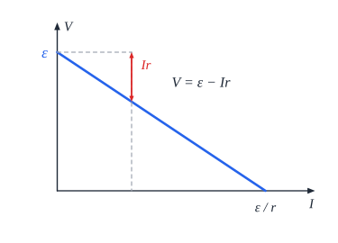

# מעגלי זרם ישר

## זרם חשמלי

**זרם** - **קצב** מעבר מטען דרך חתך המוליך:

$$I = \frac{\Delta q}{\Delta t}$$

- **יחידה**: **אמפר**, $\text{A} = \frac{\text{C}}{\text{s}}$.
- **הכיוון המוסכם** - כיוון התנועה של **מטען חיובי**: מ**הפוטנציאל הגבוה** (+) **לנמוך** (−) במעגל החיצוני. **בפועל** נעים **אלקטרונים** - בכיוון ההפוך.
- **מהירות** האלקטרונים עצמם **קטנה מאוד**; אבל **האות** החשמלי מתקדם **כמעט במהירות האור** - לכן הנורה נדלקת מיד.

## מקור המתח

**תפקידי** מקור המתח (סוללה):

1. ליצור **הפרש פוטנציאלים קבוע** שמניע את המטענים.
2. **להמיר** אנרגיה (כימית, למשל) **לאנרגיה חשמלית**.
3. **בתוך** הסוללה - להעלות את המטענים החיוביים **מהפוטנציאל הנמוך לגבוה** ("משאבה").

**כא"מ** (כוח אלקטרו-מניע) $\varepsilon$ - **האנרגיה שהמקור נותן לכל קולון** שעובר בו. יחידה: וולט.

## חוק אוהם והתנגדות

$$V = IR$$

**התנגדות** $R$ - כמה הרכיב **"מקשה"** על הזרם. יחידה: **אוהם** ($\Omega$).

**הגורמים להתנגדות תיל**:

$$R = \rho\frac{L}{A}$$

- ‏$L$ - **אורך** (ארוך ← יותר התנגדות).
- ‏$A$ - **שטח החתך** (עבה ← פחות).
- ‏$\rho$ - **התנגדות סגולית**, תכונה של **החומר** (ותלויה בטמפרטורה).

## חיבור נגדים

| | **בטור** | **במקביל** |
|---|---|---|
| **זרם** | **שווה** בכולם | **מתחלק**: $I = I_1 + I_2$ |
| **מתח** | **מתחלק**: $V = V_1 + V_2$ | **שווה** על כולם |
| **התנגדות שקולה** | ‏$R = R_1 + R_2$ - **גדלה** | ‏$\frac{1}{R} = \frac{1}{R_1} + \frac{1}{R_2}$ - **קטנה** (קטנה מהקטן שבהם) |

**שני נגדים במקביל**: $R = \frac{R_1R_2}{R_1 + R_2}$.

### דרך עבודה במעגל מורכב

**התנגדות שקולה** ← **זרם כולל** (חוק אוהם על כל המעגל) ← **מתח** על כל נגד **בטור** ← **מתח** על החלק **המקבילי** ← **זרם** בכל ענף ← **מתח** על כל נגד בענף.

### מקרים מיוחדים

- **קצר** - חיבור **בלי התנגדות** (תיל ישר) בין שתי נקודות. **הזרם עובר דרך הקצר**, והרכיבים שבמקביל לו **מושבתים**. קצר על המקור: הזרם **עצום**, התיל **מתחמם ונמס**, והמעגל נפתח.
- **נתק** - המעגל **פתוח** בנקודה כלשהי: **אין זרם** בענף.

## הספק

**הספק חשמלי** - קצב המרת האנרגיה ברכיב:

$$P = IV = I^2R = \frac{V^2}{R}$$

- **הספק המקור** (מה שהוא מייצר): $P = \varepsilon I$.
- **נצילות** - היחס בין ההספק **המועיל** (במעגל החיצוני) להספק **שהמקור מייצר**.

## התנגדות פנימית

לכל מקור יש **התנגדות פנימית** $r$ - ולכן חלק מהמתח "הולך לאיבוד" בתוכו.

**מתח ההדקים** (מה שהמקור מספק בפועל למעגל):

$$V = \varepsilon - Ir \qquad I = \frac{\varepsilon}{R + r}$$

- **כשאין זרם** (מעגל פתוח) - מתח ההדקים **שווה לכא"מ**.
- **בקצר** ($R = 0$) - הזרם המקסימלי $\frac{\varepsilon}{r}$, ומתח ההדקים **אפס**.
- **הגרף** $V(I)$ - **ישר** יורד: **חיתוך** עם ציר $V$ = $\varepsilon$; **שיפוע** = $-r$.
- **הספק מקסימלי במעגל החיצוני** - כש-$R = r$.

## מכשירי מדידה

| מכשיר | מודד | מחובר | התנגדות אידאלית |
|---|---|---|---|
| **אמפרמטר** | זרם | **בטור** | **אפס** - כדי לא לשנות את הזרם |
| **וולטמטר** | מתח | **במקביל** | **אינסופית** - כדי שלא יעבור בו זרם |
| **גלוונומטר** | זרם **קטן** | | הבסיס לשניהם |

## חוקי קירכהוף

1. **חוק הצמתים**: סכום הזרמים **הנכנסים** לצומת = סכום הזרמים **היוצאים** (שימור מטען).
2. **חוק הלולאות**: סכום **שינויי המתח** סביב כל **לולאה סגורה** הוא **אפס** (שימור אנרגיה).

## חיבור מקורות זהים

| | **בטור** | **במקביל** |
|---|---|---|
| **כא"מ שקול** | ‏$n\varepsilon$ | ‏$\varepsilon$ |
| **התנגדות פנימית שקולה** | ‏$nr$ | ‏$\frac{r}{n}$ |

## דוגמה

סוללה עם $\varepsilon = 12\ \text{V}$ ו-$r = 1\ \Omega$ מחוברת ל-$R_1 = 3\ \Omega$ בטור עם שני נגדים של $4\ \Omega$ במקביל.

- **שקולה חיצונית**: $3 + \frac{4\cdot4}{4+4} = 3 + 2 = 5\ \Omega$.
- **זרם**: $I = \frac{12}{5 + 1} = 2\ \text{A}$.
- **מתח ההדקים**: $12 - 2\cdot1 = 10\ \text{V}$.
- **על $R_1$**: $2\cdot3 = 6\ \text{V}$; **על המקבילי**: $2\cdot2 = 4\ \text{V}$, ובכל אחד מהם זרם $1\ \text{A}$.

## שאלות לחזרה

- מה הכיוון המוסכם של הזרם? באיזה כיוון נעים האלקטרונים?
- איך משתנה ההתנגדות השקולה כשמוסיפים נגד בטור? במקביל?
- מה קורה לרכיב שמקוצר?
- למה מתח ההדקים קטן מהכא"מ? מתי הם שווים?
- איך מחברים אמפרמטר ווולטמטר, ולמה?
