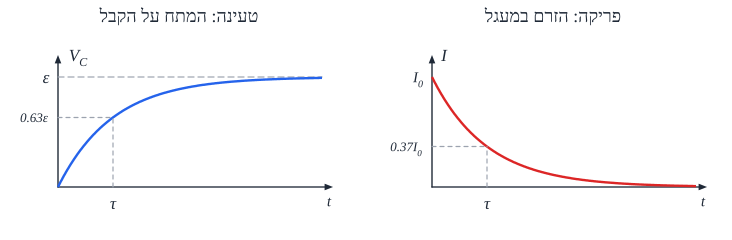

# קבלים

## מהו קבל?

**קבל** - שני מוליכים (בדרך כלל **שני לוחות מקבילים**) עם **בידוד** ביניהם. כשמחברים אותו למתח, לוח אחד נטען $+Q$ והשני $-Q$, ובין הלוחות נוצר **שדה חשמלי אחיד**. הקבל **אוגר מטען ואנרגיה**.

## קיבול

**קיבול** - המטען שהקבל אוגר **לכל וולט**:

$$C = \frac{Q}{V}$$

- **יחידה**: **פאראד**, $\text{F} = \frac{\text{C}}{\text{V}}$. (פאראד הוא ענק - בפועל $\mu\text{F}$, $\text{nF}$, $\text{pF}$.)
- **קבל לוחות**: $C = \frac{\varepsilon_0 A}{d}$ - לוחות **גדולים** וקרובים ← קיבול **גדול**.
- הקיבול הוא תכונה של **הקבל** - לא תלוי במתח או במטען.

## אנרגיה בקבל

$$E = \frac{1}{2}QV = \frac{1}{2}CV^2 = \frac{Q^2}{2C}$$

## קבלים במעגל: קבל שקול

**קבל שקול** - קבל שאם מחליפים בו את הקבלים הנתונים, המקור עושה **אותה עבודה** בטעינה.

| | **בטור** | **במקביל** |
|---|---|---|
| **מטען** | **שווה** בכולם | **מתחלק** |
| **מתח** | **מתחלק** | **שווה** |
| **קיבול שקול** | ‏$\frac{1}{C} = \frac{1}{C_1} + \frac{1}{C_2}$ | ‏$C = C_1 + C_2$ |

**שימו לב**: זה **הפוך** מנגדים!

**דרך עבודה**: קיבול שקול ← מטען כולל ($Q = CV$) - **שווה לכולם בטור** ← המתח על כל קבל ($V_i = \frac{Q}{C_i}$).

## טעינה ופריקה של קבל

כשמחברים **נגד, קבל ומקור** במעגל:

- **ברגע הראשון** - הקבל ריק, **כל המתח על הנגד**, והזרם **מקסימלי**: $I_0 = \frac{\varepsilon}{R}$.
- **עם הזמן** - הקבל נטען: **המתח עליו עולה**, **המתח על הנגד יורד** (סכומם קבוע - מתח המקור), ו**הזרם יורד**.
- **בסוף** - הקבל **מלא**, $V_C = \varepsilon$, **אין זרם**. קבל טעון בזרם ישר = **נתק**.

**הנוסחאות:**

| | **טעינה** | **פריקה** |
|---|---|---|
| **מתח על הקבל** | ‏$V_C = \varepsilon\left(1 - e^{-t/RC}\right)$ | ‏$V_C = V_0\,e^{-t/RC}$ |
| **זרם** | ‏$I = I_0\,e^{-t/RC}$ | ‏$I = I_0\,e^{-t/RC}$ |

### קבוע הזמן

$$\tau = RC$$

- **הזמן האופייני** לטעינה או לפריקה. ($R$ - ההתנגדות השקולה במעגל.)
- אחרי זמן $\tau$: הזרם יורד ל-**37%** מהתחלתי ($e^{-1} \approx 0.37$):
$$I(\tau) = I_0 e^{-1} \approx 0.37\,I_0$$
- בטעינה - המתח על הקבל מגיע ל-**63%** מהסופי.
- אחרי בערך $5\tau$ - הקבל **כמעט מלא** (או ריק).

## דוגמה

קבל $C = 100\ \mu\text{F}$ נטען דרך נגד $R = 10\ \text{k}\Omega$ ממקור $\varepsilon = 9\ \text{V}$.

- ‏$\tau = RC = 10^4\cdot10^{-4} = 1\ \text{s}$.
- **זרם התחלתי**: $I_0 = \frac{9}{10^4} = 0.9\ \text{mA}$.
- **בסוף**: $Q = CV = 10^{-4}\cdot9 = 0.9\ \text{mC}$; **אנרגיה**: $\frac{1}{2}\cdot10^{-4}\cdot81 \approx 4\ \text{mJ}$.

## שאלות לחזרה

- מהו קיבול? מה קובע את הקיבול של קבל לוחות?
- איך מחשבים קיבול שקול בטור ובמקביל? מה ההבדל מנגדים?
- תאר מה קורה למתח על הקבל ועל הנגד בזמן הטעינה.
- מהו $\tau$? מה הזרם אחרי זמן $\tau$?
