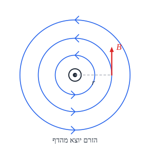

# שדה מגנטי וכוח מגנטי

## מקורות השדה המגנטי

שדה מגנטי $\vec{B}$ נוצר בשתי דרכים:

1. **מגנט טבעי** (קבוע).
2. **מטענים חשמליים בתנועה** - כלומר **זרם**.

**יחידה**: **טסלה** ($\text{T}$).

## מגנט טבעי

- לכל מגנט שני קטבים: **צפון** ו**דרום**. **קטבים שונים נמשכים**, **זהים נדחים**. אי אפשר להפריד ביניהם - חותכים מגנט ומקבלים **שני מגנטים**.
- **קווי השדה** - **מחוץ** למגנט **יוצאים מהצפון ונכנסים לדרום**. צפיפותם - **עוצמת** השדה.
- **מצפן** - מגנט קטן, שהקוטב הצפוני שלו **מצביע בכיוון השדה**.
- **השדה המגנטי של כדור הארץ** - כמו מגנט ענק. **הקוטב הצפוני הגיאוגרפי** הוא בעצם **קוטב דרומי מגנטי** (לכן הצפון של המצפן נמשך אליו).

## שדה מגנטי של זרם

**כלל יד ימין**: **אגודל בכיוון הזרם** - **האצבעות המתקפלות** מראות את כיוון השדה.

**סימונים**: $\odot$ - **יוצא** מהדף (רואים את "חוד החץ"); $\otimes$ - **נכנס** לדף ("הזנב").

| מקור | השדה | כיוון |
|---|---|---|
| **תיל ארוך וישר** | ‏$B = \frac{\mu_0 I}{2\pi r}$ | **מעגלים** סביב התיל |
| **במרכז לולאה** (סילונית) עם $N$ כריכות | ‏$B = \frac{\mu_0 N I}{2R}$ | **מאונך** למישור הלולאה |
| **בתוך סליל** ארוך | ‏$B = \mu_0 n I$ ($n$ - כריכות ליחידת אורך) | **לאורך הציר**, **אחיד** בפנים |

‏$\mu_0 = 4\pi\cdot10^{-7}\ \frac{\text{T}\cdot\text{m}}{\text{A}}$.

**דגש**: כל הכריכות צריכות להיות **באותו כיוון** - אחרת השדות **מבטלים** זה את זה.

## כוח מגנטי

### על מטען נע

$$F = qvB\sin\theta$$

### על תיל נושא זרם

$$F = ILB\sin\theta$$

- ‏$\theta$ - הזווית בין **המהירות** (או **הזרם**) ל**שדה**. **מקביל** לשדה - **אין כוח**; **מאונך** - כוח **מקסימלי**.
- **הכיוון**: **מאונך גם למהירות וגם לשדה** - לפי **כלל יד ימין** (לכוח, $\vec{v}\times\vec{B}$): אצבעות בכיוון $\vec{v}$, מקפלים לכיוון $\vec{B}$ - האגודל מראה את $\vec{F}$ על **מטען חיובי**. **מטען שלילי** - **הפוך**.
- **הכוח המגנטי לא עושה עבודה** - הוא תמיד **מאונך לתנועה**. הוא משנה **כיוון**, **לא גודל** מהירות.

### תנועת חלקיק טעון בשדה אחיד

חלקיק שנכנס **מאונך** לשדה נע **במעגל** - הכוח המגנטי הוא הכוח אל המרכז:

$$qvB = m\frac{v^2}{R} \quad\Rightarrow\quad R = \frac{mv}{qB} \qquad T = \frac{2\pi m}{qB}$$

**זמן המחזור לא תלוי במהירות!** חלקיק מהיר עושה מעגל **גדול יותר** - ב**אותו זמן**.

### כוח בין שני תילים

שני תילים מקבילים: זרמים **באותו כיוון - נמשכים**; **בכיוונים מנוגדים - נדחים**. (כל תיל נמצא בשדה של השני.)

## שימושים טכנולוגיים

### בורר מהירויות

שדה **חשמלי** ו**מגנטי** **מאונכים**, כך שהכוחות **מנוגדים**. רק חלקיק שבו $qE = qvB$ עובר **ישר**:

$$v = \frac{E}{B}$$

### שפופרת תומסון

תומסון השתמש בשדות חשמלי ומגנטי כדי למדוד את **היחס בין מטען האלקטרון למסתו**, $\frac{e}{m}$ - וכך **גילה את האלקטרון**.

### ספקטרוגרף מסות

מפריד חלקיקים **לפי מסה**:

1. **תא יונים** - יוצר יונים חיוביים (קובע את $q$).
2. **מאיץ** - נותן מהירות.
3. **בורר מהירויות** - מעביר רק $v = \frac{E}{B}$.
4. **שדה מגנטי** - כל יון נע בחצי מעגל ברדיוס $R = \frac{mv}{qB}$, ופוגע במרחק $x = 2R$ מהכניסה. **מסה שונה - נקודה שונה**.

### ציקלוטרון

**מאיץ חלקיקים**: שני חלקים בצורת **D** עם **שדה מגנטי**, וביניהם **מתח חילופין**.

- בתוך כל D החלקיק עושה **חצי מעגל**; בכל מעבר ברווח הוא **מואץ** - והרדיוס **גדל**.
- תדירות החלפת המתח **קבועה** - כי **זמן המחזור לא תלוי במהירות**.
- **מהירות מקסימלית** (ברדיוס החיצוני): $v_{max} = \frac{qBR_{max}}{m}$.

### גלוונומטר טנגנטי

לולאה עם מצפן **במרכזה**, שמכוונת כך שמישורה **מקביל לשדה כדור הארץ**. כשעובר זרם, המצפן מצביע בכיוון **השקול** של שני שדות **מאונכים**: של הלולאה ושל כדור הארץ.

$$\tan\theta = \frac{B_i}{B_E} = \frac{\mu_0 N I}{2R\,B_E}$$

## שאלות לחזרה

- מה הם שני המקורות לשדה מגנטי?
- תאר את השדה סביב תיל ובתוך סליל. איך קובעים את כיוונו?
- למה הכוח המגנטי לא עושה עבודה?
- גזור את רדיוס התנועה של חלקיק בשדה מגנטי. למה זמן המחזור לא תלוי במהירות?
- איך עובד בורר מהירויות? ספקטרוגרף מסות?
