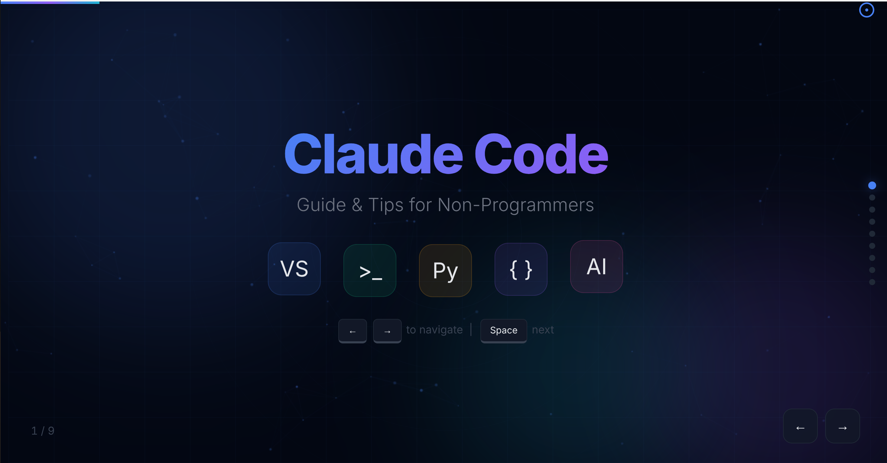
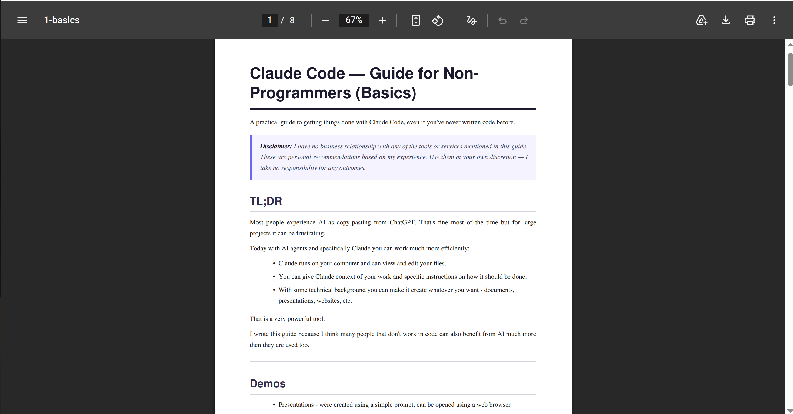
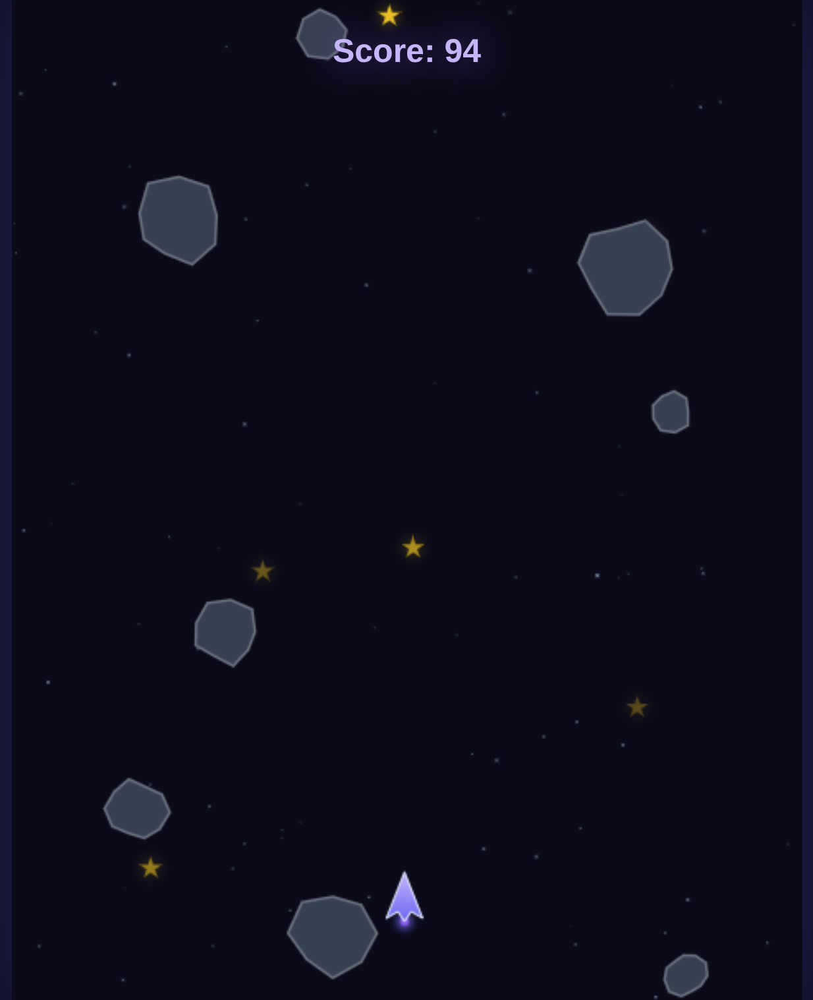

# מדריך קלוד (Claude) למי שלא מתכנת (בסיס)

המדריך הזה מיועד לכל מי שמשתמש במחשב ברמה בסיסית. אם אתם יודעים לגלוש באינטרנט, לפתוח קובץ ולשמור אותו, זה מספיק. לא צריך לדעת לתכנת, ונסביר כל שלב.

## בקצרה

קלוד (Claude) הוא בינה מלאכותית: תוכנה שאפשר לדבר איתה בשפה רגילה, כמו עם אדם, והיא עונה ועוזרת במשימות.

רוב האנשים משתמשים בכלים כאלה דרך אתר: מעתיקים טקסט לצ'אט, ומעתיקים את התשובה בחזרה. זה מספיק ברוב המקרים, אבל זה מתסכל כשהמשימה גדולה, או כשצריך להסביר שוב ושוב מה בדיוק רוצים.

כשקלוד מותקן על המחשב, אפשר לעבוד אחרת:

- קלוד יכול לראות ולשנות קבצים בתיקייה שנתתם לו, בזמן שאתם שותים קפה.
- אפשר להסביר לו על העבודה שלכם ואיך בדיוק אתם רוצים שהיא תיעשה.
- הוא יוצר בשבילכם מסמכים, טבלאות, מצגות ואפילו אתרים קטנים.

כתבתי את המדריך כי אני חושב שאנשים רבים יכולים להפיק מהכלים האלה הרבה יותר ממה שהם רגילים.

> **הבהרה:** זה מדריך אישי ולא רשמי. הוא לא קשור ל-Anthropic או לאף אחד מהכלים והשירותים שמוזכרים בו, ואין לי קשר עסקי אליהם. אלה המלצות מהניסיון שלי, והמידע עלול להתיישן. השתמשו בהן על אחריותכם. אני לא לוקח אחריות על התוצאות, כולל אובדן או דליפה של קבצים ומידע.

> **הערה:** אם יש לכם מנוי ל-ChatGPT, יש שם כלי דומה בשם Codex, וברוב הדברים במדריך אפשר לעבוד איתו באותה דרך.

---

## הדגמות

נתחיל מהסוף. את הדברים האלה יצרתי בעזרת כמה בקשות פשוטות:

**מצגת** שנוצרה מהטקסט של המדריך ([לפתיחה](_files/presentation.html)):



**מסמך PDF** של המדריך, בגרסה האנגלית ([לפתיחה](_files/document.pdf)):



**משחק** חלל קטן שמשחקים בדפדפן ([לפתיחה](_files/game.html)):



---

## כשמשהו לא ברור

לא צריך לזכור הכול. אם נתקעתם או שמילה לא ברורה, פשוט שאלו את קלוד, למשל: "מה זה קובץ PDF? תסביר לי בפשטות". אפשר גם לחפש בגוגל.

---

## מילים שכדאי להכיר

| מילה | מה זה |
| --- | --- |
| קובץ | פריט שנשמר במחשב: מסמך, תמונה, שיר וכן הלאה |
| תיקייה | מקום במחשב שמרכז קבצים, כמו קלסר |
| תוכנה או אפליקציה | משהו שמפעילים במחשב או בטלפון, כמו Word או דפדפן |
| דפדפן | התוכנה שבה גולשים באינטרנט: Chrome, Edge או Safari |
| הורדה | העתקת קובץ מהאינטרנט למחשב. קבצים שירדו נמצאים בדרך כלל בתיקייה Downloads (הורדות) |
| התקנה | הוספת תוכנה חדשה למחשב |
| גיבוי | עותק נוסף של קבצים חשובים, למקרה שמשהו יקרה למקור |

---

## התקנת קלוד

1. פתחו את הדפדפן והיכנסו ל-[claude.com/download](https://claude.com/download).
2. לחצו על כפתור ההורדה שמתאים למחשב שלכם: Windows או Mac.
3. כשההורדה מסתיימת, פתחו את הקובץ בלחיצה כפולה. תמצאו אותו בתיקייה Downloads.
4. המשיכו לפי ההוראות על המסך. אם Windows שואל אם לאפשר לתוכנה לבצע שינויים, אשרו, כי הורדתם אותה מהאתר הרשמי. ב-Mac, גררו את סמל קלוד לתיקייה Applications.
5. פתחו את קלוד: ב-Windows מתפריט התחל, וב-Mac מהתיקייה Applications.
6. התחברו לחשבון. אם אין לכם חשבון, אפשר ליצור אחד בחינם עם כתובת מייל.

ההורדה חינמית. מה שעולה כסף הוא המנוי, כלומר תשלום חודשי:

| תוכנית | מחיר (אוקטובר 2026) | מה מקבלים |
| --- | --- | --- |
| Free | חינם | צ'אט, עם הגבלה על כמות השימוש |
| Pro | 20$ לחודש, או 17$ לחודש בתשלום שנתי | גם Cowork וקלוד קוד (מוסבר בהמשך) |
| Max | החל מ-100$ לחודש | אותו דבר, עם הרבה יותר שימוש |

כדאי להתחיל בחינם, ולעבור ל-Pro כשרוצים שקלוד יעבוד על הקבצים שלכם. המחירים משתנים, אז בדקו אותם ב-[claude.com/pricing](https://claude.com/pricing) לפני שאתם משלמים.

### צ'אט או Cowork

באפליקציה יש שתי דרכים עיקריות לעבוד:

- **צ'אט:** שיחה רגילה. שואלים שאלה או מצרפים קובץ, ומקבלים תשובה.
- ‏**Cowork:** מתארים משימה, וקלוד מבצע אותה בעצמו על קבצים בתיקייה שבחרתם, גם אם יש בה הרבה שלבים. בוחרים בו בתיבת ההודעה באפליקציה, והוא דורש מנוי בתשלום.

### לפני שמשתמשים ב-Cowork

‏Cowork עובד בעצמו על הקבצים האמיתיים שלכם, ויש לו גישה לאינטרנט. זה מה שהופך אותו לחזק, וזה גם הסיכון: קבצים עלולים להשתנות או להימחק, ומידע עלול להגיע למקומות שלא התכוונתם אליהם. גם Anthropic, החברה שמפתחת את קלוד, מזהירה על כך, אז קראו את [ההנחיות הרשמיות](https://support.claude.com/en/articles/13345190-get-started-with-claude-cowork) לפני שמתחילים.

- **עבדו על עותק:** אל תתנו לקלוד את המקור של קבצים חשובים. העתיקו אותם קודם לתיקייה חדשה, ושמרו גיבוי.
- **תנו רק תיקייה אחת קטנה:** רק מה שדרוש למשימה, ולא את כל המחשב.
- **השאירו מידע רגיש בחוץ:** סיסמאות, מסמכים רפואיים, מסמכי בנק ותעודות מזהות. על חומרים מהעבודה או של אנשים אחרים צריך לקבל קודם אישור ממי שהם שייכים לו.
- **היזהרו מקבצים שאתם לא מכירים:** קבצים ואתרים עלולים להכיל הוראות מכוונות שיטעו את קלוד. אל תתנו לו לעבוד על קבצים ממקור לא מוכר.
- **קראו לפני שאתם מאשרים:** קלוד מציג מה הוא מתכוון לעשות ומבקש אישור. אם משהו לא ברור, אל תאשרו, ושאלו אותו קודם. אל תפעילו מצבים שמדלגים על האישורים.
- **הישארו ליד המחשב:** השאירו את האפליקציה פתוחה ועקבו אחרי העבודה.
- **בדקו את התוצאה:** קלוד יכול לטעות. בדקו עובדות, מספרים וכל דבר חשוב לפני שאתם משתמשים בו.

---

## התקנת Obsidian

‏[Obsidian](https://obsidian.md/) (אובסידיאן) היא אפליקציה לכתיבת פתקים. היא מתאימה לעבודה עם קלוד, כי כל פתק נשמר כקובץ טקסט רגיל במחשב שלכם: קלוד יכול לקרוא ולערוך את הפתקים, ואתם רואים את השינויים מיד. היא [חינמית לכל מטרה](https://obsidian.md/license), גם לעבודה, והפתקים נשארים שלכם גם אם תפסיקו להשתמש בה.

1. היכנסו ל-[obsidian.md/download](https://obsidian.md/download), הורידו והתקינו כמו שעשיתם עם קלוד.
2. פתחו את האפליקציה, בחרו **Create new vault** ותנו שם, למשל `notes`. המילה **vault** (כספת) פשוט אומרת תיקייה במחשב שבה נשמרים הפתקים.
3. צרו פתק חדש בלחיצה על `Ctrl+N` (ב-Mac: `Cmd+N`) וכתבו בו משהו. הפתק נשמר לבד.
4. אם העברית לא מיושרת לימין, פתחו את ההגדרות (Settings), בחרו Editor והפעילו את **Right-to-left (RTL)**.

יש גם אפליקציה לטלפון. כדי לראות את אותם פתקים בכמה מכשירים אפשר לשלם על השירות Sync של Obsidian, או לשמור את התיקייה בשירות כמו Google Drive או OneDrive.

### כך הם עובדים יחד

1. שמרו עותק של תיקיית הפתקים, ובדקו שאין בה מידע רגיש.
2. ב-Cowork, בחרו את תיקיית הפתקים.
3. בקשו משהו, למשל: "קרא את כל הפתקים בתיקייה וכתוב פתק חדש עם סיכום ורשימת משימות".
4. הפתק החדש מופיע ב-Obsidian.

כך נוצר אוסף ידע אישי שנשמר אצלכם, וקלוד יכול להיעזר בו במשימות הבאות.

---

## Markdown

‏Markdown (מארקדאון) היא דרך פשוטה לעצב טקסט בעזרת סימנים רגילים. הפתקים ב-Obsidian כתובים כך, ושמות הקבצים מסתיימים ב-`.md`.

למשל, `#` בתחילת שורה הופך אותה לכותרת, ו-`**מילה**` הופך מילה למודגשת. **אין צורך ללמוד את זה**: קלוד כותב כך בעצמו, ו-Obsidian מציג את הטקסט מעוצב. הנה הסימנים העיקריים, למי שסקרן:

```markdown
# Heading 1

## Heading 2

### Heading 3

**bold text**
_italic text_

- bullet point
- another bullet

1. numbered list
2. second item

[link text](https://example.com)

> blockquote

`inline code`
```

> **לקריאה נוספת:** [Markdown Guide](https://www.markdownguide.org/basic-syntax/)

---

## סוגי קבצים שימושיים

יש במחשב הרבה סוגי קבצים. הסיומת, האותיות שאחרי הנקודה בשם הקובץ, מראה מה יש בו ואיזו תוכנה פותחת אותו. למשל, `report.pdf` הוא קובץ PDF.

אם אתם לא רואים סיומות: ב-Windows, בסייר הקבצים (התיקייה הצהובה בשורת המשימות), בחרו **View**, אחר כך **Show**, ואז **File name extensions**. ב-Mac, ב-Finder בחרו **Settings**, אחר כך **Advanced**, ואז **Show all filename extensions**.

### קובצי טקסט

אלה הקבצים הפשוטים ביותר: רק אותיות וסימנים, בלי תמונות. קלוד עובד איתם הכי טוב, כי הוא קורא ומשנה אותם ישירות, אז כדאי להעדיף אותם כשאפשר.

| סיומת | מה זה | פותחים עם | למה זה טוב |
| --- | --- | --- | --- |
| `.txt` | טקסט פשוט, בלי עיצוב | פנקס רשימות (Notepad) | הערות מהירות |
| `.md` | טקסט עם עיצוב פשוט (Markdown) | Obsidian | פתקים, סיכומים, מסמכים |
| `.csv` | טבלה שנשמרה כטקסט | Excel, Google Sheets | רשימות ונתונים |
| `.html` | דף אינטרנט | דפדפן, בלחיצה כפולה | מצגות, דוחות יפים, כלים קטנים |

אם בקובץ טקסט העברית מופיעה כסימנים משונים, הקובץ נשמר בשיטת כתיבה (קידוד, encoding) לא מתאימה. בקשו מקלוד לשמור אותו בקידוד UTF-8, שמתאים לעברית.

### קובצי מסמכים

קלוד יודע לקרוא וליצור גם את אלה, אבל לפעמים צריך לתקן את העיצוב ביד.

| סיומת | מה זה | פותחים עם | למה זה טוב |
| --- | --- | --- | --- |
| `.docx` | מסמך Word | Word, Google Docs | מסמכים ששולחים לאחרים |
| `.xlsx` | טבלה של Excel | Excel, Google Sheets | טבלאות עם חישובים וגרפים |
| `.pptx` | מצגת | PowerPoint, Google Slides | מצגות שאחרים צריכים לערוך |
| `.pdf` | מסמך סופי לקריאה ולהדפסה | דפדפן | נראה אותו דבר בכל מחשב |

### תמונות, סרטונים וקבצים אחרים

| סיומת | מה זה | פותחים עם | למה זה טוב |
| --- | --- | --- | --- |
| `.png`, `.jpg` | תמונה | לחיצה כפולה | צילומי מסך ותמונות שקלוד יכול לראות |
| `.mp3`, `.mp4` | הקלטה וסרטון | לחיצה כפולה | שמע ווידאו |
| `.zip` | כמה קבצים ארוזים יחד בקובץ אחד | לחיצה כפולה | שליחת הרבה קבצים בבת אחת |
| `.exe`, `.msi` | תוכנה ל-Windows | לחיצה כפולה מפעילה אותה | התקנת תוכנות |

> **זהירות:** אל תפעילו קובץ `.exe` שקיבלתם במייל או שהורדתם מאתר לא מוכר. הוא עלול לפגוע במחשב.

---

## אפליקציות שימושיות

| למה זה טוב | אפליקציה | הערה |
| --- | --- | --- |
| עבודה עם קלוד | קלוד | צ'אט ו-Cowork |
| פתקים | Obsidian | הפתקים נשמרים אצלכם במחשב |
| מציאת קבצים | סייר הקבצים (Windows), Finder (Mac) | כאן תראו את מה שקלוד יצר |
| מסמכים וטבלאות | Word ו-Excel, או Google Docs ו-Sheets | של Google חינמיים ועובדים בדפדפן |
| קריאת PDF ודפי HTML | דפדפן | לא צריך תוכנה נוספת |
| גיבוי | Google Drive, OneDrive, Dropbox | עותק של הקבצים החשובים באינטרנט |
| צילום מסך | `Win+Shift+S` (Windows), `Cmd+Shift+4` (Mac) | הדביקו בצ'אט עם `Ctrl+V` כדי להראות לקלוד מה אתם רואים |
| נגינת הקלטות וסרטונים | VLC | פותחת כמעט כל קובץ שמע או וידאו |

---

## תרגול ראשון

1. צרו תיקייה חדשה: בשולחן העבודה, לחצו בלחצן הימני של העכבר, ובחרו **New** ואז **Folder** (או **חדש** ואז **תיקייה**).
2. העתיקו אליה כמה קבצים לא חשובים ולא אישיים.
3. ב-Cowork, בחרו את התיקייה הזו.
4. נסו את הבקשות האלה:

> "סכם את הקבצים בתיקייה הזו בקובץ חדש בשם `summary.md`"

> "צור קובץ Excel לדוגמה עם הוצאות בדיוניות ועם גרף לפי קטגוריה"

> "הפוך את `summary.md` למצגת יפה בעברית שנפתחת בדפדפן"

> "סדר את התמונות בתיקייה הזו בתיקיות לפי חודשים"

אם התוצאה לא מה שרציתם, פשוט כתבו את זה: "הכותרות גדולות מדי" או "כתוב את זה קצר יותר". ככל שתהיו מדויקים יותר, התוצאה תהיה טובה יותר: "הפוך את הכותרת לכחולה" עובד טוב יותר מ"תעשה את זה יפה".

---

## ‏VS Code ו-Python: לעבודה מתקדמת יותר

עד כאן אין צורך בתכנות, ואפשר לעצור כאן ולעבוד רק עם קלוד ו-Obsidian. לעבודה נוחה יותר עם קובצי טקסט וליצירת אפליקציות מתקדמות יותר, מומלץ להתקין גם את VS Code ו-Python. החלק הזה טכני יותר, אבל עדיין לא צריך לדעת לתכנת.

### מה זה ולמה צריך

- ‏**VS Code** (חינם): תוכנה לעריכת קובצי טקסט, מעין פנקס רשימות משוכלל. אפשר להריץ בתוכה את קלוד, ולראות כל קובץ שהוא משנה.
- ‏**Python** (פייתון, חינם): שפת תכנות שקלוד משתמש בה מאחורי הקלעים לעבודות כמו המרת קבצים ועיבוד נתונים. אין צורך ללמוד אותה: כשקלוד צריך אותה, הוא מטפל בהכול בעצמו.
- **קלוד קוד** (Claude Code): גרסה של קלוד שעובדת בתוך VS Code, כלולה במנוי Pro.
- **טרמינל** (Terminal): חלון שבו מפעילים את המחשב בהקלדת פקודות במקום בלחיצות. קלוד משתמש בו בשבילכם, ולרוב לא תצטרכו להקליד בו דבר.

### מה להתקין

1. ‏**VS Code:** הורידו מ-[code.visualstudio.com](https://code.visualstudio.com/), התקינו ופתחו.
2. ‏**Python:** הורידו מ-[python.org/downloads](https://www.python.org/downloads/). בחלון ההתקנה הראשון סמנו את **"Add Python to PATH"** בתחתית החלון, ורק אז המשיכו.
3. **קלוד קוד:** ב-VS Code, לחצו `Ctrl+Shift+X`. בחלון החיפוש שנפתח כתבו "Claude Code", ולחצו Install. התחברו לחשבון קלוד שלכם בתשלום. המחירים מופיעים [בתחילת המדריך](#התקנת-קלוד).

כדי לבדוק ש-Python הותקן: ב-VS Code, בחרו בתפריט **Terminal** את **New Terminal**, הקלידו `python --version` ולחצו Enter. אם מופיע מספר גרסה, הכול תקין.

### VS Code

#### החלקים של המסך

- **סייר הקבצים** (File Explorer, בסרגל הצד): הקבצים של התיקייה שפתחתם. פותחים תיקייה מהתפריט **File**, בבחירה ב-**Open Folder**
- **העורך** (Editor, במרכז): כאן רואים ועורכים את הקובץ
- **הטרמינל** (Terminal, בחלק התחתון): חלון הפקודות
- **הרחבות** (Extensions, בסרגל הצד, סמל הקוביות): תוספות שנותנות ל-VS Code יכולות חדשות, כמו קלוד קוד
- **לוח הפקודות** (Command Palette): לחצו `Ctrl+Shift+P` כדי לחפש כל פעולה

#### התקנת הרחבות

1. לחצו על סמל **Extensions** בסרגל הצד (או `Ctrl+Shift+X`)
2. חפשו את מה שאתם צריכים
3. לחצו **Install**

לא כל הרחבה בטוחה, כי כל אחד יכול לפרסם הרחבה:

- **העדיפו מפרסמים מאומתים:** חפשו וי כחול ליד שם המפרסם.
- **אם אין וי:** בדקו שיש מיליוני הורדות ודירוג של 4 כוכבים ומעלה.
- **היזהרו** מהרחבות לא מוכרות עם מעט הורדות. הן עלולות להכיל קוד מזיק. אם יש ספק, אל תתקינו.

#### קיצורי מקלדת שימושיים

| פעולה | קיצור |
| --- | --- |
| חיפוש כל פעולה (לוח הפקודות) | `Ctrl+Shift+P` |
| פתיחת קובץ לפי שם | `Ctrl+P` |
| הצגה או הסתרה של הטרמינל | `` Ctrl+` `` |
| הצגה או הסתרה של סרגל הצד | `Ctrl+B` |
| שמירת קובץ | `Ctrl+S` |
| חיפוש בקובץ | `Ctrl+F` |
| חיפוש בכל הקבצים | `Ctrl+Shift+F` |
| תצוגה מעוצבת של קובץ `.md` | `Ctrl+Shift+V` |
| פתיחת דף אינטרנט בתוך VS Code | `Ctrl+Shift+P` ואז "Simple Browser: Show" |

> **לקריאה נוספת:** [VS Code Getting Started](https://code.visualstudio.com/docs/getstarted/introvideos)

### קלוד קוד (Claude Code)

קלוד קוד הוא קלוד שעובד בתוך VS Code. הוא קורא, יוצר ומשנה קבצים בתיקייה שפתחתם, ומדברים איתו בשפה רגילה. כדי לפתוח אותו, לחצו `Ctrl+Shift+P` ובחרו "Claude code: Open in Side Bar".

#### מה הוא יודע לעשות?

- **לשנות קבצים:** "שנה את צבע הכותרת לאדום" או "תקן את שגיאת הכתיב בפסקה 3"
- **ליצור קבצים:** "צור מסמך עם חלקים לתאריך, משתתפים ומשימות" או "בנה אתר עם טופס יצירת קשר"
- **להסביר:** "מה הקובץ הזה עושה?"
- **להפעיל פקודות:** הוא מקליד בשבילכם בטרמינל, למשל כדי להמיר קבצים או לעבד נתונים

#### אפשר ליצור אפליקציה בעזרת קלוד?

- **אתר:** אפשר בקלות, אבל הוא יהיה רק במחשב שלכם. כדי שאחרים יוכלו להיכנס אליו, צריך להעלות אותו לשירות אחסון באינטרנט. קלוד יכול להסביר לכם איך. גם אתר ששומר מידע או מתחבר לשירותים אחרים הוא אפשרי, אבל מסובך יותר.
- **אפליקציה לטלפון:** לא ישירות. אפליקציה לחנויות של Apple ו-Google דורשת חשבונות מפתח ותהליך מורכב יותר. קלוד יכול לעזור לכם ליצור **אתר שנראה כמו אפליקציה** כשפותחים אותו בטלפון, וזה הרבה יותר פשוט.

#### הקובץ CLAUDE.md: הוראות קבועות לקלוד

אפשר ליצור בתיקייה קובץ בשם `CLAUDE.md` ולכתוב בו מה קלוד צריך לדעת על העבודה. הוא קורא את הקובץ בעצמו בכל פעם שהוא מתחיל, וכך לא צריך להסביר שוב. למשל:

```markdown
זה פרויקט שיווק. כל המסמכים צריכים להיות בעברית.
קובצי הפלט נשמרים בתיקייה output.
```

#### מצבי עבודה

| מצב | מה הוא עושה | מתי להשתמש בו |
| --- | --- | --- |
| **Plan mode** | קורא קבצים ומכין תוכנית, בלי לשנות דבר | כשרוצים לראות את התוכנית לפני שינויים |
| **Normal mode** | קורא ומשנה קבצים | עבודה יומיומית |

#### הרשאות

קלוד מבקש רשות לפני פעולות כמו שינוי קבצים או הפעלת פקודות. אפשר:

- **לאשר פעם אחת:** אישור לפעולה הזו בלבד
- **לאשר לתיקייה הזו:** "Yes, don't ask again" אומר שקלוד לא ישאל שוב על פעולה מהסוג הזה בתיקייה הזו, אבל ימשיך לשאול בתיקיות אחרות

> **המלצה למתחילים:** אשרו כל פעולה בנפרד עד שתרגישו בנוח. כך השליטה נשארת בידיים שלכם.

#### דברים לנסות

**מסמך:**

> "צור קובץ בשם meeting-notes.md עם חלקים לתאריך, משתתפים, סדר יום ומשימות"

**אתר:**

> "צור אתר פשוט בעיצוב כהה שמציג רשימה של הספרים האהובים עליי. שיהיה יפה."

**מצגת:**

> "צור מצגת HTML מהטקסט הזה". אחר כך פתחו את הקובץ בדפדפן. זו דרך מהירה ליצור שקפים יפים בלי PowerPoint.

**שינוי קובץ קיים:**

> "ב-index.html, שנה את צבע הרקע לאפור בהיר והגדל את הגופן"

#### טיפים

- היו מדויקים: "הפוך את הכותרת לכחולה וממורכזת" עובד טוב יותר מ"תעשה את זה יפה יותר"
- אפשר לסמן טקסט בקובץ ולשאול את קלוד רק על הקטע המסומן
- אם השינוי לא מה שרציתם, פשוט אמרו לו: "בטל את זה" או "לא, התכוונתי לכותרת השנייה"

### יצירת PDF מקובץ Markdown

יש סקריפט קטן, כלומר תוכנית קצרה, בשם [`markdown_to_pdf.py`](_files/markdown_to_pdf.py) שממיר קובץ `.md` ל-PDF. הוא דורש Python:

1. הורידו את הקובץ `markdown_to_pdf.py` ושימו אותו בתיקייה שבה אתם עובדים
2. בקשו מקלוד: "המר את my-document.md ל-PDF בעזרת markdown_to_pdf.py"

קלוד יתקין את מה שצריך ויפעיל את הסקריפט. כך נוצר [מסמך ההדגמה](_files/document.pdf):

```bash
python markdown_to_pdf.py basics.md -o document.pdf
```

### ‏HTML, JavaScript ו-CSS

אלה שלוש השפות שמהן בנויים אתרים, ומהן קלוד בונה דפים ומצגות. לא צריך לדעת אותן, אבל טוב להכיר את השמות:

- ‏**HTML:** התוכן והמבנה (כותרות, פסקאות, כפתורים)
- ‏**CSS:** העיצוב (צבעים, גופנים, סידור על המסך)
- ‏**JavaScript (JS):** מה קורה כשלוחצים על דברים

אתר בסיסי הוא פשוט קובץ `.html`. כדי לפתוח אותו, לחצו עליו לחיצה כפולה, והוא ייפתח בדפדפן. אם זה לא עובד, לחצו בלחצן הימני, בחרו "Open with" ואז דפדפן.

כך נראה דף פשוט:

```html
<!DOCTYPE html>
<html>
<head>
    <title>My Page</title>
    <style>
        body { font-family: sans-serif; margin: 40px; }
        h1 { color: darkblue; }
    </style>
</head>
<body>
    <h1>Hello!</h1>
    <p>This is a paragraph.</p>
    <button onclick="alert('clicked!')">Click me</button>
</body>
</html>
```

> **לקריאה נוספת:** [MDN Web Docs: Getting Started](https://developer.mozilla.org/en-US/docs/Learn/Getting_started_with_the_web)

---

## מה הלאה?

רוצים להתקדם? [המדריך המתקדם](../02-advanced/advanced.md) עוסק ב:

- **שורת הפקודה:** איך המחשב מפעיל תוכנות מאחורי הקלעים
- ‏**Git ו-GitHub:** שמירת גרסאות של העבודה והצגתה באינטרנט
- ‏**Python:** איך להשתמש בה עם קלוד לעבודות מורכבות יותר
