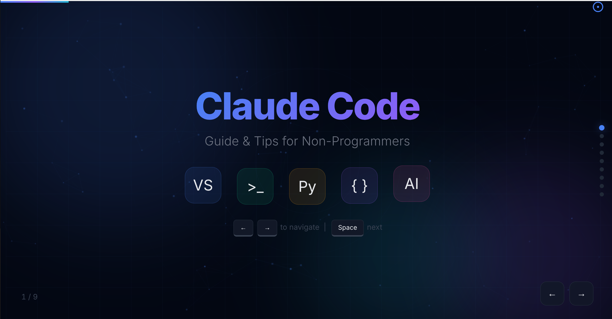
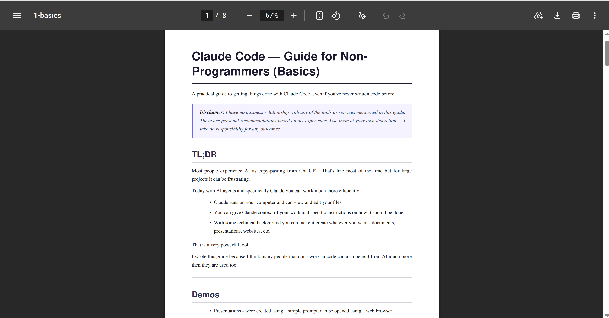

# מדריך Claude למי שלא מתכנת (בסיס)

מדריך מעשי לשימוש טוב יותר בבינה מלאכותית, גם אם מעולם לא כתבתם קוד. כדאי לקרוא קודם את [הצעדים הראשונים](../01-first-steps/first-steps.md).

## בקצרה

רוב האנשים מכירים AI בתור העתק-הדבק מ-ChatGPT.

זה מספיק ברוב המקרים, אבל זה עלול לתסכל, במיוחד בפרויקטים גדולים או כשיש לכם דרישות ספציפיות ואתם צריכים להסביר אותן שוב ושוב.

היום, עם סוכני AI ובפרט Claude, אפשר לעבוד הרבה יותר ביעילות:

- ‏Claude רץ על המחשב שלכם ויכול לראות ולערוך את הקבצים שלכם, בזמן שאתם שותים קפה.
- אפשר לתת ל-Claude הקשר על העבודה שלכם והוראות מדויקות איך לבצע אותה.
- עם קצת רקע טכני אפשר לגרום לו ליצור כל מה שתרצו: מסמכים, מצגות, אתרים ועוד.

זה כלי חזק מאוד.

כתבתי את המדריך הזה כי אני חושב שאנשים רבים שלא עובדים עם קוד יכולים להפיק מ-AI הרבה יותר ממה שהם רגילים.

> **הבהרה:** אין לי קשר עסקי לאף אחד מהכלים או השירותים שמוזכרים במדריך. אלה המלצות אישיות מהניסיון שלי. השתמשו בהן על אחריותכם, ואני לא לוקח אחריות על התוצאות.

> **הערה:** המדריך נכתב עם Claude בראש, אבל אם יש לכם מנוי ל-ChatGPT אפשר לעבוד בדיוק באותה דרך: לערוך קבצים עם Codex בתוך VS Code.

---

## הדגמות

נתחיל מהסוף. הנה מה שיצרתי בעזרת כמה הנחיות פשוטות:

**מצגת:** מצגת שקפים יפה, שנוצרה מהטקסט של המדריך ([לפתיחה](_files/presentation.html)):



**מסמך:** גרסת PDF של המדריך באנגלית ([לפתיחה](_files/document.pdf)):



**משחק:** משחק חלל קטן שמשחקים בדפדפן ([לפתיחה](_files/game.html)):


המסמך נוצר בפקודה הזו:

```bash
python markdown_to_pdf.py basics.md -o document.pdf
```

---

## למידה

המדריך מציג כמה מונחים וטכנולוגיות בסיסיים.

רוצים לדעת עוד? חפשו בגוגל או שאלו את מודל השפה האהוב עליכם :)

היום אפשר ללמוד ולעשות כל דבר. הגבול היחיד הוא הדמיון.

---

## מתחילים: מה להתקין

כדי לעבוד לפי המדריך צריך להתקין שלושה דברים:

1. ‏**VS Code** (חינם): עורך טקסט שבו תעשו את כל העבודה. הורידו מ-[code.visualstudio.com](https://code.visualstudio.com/), הריצו את תוכנית ההתקנה ופתחו אותו.

2. ‏**Python** (חינם): שפת תכנות ש-Claude משתמש בה מאחורי הקלעים כדי לבצע פעולות חזקות. הורידו מ-[python.org/downloads](https://www.python.org/downloads/). בזמן ההתקנה הקפידו לסמן **"Add Python to PATH"**. כדי לוודא שזה עובד, פתחו טרמינל והקלידו `python --version`.

3. ‏**Claude Code** (כלול במנוי Pro, כ-20$ לחודש): עוזר ה-AI עצמו. התקינו את ההרחבה Claude Code ב-VS Code: פתחו את VS Code, לחצו על סמל ההרחבות בסרגל השמאלי (`Ctrl+Shift+X`), חפשו "Claude Code" ולחצו Install. צריך חשבון Claude בתשלום. המחירים מופיעים ב[צעדים הראשונים](../01-first-steps/first-steps.md#התקנת-claude).

## רקע טכני קצר

הנה כמה מונחים שיעזרו לכם להפיק את המרב מ-Claude.

### קבצים

במחשב שלכם יש קבצים רבים: תמונות, מסמכים, תוכנות ועוד. [בצעדים הראשונים](../01-first-steps/first-steps.md#סוגי-קבצים-שימושיים) יש סקירה של הסוגים השימושיים.

הקובץ הבסיסי ביותר הוא קובץ טקסט: הוא מכיל תווים בלבד, בלי תמונות ובלי עיצוב.

לכל קובץ טקסט יש **קידוד** (encoding): הכלל שקובע איך התווים נשמרים. לאנגלית ולסימנים רגילים מספיק ASCII. לשפות אחרות (עברית, ערבית, סינית וכן הלאה) משתמשים ב-UTF-8.

### Python

‏Python היא שפת תכנות. אין צורך ללמוד או להבין אותה. מספיק לדעת ש-Claude יכול להשתמש בה מאחורי הקלעים כדי לבצע בשבילכם פעולות חזקות, כמו עיבוד נתונים, המרת קבצים או אוטומציה של משימות. כש-Claude צריך Python, הוא מטפל בהכול בעצמו.

### טרמינל

אפשר לשלוט במחשב גם בהקלדת פקודות טקסט במקום בלחיצה על כפתורים. לזה קוראים **טרמינל** (Terminal, וגם שורת פקודה, Command Line או Command Prompt). Claude משתמש בו כדי להריץ בשבילכם סקריפטים וכלים.

---

## VS Code

### מה זה?

‏VS Code (ובשמו המלא Visual Studio Code) הוא עורך טקסט חינמי של Microsoft. חשבו עליו כעל פנקס רשימות משוכלל: הוא פותח כל קובץ, צובע שפות שונות בצבעים שונים ומריץ בתוכו כלים כמו Claude Code.

### מושגי יסוד

- **סייר הקבצים** (File Explorer, בסרגל השמאלי): עיון בקבצים של תיקיית הפרויקט ופתיחתם
- **העורך** (Editor, במרכז): המקום שבו רואים ועורכים קבצים
- **הטרמינל** (Terminal, בפאנל התחתון): שורת פקודה שמובנית ב-VS Code
- **הרחבות** (Extensions, בסרגל השמאלי, סמל הקוביות): תוספים שנותנים ל-VS Code יכולות חדשות, כמו Claude Code או תמיכה ב-Python
- **לוח הפקודות** (Command Palette): לחצו `Ctrl+Shift+P` כדי לחפש כל פעולה

### התקנת הרחבות

הרחבות מוסיפות ל-VS Code תכונות: תמיכה בשפות, ערכות נושא, כלים ועוד. כדי להתקין:

1. לחצו על סמל **Extensions** בסרגל השמאלי (או `Ctrl+Shift+X`)
2. חפשו את מה שאתם צריכים
3. לחצו **Install**

**איך בוחרים הרחבות בטוחות:**

- **העדיפו מפרסמים מאומתים:** חפשו את הוי הכחול ליד שם המפרסם. Microsoft מאמתת אותם.
- **אם המפרסם לא מאומת:** בדקו את מספר ההורדות והדירוג. הרחבות פופולריות (מיליוני הורדות, 4 כוכבים ומעלה) הן בדרך כלל בטוחות.
- **היזהרו** מהרחבות לא מוכרות עם מעט הורדות: הן עלולות להכיל באגים ואפילו קוד זדוני. אם יש ספק, חפשו המלצות ברשת.

### קיצורי מקלדת חיוניים

| פעולה | קיצור |
| --- | --- |
| פתיחת לוח הפקודות | `Ctrl+Shift+P` |
| פתיחת קובץ לפי שם | `Ctrl+P` |
| הצגה או הסתרה של הטרמינל | `` Ctrl+` `` |
| הצגה או הסתרה של הסרגל הצדדי | `Ctrl+B` |
| שמירת קובץ | `Ctrl+S` |
| חיפוש בקובץ | `Ctrl+F` |
| חיפוש בכל הקבצים | `Ctrl+Shift+F` |
| פתיחת Simple Browser (תצוגה מקדימה) | `Ctrl+Shift+P` ואז "Simple Browser" |

> **לקריאה נוספת:** [VS Code Getting Started](https://code.visualstudio.com/docs/getstarted/introvideos)

---

## Markdown

### מה זה?

‏Markdown היא דרך פשוטה לעצב טקסט בעזרת תווים רגילים. הקבצים מסתיימים ב-`.md`. המדריך הזה כתוב ב-Markdown.

### תחביר

```markdown
# Heading 1

## Heading 2

### Heading 3

**bold text**
_italic text_

- bullet point
- another bullet

1. numbered list
2. second item

[link text](https://example.com)

> blockquote

`inline code`
```

### איך רואים תצוגה מקדימה

- ב-Obsidian: הקבצים מוצגים מעוצבים כבר בזמן הכתיבה
- ב-VS Code: פתחו קובץ `.md` ולחצו `Ctrl+Shift+V` לתצוגה מקדימה, או `Ctrl+K V` לתצוגה מקדימה זה לצד זה
- אפשר לבקש מ-Claude ליצור קובצי Markdown ולראות אותם ישירות ב-VS Code

> **לקריאה נוספת:** [Markdown Guide](https://www.markdownguide.org/basic-syntax/)

---

### יצירת PDF מקובצי Markdown

יש סקריפט עזר בשם [`markdown_to_pdf.py`](_files/markdown_to_pdf.py) שממיר קובצי Markdown ל-PDF. כדי להשתמש בו:

1. העתיקו את הקובץ `markdown_to_pdf.py` לתיקיית הפרויקט
2. בקשו מ-Claude: "המר את my-document.md ל-PDF בעזרת markdown_to_pdf.py"

‏Claude יתקין את מה שצריך ויריץ בשבילכם את הסקריפט.

---

## ‏HTML, JavaScript ו-CSS

### מה הם?

שלוש השפות האלה עובדות יחד כדי ליצור אתרים:

- ‏**HTML:** המבנה והתוכן (כותרות, פסקאות, כפתורים)
- ‏**CSS:** העיצוב (צבעים, גופנים, פריסה)
- ‏**JavaScript (JS):** ההתנהגות (מה קורה כשלוחצים על דברים)

אתר בסיסי הוא פשוט קובץ `.html` שיכול להפנות לקובצי `.css` ו-`.js`.

### איך פותחים

1. לחצו לחיצה כפולה על קובץ `.html`: הוא ייפתח בדפדפן ברירת המחדל (Chrome, Firefox וכן הלאה)
2. או לחצו על הקובץ בלחצן הימני, בחרו "Open with" ואז דפדפן
3. ב-VS Code אפשר להשתמש ב-**Simple Browser** כדי לראות תצוגה מקדימה בלי לצאת מהעורך:
   לחצו `Ctrl+Shift+P`, הקלידו "Simple Browser: Show" והדביקו את נתיב הקובץ

### מבנה בסיסי

```html
<!DOCTYPE html>
<html>
<head>
    <title>My Page</title>
    <style>
        body { font-family: sans-serif; margin: 40px; }
        h1 { color: darkblue; }
    </style>
</head>
<body>
    <h1>Hello!</h1>
    <p>This is a paragraph.</p>
    <button onclick="alert('clicked!')">Click me</button>
</body>
</html>
```

שמרו את זה כקובץ `.html` ופתחו אותו בדפדפן כדי לראות איך זה עובד.

> **לקריאה נוספת:** [MDN Web Docs: Getting Started](https://developer.mozilla.org/en-US/docs/Learn/Getting_started_with_the_web)

---

## Claude Code

### מה זה?

‏Claude Code הוא עוזר AI שחי בתוך VS Code (או בטרמינל). הוא יכול לקרוא, ליצור ולערוך קבצים במחשב שלכם. מדברים איתו בשפה רגילה, והוא עושה את העבודה.

### איפה משתמשים בו?

- ב-VS Code: מתקינים את התוסף ולוחצים `CTRL+SHIFT+P` ואז "Claude code: Open in Side Bar"

### מה הוא יודע לעשות?

- **לערוך קבצים:** "שנה את צבע הכותרת לאדום" או "תקן את שגיאת הכתיב בפסקה 3"
- **ליצור קבצים:** "צור מסמך עם חלקים לתאריך, משתתפים ומשימות" או "בנה אתר עם טופס יצירת קשר"
- **להסביר דברים:** "מה הקובץ הזה עושה?"
- **להריץ פקודות:** הוא יכול להריץ בשבילכם פקודות טרמינל, כמו המרת קבצים או עיבוד נתונים

### אפשר ליצור אפליקציה בעזרת Claude?

- **אתר:** אפשר ליצור בקלות רבה, אבל הוא יהיה קיים רק במחשב שלכם.
  - כדי שגם אחרים יוכלו להיכנס אליו, צריך לארח אותו במקום כלשהו (שרת שמחזיק אותו באוויר).
  - גם מסד נתונים וחיבור לשירותי אינטרנט אחרים אפשריים, אבל זה קצת יותר מסובך.
- **אפליקציה לטלפון:** לא ישירות. בניית אפליקציה ייעודית דורשת חשבונות מפתח (Apple או Google), כלים מיוחדים והקמה מורכבת יותר. עם זאת, Claude יכול לעזור לכם ליצור **אפליקציית ווב** שעובדת טוב בטלפון: היא נראית ומרגישה כמו אפליקציה כשפותחים אותה בדפדפן של הטלפון, והרבה יותר פשוט לבנות ולשתף אותה.

### ‏CLAUDE.md: לתת ל-Claude הקשר

אפשר ליצור בתיקיית הפרויקט קובץ בשם `CLAUDE.md` עם הקשר והוראות ל-Claude. Claude קורא את הקובץ אוטומטית כשהוא מתחיל לעבוד. תארו בו את הפרויקט ואיך Claude צריך לעבוד בו. למשל:

```markdown
זה פרויקט שיווק. כל המסמכים צריכים להיות בעברית.
קובצי הפלט נשמרים בתיקייה output.
```

### מצבי עבודה

| מצב | מה הוא יכול לעשות | מתי להשתמש בו |
| --- | --- | --- |
| **Plan mode** | קורא קבצים, חושב ובונה תוכנית | כשרוצים לעבור על התוכנית לפני שינויים |
| **Normal mode** | קורא ועורך קבצים | עבודה יומיומית |

### הרשאות

‏Claude מבקש רשות לפני פעולות כמו עריכת קבצים או הרצת פקודות. אפשר:

- **לאשר פעם אחת:** אישור לפעולה הזו בלבד
- **לאשר לפרויקט הזה:** לחיצה על "Yes, don't ask again" שומרת את ההרשאה לתיקיית הפרויקט הנוכחית. Claude לא ישאל שוב על אותו סוג של פעולה בפרויקט הזה, אבל ימשיך לשאול בפרויקטים אחרים.

> **המלצה למתחילים:** אשרו כל פעולה בנפרד ("Allow once") עד שתרגישו בנוח עם מה ש-Claude עושה. כך השליטה נשארת בידיים שלכם ואפשר לבדוק כל שינוי.

### דברים לנסות

**יצירת מסמכי Markdown:**

> "צור קובץ Markdown בשם meeting-notes.md עם חלקים לתאריך, משתתפים, סדר יום ומשימות"

**בניית אתרים:**

> "צור אתר פשוט בעיצוב כהה שמציג רשימה של הספרים האהובים עליי. שיהיה יפה."

**יצירת מצגות:**

> יש לכם חומר טקסט שאתם רוצים להציג? בקשו מ-Claude להפוך אותו למצגת ווב. למשל: "צור מצגת HTML מהטקסט הזה", ואז פתחו את קובץ ה-`.html` בדפדפן. זו דרך מהירה ליצור שקפים יפים בלי PowerPoint.

**המרה ל-PDF:**

> "המר את my-document.md ל-PDF בעזרת markdown_to_pdf.py"

**תצוגה מקדימה בסרגל הצדדי של VS Code:**

> אחרי שיצרתם קובץ HTML, פתחו אותו ב-Simple Browser של VS Code: לחצו `Ctrl+Shift+P`, בחרו "Simple Browser: Show" והזינו את נתיב הקובץ

**עריכת קבצים קיימים:**

> "ב-index.html, שנה את צבע הרקע לאפור בהיר והגדל את הגופן"

### טיפים

- היו מדויקים במה שאתם רוצים: "הפוך את הכותרת לכחולה וממורכזת" עובד טוב יותר מ"תעשה את זה יפה יותר"
- אפשר לסמן טקסט ב-VS Code ולשאול את Claude רק על הקטע המסומן
- אם השינוי של Claude לא מה שרציתם, פשוט אמרו לו: "בטל את זה" או "לא, התכוונתי לכותרת השנייה"
- ‏Claude יודע לעבוד עם כל סוג של קובץ טקסט: טקסט רגיל, קוד, קובצי הגדרות וכן הלאה

---

## מה הלאה?

רוצים להתקדם? [המדריך המתקדם](../03-advanced/advanced.md) עוסק ב:

- **שורת הפקודה:** להבין איך המחשב מריץ תהליכים מאחורי הקלעים
- ‏**Git ו-GitHub:** לשמור את העבודה, לעקוב אחרי שינויים ולהציג אותה בפומבי מכל מחשב או טלפון
- ‏**Python:** ליצור עם Claude פעולות מורכבות וחזקות יותר
