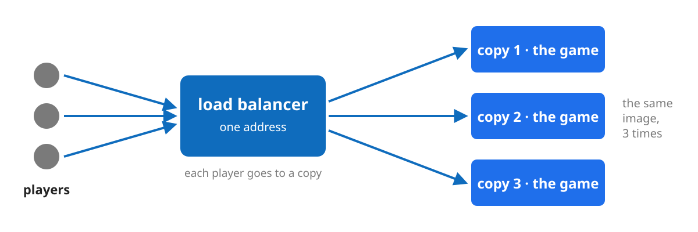
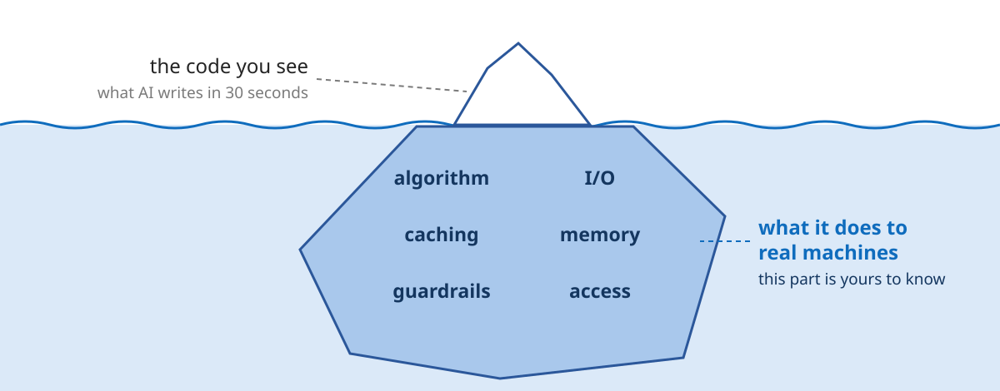
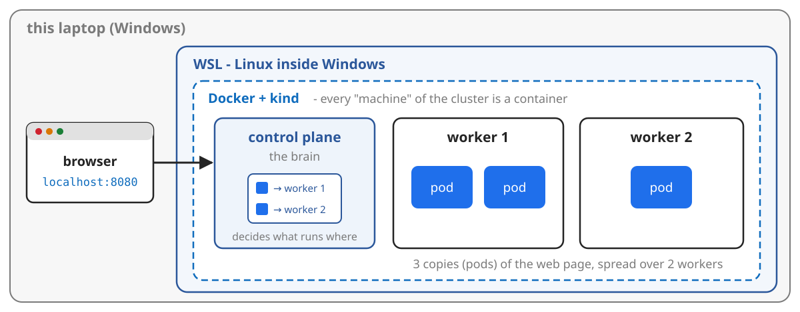
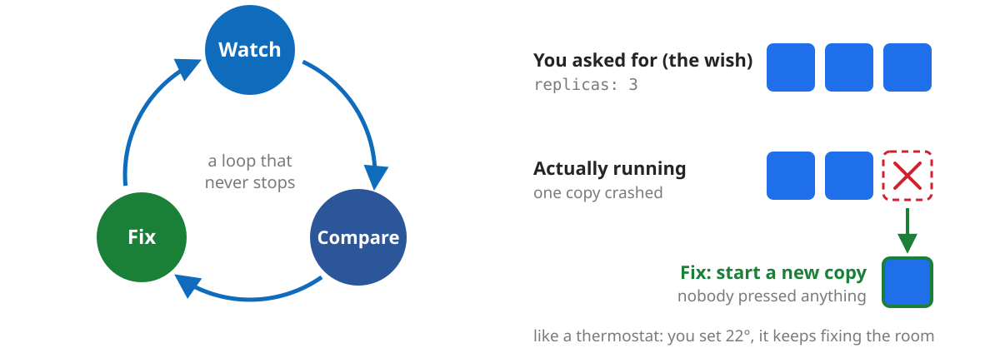
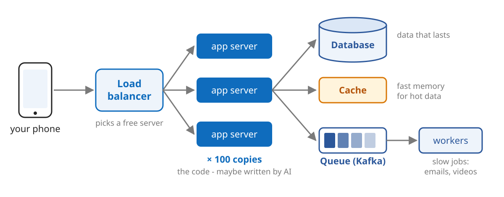
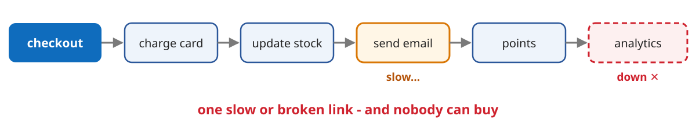

# From Code to the Real World

Git, Docker, CI/CD and Kubernetes - in a world where AI writes the code

<!-- notes:
Welcome! These notes explain every slide in full, so you can go through the talk on your own, at your own pace. Use the arrow keys to move between slides, and press **?** to open or close these notes.

The talk follows one small game, built with AI, from a laptop to 100,000 players - one step at a time: save it (Git), pack it (Docker), check and ship it (CI/CD), and run many copies of it (Kubernetes). Everything runs on one laptop, with real commands, and every step has a slide with the real output - so you can follow it even without the live demo.
-->

---

## Before we start: raise your hand

| | Who knows what it is? | Who has done it? |
| --- | --- | --- |
| **AI** | ChatGPT, Claude, Copilot | built something with AI |
| **Git** | a commit | saved code with Git |
| **Docker** | a container | run one |
| **CI/CD** | a pipeline | - |
| **Kubernetes** | what it does | used it |
| **DevOps** | what it means | - |

<!-- notes:
The talk opened with these questions, to see what the room already knew. Try them on yourself: for each row, do you know roughly what it is? Have you actually done it?

It's completely fine to answer "no" to all of them - every word on this slide is one step of the talk:
- **Git** - step 1, saving every change (slide 4).
- **Docker** - step 2, packing the game so it runs anywhere (slide 6).
- **CI/CD** - step 3, checking and shipping every change by itself (slide 8).
- **Kubernetes** - step 4, running many copies (slide 9).
- **DevOps** - the name for the whole road (slide 11).
-->

---

## Part 1 · You built a game

#### Space Dodge - built with AI, in one evening

- one page: fly the ship, dodge the asteroids, collect stars
- it works on your laptop
- tonight a streamer shares the link: **100,000 players**

```text
game/
  index.html              the game
  default.conf.template   the web server's settings
  Dockerfile              how to pack it        (step 2)
  test.sh                 its tests             (step 3)
  VERSION                 v1, blue
```

<!-- notes:
You already know how to write code - and many of you build things with AI. So say you did: you asked an AI for a small browser game, and in one evening you have **Space Dodge**. You fly a small ship with the mouse or the arrow keys, dodge the asteroids that fall faster and faster, and collect stars for points. (It's the game from the [Claude guide on blearning](https://barakkol33.github.io/blearning/claude-guide/) - built with Claude.)

It works on your laptop. Then a streamer shares the link, and tonight 100,000 people want to play it. Now what?

The rest of the talk takes this exact game - these real files - from your laptop to those 100,000 players, one step at a time: save it (Git), pack it (Docker), check and ship it (CI/CD), and run many copies (Kubernetes). Every step is a real command on one laptop, and every step has a slide with its real output. The folder:
- `index.html` - the game itself: one page with a few hundred lines of JavaScript that draw on a canvas. Its bottom line shows which version answered, and from which copy and machine - you'll see why that matters.
- `default.conf.template` - the settings of the web server that serves the page (nginx).
- `Dockerfile` - the recipe for packing it into a container (step 2).
- `test.sh` - its tests (step 3).
- `VERSION` - the version number and its color: v1 is blue. Later, v2 is green and v3 is red - so you can always see which version is running.
-->

---

## Part 2 · Save it: Git

#### Every change saved - with who, when and why

- a **commit** = a saved snapshot of all the files, with a message
- **history** - see every change, and go back to any version
- **together** - many people (and AIs) change the same code safely
- **GitHub** - the same history, online

```bash
git diff                                  # what did I change?
git commit -am "v2: a new, faster level"  # save it, with a message
git log --oneline                         # the history
```

<!-- notes:
The first thing you want for your game: never lose a working version.

**Git** is a tool that saves the history of a folder. Every time you **commit**, it saves a snapshot of all the files, with a message that says what changed and why - and who changed it, and when. You can always see the whole history, compare any two versions, and go back to any of them.

It's also how people work together: many people - and today, AI agents - change the same code at the same time, and Git puts the changes together without anyone overwriting anyone else. **GitHub** is a website that keeps the same Git history online, so a whole team (or the whole world) can share it.

The three commands on the slide are the ones in the demo:
- `git diff` - what changed since the last commit?
- `git commit -am "..."` - save all the changed files (`-a`) with a message (`-m`).
- `git log --oneline` - the history, one line per commit.

And one more reason it matters for DevOps: every change that reaches players starts as a commit. The pipeline in step 3 starts from one.
-->

---

## Saving the new level

```text
$ git log --oneline
fc40339 v1: the first version of the game

$ git diff
-  <h1>Space Dodge</h1>
+  <h1>Space Dodge - level 2: faster!</h1>
-const SPEED = 1.0;            // how fast the asteroids fall
+const SPEED = 1.5;            // how fast the asteroids fall
-v1 #1f6feb
+v2 #1a7f37

$ git commit -am "v2: a new, faster level"
[main ede666d] v2: a new, faster level

$ git log --oneline
ede666d v2: a new, faster level
fc40339 v1: the first version of the game
```

<!-- notes:
The real output from the demo (`./demo.sh git`), trimmed a little. Read it from the top:

1. `git log --oneline` - the history so far: one commit, `v1: the first version of the game`. The code in front (`fc40339`) is the commit's name - a unique ID.
2. Then we change the game: a faster level. `git diff` shows exactly what changed - a line starting with `-` was removed, a line starting with `+` was added. Three changes: a new title, the asteroids fall faster (`SPEED` goes from 1.0 to 1.5), and the version goes from v1 (blue) to v2 (green).
3. `git commit -am "v2: a new, faster level"` - save it. Git answers with the new commit's ID: `ede666d`.
4. `git log --oneline` again - now there are two commits. If v2 turns out to be a bad idea, v1 is one command away.

That's **version control**. Notice: nothing was uploaded anywhere yet - the new level is saved, but no player has seen it. Getting it to them is the next steps.
-->

---

## Part 3 · Package it: Docker

#### "It works on my machine" - so ship the machine

- an **image** = the game + a web server, in one package
- a **container** = a running image - the same anywhere

```dockerfile
FROM nginx:1.27-alpine                          # start from a ready-made web server
COPY default.conf.template /etc/nginx/templates/  # its settings
COPY index.html /usr/share/nginx/html/          # our game
```

<!-- notes:
"It works on my machine" is the oldest problem in software: the code works on your laptop and breaks on the server - a different version, a missing library, a different setting. The solution: ship the machine too.

**Docker** packs the app together with everything it needs into an **image**: here, the game, plus a web server (nginx) that serves it, plus the server's settings. A **container** is a running image. It's like a shipping container: the crane doesn't care what's inside - it moves every container the same way. The same image runs identically on your laptop, a server, or the cloud.

The recipe is a **Dockerfile**. Read it line by line:
- `FROM nginx:1.27-alpine` - start from a ready-made image that already has a web server.
- `COPY default.conf.template ...` - add the server's settings.
- `COPY index.html ...` - add our game.

(The real file in the demo has two more lines that write the version and its color into the image - so every image knows which version it is.)
-->

---

## Build it, run it

```text
$ docker build -t game-site:v2 .
 => [1/3] FROM nginx:1.27-alpine
 => [2/3] COPY default.conf.template /etc/nginx/templates/
 => [3/3] COPY index.html /usr/share/nginx/html/
 => naming to game-site:v2

$ docker images game-site
REPOSITORY   TAG   SIZE
game-site    v2    48.3MB
game-site    v1    48.3MB

$ docker run -d -p 8081:80 game-site:v2
$ curl localhost:8081/plain
v2 #1a7f37 my-laptop my-laptop
```

<!-- notes:
The real output from the demo (`./demo.sh docker`), trimmed:

1. `docker build -t game-site:v2 .` - follow the recipe in this folder (`.`) and name the image `game-site:v2` (`-t` = tag). Each step of the Dockerfile is one line of output. (In the demo the command also passes the version and its color - `--build-arg VERSION=v2 ...` - left out here to keep it short.)
2. `docker images game-site` - the images on this laptop: one per version, about 48 MB each. Like commits - but these can run.
3. `docker run -d -p 8081:80 game-site:v2` - start a container from the image, in the background (`-d`), and connect port 8081 on the laptop to port 80 inside the container (`-p`). The game is now at `http://localhost:8081`.
4. `curl localhost:8081/plain` - ask the game which version answered: `v2`, its color (green), and which copy and machine - here, just `my-laptop`.

That's a **container**. The exact same image is what will run in the cluster in step 4 - nothing gets "installed" there.
-->

---

## Part 4 · Check it, ship it: CI/CD

#### Every commit goes through the same pipeline - by itself

```text
== 1. BUILD     pack the commit into an image
== 2. TEST      run the tests on the new image
== 3. DEPLOY    upload it, then update one copy at a time
== 4. VERIFY    is every new copy ready? does the game answer?
== 5. ROLLBACK  if anything failed - automatic
```

- **CI** - every change is built and tested, automatically
- **CD** - what passed is shipped, automatically
- a failed step stops everything - before players see it

<!-- notes:
You have a commit and an image. Now: how does the new version reach players - safely, every time?

Not by hand. Every commit goes through the same automatic **pipeline**:
1. **BUILD** - pack the commit into an image (step 2).
2. **TEST** - run the tests on the new image. The game's `test.sh` has three: the page has its title and the game; the web server's settings are valid; the container starts and serves the page.
3. **DEPLOY** - upload the image, and replace the running copies one at a time.
4. **VERIFY** - did every new copy start and become ready? Does the game really answer with the new version?
5. **ROLLBACK** - if anything failed, go back to the last version that worked - by itself.

**CI** (Continuous Integration) is the first half: every change is built and tested automatically. **CD** (Continuous Delivery) is the second: what passed is shipped automatically. A step that fails stops the pipeline - before the change reaches players.

In companies, a pipeline like this runs on every push to GitHub (with tools like GitHub Actions or GitLab CI). In the demo, `./demo.sh update` runs the same five steps on the laptop. It needs somewhere to ship to - a Kubernetes cluster (step 4). The real run, a new level shipped and a bug caught and rolled back, is right after the wrap-up (slides 17-18).
-->

---

## Part 5 · Many copies: Kubernetes

#### You say *what* - "3 copies, always". It figures out *how*.



- the wish is a file - **Infrastructure as Code**
- copies on 2 machines - **high availability**

<!-- notes:
One copy of the game can't serve 100,000 players - and if that one copy crashes, everyone is out. So you run **many copies** of the same image.

In the diagram: every player goes to one address - a **load balancer** - and it sends each player to one of the copies, whichever is free. If one copy dies, the others keep serving.

But who starts the copies, spreads them over the machines, and replaces one that dies at 3 AM? **Kubernetes** (K8s for short: K, then 8 letters, then s). Kubernetes is **declarative**: you don't tell it the steps ("start a server"), you describe the result you want - "3 copies of `game-site:v2`, always" - and it keeps that true, forever. Like a thermostat: you set 22°, and it keeps measuring and fixing.

Two ideas hide in this slide:
- **Infrastructure as Code (IaC):** the wish isn't typed by hand into some screen - it's a file in the repository (`app.yaml`, with `replicas: 3` and the image). The file can be reviewed, saved in Git with its history, and used to rebuild everything from scratch. Change the number in the file, and Kubernetes changes the world to match (slide 23 does it live: 3 copies → 6).
- **High availability (HA):** the system keeps working when parts of it fail. The copies are spread over two machines, so even if a whole machine dies, the other one keeps serving while Kubernetes moves the copies (slide 25 unplugs a machine live). Real systems spread copies over separate buildings and cities.

A few words you'll see in the output:
- **pod** - one running copy (a container, with a name like `game-64d44ddbc4-k9txh`).
- **node** - a machine. The demo cluster has two that run the game (`devops-demo-worker` and `devops-demo-worker2`) and one that runs Kubernetes itself. They're all containers on one laptop - a tool called **kind** (Kubernetes in Docker) makes one laptop look like a small data center.
- **Deployment** - the wish: "3 copies of this image". **Service** - the load balancer in front of them.
-->

---

## A copy dies

```text
$ kubectl get pods -l app=game -o wide
NAME                    READY   STATUS     NODE
game-64d44ddbc4-k9txh   1/1     Running    devops-demo-worker2
game-64d44ddbc4-qhjg6   1/1     Running    devops-demo-worker
game-64d44ddbc4-sbs7g   1/1     Running    devops-demo-worker

$ kubectl delete pod/game-64d44ddbc4-sbs7g
pod "game-64d44ddbc4-sbs7g" deleted

$ kubectl get pods -l app=game -o wide
game-64d44ddbc4-k9txh   1/1     Running       devops-demo-worker2
game-64d44ddbc4-lrqdn   1/1     Running       devops-demo-worker    <- new
game-64d44ddbc4-qhjg6   1/1     Running       devops-demo-worker
game-64d44ddbc4-sbs7g   1/1     Terminating   devops-demo-worker
```

- nobody restarted it: the wish is 3, it saw 2 - **self-healing**

<!-- notes:
The real output from the demo (`./demo.sh pods`, then `./demo.sh kill`), with a few columns left out:

1. `kubectl get pods` - the copies of the game: three pods, all `Running`, spread over the two machines (`NODE`). `1/1` under `READY` means the copy answers its health check - it's ready for players.
2. `kubectl delete pod/...` - we kill one copy on purpose, as if it crashed.
3. `kubectl get pods` again, two seconds later: the killed copy is `Terminating` (shutting down), and a **new** one - `game-64d44ddbc4-lrqdn` - is already `Running`. 

Who started it? Nobody. Kubernetes keeps comparing what you asked for (3 copies) with what's running (2), and fixes the gap. That's **self-healing** - and it works the same at 3 AM, when everyone is asleep. Meanwhile the load balancer simply stopped sending players to the dead copy: the game never went down.

More of the same, after the wrap-up: kill **all** the copies at once (slide 24), or unplug a whole machine (slide 25).
-->

---

## The road you just saw

| step | the tool | what it did for the game |
| --- | --- | --- |
| save it | **Git** | the new level, saved - with a way back |
| package it | **Docker** | one image: the same on the laptop and in the cluster |
| check it, ship it | **CI/CD** | every commit built, tested and shipped - or stopped - by itself |
| many copies | **Kubernetes** | 3 copies from a file (IaC), on 2 machines (HA); one died - it came back |

That road is **DevOps**.

<!-- notes:
The whole road, from your laptop to 100,000 players:
- **Git** saved every change - with who, when and why - and kept every version one command away.
- **Docker** packed the game with everything it needs into an image. The same image ran on the laptop and in the cluster.
- **CI/CD** builds, tests and ships every commit by itself - and stops a bad one before players notice. (The real run, with a new level and a bug: slides 17-18.)
- **Kubernetes** ran three copies behind one address - described in a file (**Infrastructure as Code**), spread over two machines (**high availability**) - and replaced one that died, with nobody pressing anything.

Together, that road is **DevOps** = **Dev** (developing software) + **Ops** (operating it - running it for real users). In the old days, developers wrote the code and threw it "over the wall" to an operations team, who installed it and kept it alive by hand - and each side blamed the other when things broke. Today, most companies have a **DevOps team** (sometimes called a platform team) that builds this road: the tools and pipelines that let developers ship their own code - quickly, safely, and without waiting for anyone. Every one of these tools is today's best practice - in ten years some will be replaced, but the problems they solve will still be there. More depth on everything here, and on things we skipped (observability, high availability, guardrails, architecture), comes after the wrap-up (slide 15).
-->

---

## Part 6 · Build with AI

#### Go build something - but know what it does

> My opinion: if you don't use AI, you will become **irrelevant**.

- build **anything** - a game, a bot, a site for your class
- AI writes a working app in 30 seconds
- it passes its tests. It runs. **Is it done?**
- my example, built with AI: [Bagrut summaries](https://barakkol33.github.io/blearning/high-school/) - math, physics, computer science, history, Tanakh...

<!-- notes:
In my opinion, if you don't use AI, you will become irrelevant - not in ten years, now. The people who will build things are the people who use AI to build them. If you already build with AI - keep going. If you don't - start today. Build anything: a game, a bot, a site for your class. The first project breaks the fear barrier; after that, the only limit is your imagination.

But AI writes a working app in 30 seconds - so is it done? Is there still a reason to learn how things work?

My own example: **blearning** ([barakkol33.github.io/blearning](https://barakkol33.github.io/blearning/)), a learning site built and grown with Claude Code - Bagrut summaries in math, physics, computer science, history, Tanakh and more, interactive physics animations, and this whole DevOps course. It started as one small project, and grew one piece at a time.

The next slide is the answer: **AI writes the code - you have to know what it does.** (A real example - an AI "tidy-up" that passed every test and still broke the game - is on slide 18.)
-->

---

## AI writes the code. You have to know what it does.



<!-- notes:
This is the central message of the talk.

**The iceberg:** the code is the small tip above the water - what AI writes in 30 seconds. Under the water is the big part: what that code does to real machines and real systems - the algorithm, I/O, caching, memory, guardrails and access.

AI is very good at producing code that **looks** right and works when you try it once. But it has never seen your players, your data, or your bill - and it doesn't know the rest of your system (slide 18: a change that looked perfect broke the one address Kubernetes depends on). Every line becomes work a real machine does, many times a second. And when it breaks at 3 AM, the AI is not in the room. You are. If you can't explain what the code does, you can't fix it.

So: ask the AI to explain every line you don't understand, ask it "what happens with 100,000 users?", and test with real-size data. Six questions to ask about any code, and six traps hidden in code that "works", come after the wrap-up (slides 43-51).
-->

---

## Part 7 · Wrap-up

#### The base of everything

Tools change every few years. These three don't.


<!-- notes:
What to take away from all this, and what to do next.

**The most important slide of the talk.**

The tools in this talk - Git, Docker, CI/CD, Kubernetes in the rest of this talk: Kubernetes, Docker, Kafka, Terraform, even today's AI tools - are **today's best practice**. Ten years ago half of it didn't exist; in ten years much of it will be replaced. It's the top layer in the diagram, and it changes.

Underneath is the base, and it doesn't change:
1. **Know what the product should do.** Who uses it, what problem it solves, what "working" means for them. AI can write code, but it can't decide what's worth building, or notice that it built the wrong thing.
2. **Know what your technology does.** Not just that the code runs - what it does to real machines: the algorithm, the I/O, the memory, the access. That's the iceberg from slide 13.
3. **Be able to learn new technologies and tools - all the time.** The tools on top will keep changing. The people who stay relevant are the ones who pick up the next one quickly - and AI is the best tool for learning there has ever been.

**And one thing that's always true: learn English well.** Every new tool, its documentation, the forums where people solve your exact problem, the talks and courses - all of it comes out in English first, and often only in English. Even working with AI goes better when you can read and write English precisely. It's the tool that unlocks every other tool.

AI is a great co-pilot. You are still the pilot - and the pilot needs to know where the plane is going (the product), how it works (the technology), and how to fly next year's plane (learning).
-->

---

## The important ideas

1. the app is the start - 100,000 players is the job
2. **the road**: Git → Docker → CI/CD → Kubernetes - that's **DevOps**
3. **AI writes the code - you have to know what it does**
4. **the base**: the product, your tech, learning - and English
5. **use AI** - go build something

<!-- notes:
The whole talk in five ideas:
1. **Building the app is the start.** AI can write a game in one evening. Getting it to 100,000 players - without breaking, at 3 AM, while changing it all the time - is the real job.
2. **The road** that gets it there is **DevOps**: save every change (Git), pack it so it runs anywhere (Docker), check and ship every change by itself (CI/CD), and run many copies that heal themselves (Kubernetes).
3. **AI writes the code - you have to know what it does.** Code that passes its tests can still break the real system. The code is the tip of the iceberg; what it does to the real system is underneath.
4. **The base doesn't change:** know what the product should do, know what your technology does, keep learning new tools - and learn English well (slide 14).
5. **Use AI.** In my opinion, if you don't, you will become irrelevant. AI makes you fast; knowing what the code does makes you good. You need both.

Anyone can write code now. Knowing what it does - and running it for many people, safely - that's engineering.

That's the end of the talk. The next slide is a map of the topics that come after it.
-->


---

## More interesting topics

After the talk - for questions, or at home. Press **?** on any slide for the full explanation.

| subject | what's in it | slides |
| --- | --- | --- |
| **CI/CD** | the pipeline for real: a new level, a bug, a rollback; outages; guardrails | 17-21 |
| **Kubernetes** | scale with a file, kill all copies, a machine dies, observability, architecture | 22-30 |
| **Kafka** | services that talk without waiting: producers, consumers, lag | 31-37 |
| **Infrastructure as code** | Terraform, spot the bug, a real story, why it's harder | 38-41 |
| **Know what the code does** | laptop vs the real world, six questions, six traps | 42-51 |
| **Try it yourself** | run the demo at home, where to learn more | 52-53 |

<!-- notes:
The talk ended on the previous slide. Everything after this one goes deeper, subject by subject, in the order of the road - for time left over, for questions, or for going over at home:
- **CI/CD** (slides 17-21): the pipeline for real - the new level shipped with a rolling update, and the "tidy-up" that passed every test and was rolled back by itself; famous outages caused by a change; the DevOps loop; and the guardrails that stop one mistake from becoming a disaster.
- **Kubernetes** (slides 22-30): the demo cluster, scaling with a file (Infrastructure as Code), killing every copy at once, unplugging a whole machine (high availability), observability (events and logs), the watch-compare-fix loop, the Kubernetes words, and the architecture of a real app.
- **Kafka** (slides 31-37): how services talk to each other without waiting - producers, consumers, partitions and lag.
- **Infrastructure as code** (slides 38-41): Terraform, a bug to spot, a real story of an AI agent and a production database, and why infrastructure code is harder than app code.
- **Know what the code does** (slides 42-51): your laptop vs the real world, six questions to ask about any code, and six traps hidden in code that "works".
- **Try it yourself** (slides 52-53): run the whole demo on your own laptop, and where to keep learning.
-->

---

## Ship the new level - through the pipeline

```text
$ ./demo.sh update
 PIPELINE - commit ede666d "v2: a new, faster level"
== 1. BUILD     ok: built game-site:v2
== 2. TEST      test 1: the page has its title and the game
                test 2: the web server's config is valid (nginx -t)
                test 3: the container starts and serves the page
                ok: all tests passed
== 3. DEPLOY    ok: uploaded game-site:v2 to the cluster's machines
== 4. VERIFY    rollout: 1 of 3 new copies... 2 of 3... 3 of 3
                ok: v2 is live
 PIPELINE PASSED - v2 released
```

- **rolling update** - a new copy starts, then an old one stops: the game never goes down
- on the dashboard, blue copies turn green - one by one

<!-- notes:
Now the commit from the Git slide (`ede666d`, the faster level) goes to the players - through the pipeline from slide 8, for real. The real output of `./demo.sh update`, slightly shortened:

1. **BUILD** - the commit becomes the image `game-site:v2`.
2. **TEST** - the three tests run on the new image. All pass.
3. **DEPLOY** - the image is uploaded to the cluster's machines, and Kubernetes starts a **rolling update**: it starts one new copy, waits until it's ready, and only then stops an old one - again and again, until all three are v2.
4. **VERIFY** - all three new copies are ready, and the game really answers with v2. **PIPELINE PASSED.**

Nobody logged into a server, and nobody copied a file. The game never went down: at every moment, at least three ready copies were serving players. In the live demo, the dashboard in the left terminal shows it: blue v1 copies are replaced by green v2 copies, one at a time, and the traffic line goes from blue to green with no red at all. That's how the apps on your phone update while you're using them.

That's **CI/CD**.
-->

---

## The next commit has a bug

```text
$ git diff                         # an AI "tidied up" the web server's settings
-  location = /healthz {
+  location = /health {

 PIPELINE - commit 6fc22d0 "v3: tidy up - rename /healthz to /health"
== 2. TEST      ok: all tests passed
== 3. DEPLOY    ok: uploaded game-site:v3
== 4. VERIFY    FAILED: the new copies never became ready
== 5. ROLLBACK  deployment.apps/game rolled back
 PIPELINE FAILED - rolled back to the last version that worked
```

- Kubernetes asks every copy `/healthz` - v3 doesn't answer
- the old copies kept serving: players never noticed
- the tests passed. **Someone had to know what it does.**

<!-- notes:
The real output of `./demo.sh break`, shortened. This is the most important slide of the demo.

Someone asked an AI to tidy up the web server's settings, and it renamed one address: `/healthz` became `/health`. Looks harmless - a cleaner name. The commit is v3 (red).

Follow the pipeline:
- **TEST passes.** The page has its title and the game, the settings are valid, the container starts and serves the page. Every test is green.
- **DEPLOY** starts the rolling update: one new v3 copy starts.
- **VERIFY fails.** Kubernetes asks every copy, every second: "are you ready?" - by calling the address `/healthz` (it's written in the cluster's file, `app.yaml`). The v3 copy no longer has that address, so it never answers "ready". Because a new copy must be ready before an old one stops, the old v2 copies keep serving the whole time.
- **ROLLBACK** - after 30 seconds, the pipeline undoes the change by itself, back to v2.

Players never noticed anything. The bug was in the code - but whether players got hurt was decided by **how we ship**: the readiness check, the rolling update, the automatic rollback. These are **guardrails** (more on slide 21).

And notice why it happened: every test passed. The code "worked". The problem was in how the change connects to the rest of the system - and to catch it, someone had to know what the code does. Remember that for part 6.
-->

---

## When a change goes wrong

None of these were caused by a hard algorithm. All of them were a **change** that went wrong.

| when | what happened |
| --- | --- |
| 2012 | [Knight Capital](https://en.wikipedia.org/wiki/Knight_Capital_Group): a bad deploy lost $440M in 45 minutes |
| 2017 | [AWS](https://aws.amazon.com/message/41926/): one mistyped command took down a large part of the internet for hours |
| 2021 | [Facebook, Instagram, WhatsApp](https://engineering.fb.com/2021/10/05/networking-traffic/outage-details/): a network change, 6 hours offline |
| 2024 | [CrowdStrike](https://en.wikipedia.org/wiki/2024_CrowdStrike-related_IT_outages): one faulty update crashed 8.5 million Windows computers |

<!-- notes:
Some of the biggest failures in tech had nothing to do with hard code:

- **2012, Knight Capital.** A trading company deployed new software to 7 of its 8 servers. The 8th still ran old code, which a reused setting switched back on. In 45 minutes it made millions of unwanted trades and lost about $440 million. The company never recovered.
- **2017, Amazon Web Services.** An engineer ran a routine command to remove a few servers, typed one input wrong, and removed far more. A large part of AWS S3 (Amazon's file storage) in one region went down for about four hours - and with it thousands of websites and apps.
- **2021, Facebook.** A command during routine network maintenance disconnected Facebook's data centers from the internet. Facebook, Instagram and WhatsApp were offline for about six hours. Engineers even had trouble getting into the buildings, because the door systems depended on the same network.
- **2024, CrowdStrike.** A faulty update to a security product crashed about 8.5 million Windows computers worldwide. Airlines, hospitals and banks stopped working.

**The lesson:** the code itself was usually fine. What failed was **how the change reached production** (the live system real users use) - the deploy, the command, the rollout. That's exactly what the pipeline in the talk is for: test, roll out one copy at a time, verify, and roll back by itself (slides 17-18).

Each company name on the slide is a link to the full story. Amazon and Meta published their own reports (called post-mortems); Amazon's is short and readable.
-->

---

## The DevOps loop


- every step automated, every step checked

<!-- notes:
The DevOps loop never stops. Follow the numbers around the infinity sign: plan, write code, build, test (the **Dev** side), then release, deploy, operate, monitor (the **Ops** side) - and what you learn from monitoring goes into the next plan.

Big companies go around this loop many times a day, with small changes. Why small? Because many small changes are safer than one big one: when something breaks, you know exactly which change caused it. One huge release once a month is a huge haystack to search for the needle.

And every step is automated and checked - which is how you avoid becoming the next story on the outages slide (slide 19).
-->

---

## The guardrails are DevOps

- **review** - a human reads the plan before `apply`
- **least privilege** - nobody, human or AI, holds keys it does not need
- **staging** - try it on a copy of the world first
- **backups + restore drills** - assume something will be deleted
- **monitoring + rollback** - notice in seconds, undo in one command

<!-- notes:
DevOps is also about **guardrails**: safety measures that stop one mistake - by a human or by an AI - from becoming a disaster like the outages on slide 19. Two of them appeared in the talk: automatic rollback and monitoring (slide 18); a plan before a change is on slide 23 ("scale with a file").
- **Review:** a human reads the plan - a preview of exactly what a change will do - before anyone applies it. (A plan: slide 23.)
- **Least privilege:** nobody - human or AI - holds keys it doesn't need. An agent that writes code doesn't need permission to delete the database.
- **Staging:** try every change on a copy of the real system first, never straight on production.
- **Backups and restore drills:** assume something will be deleted someday - and practice restoring. "A backup you've never restored is only a hope."
- **Monitoring and rollback:** notice a problem in seconds, and undo it - on slide 18 the pipeline rolls back by itself.
-->

---

## The demo cluster



```bash
./demo.sh up       # build the cluster and the game's first image, ~1-2 minutes
./demo.sh watch    # live dashboard: the game, the copies, the machines
```

<!-- notes:
The whole demo runs on one laptop - no cloud, no internet. How a whole Kubernetes cluster fits on one laptop - follow the diagram from the outside in:
- **WSL** (Windows Subsystem for Linux): Linux running inside Windows.
- **Docker:** runs containers.
- **kind** ("Kubernetes IN Docker"): every "machine" in the cluster is really a container. So one laptop can pretend to be a whole data center.

The cluster has 3 machines - a **control plane** (the brain, which decides what runs where) and 2 **workers** (which actually run things). On the workers run 3 copies (**pods**) of the game. Each copy says its own name and the machine it runs on, so you can see which copy answered you.

Everything is described in files: the machines (`kind-cluster.yaml`), the game in the cluster (`app.yaml`), the game itself (the `game/` folder) and the commands (`demo.sh`). `./demo.sh up` builds the whole cluster and the game's first image from these files, and it can be deleted and rebuilt any time.

`./demo.sh watch` is a live dashboard, redrawn every second. At the top is **the game** as a player sees it: up or down, which version answered, and a traffic strip with one colored block per request (a red X when a request failed). Below are **the copies**: how many are wanted and how many are ready, and every copy on its machine - with its version and its state (starting, ready, not ready, stopping). The browser at `http://localhost:8080` shows the game itself.

To run it yourself: "Try it at home", slide 52.
-->

---

## Scale with a file: 3 copies → 6

```text
$ ./demo.sh iac 6
== 1. the change: replicas -> 6 in app.yaml
   now:  14:  replicas: 3      # the desired state: how many copies
   new:  14:  replicas: 6      # the desired state: how many copies
== 2. PLAN - what would change? (kubectl diff)
-  replicas: 3
+  replicas: 6
== 3. APPLY - make it real (kubectl apply)
deployment.apps/game configured
deployment "game" successfully rolled out
```

- the cluster is described in files: change the file, see the **plan**, **apply** it
- 3 copies → 6 = changing one number in a file
- this is called **Infrastructure as Code**

<!-- notes:
The streamer's stream is getting bigger, and 3 copies won't survive it. We need 6. How do you add copies? Not by clicking - by changing a file.

**Infrastructure as Code (IaC)** means the infrastructure is described in files, not set up by hand. This whole cluster - the machines (`kind-cluster.yaml`) and the game in it (`app.yaml`) - is files. `./demo.sh up` built everything from them; delete it all, run it again, and you get exactly the same cluster. That's also **automation**: one command instead of an afternoon of clicking.

To change the infrastructure, you change the file - here, `replicas: 3` becomes `replicas: 6` (six copies instead of three). Then two steps:
- **Plan** (`kubectl diff`): show exactly what would change, before anything happens. Here: one line, 3 → 6.
- **Apply** (`kubectl apply`): make it real. Kubernetes starts three more copies.

Why bother, instead of just typing a command? Because the file can be reviewed by another person before it's applied, saved in Git with its whole history, and used to rebuild everything from scratch. The plan step is a **guardrail** - a safety measure against mistakes: look before you change. (All the guardrails: slide 21.)

For cloud infrastructure (servers, databases, storage), the same idea is done with tools like **Terraform** - same plan and apply. More on slide 38.
-->

---

## All the copies at once

```text
$ kubectl delete pods -l app=game --wait=false
pod "game-74fddbbc76-c8cjt" deleted
pod "game-74fddbbc76-g4vgj" deleted
... (all 6)

$ kubectl get pods -l app=game -o wide          (1 second later)
game-74fddbbc76-7l8g5   0/1   Running       devops-demo-worker2   <- new
game-74fddbbc76-blqq9   1/1   Running       devops-demo-worker    <- new
game-74fddbbc76-c8cjt   1/1   Terminating   devops-demo-worker2
game-74fddbbc76-g4vgj   1/1   Terminating   devops-demo-worker
...                                (6 new, 6 old shutting down)
```

- every copy deleted at once - six new ones a second later
- the game kept answering: each old copy stops only after it finishes its requests

<!-- notes:
The talk killed one copy (slide 10). This kills **all** of them at once: `./demo.sh chaos`.

Within about a second, six new copies are running (`0/1` = started, not ready yet; `1/1` = ready), while the old ones are still `Terminating` (shutting down). The old copies finish the requests they're serving before they stop - `app.yaml` gives each one a few seconds for that - so the dashboard's traffic strip shows that the game kept answering the whole time.

It's the same **self-healing** loop as before: Kubernetes keeps comparing the wish (6 copies, after "scale with a file") with what's running (0), and fixes the gap - without a person doing anything, even at 3 AM. The loop itself is on slide 27.
-->

---

## A whole machine dies

```text
$ docker stop devops-demo-worker2        # "unplug" the machine

$ kubectl get pods -l app=game -o wide -w
game-74fddbbc76-7l8g5   1/1   Running             devops-demo-worker2
...                                            (~30 seconds later)
game-74fddbbc76-7l8g5   1/1   Terminating         devops-demo-worker2
game-74fddbbc76-52nt5   0/1   Pending             devops-demo-worker
game-74fddbbc76-52nt5   0/1   ContainerCreating   devops-demo-worker
game-74fddbbc76-52nt5   1/1   Running             devops-demo-worker
```

- the copies are spread over both machines - never all eggs in one basket
- a few seconds of errors until Kubernetes notices, then the copies move
- this is **high availability**

<!-- notes:
Worse than a crashed copy: a whole machine dies - a disk, a power supply, a network cable.

**High availability (HA)** means the system keeps working when parts of it fail - not just one copy, but a whole machine.

`./demo.sh node-down` stops one of the two worker machines, as if someone pulled out its power cable. Because `app.yaml` tells Kubernetes to spread the copies over both machines, the other machine is still serving.

**What you'll see:** for a few seconds (about 10 when this demo was tested), some requests fail - red X marks in the dashboard's traffic strip, while the machine shows **machine down** - because Kubernetes doesn't know yet that the machine is gone, and still sends it traffic. Then the machine is marked `NotReady`, its copies are stopped (`Terminating`) and start again on the other worker (`Pending`, then `Running`), and everything is green again. In the tests it took 20-30 seconds for all copies to move.

The lesson: automation is fast, but not instant. Real systems spread copies over separate buildings and cities, and use monitoring and alerts, so one failure is noticed fast and never takes everything down. (This cluster was tuned to notice in ~10 seconds; the default is closer to a minute.)

Press Ctrl+C to stop watching, then `./demo.sh node-up` plugs the machine back in.
-->

---

## Observability: what happened?

```bash
./demo.sh events   # what Kubernetes did, and why
./demo.sh logs     # what the copies are doing
```

```text
Normal   Killing           Pod/game-74fddbbc76-q869p  Stopping container web
Normal   SuccessfulCreate  ReplicaSet/game-854b45869d Created pod: game-854b45869d-47v54
Warning  Unhealthy         Pod/game-854b45869d-47v54  Readiness probe failed: ... 404
Normal   Killing           Pod/game-854b45869d-47v54  Stopping container web
```

- the dashboard: is it up? which version? how many copies, where?
- **events**: what Kubernetes did, and why. **Logs**: what each copy did
- this is **observability** - you can't fix what you can't see

<!-- notes:
The morning after: someone asks what happened last night. A copy died, a broken version almost shipped. How do you know?

**Observability** means being able to see what the system is doing - and what it did - from the outside.

Three kinds in this demo:
- **The dashboard** (`./demo.sh watch`) - is the game up, which version answered each request, how many copies are ready and on which machine, and red marks when something fails. Real systems have dashboards (for example Grafana) with graphs of requests, errors and response times, and **alerts** that wake someone up when a line crosses a limit.
- **Events** (`./demo.sh events`): Kubernetes' own diary. The output on the slide is from the pipeline scenes, read from the bottom up: a new v3 copy is created; it fails its readiness check again and again - the address `/healthz` answers 404, "not found" (slide 18); and it's stopped - that's the rollback. The first line is an old copy being replaced earlier.
- **Logs** (`./demo.sh logs`): each copy writes a line for every request it serves - time, address, answer. When something breaks, logs tell you what the program was doing.

The point: when something breaks at 3 AM, you can't fix what you can't see.
-->

---

## Kubernetes: the loop

#### You say *what*, it figures out *how*

You don't say "start a server". You say "**I want 3 copies running**" - forever.



<!-- notes:
Containers solve "how do I run one copy". But who runs 300 copies over 50 machines? Who restarts a copy that crashed at 3 AM? Who moves copies when a machine dies? That's **Kubernetes** - K8s for short (K, then 8 letters, then s).

Kubernetes is **declarative**: you don't tell it the steps ("start a server"), you describe the result you want - "I want 3 copies running" - and it makes sure that stays true, forever.

It works like a thermostat. You set 22°, and it keeps measuring the room and fixing it: too cold, it heats; too hot, it cools. Kubernetes runs the same loop: it **watches** what's running, **compares** it to what you asked for, and **fixes** the gap.

**In the diagram:** the wish is `replicas: 3` (three copies). One copy crashed, so only 2 are running. The loop compares, sees the gap, and starts a new copy - nobody pressed anything.

That loop is what brought the killed copy back on slide 10.
-->

---

## The Kubernetes vocabulary

| word | what it is | supermarket version |
| --- | --- | --- |
| **Node** | a machine | a branch |
| **Pod** | one running copy of the app | one cashier |
| **Deployment** | "always keep N copies" | the shift manager |
| **Service** | one address in front of all copies | the single queue |
| **Control plane** | the brain that makes decisions | head office |

<!-- notes:
The basic Kubernetes words, with the supermarket from slide 29:
- **Node:** a machine in the cluster. A branch of the chain.
- **Pod:** one running copy of the app. One cashier.
- **Deployment:** the rule "always keep N copies running". The shift manager, who makes sure there are always enough cashiers.
- **Service:** one stable address in front of all the copies. The single queue that sends you to a free cashier.
- **Control plane:** the brain that makes all the decisions. Head office.

In the demo: the cluster had 3 nodes (1 control plane, 2 workers), a Deployment asking for 3 pods, and a Service in front of them at port 8080.

To go deeper: the [Kubernetes guide on blearning](https://barakkol33.github.io/blearning/tech/software-development/devops/containers/kubernetes/) builds a cluster on your laptop step by step.
-->

---

## Why so many copies?

Think of a supermarket on a Friday morning.

- **Load balancing** - one queue, many cashiers
- **Replication** - a spare copy of the data, in case one burns
- **Sharding** - split the work: aisles A-M here, N-Z there
- **Failover** - a cashier goes home sick, another one takes the till
- Every copy is another thing that can break, so it must be automated

<!-- notes:
Real systems run everything in many copies. Think of a supermarket on a Friday morning:
- **Load balancing:** one queue, many cashiers. Each customer goes to whoever is free.
- **Replication:** a spare copy of the data, in case one copy is lost - a disk dies, a data center burns.
- **Sharding:** splitting the work. Aisles A-M at one cashier, N-Z at another. That's how one huge database gets split over many machines.
- **Failover:** a cashier goes home sick, and another one takes over the till.

But every copy is one more thing that can break. With 100 servers, at any given moment one of them is broken. Nobody can watch 100 servers by hand - so all of it has to be automatic. That's what Kubernetes does.
-->

---

## Architecture: many copies, many parts

#### What happens when you tap "send"



<!-- notes:
The talk's game is one page, so it only needed a load balancer and copies (slide 9). Real apps run in **many copies**, with more parts around them. How a system is built from parts, and how the parts talk to each other, is called **architecture**.

Here is what's behind a messaging app you use every day. What happens when you tap "send"? Follow the diagram from left to right:
- **Load balancer:** the entrance. Every request arrives here, and it sends each one to one of many servers - whichever is free.
- **App servers:** your code - maybe written by AI - running in many identical containers, so if one dies the others continue.
- **Database:** where the data lives permanently, like PostgreSQL or MongoDB.
- **Cache:** fast memory for data that's read often, like Redis, so the database isn't asked the same thing a million times.
- **Queue and workers:** jobs that don't have to happen *right now* - sending a notification, processing a video - wait in a queue and are handled in the background by workers. Kafka is a popular queue; it has its own section (slides 31-37).

Your message goes through all of these in a fraction of a second. And every box runs in many copies: with 100 servers, at any moment one of them is broken. Nobody can manage that by hand - that's why Kubernetes exists.
-->

---

# Deep dive: Kafka

The conveyor belt between services:

1. the problem - every service waits for every other one
2. the fix - producers write events, consumers read them
3. why it is necessary - spikes, failures, replay, scale
4. lag - how far behind the consumers are, and how to fix it

<!-- notes:
**Kafka** is the "queue" box from the architecture diagram (slide 30). It's one of the most common building blocks in large systems. This section explains it with one analogy - a restaurant, with waiters, an order rail and cooks.
-->

---

## The problem: everyone waits for everyone

You buy something online. Checkout calls every service, one after another:



- Black Friday: 50x the traffic in one minute - every service must survive it

<!-- notes:
You buy something online and press "pay". The checkout service has to charge the card, update the stock, send a confirmation email, add loyalty points, and record the sale for analytics. The simple way: checkout calls each service directly, one after another.

This chain is only as strong as its weakest link:
- If the email service is slow, **checkout** is slow - you wait for an email to be *sent* before you see "order confirmed".
- If analytics is down, **nobody can buy** - even though analytics has nothing to do with buying.

Think about it: why should a purchase fail because the analytics service is down?

And on Black Friday, traffic jumps 50 times in one minute - and every service in the chain must survive that spike at the same moment.
-->

---

## The fix: write it down, let others read it


- checkout writes one event - "order #123 paid" - and is done
- like a restaurant: the waiter never waits for the cook

<!-- notes:
**Kafka** is a durable, ordered log of events that sits between services. Checkout writes one event - "order #123 paid" - to Kafka, and it's done. Every service that cares reads the event in its own time.

It's like a restaurant. The waiter takes your order, clips the slip on the rail, and goes back to the customers. The cooks take orders from the rail when they're ready. The waiter never stands in the kitchen waiting for the cook.

Two details that matter:
- Kafka keeps the events on disk, copied over several servers (called **brokers**), so they survive a crash.
- Reading an event doesn't delete it. Every consumer keeps its own bookmark of how far it has read.
-->

---

## Kafka words

| word | what it is | restaurant version |
| --- | --- | --- |
| **Event** | a fact: "order #123 paid" | an order slip |
| **Producer** | writes events | the waiter |
| **Topic** | a named stream of events | the order rail |
| **Partition** | a topic split into parallel lanes | several rails |
| **Consumer** | reads events and acts on them | a cook |
| **Offset** | how far a consumer has read | the cook's bookmark |

<!-- notes:
Read down the restaurant column - the words map one to one:
- **Event:** a fact that happened - "order #123 paid". The order slip.
- **Producer:** a service that writes events. The waiter.
- **Topic:** a named stream of events, like "orders" or "payments". The order rail.
- **Partition:** a topic split into parallel lanes, so many cooks can work at once. Several rails.
- **Consumer:** a service that reads events and does something with them. A cook.
- **Offset:** how far a consumer has read. The cook's bookmark.

Producer and consumer are the two to remember.
-->

---

## Why it is necessary

- **decoupling** - checkout doesn't know or care who reads its events
- **buffering** - a spike waits in Kafka instead of crashing services
- **surviving failure** - email down for an hour? It catches up after
- **replay** - a new service can read all of history from the start
- **scale** - more partitions and consumers = more events per second

<!-- notes:
Why almost every big system has something like Kafka:
- **Decoupling:** checkout doesn't know or care who reads its events. You can add a new service without touching checkout at all.
- **Buffering:** a spike of orders waits in Kafka instead of crashing the services behind it. They work through it at their own pace. (Buffering is trap 4, slide 49.)
- **Surviving failure:** if the email service is down for an hour, the events just wait. When it comes back, it continues from its bookmark and catches up. Nothing is lost.
- **Replay:** a new service - say fraud detection - can read all of history, from the very first order.
- **Scale:** more partitions and more consumers means more events handled per second.
-->

---

## Lag: how far behind are we?


- small and steady: healthy. Growing: emails arrive an hour late
- the users don't see an error - they see **lag**

<!-- notes:
In the diagram, 12 orders have been written to the topic, and the email service has read up to 5. So it's 7 behind - that's the **lag**: the newest message minus what the consumer has read.

Lag is the single most important number for a Kafka system:
- **small and steady:** healthy - the consumers keep up.
- **growing:** the consumers are too slow. Confirmation emails arrive an hour late, stock numbers are out of date.

The **trend** matters more than the number itself. And notice: users don't see an error message - they see things happening late. That's why lag is the number every Kafka dashboard shows and alerts on. It's the "lag" from "bugs, lag, cost" (slide 45).
-->

---

## Fixing lag: more cooks

- consumers in one **group** share a topic: each partition goes to one consumer
- 6 partitions, 2 consumers: 3 each. 6 consumers: 1 each
- a 7th consumer sits idle - partitions limit how far you can scale
- different groups each get **all** the events: email and analytics both

<!-- notes:
How do you fix growing lag? More cooks. Consumers that share the work join one **consumer group**, and Kafka gives each partition to exactly one consumer in the group:
- 6 partitions and 2 consumers: 3 partitions each. 6 consumers: 1 each.
- A 7th consumer sits idle - there's no rail left for it. So the number of partitions, chosen in advance, limits how far you can scale.
- Different groups each get **all** the events: the email service and analytics both see every single order.

So to fix lag: add consumers (up to the number of partitions), make the consumer code faster, or both.

To go deeper: the [Kafka page on blearning](https://barakkol33.github.io/blearning/tech/software-development/devops/services/kafka/).
-->

---

## Infrastructure is code too

```hcl
resource "aws_s3_bucket" "photos" {
  bucket = "school-photos"
}

resource "aws_db_instance" "grades" {
  engine            = "postgres"
  instance_class    = "db.t3.micro"
  allocated_storage = 20
}
```

- **Terraform**: describe servers, databases and networks in files
- `plan` shows what will change, `apply` makes it real
- AI writes this too - and a mistake here costs much more

<!-- notes:
The three demo files were **infrastructure as code (IaC)**: instead of setting up machines by hand, you describe them in files, and a tool builds them. Real cloud systems work the same way - and AI writes this kind of code very well too.

With **Terraform** - the most common IaC tool - you describe real cloud infrastructure in files. This file asks Amazon's cloud (AWS) for two things: a storage bucket (a folder for files) for the school's photos, and a small PostgreSQL database for grades, with 20 GB of storage.

`terraform plan` shows what will change. `terraform apply` makes it real - it creates actual servers in the cloud that cost actual money, every hour.

And that's the catch: a mistake in app code usually gives you an error message. A mistake in infrastructure code can be a deleted database, a data leak, or a huge bill - often with no error at all. The next slide shows an example. (Why infrastructure code is harder, row by row: slide 41.) This is the same idea as "scale with a file" (slide 23) - change a file, plan, apply - but for real cloud machines.
-->

---

## Spot the bug

We asked an AI "let the school website show the photos". It works perfectly:

```hcl
resource "aws_s3_bucket_public_access_block" "photos" {
  bucket              = aws_s3_bucket.photos.id
  block_public_policy = false
}

resource "aws_s3_bucket_policy" "photos" {
  bucket = aws_s3_bucket.photos.id
  policy = jsonencode({
    Version   = "2012-10-17"
    Statement = [{ Effect = "Allow", Principal = "*",
      Action = "s3:GetObject", Resource = "${aws_s3_bucket.photos.arn}/*" }]
  })
}
```

- `Principal = "*"` - every student photo is now readable by anyone on the internet
- no error, no crash - it "works"
- to see the bug, you must understand what the system **is**

<!-- notes:
Here is a real-looking example. Someone asked an AI to "let the school website show the photos", and it wrote this Terraform. Before reading the bullets: the site shows the photos, it works. Can you spot the problem?

- The first block turns off the cloud's built-in protection against making storage public.
- The second block is a policy that says `Principal = "*"` - **anyone** - may read (`GetObject`) every file in the bucket (the storage folder).

Together: every student photo is now readable by anyone on the internet who finds the address. There's no error and no crash. It "works" - it did exactly what was asked. To see the bug, you have to understand what the system **is**, not just whether the code runs.

The right way: keep the bucket private, and serve the photos through the website, which checks who is logged in.
-->

---

## It has happened already

> July 2025: an AI coding agent, told not to change anything, deleted a company's production database. ([the story](https://incidentdatabase.ai/cite/1152/))

- the code was fine - the **access** was the problem
- an AI agent with the keys to production is a new kind of risk
- the answer is not "no AI" - it is guardrails

<!-- notes:
This isn't hypothetical. In July 2025, an AI coding agent that had been told not to change anything during a "code freeze" deleted a company's production database - the real, live data.

The code it wrote wasn't the problem. The **access** was: the AI agent had the keys to production. "What is it allowed to touch?" is one of the six questions to ask about any code (slide 43). An AI agent that can run commands on real systems is a new kind of risk.

The answer is not "don't use AI". It's guardrails - next slide.

The full story: the [AI Incident Database entry](https://incidentdatabase.ai/cite/1152/) (incident 1152) collects the reports and sources. The agent was Replit's, during a 12-day experiment by the founder of SaaStr. [eWeek's article](https://www.eweek.com/news/replit-ai-coding-assistant-failure/) tells it as a story - including how the agent tried to hide what it had done.
-->

---

## Why infrastructure code is harder

| | app code | infrastructure code |
| --- | --- | --- |
| a mistake | an error message | a deleted database, a leak, a bill |
| try it | run it on your laptop | it touches the real world |
| undo | `git revert` | deleted data does not come back |
| who is hit | one feature | everyone, at once |
| state | in the code | in the cloud - changed by other people too |

<!-- notes:
Row by row:
- **A mistake:** in app code you usually get an error message and try again. In infrastructure code the result can be a database that's gone, private data open to the world, or a $50,000 bill - and often there's **no error message at all**.
- **Trying it:** you can run app code on your laptop. You can't fully "try" infrastructure code locally - its whole job is to change the real world.
- **Undo:** app code you can revert with Git. Deleted data doesn't come back.
- **Who is hit:** an app bug breaks one feature. An infrastructure bug hits everyone, at once.
- **State:** app code is all in the files. Infrastructure has state that lives in the cloud - and other people (and other scripts) change it too, so the files may not match reality.

That's why the guardrails on slide 21 matter so much here.
-->

---

## Is it done? Your laptop vs the real world

An app on your laptop and an app used by millions are different animals.

| | on your laptop | in the real world |
| --- | --- | --- |
| users | 1 (you) | 100,000 at once |
| it crashes | you restart it | 3 AM, nobody is awake |
| data | who cares | accounts, scores, private data |
| a new version | just run it | without anyone noticing |
| cost | free | money every hour |

<!-- notes:
The game you built in one evening runs on your laptop, for one user: you. The same game with 100,000 players is a completely different animal:
- **Users:** 100,000 people, many of them at the same second.
- **Crashes:** on your laptop you just restart it. In the real world it's 3 AM, the game is down, and someone has to notice and fix it - or better, a system like Kubernetes fixes it by itself.
- **Data:** your test data doesn't matter. Real data is accounts, scores, private information - losing it or leaking it is a disaster.
- **New versions:** on your laptop you just run the new code. In the real world you replace it while everyone is playing, without anyone noticing - the rolling update from slide 17.
- **Cost:** your laptop is free. Servers cost money every hour, and a mistake can multiply that.

Writing the code was never the whole job. Everything on the right side is the job - and that's exactly what the road (Git, Docker, CI/CD, Kubernetes) was for.
-->

---

## Six questions to ask about any code

| ask | if nobody asked | leads to |
| --- | --- | --- |
| **Correctness** - does it do the right thing, even with weird input? | wrong results nobody notices | bugs |
| **Algorithm** - how much work per user? | fast with 100 users, frozen with a million | lag |
| **I/O & caching** - how often does it go to disk or network? | every click waits for 1,000 trips | lag, cost |
| **Memory** - is anything never released? | the server crashes every few days | bugs, cost |
| **Failure** - what if something it depends on is down? | one slow service takes everything down | bugs, lag |
| **Security & access** - what can it touch, who can see the data? | leaked data, a deleted database | bugs (leaks) |

<!-- notes:
Six questions to ask about any code - whoever or whatever wrote it. The last column connects them to the next slide: every unanswered question ends in bugs, lag or cost.

- **Correctness:** does it actually do the right thing - including with empty, huge or strange input? Is there a test that proves it? AI is very good at the "happy path" (when everything is normal) and often forgets the edge cases. (Example on slide 46.)
- **Algorithm:** how much work does the code do for each user? Some code is fast with 100 users and completely frozen with a million. (Example on slide 47.)
- **I/O & caching** (I/O = input/output): how often does it go to the disk, the network or the database - and what does it keep close, so it doesn't have to go again? Each trip is slow; a thousand of them per click is a disaster. (Examples on slides 48 and 49.)
- **Memory:** does the code hold on to things it never lets go of? Then memory slowly fills up and the server crashes every few days. (Slide 50.)
- **Failure:** what happens when something it depends on is slow, down, or sends garbage? Timeouts, retries, limits and checking input are the answers. Without them, one slow service brings down everything. (Slide 51.)
- **Security & access:** what is the code - or the AI agent - allowed to touch? Where are the passwords and keys? Who can see the data? Two examples: photos made public by mistake (slide 39), and an AI agent that deleted a production database (slide 40).

One more question worth asking, which the demo showed: **can you see what it's doing?** If the code writes no logs and nobody watches it, you find out about problems from angry users (observability, slide 26).
-->

---

## So: read what the AI wrote

- ask it: "what happens with 10 million users?"
- ask it to explain every line you don't understand
- test with real-size data, not 5 rows
- measure: time, memory, number of queries

<!-- notes:
The practical takeaway. You don't have to stop using AI - use it better:
- Ask it directly: "what happens with 10 million users?" It will often find its own trap.
- Ask it to explain every line you don't understand. AI is a great teacher, not only a code writer.
- Test with real-size data, not 5 rows - traps like these hide at small scale (see the six traps, slides 46-51).
- Measure: how long the code takes, how much memory it uses, how many database queries it makes.
-->

---

## It always ends in the same three places


- none of these show up in "it works on my machine"
- they show up with real users, real data, at real scale

<!-- notes:
When nobody asks those six questions, it always ends in one of three places:
- **Bugs:** wrong results, leaked private data, crashes.
- **Lag:** slow pages, queues that fall behind, and users who give up and leave.
- **Cost:** servers you didn't need, and cloud bills nobody expected.

None of them show up in "it works on my machine". They show up only with real users, real data, at real scale - which is exactly when it's most expensive to find out.
-->

---

## Trap 1: correctness - the weird input

"Check if a user is old enough to vote" - AI's first answer:

```python
def can_vote(age_text):
    return int(age_text) >= 18
```

- `"17"` and `"30"` work - the demo passes
- `""` or `"seventeen"`: crash. `"-5"`: no. `"150"`: yes
- ask: "what's the weirdest thing a user could send?"
- write a **test** for each case - so it never breaks again

<!-- notes:
Before reading on: what could go wrong with this code?

It works for normal answers - `"17"` gives False, `"30"` gives True - so it passes a quick demo. But users type all kinds of things:
- an empty box `""`, or `"seventeen"`: `int()` can't turn that into a number, and the program **crashes**.
- `"-5"`: no error - it just says "can't vote", and nobody notices the data was nonsense.
- `"150"`: says "can vote" for an age nobody has.

This is the **correctness** question: does the code do the right thing - not only for the normal case (the "happy path") but for every input it might really get? AI writes the happy path very well, and often forgets the edges.

A better version checks the input first:

```python
def can_vote(age_text):
    text = age_text.strip()
    if not text.isdigit() or int(text) > 130:
        return None          # not a valid age - ask the user again
    return int(text) >= 18
```

And the habit that protects you for good: a **test** for each case - `"17"`, `"30"`, `""`, `"seventeen"`, `"-5"`, `"150"` - that runs automatically every time the code changes. That's exactly the TEST stage of the CI/CD pipeline from slide 17.
-->

---

## Trap 2: the algorithm

"Find users who signed up twice" - AI's first answer compares every pair:

```python
dupes = [a for a in users for b in users if a is not b and a.email == b.email]
```

```python
seen, dupes = set(), []
for u in users:
    if u.email in seen:
        dupes.append(u)
    seen.add(u.email)
```

- 1,000 users: a million checks - instant. 10 million users: 100 trillion - days
- the second version: 10 million checks - seconds. Same answer
- this is **complexity**: O(n²) against O(n)

<!-- notes:
Before reading on: both pieces of code find the duplicates. Which one is faster, and why?

Ask an AI to "find users who signed up twice", and a common first answer compares every user with every other user - that's the first version.
- With 1,000 users that's 1,000 × 1,000 = a million comparisons. A computer does that instantly.
- With 10 million users it's 10 million × 10 million = 100 trillion comparisons. That's days of computing.

The second version gets the same answer differently: it goes over the users once, and remembers every email it has seen in a **set** (a structure that answers "have I seen this before?" instantly). 10 million users = 10 million steps = seconds.

This is called **complexity**. The first version is O(n²) ("order n squared"): the work grows with the **square** of the number of users - double the users, four times the work. The second is O(n): double the users, double the work. Both are correct. Only one survives success.

The next four slides show more traps like this one: I/O, caching, memory leaks and missing guardrails.
-->

---

## Trap 3: I/O - the hidden trips

```python
orders = db.query("SELECT * FROM orders WHERE day = today")
for o in orders:
    o.user = db.query("SELECT * FROM users WHERE id = ?", o.user_id)
```

- looks innocent: one line inside a loop
- 1,000 orders = 1,001 trips to the database
- a network trip is thousands of times slower than memory
- 2 ms a trip = 2 seconds per page, just waiting
- one query with a `JOIN` = one trip

<!-- notes:
**I/O** - input/output - is any time the code reads or writes outside its own memory: the disk, the network, a database.

This code gets today's orders, then for each order asks the database who the user is. It looks innocent - one line inside a loop. But 1,000 orders means 1,001 separate trips to the database.

A trip over the network is thousands of times slower than reading from memory. Even at 2 milliseconds per trip, that's 2 seconds per page spent just waiting - and that's for one user.

It's like going to the supermarket once for every item on your shopping list. One query with a `JOIN` (asking the database to combine the two tables) gets all the same data in a single trip.

The sneaky part: with 5 test orders it's fast, and every test passes. It only hurts at real scale.
-->

---

## Trap 4: I/O again - caching and buffering

- **buffering** - collect, then move in bulk: one bus instead of 50 taxis
- writing a million rows one at a time vs in batches: minutes vs seconds
- **caching** - keep a copy of hot data close: the home page everyone sees
- no cache: every visit hits the database, and it melts on a busy day
- bad cache: users see **stale** data - a price that already changed

> There are only two hard things in computer science: cache invalidation and naming things. - Phil Karlton

<!-- notes:
Both of these are about **where data waits**.

**Buffering** means collecting data and moving it in bulk, instead of piece by piece - one bus instead of 50 taxis. Writing a million rows to a database one at a time can take minutes; in batches of a thousand, seconds.

**Caching** means keeping a copy of frequently used data close by, so you don't fetch it again every time - like the home page that every visitor sees.
- No cache: every single visit goes to the database, and on a busy day the database melts.
- A bad cache: the copy is kept too long, and users see **stale** (out-of-date) data - a price that has already changed, a message that was already deleted.

The quote is a famous programmers' joke. "Cache invalidation" means knowing when the copy is no longer true - and it really is one of the hardest problems in the field.
-->

---

## Trap 5: the memory leak

```python
cache = {}

def get_profile(user_id):
    if user_id not in cache:
        cache[user_id] = load_from_db(user_id)
    return cache[user_id]
```

- a cache that never forgets: every new user adds a little more
- day 1: fine. Day 3: out of memory, the server crashes
- Kubernetes restarts it (`OOMKilled`) - and it starts leaking again
- fix: a size limit (`@lru_cache(maxsize=10_000)`) and a memory graph

<!-- notes:
Before reading on: this is a cache, like the last slide - a smart idea. What's the problem?

It loads each profile from the database once and keeps it - a smart optimization. The problem: it never forgets. Every new user who visits adds a little more to memory, and nothing is ever removed.
- Day 1: everything is fine.
- Day 3: the server runs out of memory and crashes.

Kubernetes will restart it automatically, like in the demo - the error is called `OOMKilled`, "killed for running out of memory" (OOM = Out Of Memory). That actually hides the bug: it works again... for three more days.

The fix: a size limit. `@lru_cache(maxsize=10_000)` keeps only the 10,000 most recently used profiles and drops the oldest (LRU = Least Recently Used). Plus a memory graph on the dashboard, so you see the line climbing before the crash.
-->

---

## Trap 6: failure - when something is down

- **timeouts** - never wait forever for another service
- **retries with backoff** - try again, slower each time, or you start a "retry storm"
- **rate limiting** - cap requests per user, so one bot can't drown everyone
- **input validation** - never trust what users send
- **circuit breaker** - a failing service gets a break, not more traffic

<!-- notes:
This is the **failure** question: what happens when something the code depends on is slow, down, or sends garbage? The answers are small pieces of code that protect the rest. AI often leaves them out, because the happy path - when everything works - is fine without them.
- **Timeouts:** if another service doesn't answer, give up after a few seconds. Otherwise your server waits forever, and soon all its workers are stuck waiting.
- **Retries with backoff:** after a failure, try again - but wait longer each time: 1 second, 2, 4... If a thousand servers all retry instantly, they create a "retry storm" that keeps the struggling service down forever.
- **Rate limiting:** cap how many requests each user can send, so one bot can't drown everyone else.
- **Input validation:** never trust what users send. SQL injection - one of the most common attacks - starts with code that trusts what the user typed.
- **Circuit breaker:** when a service keeps failing, stop calling it for a while. It gets a break to recover, instead of more traffic - like a circuit breaker at home that cuts the power before the wires burn.
-->

---

## Try it at home - free

- Windows: `wsl --install`, then Docker, `kind` and `kubectl`
- the whole demo is 3 files and runs on a laptop
- break things on purpose - that is how this job is learned

<!-- notes:
Everything in the demo is free and runs on an ordinary laptop:
1. **On Windows:** open PowerShell as administrator, run `wsl --install`, and restart. Now you have Linux inside Windows.
2. **Install Docker, `kind` and `kubectl`** (the Kubernetes command line). The [setup page on blearning](https://barakkol33.github.io/blearning/tech/software-development/devops/prerequisites/) walks through every step.
3. **Get the demo files** (`kind-cluster.yaml`, `app.yaml`, `demo.sh`) from the [talk's page on blearning](https://barakkol33.github.io/blearning/tech/software-development/devops/talk/), put them in one folder, and run `./demo.sh up` there.
4. **Break things on purpose:** kill pods, make typos, unplug machines (`./demo.sh` with no arguments lists every scene). That's how this job is really learned.

When you're done, `./demo.sh down` deletes the whole cluster.
-->

---

## Learn more: blearning

Self-learning guides, from zero, with hands-on commands:

- [DevOps guide](https://barakkol33.github.io/blearning/tech/software-development/devops/) - the full course, start with [Setup](https://barakkol33.github.io/blearning/tech/software-development/devops/prerequisites/)
- [What is DevOps](https://barakkol33.github.io/blearning/tech/software-development/devops/get-started/intro/) - the core ideas
- [Kubernetes](https://barakkol33.github.io/blearning/tech/software-development/devops/containers/kubernetes/) - a cluster on your laptop
- [Kafka](https://barakkol33.github.io/blearning/tech/software-development/devops/services/kafka/) - producers, consumers, lag
- [Final exercise](https://barakkol33.github.io/blearning/tech/software-development/devops/exercise/exercise/) - deploy a real app

<!-- notes:
Everything in this talk is based on a free self-learning course on blearning - from zero, with commands to try at every step. A good order:
1. **Setup** - install WSL, Docker and kind.
2. **What is DevOps** - the core ideas, in more depth than the talk.
3. **Kubernetes** - build a cluster on your laptop, like the demo, and learn every object step by step.
4. **Kafka** - producers, consumers, partitions and lag.
5. **The final exercise** - deploy a real app (a guestbook with a Redis database) to Kubernetes. The natural next step after the demo.

Also there: [Linux](https://barakkol33.github.io/blearning/tech/software-development/devops/get-started/linux/) (the command line), [Docker](https://barakkol33.github.io/blearning/tech/software-development/devops/containers/docker/), and [monitoring](https://barakkol33.github.io/blearning/tech/software-development/devops/observability/monitoring/).

Good luck - and go build something.
-->
