# From Code to the Real World

DevOps, Kubernetes and architecture - in a world where AI writes the code

<!-- notes:
Welcome! These notes explain every slide in full, so you can go through the talk on your own, at your own pace. Use the arrow keys to move between slides, and press **?** to open or close these notes.

This talk is not about how to write code - AI already does a lot of that. It's about everything that happens **after** the code is written: getting it to millions of people, keeping it running, changing it without breaking it - and why that part needs people who understand what is going on.
-->

---

## Before we start: raise your hand

| | Who knows what it is? | Who has done it? |
| --- | --- | --- |
| **Code** | a programming language | written code |
| **AI** | ChatGPT, Claude, Copilot | built something with AI |
| **The cloud** | a server | put something online for others |
| **Linux** | a terminal | typed commands in one |
| **Docker** | a container | run one |
| **Kubernetes** | what it does | used it |
| **DevOps** | what it means | - |

<!-- notes:
The talk opened with these questions, to see what the room already knew. Try them on yourself: for each row, do you know roughly what it is? Have you actually done it?

It's completely fine to answer "no" to most of them - every one of these words is explained later in the talk:
- **a server / the cloud:** a computer that runs all the time and serves many people over the internet. "The cloud" means renting servers from a company like Amazon, Google or Microsoft instead of owning them.
- **Linux / a terminal:** the operating system most servers run, and the text window where you type commands to control it.
- **Docker / a container:** explained on the Kubernetes slide and in the self-study part.
- **Kubernetes** and **DevOps:** the subject of this talk.
-->

---

## The map

Today: the big picture. At the end of the file: **self-study** - more depth, at your own pace.

| | part | min |
| --- | --- | --- |
| 0 | Raise your hand | 2 |
| 1 | The real job | 5 |
| 2 | DevOps - and the base under it | 6 |
| 3 | Architecture | 3 |
| 4 | Containers and Kubernetes | 3 |
| 5 | Live demo: every DevOps idea | 12 |
| 6 | Know what is in the code | 3 |
| 7 | Build with AI | 2 |
| 8 | Wrap-up | 2 |
| | **Talk** | **38** |
| | Self-study: Kafka, six traps, AI and infrastructure, more Kubernetes | at home |

<!-- notes:
The talk goes from the problem (why running software is hard), through how real systems are built, to a live demo of Kubernetes, and ends with what all this means for you in a world where AI writes code.

The talk itself covers the big picture. After the last slide comes a **self-study** part with more depth: how services talk to each other with Kafka, six traps hidden in code that "works", more about containers and Kubernetes, AI and infrastructure as code, and how to run the demo at home.
-->

---

## Part 1 · The real job

#### So... are we done?

- many of you just told me: you built something with AI
- AI can write a working app in 30 seconds
- so is software engineering done?

<!-- notes:
If AI writes the code, what is left for people to do? The next three slides answer it: writing the code is the easy part. Running it in the real world - for millions of people, without breaking - is the hard part.

Today an AI can write a working app in 30 seconds - a game, a website, a bot. So is software engineering finished? Is there still a reason to learn it?

The answer is no - because writing the code was never the whole job. The next slide shows why.
-->

---

## Writing code was never the whole job

An app on your laptop and an app used by millions are different animals.

| | on your laptop | in the real world |
| --- | --- | --- |
| users | 1 (you) | 10,000,000 |
| it crashes | you restart it | 3 AM, nobody is awake |
| data | who cares | bank accounts, medical records |
| a new version | just run it | without anyone noticing |
| cost | free | thousands of dollars an hour |

<!-- notes:
An app you build with AI runs on your laptop, for one user: you. A real app - WhatsApp, a bank, the Bagrut results site - is a completely different animal:
- **Users:** 10 million people, many of them at the same second.
- **Crashes:** on your laptop you just restart it. In the real world it's 3 AM, the app is down, millions can't pay or send messages - and someone has to wake up and fix it, fast.
- **Data:** your test data doesn't matter. Real data is bank accounts and medical records - losing it or leaking it is a disaster.
- **New versions:** on your laptop you just run the new code. In the real world you replace the app while millions are using it, without anyone noticing.
- **Cost:** your laptop is free. Servers cost thousands of dollars an hour, and a mistake can multiply that.

The hard part is everything **after** the code is written: getting it to users, keeping it running, changing it safely, and recovering when something breaks.
-->

---

## When the running goes wrong

None of these were caused by a hard algorithm. All of them were a **change** that went wrong.

| when | what happened |
| --- | --- |
| 2012 | [Knight Capital](https://en.wikipedia.org/wiki/Knight_Capital_Group): a bad deploy lost $440M in 45 minutes |
| 2017 | [AWS](https://aws.amazon.com/message/41926/): one mistyped command took down a large part of the internet for hours |
| 2021 | [Facebook, Instagram, WhatsApp](https://engineering.fb.com/2021/10/05/networking-traffic/outage-details/): a network change, 6 hours offline |
| 2024 | [CrowdStrike](https://en.wikipedia.org/wiki/2024_CrowdStrike-related_IT_outages): one faulty update crashed 8.5 million Windows computers |

<!-- notes:
Some of the biggest failures in tech had nothing to do with hard code:

- **2012, Knight Capital.** A trading company deployed new software to 7 of its 8 servers. The 8th still ran old code, which a reused setting switched back on. In 45 minutes it made millions of unwanted trades and lost about $440 million. The company never recovered.
- **2017, Amazon Web Services.** An engineer ran a routine command to remove a few servers, typed one input wrong, and removed far more. A large part of AWS S3 (Amazon's file storage) in one region went down for about four hours - and with it thousands of websites and apps.
- **2021, Facebook.** A command during routine network maintenance disconnected Facebook's data centers from the internet. Facebook, Instagram and WhatsApp were offline for about six hours. Engineers even had trouble getting into the buildings, because the door systems depended on the same network.
- **2024, CrowdStrike.** A faulty update to a security product crashed about 8.5 million Windows computers worldwide. Airlines, hospitals and banks stopped working.

**The lesson:** the code itself was usually fine. What failed was **how the change reached production** (the live system real users use) - the deploy, the command, the rollout. That's exactly what DevOps deals with.

Each company name on the slide is a link to the full story. Amazon and Meta published their own reports (called post-mortems); Amazon's is short and readable.
-->

---

## Part 2 · DevOps

#### So what is DevOps?

**Dev** (writing software) + **Ops** (running it): DevOps builds the tools that let developers ship safely.

- **Automation** - a machine does it the same way every time
- **CI/CD** - every change is tested and shipped by a pipeline
- **Infrastructure as Code** - servers and networks described in files
- **Observability** - see what the system is doing right now
- **High availability** - keep working when parts fail

<!-- notes:
Now the name of the field: **DevOps** - the people and practices that make sure code keeps running for real users.

DevOps = **Dev** (developing software) + **Ops** (operating it).

In the old days, developers wrote code and threw it "over the wall" to an operations team, who had to install it and keep it alive by hand - and each side blamed the other when things broke.

DevOps changed how the two work together. In most companies today there are still developers and a **DevOps team** (sometimes called a platform team), but the job of the DevOps team is different: it builds the **tools, pipelines and infrastructure** that let developers ship their own code - quickly, safely, and without waiting for anyone. Developers press a button (or just merge their code), and the pipeline tests it, builds it, and deploys it. The DevOps team doesn't write the product, but it has to understand enough of the code to run it well: how it's built, what it needs, how it fails.

So DevOps is two things at once: a **job** (the people who build that "paved road" to production) and a **way of working** - everyone shares the goal of software that works **for users**, not just on a laptop.

The core ideas:
- **Automation:** a machine does each task the same way every time, without the mistakes of a tired human at 3 AM. If everything is automated, you can even delete it all and rebuild it from scratch.
- **CI/CD** (Continuous Integration / Continuous Delivery): every change goes through an automatic pipeline - test → build → deploy to a test environment → approve → deploy to production. A failure stops the pipeline before it reaches users.
- **Infrastructure as Code:** servers, networks and databases are described in files, so they can be reviewed, versioned and rebuilt like any other code.
- **Observability:** metrics (numbers over time), logs (what happened) and traces (the path of one request) show what the system is doing right now, so you notice a problem before users do.
- **High availability:** the system keeps working even when some of its parts fail.

More in the self-study part: the DevOps loop (slide 30). And every one of these ideas is practiced live in the demo (slides 13-20).
-->

---

## The guardrails are DevOps

- **review** - a human reads the plan before `apply`
- **least privilege** - nobody, human or AI, holds keys it does not need
- **staging** - try it on a copy of the world first
- **backups + restore drills** - assume something will be deleted
- **monitoring + rollback** - notice in seconds, undo in one command

<!-- notes:
DevOps is also about **guardrails**: safety measures that stop one mistake - by a human or by an AI - from becoming a disaster like the outages on slide 6. Three of them appear in the demo (a plan, automatic rollback, monitoring), and the recap after the demo (slide 20) comes back to this slide.
- **Review:** a human reads the plan - a preview of exactly what a change will do - before anyone applies it. (You'll see a plan in Demo 1.)
- **Least privilege:** nobody - human or AI - holds keys it doesn't need. An agent that writes code doesn't need permission to delete the database.
- **Staging:** try every change on a copy of the real system first, never straight on production.
- **Backups and restore drills:** assume something will be deleted someday - and practice restoring. "A backup you've never restored is only a hope."
- **Monitoring and rollback:** notice a problem in seconds, and undo it - in Demo 5 the pipeline rolls back by itself.
-->

---

## The base of everything

Tools change every few years. These three don't.

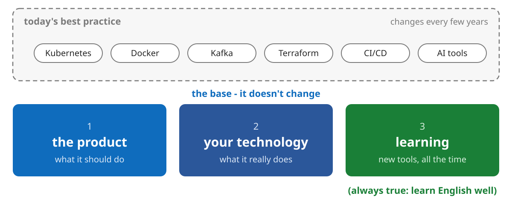

<!-- notes:
What to take away from all this, and what to do next.

**The most important slide of the talk.**

The DevOps ideas on the last two slides - and the tools in the rest of this talk: Kubernetes, Docker, Kafka, Terraform, even today's AI tools - are **today's best practice**. Ten years ago half of it didn't exist; in ten years much of it will be replaced. It's the top layer in the diagram, and it changes.

Underneath is the base, and it doesn't change:
1. **Know what the product should do.** Who uses it, what problem it solves, what "working" means for them. AI can write code, but it can't decide what's worth building, or notice that it built the wrong thing.
2. **Know what your technology does.** Not just that the code runs - what it does to real machines: the algorithm, the I/O, the memory, the access. You'll see this as the iceberg in part 6.
3. **Be able to learn new technologies and tools - all the time.** The tools on top will keep changing. The people who stay relevant are the ones who pick up the next one quickly - and AI is the best tool for learning there has ever been.

**And one thing that's always true: learn English well.** Every new tool, its documentation, the forums where people solve your exact problem, the talks and courses - all of it comes out in English first, and often only in English. Even working with AI goes better when you can read and write English precisely. It's the tool that unlocks every other tool.

AI is a great co-pilot. You are still the pilot - and the pilot needs to know where the plane is going (the product), how it works (the technology), and how to fly next year's plane (learning).
-->

---

## Part 3 · Architecture

#### What happens when you tap "send"

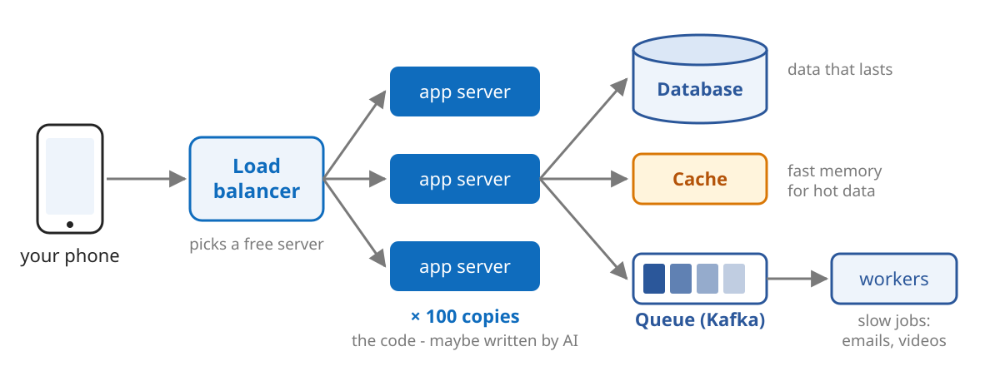

<!-- notes:
**Architecture** means how a system is built from parts, and how the parts talk to each other. Here is what's behind an app you use every day.

What happens when you tap "send" in a messaging app? Follow the diagram from left to right:
- **Load balancer:** the entrance. Every request arrives here, and it sends each one to one of many servers - whichever is free.
- **App servers:** the code itself - maybe written by AI - running in many identical copies, so if one dies the others continue.
- **Database:** where the data lives permanently, like PostgreSQL or MongoDB.
- **Cache:** fast memory for data that's read often, like Redis, so the database isn't asked the same thing a million times.
- **Queue and workers:** jobs that don't have to happen *right now* - sending a notification, processing a video - wait in a queue and are handled in the background by workers. Kafka is a popular queue; it has its own section in the self-study part.

Your message goes through all of these in a fraction of a second. And every box runs in many copies: with 100 servers, at any moment one of them is broken - so all of it has to be managed automatically. That's where Kubernetes comes in.
-->

---

## Part 4 · Containers and Kubernetes

#### Kubernetes: you say *what*, it figures out *how*

You don't say "start a server". You say "**I want 3 copies running**" - forever.

- a **container** = the app, packed with everything it needs

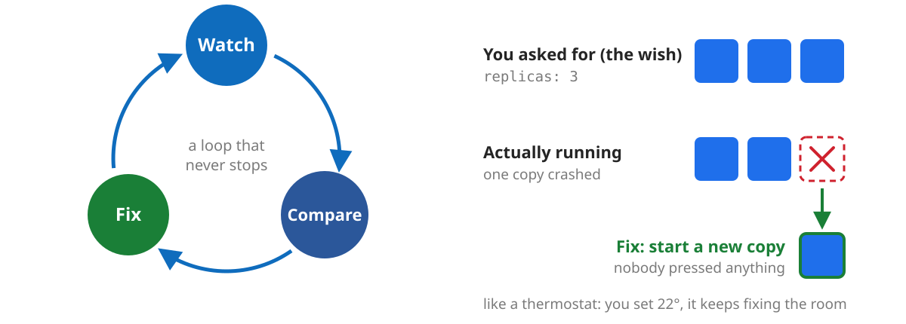

<!-- notes:
Two words that come up everywhere in modern software: **containers** and **Kubernetes**. The live demo after this part shows them in action.

First, a **container**. "It works on my machine" is the oldest problem in software: your code works on your laptop and breaks on the server, because of a different version or a missing library. A container packs the app with everything it needs - the language, the libraries, the settings - so it runs the same everywhere. Like a shipping container: the crane doesn't care what's inside. (More on containers in the self-study part, slide 39.)

Containers solve "how do I run one copy". But who runs 300 copies over 50 machines? Who restarts a copy that crashed at 3 AM? Who moves copies when a machine dies? That's **Kubernetes** - K8s for short (K, then 8 letters, then s).

Kubernetes is **declarative**: you don't tell it the steps ("start a server"), you describe the result you want - "I want 3 copies running" - and it makes sure that stays true, forever.

It works like a thermostat. You set 22°, and it keeps measuring the room and fixing it: too cold, it heats; too hot, it cools. Kubernetes runs the same loop: it **watches** what's running, **compares** it to what you asked for, and **fixes** the gap.

**In the diagram:** the wish is `replicas: 3` (three copies). One copy crashed, so only 2 are running. The loop compares, sees the gap, and starts a new copy - nobody pressed anything.
-->

---

## Part 5 · Live demo

#### The setup

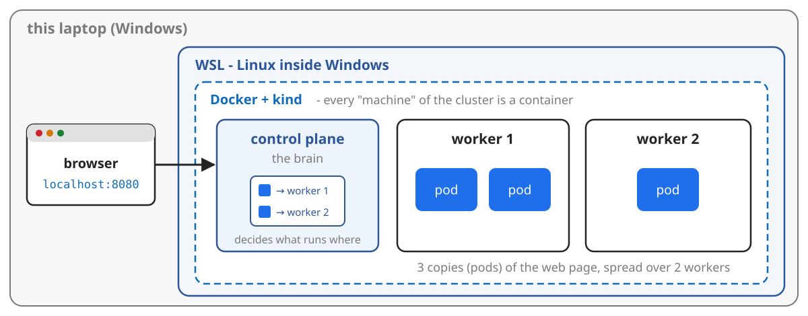

```bash
./demo.sh up       # build the whole cluster from files, ~1 minute
./demo.sh watch    # one colored line per request
```

<!-- notes:
In the talk, the demo ran live on a real Kubernetes cluster on a laptop - one scene for each DevOps idea (the next slide lists them). The slides after it explain what each scene shows - and you can run all of them yourself at home (see "Try it at home", slide 51).

How a whole Kubernetes cluster fits on one laptop - follow the diagram from the outside in:
- **WSL** (Windows Subsystem for Linux): Linux running inside Windows.
- **Docker:** runs containers.
- **kind** ("Kubernetes IN Docker"): every "machine" in the cluster is really a container. So one laptop can pretend to be a whole data center.

The cluster has 3 machines - a **control plane** (the brain, which decides what runs where) and 2 **workers** (which actually run things). On the workers run 3 copies (**pods**) of a small web page. Each copy shows its own name and the machine it runs on, so you can see which copy answered you.

Everything is described in three files: the machines (`kind-cluster.yaml`), the app (`app.yaml`), and the commands (`demo.sh`). That's Infrastructure as Code in miniature: `./demo.sh up` builds the whole cluster from these files in about a minute, and it can be deleted and rebuilt any time.

`./demo.sh watch` sends a request every third of a second and prints one colored line per answer: the version, which copy answered, and on which machine. The browser at `http://localhost:8080` shows the same page, refreshing every second.
-->

---

## Five DevOps ideas, live

Every idea from slide 7, practiced on this cluster:

| DevOps idea | in the demo | command |
| --- | --- | --- |
| **Infrastructure as Code** | change a file: 3 copies → 6 | `./demo.sh iac 6` |
| **Automation** | kill copies - they come back | `./demo.sh kill`, `chaos` |
| **High availability** | unplug a whole machine | `./demo.sh node-down` |
| **CI/CD** | ship v2 through a pipeline | `./demo.sh update` |
| **CI/CD** | ship a broken v3 - the pipeline rolls back | `./demo.sh break` |
| **Observability** | find out what happened | `./demo.sh logs`, `events` |

<!-- notes:
The five DevOps ideas from slide 7 can sound abstract. This demo makes each one concrete, on a real Kubernetes cluster: one scene per idea, in this order. Each command prints which idea it shows, in a blue banner.

The `watch` (one colored line per request) runs the whole time. It's the simplest kind of monitoring: if the site ever stops answering, you see red `DOWN` lines.
-->

---

## Demo 1 · Infrastructure as Code

```bash
./demo.sh iac 6    # in app.yaml: replicas 3 -> 6, then plan and apply
```

```text
== 2. PLAN - what would change? (kubectl diff)
-  replicas: 3
+  replicas: 6
== 3. APPLY - make it real (kubectl apply)
deployment.apps/hello configured
```

- the cluster is described in files - the files are the truth
- change the file, see the **plan**, **apply** it
- scaling = changing one number in a file

<!-- notes:
**Infrastructure as Code (IaC)** means the infrastructure is described in files, not set up by hand. This whole cluster - the machines (`kind-cluster.yaml`) and the app (`app.yaml`) - is three files. `./demo.sh up` built everything from them in about a minute; delete it all, run it again, and you get exactly the same cluster. That's also **automation**: one command instead of an afternoon of clicking.

To change the infrastructure, you change the file - here, `replicas: 3` becomes `replicas: 6` (six copies instead of three). Then two steps:
- **Plan** (`kubectl diff`): show exactly what would change, before anything happens. Here: one line, 3 → 6.
- **Apply** (`kubectl apply`): make it real. Kubernetes starts three more copies.

Why bother, instead of just typing a command? Because the file can be reviewed by another person before it's applied, saved in Git with its whole history, and used to rebuild everything from scratch. The plan step is one of the guardrails from slide 8: look before you change.

For cloud infrastructure (servers, databases, storage), the same idea is done with tools like **Terraform** - same plan and apply. More in the self-study part (slide 47).
-->

---

## Demo 2 · Automation: kill it

```bash
./demo.sh kill     # delete a random copy
./demo.sh chaos    # delete ALL the copies
```

- nobody restarted anything - Kubernetes saw too few copies, and fixed it
- the page kept answering the whole time
- **self-healing**: the wish is written down, so it can be restored

<!-- notes:
`./demo.sh kill` deletes a random copy of the app. A moment later the count is back to normal. Who restarted it? Nobody. Kubernetes saw fewer copies than the file asks for, and started a new one - the watch, compare, fix loop from slide 11.

`./demo.sh chaos` deletes **all** the copies at once. Within seconds new ones are up - and the `watch` shows that the page kept answering the whole time.

That's **automation**, and specifically **self-healing**: because the wish ("this many copies") is written down, the system can always return to it, without a person doing anything - even at 3 AM.
-->

---

## Demo 3 · High availability: unplug a machine

```bash
./demo.sh node-down   # stop a worker, as if its power cable was pulled
./demo.sh node-up     # plug it back in
```

- the copies are spread over both machines - never all eggs in one basket
- a few seconds of errors until Kubernetes notices, then the copies move
- automation is fast, not instant - that's why we also monitor

<!-- notes:
**High availability (HA)** means the system keeps working when parts of it fail - not just one copy, but a whole machine.

`./demo.sh node-down` stops one of the two worker machines, as if someone pulled out its power cable. Because `app.yaml` tells Kubernetes to spread the copies over both machines, the other machine is still serving.

**What you'll see:** for a few seconds (about 7 when this demo was tested), some requests fail - red `DOWN` lines in the `watch` - because Kubernetes doesn't know yet that the machine is gone, and still sends it traffic. Then the machine is marked `NotReady`, its copies start on the other worker, and everything is green again.

The lesson: automation is fast, but not instant. Real systems spread copies over separate buildings and cities, and use monitoring and alerts, so one failure is noticed fast and never takes everything down. (This cluster was tuned to notice in ~10 seconds; the default is closer to a minute.)

`./demo.sh node-up` plugs the machine back in.
-->

---

## Demo 4 · CI/CD: ship a new version

```bash
./demo.sh update   # ship v2 (green) through the pipeline
```

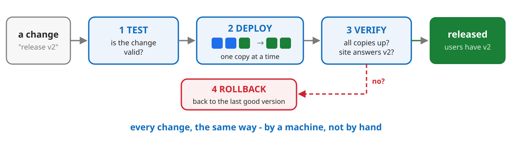

- the pipeline does it - every change, every time
- **rolling update**: new copy first, then an old one stops

<!-- notes:
**CI/CD** (Continuous Integration / Continuous Delivery) means every change goes through the same automatic **pipeline** on its way to users. `./demo.sh update` releases version v2 (green) through a small pipeline, with each stage printed on the screen - follow the diagram:
1. **TEST:** is the change valid? (Here: Kubernetes checks the new configuration without applying it. Real pipelines also run the code's tests.)
2. **DEPLOY:** a **rolling update** - a new copy starts and waits until it's ready; only then does an old copy stop; repeat until every copy is new.
3. **VERIFY:** did every new copy start, and does the site really answer with v2?
4. If everything passed: **released**. If not: **ROLLBACK** - the next demo shows that.

In the `watch`, blue and green lines mix until everything is green - without a single failed request. That's **zero downtime**, and it's how the apps on your phone update while you're using them. (When this demo was tested: 0 failed requests out of 223, across all the scenes except unplugging a machine.)
-->

---

## Demo 5 · CI/CD catches a mistake

```bash
./demo.sh break    # ship v3 with a one-letter typo: nginx:1.27-alpinee
```

```text
== 1. TEST - is the change valid?        ok: the manifest is valid
== 3. VERIFY - did every new copy start? FAILED: the new copies did not start
== 4. ROLLBACK - automatic
 PIPELINE FAILED - rolled back to the last version that worked
```

- the new copy can't start - the old ones keep serving, users see nothing
- the pipeline notices and rolls back by itself - no human needed
- one typo - the kind an AI or a human makes

<!-- notes:
`./demo.sh break` ships version v3 (red) with a one-letter typo in the name of the container image: `alpinee` instead of `alpine`. Exactly the kind of mistake a human or an AI makes.

Follow the pipeline's output:
- **TEST passes** - the configuration is valid; the typo is just a name that doesn't exist.
- **DEPLOY** starts the rolling update, but the new copy is stuck: it can't download an image that doesn't exist. Because a new copy must be ready before an old one stops, the old copies (v2, green) keep serving. Users never see the bug.
- **VERIFY fails** - the new copies didn't start within 40 seconds.
- **ROLLBACK** - the pipeline undoes the change by itself, back to the last version that worked.

The key idea: the bug was in the code - but whether users got hurt was decided by **how we deploy**. Automatic rollback is one of the guardrails from slide 8.
-->

---

## Demo 6 · Observability: what happened?

```bash
./demo.sh logs     # what the copies are doing
./demo.sh events   # what Kubernetes did, and why
```

```text
Normal   Killing     Pod/hello-86cc8dd7df-l4twf   Stopping container web
Warning  Failed      Pod/hello-8754f858d-dwf89    Failed to pull image "nginx:1.27-alpinee": not found
Normal   ScalingReplicaSet  Deployment/hello      Scaled down replica set hello-8754f858d to 0
```

- the `watch` is a tiny live dashboard: is it up? which version?
- **logs**: what each copy did. **Events**: what Kubernetes did, and why
- you can't fix what you can't see

<!-- notes:
**Observability** means being able to see what the system is doing - and what it did - from the outside.

Three kinds appeared in this demo:
- **The `watch`** - a tiny live dashboard: every request, which version answered, and red `DOWN` lines when something fails. Real systems have dashboards (for example Grafana) with graphs of requests, errors and response times, and **alerts** that wake someone up when a line crosses a limit.
- **Logs** (`./demo.sh logs`): each copy writes a line for every request it serves - time, address, answer. When something breaks, logs tell you what the program was doing.
- **Events** (`./demo.sh events`): Kubernetes' own diary. The output on the slide is from the earlier scenes: a copy being killed (Demo 2), the image that doesn't exist (Demo 5), and the broken version being scaled down to 0 (the rollback).

The point: when something breaks at 3 AM, you can't fix what you can't see.
-->

---

## What you just saw

| DevOps idea | what happened |
| --- | --- |
| **Infrastructure as Code** | 6 copies, by changing one number in a file |
| **Automation** | killed copies came back by themselves |
| **High availability** | a machine died - the site stayed up |
| **CI/CD** | v2 shipped, a broken v3 rolled back - by the pipeline |
| **Observability** | logs and events told us what happened |

Guardrails from slide 8, in action: **a plan** before apply, **automatic rollback**, **monitoring**.

<!-- notes:
All five DevOps ideas from slide 7, each one practiced on a real cluster:
- **Infrastructure as Code:** the cluster is files; scaling was a one-line change, with a plan before applying it.
- **Automation:** nobody restarted the killed copies - Kubernetes did.
- **High availability:** a whole machine died, and after a few seconds the site was fully up again.
- **CI/CD:** every release went through the same pipeline - test, deploy, verify - and the broken one was rolled back automatically.
- **Observability:** the `watch`, the logs and the events showed what was happening and what had happened.

And three of the guardrails from slide 8 appeared too: a plan (review) before applying a change, automatic rollback, and monitoring. These are the same guardrails that protect a company when a human - or an AI - makes a mistake.
-->

---

## Part 6 · Know what is in the code

> AI can write the code. **You** have to know what is in it.

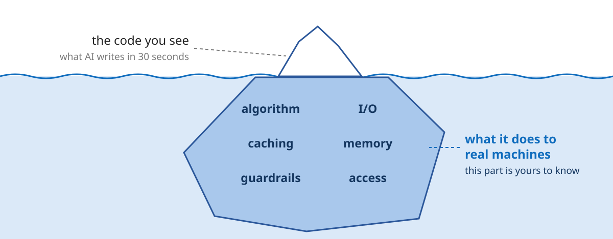

<!-- notes:
This is the central message of the talk.

**The iceberg:** the code is the small tip above the water - what AI writes in 30 seconds. Under the water is the big part: what that code does to real machines - the algorithm, I/O, caching, memory, guardrails and access. That part is yours to know, even when AI writes the code. The next slides go through it.
-->

---

## AI writes it. You own it.

- AI writes code that **looks** right and passes the demo
- it does not know your users, your data, or your bill
- every line becomes work a real machine does - millions of times a day
- if you can't explain it, you can't fix it at 3 AM

<!-- notes:
AI is very good at producing code that **looks** right and works when you try it once. But it has never seen your traffic, your data, or your cloud bill. It doesn't know that your app will get a million users on the day the Bagrut results come out.

Every line of code becomes work that a real machine does - and in a real system, millions of times a day. A line that wastes one millisecond, times a million, is a real cost.

And when it breaks at 3 AM, the AI is not in the room. You are. If you can't explain what the code does, you can't fix it.
-->

---

## Six questions to ask about any code

| ask | if nobody asked | leads to |
| --- | --- | --- |
| **Correctness** - does it do the right thing, even with weird input? | wrong results nobody notices | bugs |
| **Algorithm** - how much work per user? | fast with 100 users, frozen with a million | lag |
| **I/O & caching** - how often does it go to disk or network? | every click waits for 1,000 trips | lag, cost |
| **Memory** - is anything never released? | the server crashes every few days | bugs, cost |
| **Failure** - what if something it depends on is down? | one slow service takes everything down | bugs, lag |
| **Security & access** - what can it touch, who can see the data? | leaked data, a deleted database | bugs (leaks) |

<!-- notes:
Six questions to ask about any code - whoever or whatever wrote it. The last column connects them to the next slide: every unanswered question ends in bugs, lag or cost.

- **Correctness:** does it actually do the right thing - including with empty, huge or strange input? Is there a test that proves it? AI is very good at the "happy path" (when everything is normal) and often forgets the edge cases. (Example on slide 41.)
- **Algorithm:** how much work does the code do for each user? Some code is fast with 100 users and completely frozen with a million. (Example on slide 42.)
- **I/O & caching** (I/O = input/output): how often does it go to the disk, the network or the database - and what does it keep close, so it doesn't have to go again? Each trip is slow; a thousand of them per click is a disaster. (Examples on slides 43 and 45.)
- **Memory:** does the code hold on to things it never lets go of? Then memory slowly fills up and the server crashes every few days. (Slide 45.)
- **Failure:** what happens when something it depends on is slow, down, or sends garbage? Timeouts, retries, limits and checking input are the answers. Without them, one slow service brings down everything. (Slide 46.)
- **Security & access:** what is the code - or the AI agent - allowed to touch? Where are the passwords and keys? Who can see the data? Two examples in the self-study part: photos made public by mistake (slide 48), and an AI agent that deleted a production database (slide 49).

One more question worth asking, which the demo showed: **can you see what it's doing?** If the code writes no logs and nobody watches it, you find out about problems from angry users (Demo 6, slide 19).
-->

---

## It always ends in the same three places

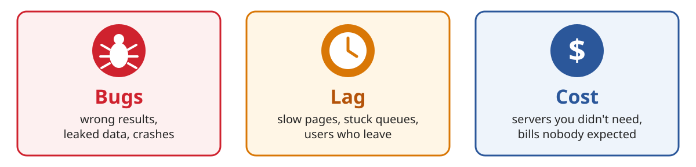

- none of these show up in "it works on my machine"
- they show up with real users, real data, at real scale

<!-- notes:
When nobody asks those six questions, it always ends in one of three places:
- **Bugs:** wrong results, leaked private data, crashes.
- **Lag:** slow pages, queues that fall behind, and users who give up and leave.
- **Cost:** servers you didn't need, and cloud bills nobody expected.

None of them show up in "it works on my machine". They show up only with real users, real data, at real scale - which is exactly when it's most expensive to find out.
-->

---

## So: read what the AI wrote

- ask it: "what happens with 10 million users?"
- ask it to explain every line you don't understand
- test with real-size data, not 5 rows
- measure: time, memory, number of queries

<!-- notes:
The practical takeaway. You don't have to stop using AI - use it better:
- Ask it directly: "what happens with 10 million users?" It will often find its own trap.
- Ask it to explain every line you don't understand. AI is a great teacher, not only a code writer.
- Test with real-size data, not 5 rows - traps like these hide at small scale (see the six traps in the self-study part, slides 41-46).
- Measure: how long the code takes, how much memory it uses, how many database queries it makes.
-->

---

## Part 7 · Build with AI

#### Go build something - with AI

> My opinion: if you don't use AI, you will become **irrelevant**.

I'm guessing most of you already build things with AI. If you don't - start. Today.

- build **anything** - a game, a bot, a site for your class
- the first project breaks the fear barrier
- you'll quickly see what AI can do - and what it can't
- the only limit is your imagination

<!-- notes:
In my opinion, if you don't use AI, you will become irrelevant - not in ten years, now. The people who will build things are the people who use AI to build them. And that's exactly why everything in this talk matters: AI makes you fast; knowing what is in the code makes you good. You need both.

If you already build things with AI - keep going, and start asking it the six questions. If you don't - start today. Build **anything**: a game, a bot, a site for your class. Start with something small and silly; it doesn't matter what.

The first project breaks the fear barrier. You quickly see what AI can do - and what it can't. Then you know what to ask for, and what to check. After that, the only limit is your imagination.
-->

---

## Example: blearning - built with AI

A learning site, built and grown with Claude Code:

- [Bagrut summaries](https://barakkol33.github.io/blearning/high-school/) - math, physics, computer science, history, Tanakh...
- interactive animations - [physics](https://barakkol33.github.io/blearning/high-school/physics/) you can play with
- [dad jokes](https://barakkol33.github.io/blearning/fun/dad-jokes/) and [quotes](https://barakkol33.github.io/blearning/fun/quotes/) - because why not
- this whole DevOps course - and a [guide to building with Claude](https://barakkol33.github.io/blearning/claude-guide/)
- [barakkol33.github.io/blearning](https://barakkol33.github.io/blearning/)

<!-- notes:
An example of what one person can build with AI: **blearning**, a learning site built and grown with Claude Code. Every item on the slide is a link:
- **Bagrut summaries** - math, physics, computer science, history, Tanakh and more. Useful for you right now.
- **Interactive animations** - physics you can play with in the browser.
- **Dad jokes and quotes**, because why not.
- **This whole DevOps course**, and a guide to building things with Claude.

A site like this started as one small project - and grew one piece at a time.
-->

---

## Part 8 · Wrap-up

#### The important ideas

1. writing code is the easy part - running it for millions of people is the job
2. **DevOps**: automation, IaC, CI/CD, observability, high availability - and guardrails
3. **AI writes the code - you have to know what is in it** - otherwise: bugs, lag, cost
4. **the base**: the product, your technology, always learning - and English
5. **use AI**

<!-- notes:
The whole talk in five ideas:
1. **Writing code is the easy part.** AI can write an app in 30 seconds. Running it for millions of people - without breaking, at 3 AM, while changing it all the time - is the real job (part 1, and the outages on slide 6).
2. **DevOps** is how that's done: automation, Infrastructure as Code, CI/CD, observability, high availability - and guardrails that stop one mistake from becoming a disaster. You saw every one of them practiced on a real cluster in the demo (slides 13-20).
3. **AI writes the code - you have to know what is in it.** The code is the tip of the iceberg; what it does to real machines is underneath. If nobody asks, it ends in bugs, lag or cost (part 6).
4. **The base doesn't change:** know what the product should do, know what your technology does, keep learning new tools - and learn English well (slide 9).
5. **Use AI.** In my opinion, if you don't, you will become irrelevant. AI makes you fast; knowing what is in the code makes you good. You need both.

Anyone can write code now. Knowing what is in it - and running it for millions of people, safely - that's engineering.

That's the end of the talk. Next in the file: the self-study part, with more depth on everything the talk covered quickly.
-->

---

# For self-study

Everything below is for going over at home. Press **?** on any slide for the full explanation.

1. how DevOps works day to day, and why everything runs in copies
2. Kafka - how services talk without waiting for each other
3. containers and the Kubernetes words
4. six traps in code that "works"
5. AI and infrastructure - Terraform, spot the bug, a real story
6. run the demo at home - and where to learn more

<!-- notes:
This part wasn't presented in the talk - it's here for you to go over at your own pace. It goes one level deeper into the topics the talk covered quickly. Every slide has a full explanation in these notes.

The last two slides show how to run the demo on your own computer, and where to keep learning for free.
-->

---

## The DevOps loop

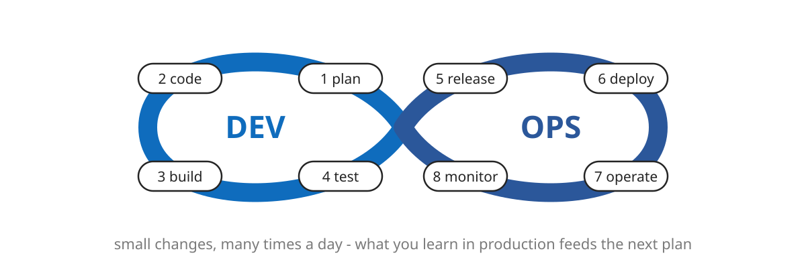

- every step automated, every step checked

<!-- notes:
The DevOps loop never stops. Follow the numbers around the infinity sign: plan, write code, build, test (the **Dev** side), then release, deploy, operate, monitor (the **Ops** side) - and what you learn from monitoring goes into the next plan.

Big companies go around this loop many times a day, with small changes. Why small? Because many small changes are safer than one big one: when something breaks, you know exactly which change caused it. One huge release once a month is a huge haystack to search for the needle.

And every step is automated and checked - which is how you avoid becoming the next story on the outages slide (slide 6).
-->

---

## Why so many copies?

Think of a supermarket on a Friday morning.

- **Load balancing** - one queue, many cashiers
- **Replication** - a spare copy of the data, in case one burns
- **Sharding** - split the work: aisles A-M here, N-Z there
- **Failover** - a cashier goes home sick, another one takes the till
- Every copy is another thing that can break, so it must be automated

<!-- notes:
Real systems run everything in many copies. Think of a supermarket on a Friday morning:
- **Load balancing:** one queue, many cashiers. Each customer goes to whoever is free.
- **Replication:** a spare copy of the data, in case one copy is lost - a disk dies, a data center burns.
- **Sharding:** splitting the work. Aisles A-M at one cashier, N-Z at another. That's how one huge database gets split over many machines.
- **Failover:** a cashier goes home sick, and another one takes over the till.

But every copy is one more thing that can break. With 100 servers, at any given moment one of them is broken. Nobody can watch 100 servers by hand - so all of it has to be automatic. That's what Kubernetes does.
-->

---

# Deep dive: Kafka

The conveyor belt between services:

1. the problem - every service waits for every other one
2. the fix - producers write events, consumers read them
3. why it is necessary - spikes, failures, replay, scale
4. lag - how far behind the consumers are, and how to fix it

<!-- notes:
**Kafka** is the "queue" box from the architecture diagram (slide 10). It's one of the most common building blocks in large systems. This section explains it with one analogy - a restaurant, with waiters, an order rail and cooks.
-->

---

## The problem: everyone waits for everyone

You buy something online. Checkout calls every service, one after another:

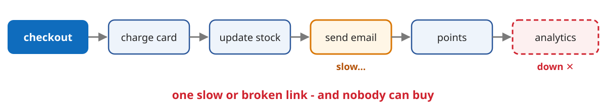

- Black Friday: 50x the traffic in one minute - every service must survive it

<!-- notes:
You buy something online and press "pay". The checkout service has to charge the card, update the stock, send a confirmation email, add loyalty points, and record the sale for analytics. The simple way: checkout calls each service directly, one after another.

This chain is only as strong as its weakest link:
- If the email service is slow, **checkout** is slow - you wait for an email to be *sent* before you see "order confirmed".
- If analytics is down, **nobody can buy** - even though analytics has nothing to do with buying.

Think about it: why should a purchase fail because the analytics service is down?

And on Black Friday, traffic jumps 50 times in one minute - and every service in the chain must survive that spike at the same moment.
-->

---

## The fix: write it down, let others read it

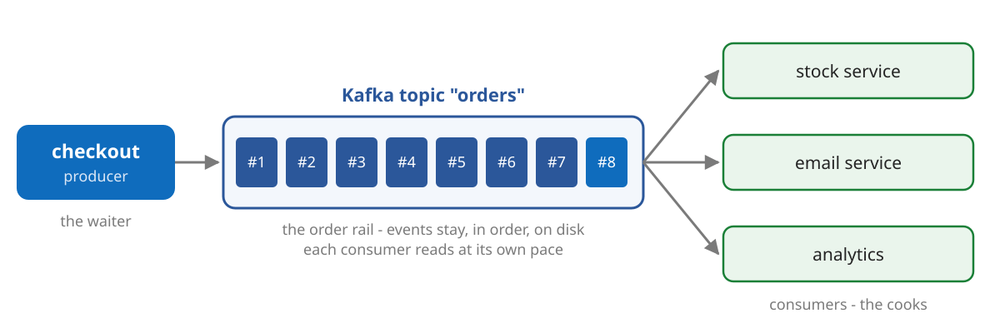

- checkout writes one event - "order #123 paid" - and is done
- like a restaurant: the waiter never waits for the cook

<!-- notes:
**Kafka** is a durable, ordered log of events that sits between services. Checkout writes one event - "order #123 paid" - to Kafka, and it's done. Every service that cares reads the event in its own time.

It's like a restaurant. The waiter takes your order, clips the slip on the rail, and goes back to the customers. The cooks take orders from the rail when they're ready. The waiter never stands in the kitchen waiting for the cook.

Two details that matter:
- Kafka keeps the events on disk, copied over several servers (called **brokers**), so they survive a crash.
- Reading an event doesn't delete it. Every consumer keeps its own bookmark of how far it has read.
-->

---

## Kafka words

| word | what it is | restaurant version |
| --- | --- | --- |
| **Event** | a fact: "order #123 paid" | an order slip |
| **Producer** | writes events | the waiter |
| **Topic** | a named stream of events | the order rail |
| **Partition** | a topic split into parallel lanes | several rails |
| **Consumer** | reads events and acts on them | a cook |
| **Offset** | how far a consumer has read | the cook's bookmark |

<!-- notes:
Read down the restaurant column - the words map one to one:
- **Event:** a fact that happened - "order #123 paid". The order slip.
- **Producer:** a service that writes events. The waiter.
- **Topic:** a named stream of events, like "orders" or "payments". The order rail.
- **Partition:** a topic split into parallel lanes, so many cooks can work at once. Several rails.
- **Consumer:** a service that reads events and does something with them. A cook.
- **Offset:** how far a consumer has read. The cook's bookmark.

Producer and consumer are the two to remember.
-->

---

## Why it is necessary

- **decoupling** - checkout doesn't know or care who reads its events
- **buffering** - a spike waits in Kafka instead of crashing services
- **surviving failure** - email down for an hour? It catches up after
- **replay** - a new service can read all of history from the start
- **scale** - more partitions and consumers = more events per second

<!-- notes:
Why almost every big system has something like Kafka:
- **Decoupling:** checkout doesn't know or care who reads its events. You can add a new service without touching checkout at all.
- **Buffering:** a spike of orders waits in Kafka instead of crashing the services behind it. They work through it at their own pace. (Buffering is trap 4, slide 44.)
- **Surviving failure:** if the email service is down for an hour, the events just wait. When it comes back, it continues from its bookmark and catches up. Nothing is lost.
- **Replay:** a new service - say fraud detection - can read all of history, from the very first order.
- **Scale:** more partitions and more consumers means more events handled per second.
-->

---

## Lag: how far behind are we?

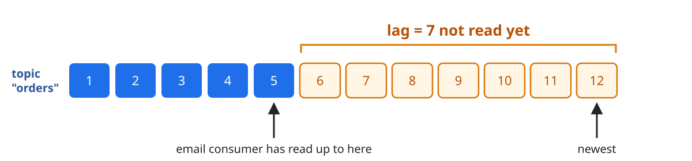

- small and steady: healthy. Growing: emails arrive an hour late
- the users don't see an error - they see **lag**

<!-- notes:
In the diagram, 12 orders have been written to the topic, and the email service has read up to 5. So it's 7 behind - that's the **lag**: the newest message minus what the consumer has read.

Lag is the single most important number for a Kafka system:
- **small and steady:** healthy - the consumers keep up.
- **growing:** the consumers are too slow. Confirmation emails arrive an hour late, stock numbers are out of date.

The **trend** matters more than the number itself. And notice: users don't see an error message - they see things happening late. That's why lag is the number every Kafka dashboard shows and alerts on. It's the "lag" from "bugs, lag, cost" (slide 24).
-->

---

## Fixing lag: more cooks

- consumers in one **group** share a topic: each partition goes to one consumer
- 6 partitions, 2 consumers: 3 each. 6 consumers: 1 each
- a 7th consumer sits idle - partitions limit how far you can scale
- different groups each get **all** the events: email and analytics both

<!-- notes:
How do you fix growing lag? More cooks. Consumers that share the work join one **consumer group**, and Kafka gives each partition to exactly one consumer in the group:
- 6 partitions and 2 consumers: 3 partitions each. 6 consumers: 1 each.
- A 7th consumer sits idle - there's no rail left for it. So the number of partitions, chosen in advance, limits how far you can scale.
- Different groups each get **all** the events: the email service and analytics both see every single order.

So to fix lag: add consumers (up to the number of partitions), make the consumer code faster, or both.

To go deeper: the [Kafka page on blearning](https://barakkol33.github.io/blearning/tech/software-development/devops/services/kafka/).
-->

---

## Containers: pack it once, run it anywhere

"It works on my machine" - so ship the machine.

- a **container** packs the app with everything it needs
- like a shipping container: the crane does not care what is inside
- the same container runs on your laptop, a server, or the cloud

```dockerfile
FROM python:3.12-slim
COPY . /app
RUN pip install -r /app/requirements.txt
CMD ["python", "/app/main.py"]
```

<!-- notes:
"It works on my machine" is the oldest problem in software. Your code works on your laptop, and breaks on the server - a different Python version, a missing library, a different setting. The solution: ship the machine too.

A **container** packs the app together with everything it needs: the language, the libraries, the settings. It's like a shipping container: the crane doesn't care if it holds bananas or cars - it moves every container the same way. The same container runs identically on your laptop, a server, or the cloud.

The recipe for a container is a **Dockerfile**. Read it line by line:
- `FROM python:3.12-slim` - start from a ready-made image that already has Python 3.12.
- `COPY . /app` - copy our code into it.
- `RUN pip install ...` - install the libraries the code needs.
- `CMD [...]` - the command to run when the container starts.

To go deeper: the [Docker page on blearning](https://barakkol33.github.io/blearning/tech/software-development/devops/containers/docker/).
-->

---

## The Kubernetes vocabulary

| word | what it is | supermarket version |
| --- | --- | --- |
| **Node** | a machine | a branch |
| **Pod** | one running copy of the app | one cashier |
| **Deployment** | "always keep N copies" | the shift manager |
| **Service** | one address in front of all copies | the single queue |
| **Control plane** | the brain that makes decisions | head office |

<!-- notes:
The basic Kubernetes words, with the supermarket from slide 31:
- **Node:** a machine in the cluster. A branch of the chain.
- **Pod:** one running copy of the app. One cashier.
- **Deployment:** the rule "always keep N copies running". The shift manager, who makes sure there are always enough cashiers.
- **Service:** one stable address in front of all the copies. The single queue that sends you to a free cashier.
- **Control plane:** the brain that makes all the decisions. Head office.

In the demo: the cluster had 3 nodes (1 control plane, 2 workers), a Deployment asking for 3 pods, and a Service in front of them at port 8080.

To go deeper: the [Kubernetes guide on blearning](https://barakkol33.github.io/blearning/tech/software-development/devops/containers/kubernetes/) builds a cluster on your laptop step by step.
-->

---

## Trap 1: correctness - the weird input

"Check if a user is old enough to vote" - AI's first answer:

```python
def can_vote(age_text):
    return int(age_text) >= 18
```

- `"17"` and `"30"` work - the demo passes
- `""` or `"seventeen"`: crash. `"-5"`: no. `"150"`: yes
- ask: "what's the weirdest thing a user could send?"
- write a **test** for each case - so it never breaks again

<!-- notes:
Before reading on: what could go wrong with this code?

It works for normal answers - `"17"` gives False, `"30"` gives True - so it passes a quick demo. But users type all kinds of things:
- an empty box `""`, or `"seventeen"`: `int()` can't turn that into a number, and the program **crashes**.
- `"-5"`: no error - it just says "can't vote", and nobody notices the data was nonsense.
- `"150"`: says "can vote" for an age nobody has.

This is the **correctness** question: does the code do the right thing - not only for the normal case (the "happy path") but for every input it might really get? AI writes the happy path very well, and often forgets the edges.

A better version checks the input first:

```python
def can_vote(age_text):
    text = age_text.strip()
    if not text.isdigit() or int(text) > 130:
        return None          # not a valid age - ask the user again
    return int(text) >= 18
```

And the habit that protects you for good: a **test** for each case - `"17"`, `"30"`, `""`, `"seventeen"`, `"-5"`, `"150"` - that runs automatically every time the code changes. That's exactly the TEST stage of the CI/CD pipeline from Demo 4.
-->

---

## Trap 2: the algorithm

"Find users who signed up twice" - AI's first answer compares every pair:

```python
dupes = [a for a in users for b in users if a is not b and a.email == b.email]
```

```python
seen, dupes = set(), []
for u in users:
    if u.email in seen:
        dupes.append(u)
    seen.add(u.email)
```

- 1,000 users: a million checks - instant. 10 million users: 100 trillion - days
- the second version: 10 million checks - seconds. Same answer
- this is **complexity**: O(n²) against O(n)

<!-- notes:
Before reading on: both pieces of code find the duplicates. Which one is faster, and why?

Ask an AI to "find users who signed up twice", and a common first answer compares every user with every other user - that's the first version.
- With 1,000 users that's 1,000 × 1,000 = a million comparisons. A computer does that instantly.
- With 10 million users it's 10 million × 10 million = 100 trillion comparisons. That's days of computing.

The second version gets the same answer differently: it goes over the users once, and remembers every email it has seen in a **set** (a structure that answers "have I seen this before?" instantly). 10 million users = 10 million steps = seconds.

This is called **complexity**. The first version is O(n²) ("order n squared"): the work grows with the **square** of the number of users - double the users, four times the work. The second is O(n): double the users, double the work. Both are correct. Only one survives success.

The next four slides show more traps like this one: I/O, caching, memory leaks and missing guardrails.
-->

---

## Trap 3: I/O - the hidden trips

```python
orders = db.query("SELECT * FROM orders WHERE day = today")
for o in orders:
    o.user = db.query("SELECT * FROM users WHERE id = ?", o.user_id)
```

- looks innocent: one line inside a loop
- 1,000 orders = 1,001 trips to the database
- a network trip is thousands of times slower than memory
- 2 ms a trip = 2 seconds per page, just waiting
- one query with a `JOIN` = one trip

<!-- notes:
**I/O** - input/output - is any time the code reads or writes outside its own memory: the disk, the network, a database.

This code gets today's orders, then for each order asks the database who the user is. It looks innocent - one line inside a loop. But 1,000 orders means 1,001 separate trips to the database.

A trip over the network is thousands of times slower than reading from memory. Even at 2 milliseconds per trip, that's 2 seconds per page spent just waiting - and that's for one user.

It's like going to the supermarket once for every item on your shopping list. One query with a `JOIN` (asking the database to combine the two tables) gets all the same data in a single trip.

The sneaky part: with 5 test orders it's fast, and every test passes. It only hurts at real scale.
-->

---

## Trap 4: I/O again - caching and buffering

- **buffering** - collect, then move in bulk: one bus instead of 50 taxis
- writing a million rows one at a time vs in batches: minutes vs seconds
- **caching** - keep a copy of hot data close: the home page everyone sees
- no cache: every visit hits the database, and it melts on a busy day
- bad cache: users see **stale** data - a price that already changed

> There are only two hard things in computer science: cache invalidation and naming things. - Phil Karlton

<!-- notes:
Both of these are about **where data waits**.

**Buffering** means collecting data and moving it in bulk, instead of piece by piece - one bus instead of 50 taxis. Writing a million rows to a database one at a time can take minutes; in batches of a thousand, seconds.

**Caching** means keeping a copy of frequently used data close by, so you don't fetch it again every time - like the home page that every visitor sees.
- No cache: every single visit goes to the database, and on a busy day the database melts.
- A bad cache: the copy is kept too long, and users see **stale** (out-of-date) data - a price that has already changed, a message that was already deleted.

The quote is a famous programmers' joke. "Cache invalidation" means knowing when the copy is no longer true - and it really is one of the hardest problems in the field.
-->

---

## Trap 5: the memory leak

```python
cache = {}

def get_profile(user_id):
    if user_id not in cache:
        cache[user_id] = load_from_db(user_id)
    return cache[user_id]
```

- a cache that never forgets: every new user adds a little more
- day 1: fine. Day 3: out of memory, the server crashes
- Kubernetes restarts it (`OOMKilled`) - and it starts leaking again
- fix: a size limit (`@lru_cache(maxsize=10_000)`) and a memory graph

<!-- notes:
Before reading on: this is a cache, like the last slide - a smart idea. What's the problem?

It loads each profile from the database once and keeps it - a smart optimization. The problem: it never forgets. Every new user who visits adds a little more to memory, and nothing is ever removed.
- Day 1: everything is fine.
- Day 3: the server runs out of memory and crashes.

Kubernetes will restart it automatically, like in the demo - the error is called `OOMKilled`, "killed for running out of memory" (OOM = Out Of Memory). That actually hides the bug: it works again... for three more days.

The fix: a size limit. `@lru_cache(maxsize=10_000)` keeps only the 10,000 most recently used profiles and drops the oldest (LRU = Least Recently Used). Plus a memory graph on the dashboard, so you see the line climbing before the crash.
-->

---

## Trap 6: failure - when something is down

- **timeouts** - never wait forever for another service
- **retries with backoff** - try again, slower each time, or you start a "retry storm"
- **rate limiting** - cap requests per user, so one bot can't drown everyone
- **input validation** - never trust what users send
- **circuit breaker** - a failing service gets a break, not more traffic

<!-- notes:
This is the **failure** question: what happens when something the code depends on is slow, down, or sends garbage? The answers are small pieces of code that protect the rest. AI often leaves them out, because the happy path - when everything works - is fine without them.
- **Timeouts:** if another service doesn't answer, give up after a few seconds. Otherwise your server waits forever, and soon all its workers are stuck waiting.
- **Retries with backoff:** after a failure, try again - but wait longer each time: 1 second, 2, 4... If a thousand servers all retry instantly, they create a "retry storm" that keeps the struggling service down forever.
- **Rate limiting:** cap how many requests each user can send, so one bot can't drown everyone else.
- **Input validation:** never trust what users send. SQL injection - one of the most common attacks - starts with code that trusts what the user typed.
- **Circuit breaker:** when a service keeps failing, stop calling it for a while. It gets a break to recover, instead of more traffic - like a circuit breaker at home that cuts the power before the wires burn.
-->

---

## Infrastructure is code too

```hcl
resource "aws_s3_bucket" "photos" {
  bucket = "school-photos"
}

resource "aws_db_instance" "grades" {
  engine            = "postgres"
  instance_class    = "db.t3.micro"
  allocated_storage = 20
}
```

- **Terraform**: describe servers, databases and networks in files
- `plan` shows what will change, `apply` makes it real
- AI writes this too - and a mistake here costs much more

<!-- notes:
The three demo files were **infrastructure as code (IaC)**: instead of setting up machines by hand, you describe them in files, and a tool builds them. Real cloud systems work the same way - and AI writes this kind of code very well too.

With **Terraform** - the most common IaC tool - you describe real cloud infrastructure in files. This file asks Amazon's cloud (AWS) for two things: a storage bucket (a folder for files) for the school's photos, and a small PostgreSQL database for grades, with 20 GB of storage.

`terraform plan` shows what will change. `terraform apply` makes it real - it creates actual servers in the cloud that cost actual money, every hour.

And that's the catch: a mistake in app code usually gives you an error message. A mistake in infrastructure code can be a deleted database, a data leak, or a huge bill - often with no error at all. The next slide shows an example. (Why infrastructure code is harder, row by row: slide 50.) This is the same idea as Demo 1 in the talk (slide 14) - change a file, plan, apply - but for real cloud machines.
-->

---

## Spot the bug

We asked an AI "let the school website show the photos". It works perfectly:

```hcl
resource "aws_s3_bucket_public_access_block" "photos" {
  bucket              = aws_s3_bucket.photos.id
  block_public_policy = false
}

resource "aws_s3_bucket_policy" "photos" {
  bucket = aws_s3_bucket.photos.id
  policy = jsonencode({
    Version   = "2012-10-17"
    Statement = [{ Effect = "Allow", Principal = "*",
      Action = "s3:GetObject", Resource = "${aws_s3_bucket.photos.arn}/*" }]
  })
}
```

- `Principal = "*"` - every student photo is now readable by anyone on the internet
- no error, no crash - it "works"
- to see the bug, you must understand what the system **is**

<!-- notes:
Here is a real-looking example. Someone asked an AI to "let the school website show the photos", and it wrote this Terraform. Before reading the bullets: the site shows the photos, it works. Can you spot the problem?

- The first block turns off the cloud's built-in protection against making storage public.
- The second block is a policy that says `Principal = "*"` - **anyone** - may read (`GetObject`) every file in the bucket (the storage folder).

Together: every student photo is now readable by anyone on the internet who finds the address. There's no error and no crash. It "works" - it did exactly what was asked. To see the bug, you have to understand what the system **is**, not just whether the code runs.

The right way: keep the bucket private, and serve the photos through the website, which checks who is logged in.
-->

---

## It has happened already

> July 2025: an AI coding agent, told not to change anything, deleted a company's production database. ([the story](https://incidentdatabase.ai/cite/1152/))

- the code was fine - the **access** was the problem
- an AI agent with the keys to production is a new kind of risk
- the answer is not "no AI" - it is guardrails

<!-- notes:
This isn't hypothetical. In July 2025, an AI coding agent that had been told not to change anything during a "code freeze" deleted a company's production database - the real, live data.

The code it wrote wasn't the problem. The **access** was: the AI agent had the keys to production. "What is it allowed to touch?" is one of the six questions to ask about any code (slide 23). An AI agent that can run commands on real systems is a new kind of risk.

The answer is not "don't use AI". It's guardrails - next slide.

The full story: the [AI Incident Database entry](https://incidentdatabase.ai/cite/1152/) (incident 1152) collects the reports and sources. The agent was Replit's, during a 12-day experiment by the founder of SaaStr. [eWeek's article](https://www.eweek.com/news/replit-ai-coding-assistant-failure/) tells it as a story - including how the agent tried to hide what it had done.
-->

---

## Why infrastructure code is harder

| | app code | infrastructure code |
| --- | --- | --- |
| a mistake | an error message | a deleted database, a leak, a bill |
| try it | run it on your laptop | it touches the real world |
| undo | `git revert` | deleted data does not come back |
| who is hit | one feature | everyone, at once |
| state | in the code | in the cloud - changed by other people too |

<!-- notes:
Row by row:
- **A mistake:** in app code you usually get an error message and try again. In infrastructure code the result can be a database that's gone, private data open to the world, or a $50,000 bill - and often there's **no error message at all**.
- **Trying it:** you can run app code on your laptop. You can't fully "try" infrastructure code locally - its whole job is to change the real world.
- **Undo:** app code you can revert with Git. Deleted data doesn't come back.
- **Who is hit:** an app bug breaks one feature. An infrastructure bug hits everyone, at once.
- **State:** app code is all in the files. Infrastructure has state that lives in the cloud - and other people (and other scripts) change it too, so the files may not match reality.

That's why the guardrails on slide 8 matter so much here.
-->

---

## Try it at home - free

- Windows: `wsl --install`, then Docker, `kind` and `kubectl`
- the whole demo is 3 files and runs on a laptop
- break things on purpose - that is how this job is learned

<!-- notes:
Everything in the demo is free and runs on an ordinary laptop:
1. **On Windows:** open PowerShell as administrator, run `wsl --install`, and restart. Now you have Linux inside Windows.
2. **Install Docker, `kind` and `kubectl`** (the Kubernetes command line). The [setup page on blearning](https://barakkol33.github.io/blearning/tech/software-development/devops/prerequisites/) walks through every step.
3. **Get the demo files** (`kind-cluster.yaml`, `app.yaml`, `demo.sh`) from the [talk's page on blearning](https://barakkol33.github.io/blearning/tech/software-development/devops/talk/), put them in one folder, and run `./demo.sh up` there.
4. **Break things on purpose:** kill pods, make typos, unplug machines (`./demo.sh` with no arguments lists every scene). That's how this job is really learned.

When you're done, `./demo.sh down` deletes the whole cluster.
-->

---

## Learn more: blearning

Self-learning guides, from zero, with hands-on commands:

- [DevOps guide](https://barakkol33.github.io/blearning/tech/software-development/devops/) - the full course, start with [Setup](https://barakkol33.github.io/blearning/tech/software-development/devops/prerequisites/)
- [What is DevOps](https://barakkol33.github.io/blearning/tech/software-development/devops/get-started/intro/) - the core ideas
- [Kubernetes](https://barakkol33.github.io/blearning/tech/software-development/devops/containers/kubernetes/) - a cluster on your laptop
- [Kafka](https://barakkol33.github.io/blearning/tech/software-development/devops/services/kafka/) - producers, consumers, lag
- [Final exercise](https://barakkol33.github.io/blearning/tech/software-development/devops/exercise/exercise/) - deploy a real app

<!-- notes:
Everything in this talk is based on a free self-learning course on blearning - from zero, with commands to try at every step. A good order:
1. **Setup** - install WSL, Docker and kind.
2. **What is DevOps** - the core ideas, in more depth than the talk.
3. **Kubernetes** - build a cluster on your laptop, like the demo, and learn every object step by step.
4. **Kafka** - producers, consumers, partitions and lag.
5. **The final exercise** - deploy a real app (a guestbook with a Redis database) to Kubernetes. The natural next step after the demo.

Also there: [Linux](https://barakkol33.github.io/blearning/tech/software-development/devops/get-started/linux/) (the command line), [Docker](https://barakkol33.github.io/blearning/tech/software-development/devops/containers/docker/), and [monitoring](https://barakkol33.github.io/blearning/tech/software-development/devops/observability/monitoring/).

Good luck - and go build something.
-->
